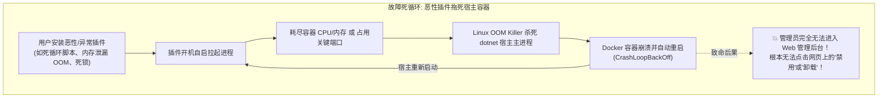
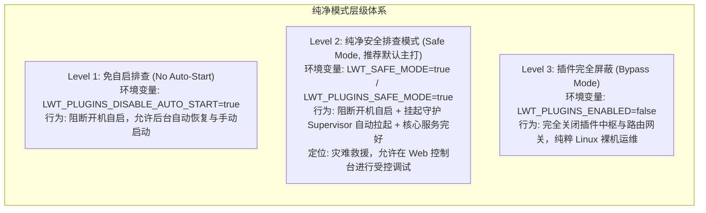
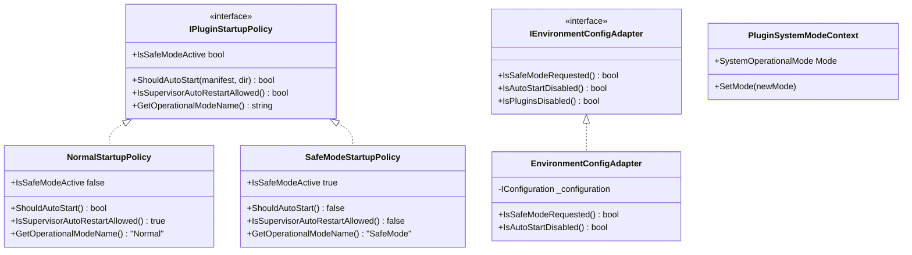

# LinuxWebTool 插件纯净排查模式 (Safe Mode) 与环境变量治理方案

> **文档状态**：调研完成 / 架构设计与方案评审通过 / 待实施  
> **涉及模块**：`LinuxWebTool.Infrastructure`、`LinuxWebTool.Contracts`、`LinuxWebTool.WebHost`、`Web前端子模块`  
> **核心原则**：灾难防御（Disaster Recovery）、非侵入式旁路（Non-mutating Bypass）、开箱即用（Docker 极简注入）、Native AOT 100% 兼容  

---

## 一、需求背景与灾难场景剖析

在插件平台（Plugin Platform）支持常驻微服务（Resident）与开机自启动后，系统获得极强扩展能力的同时，也引入了潜在的**单点雪崩（Single-Point-of-Failure Avalanche）**风险。在生产或家用服务器中，典型故障场景如下：



### 1.1 痛点诊断
1. **Web 控制台与插件生死绑定**：
   - 如果恶性插件在启动瞬间导致整个主程序崩溃或挂死，管理员连访问 `/plugins` 网页界面的机会都没有，陷入“想禁用插件需要进网页，但进网页前插件已经让系统崩溃”的先有鸡还是先有蛋的死锁。
2. **容器与集群环境下的外部干预受限**：
   - 在远程无屏幕环境（NAS、云服务器、只读文件系统容器）中，运维人员最方便、最标准、最通用的应急手段就是通过 Docker 运行参数注入环境变量（例如 `docker run -e LWT_SAFE_MODE=true ...` 或在 `docker-compose.yml` 中配置环境变量）。
3. **急需“纯净安全模式 (Safe Mode / Pure Mode)”**：
   - 在宿主遇到插件故障时，能够通过一行环境变量启动系统，**100% 阻断所有插件开机自启和后台自动拉起**，保证宿主核心运维功能（Systemd、Docker、SSH、网络与 Web 控制台）毫发无损地启动，留出充裕的排查与救灾窗口。

---

## 二、架构头脑风暴与核心逻辑辨析

针对“纯净安全模式”，在可行性、逻辑正确性与系统性能方面进行深入推演：

### 2.1 纯净模式的三大层级（Level 1 ~ Level 3）



#### 推荐方案：主打 Level 2「纯净安全排查模式 (Safe Mode)」
- **开机自启**：100% 阻断；
- **Supervisor 守护**：后台轮询任务暂停自动拉起（AutoRestart 与退避重试暂停），彻底阻断连续崩溃；
- **状态持久化保护（Non-mutating）**：**绝对不修改任何插件的 `.disabled` 文件**！保证排查完毕关掉环境变量后，原有系统状态 100% 原样恢复；
- **Web 控制台诊断通道**：
  - 允许管理员在 Web 端查看所有插件、阅读代码、查阅历史日志、修改配置、卸载恶性插件；
  - 允许手动单次点击启动某个插件进行受控单点隔离测试（手动启动崩溃时不触发无限循环重启）。

---

### 2.2 环境变量命名规范与布尔解析容错

Docker 和 Linux 环境中，用户输入环境变量的习惯千差万别（如 `true`, `1`, `TRUE`, `yes`, `on`）。因此必须提供弹性适配：

| 环境变量名 | 优先级 | 作用语义 | 兼容别名 |
| :--- | :--- | :--- | :--- |
| **`LWT_SAFE_MODE`** | 最高 (P0) | 开启纯净安全排查模式（阻断插件自启与后台自动拉起） | `SAFE_MODE`, `LWT_PLUGINS_SAFE_MODE` |
| **`LWT_PLUGINS_DISABLE_AUTO_START`** | 次高 (P1) | 仅阻断开机自启，不关闭运行中守护 | `DISABLE_AUTO_START` |
| **`LWT_PLUGINS_ENABLED`** | 系统级 (P0) | 若设为 `false`，彻底旁路插件模块 | `ENABLE_PLUGINS=false` |

#### 布尔值解析适配器规则：
- **判定为 True**：`"1"`, `"true"`, `"yes"`, `"on"`, `"enabled"`（大小写不敏感）；
- **其他情况**：默认为 False。

---

### 2.3 视觉感知与用户交互（零困惑设计）

若环境变量静默生效，容易引发用户的“假死疑惑”：“我明明配置了开机自启，为什么重启后插件都不动了？”

因此必须在前端构建清晰的**可见性保障（Visual Observability）**：
1. **插件中心全局警示横幅（Amber Banner）**：
   在 Web 端顶部显式悬浮：
   > 🛡️ **纯净安全模式已激活 (`LWT_SAFE_MODE=true`)**  
   > 系统当前运行于纯净排查模式。所有插件的开机自启动与后台自动恢复已暂停，便于故障排查与定位。移除环境变量并重启容器即可恢复正常运行。
2. **插件卡片自启徽标标记**：
   自启标识变更为 `⚡ 自启 (安全模式已挂起)`，清晰传达当前系统的调度决策。

---

## 三、业界主流标杆与开源借鉴

调研工业级系统在安全模式与应急旁路方面的成熟设计：

| 平台 / 系统 | 应急/安全模式触发方式 | 核心生效行为 | 故障排查体验 | 对本项目的借鉴价值 |
| :--- | :--- | :--- | :--- | :--- |
| **VS Code** | `code --disable-extensions` | 启动核心编辑器，彻底跳过所有第三方扩展与插件进程 | 用户可在主界面禁用或卸载有问题的扩展 | **核心标杆**：主程序必须能够在完全隔离插件的情况下正常运行。 |
| **Linux Kernel** | 内核参数 `systemd.unit=rescue.target` / `single` | 跳过普通服务自启，直接进入单用户救援模式 | 系统管理员修复挂载、网络或配置故障 | 环境变量必须拥有凌驾于任何数据库或文件配置之上的最高裁定权。 |
| **WordPress** | `WP_SANDBOX_SCRIPTS` / Recovery Mode | 发生致命 PHP 错误时生成紧急恢复 Cookie，跳过故障插件 | 管理员进入后台禁用罪魁祸首插件 | 故障插件绝对不能拖死主控面板。 |
| **Android / Windows** | 开机按特定按键进入 Safe Mode | 仅加载系统签名服务，禁用一切第三方应用自启 | 用户安全卸载导致卡死或重启的应用 | 界面上呈现醒目的“安全模式”标识，防止误解。 |
| **Docker / K8s 云原生** | 容器环境变量注入 `-e SAFE_MODE=true` | 阻断 Worker 启动，仅保持 Liveness / Readiness 探针存活 | 容器不再 CrashLoopBackOff，运维可通过 exec 或 Web 登入诊断 | **云原生最佳实践**：通过环境变量无侵入救援。 |

---

## 四、经典设计模式落地架构



### 4.1 适配器模式 (Adapter Pattern)：环境配置统一解析
定义 `IEnvironmentConfigAdapter`：
- 封装从 `IConfiguration` 及 `Environment.GetEnvironmentVariable()` 读取变量的逻辑；
- 统一清洗并支持各种布尔字符串格式（`1`, `true`, `on`, `yes`）；
- 优先判定 `LWT_SAFE_MODE`，次级判定 `LWT_PLUGINS_SAFE_MODE`，屏蔽跨平台差异。

### 4.2 策略模式 (Strategy Pattern)：系统启动策略解耦
定义 `IPluginStartupPolicy`：
- **`NormalStartupPolicy`**：在正常无环境变量约束下运行，根据 `manifest.Supervision.AutoStart` 与 `IsEnabled` 正常执行开机自启，Supervisor 正常守护；
- **`SafeModeStartupPolicy`**：当环境变量被激活时启用：
  - `IsSafeModeActive` 返回 `true`；
  - `ShouldAutoStart()` 无条件返回 `false`；
  - `IsSupervisorAutoRestartAllowed()` 无条件返回 `false`；
  - 调度器直接跳过开机自启批处理，守护线程挂起自动拉起动作。

### 4.3 状态机模式 (State Machine Pattern)：系统运行模式流转
- 系统运行模式枚举：
  ```csharp
  public enum SystemOperationalMode
  {
      Normal = 0,
      SafeMode = 1,
      PluginsDisabled = 2
  }
  ```
- 在插件中心概览接口中暴露此状态，使前端状态机能够与后端运行模式无缝同步。

---

## 五、系统已有基础设施复用审计

系统中已有成熟的底层组件，**0 外部第三方包引入**：

| 模块 / 资产 | 代码位置 | 原有能力与复用决策 |
| :--- | :--- | :--- |
| **`Microsoft.Extensions.Configuration`** | [`ServiceCollectionExtensions.cs`](file:///src/LinuxWebTool.WebHost/Composition/ServiceCollectionExtensions.cs) | 框架原生依赖注入体系，天然支持无感知从 Docker `-e` 注入的环境变量读取配置。 |
| **`PluginManager.cs` (IHostedService)** | [`PluginManager.cs:578`](file:///src/LinuxWebTool.Infrastructure/Features/Plugins/PluginManager.cs#L578) | 直接在 `StartAsync` 与 `RunSupervisorLoopAsync` 中接入 `IPluginStartupPolicy` 判定。 |
| **`PluginInstanceDto`** | [`PluginModels.cs`](file:///src/LinuxWebTool.Contracts/Features/Plugins/Contracts/PluginModels.cs) | 可以在 API 返回的模型中携带 `SystemMode` 或 `IsSafeMode` 标志。 |
| **前端架构门禁** | [`frontend-gate.cjs`](file:///src/LinuxWebTool.WebHost/wwwroot/frontend-gate.cjs) | 保证新添加的 SafeMode Banner 纯 ESM 规范与样式合规。 |

---

## 六、端到端实施与落地蓝图

### 6.1 契约与后端核心实现

1. **环境解析工具方法（统一布尔判定）**：
   在 `PluginSecurityGuard.cs` 或专用帮助类中增加环境变量安全解析：
   ```csharp
   public static bool IsSafeModeEnabled(IConfiguration? config = null)
   {
       var raw = config?["LWT_SAFE_MODE"] 
              ?? Environment.GetEnvironmentVariable("LWT_SAFE_MODE")
              ?? config?["LWT_PLUGINS_SAFE_MODE"]
              ?? Environment.GetEnvironmentVariable("LWT_PLUGINS_SAFE_MODE")
              ?? Environment.GetEnvironmentVariable("SAFE_MODE");

       if (string.IsNullOrWhiteSpace(raw)) return false;
       return raw.Trim() switch
       {
           "1" or "true" or "yes" or "on" or "enabled" => true,
           _ => false
       };
   }
   ```

2. **`PluginManager` 接入安全模式判定**：
   ```csharp
   public async Task StartAsync(CancellationToken cancellationToken)
   {
       var isSafeMode = IsSafeModeEnabled();
       if (isSafeMode)
       {
           _logger?.LogWarning("🛡️ [SAFE_MODE] 检测到环境变量已启用纯净安全模式 (LWT_SAFE_MODE=true)！所有插件开机自启已旁路。");
       }
       else
       {
           // 正常模式：执行常驻微服务开机自启
           await ExecuteStartupAutoStartAsync(cancellationToken);
       }

       _supervisorCts = new CancellationTokenSource();
       _supervisorTask = RunSupervisorLoopAsync(_supervisorCts.Token);
   }

   private async Task RunSupervisorLoopAsync(CancellationToken ct)
   {
       while (!ct.IsCancellationRequested)
       {
           await Task.Delay(5000, ct);
           // 安全排查模式下，暂停自动重启崩溃插件，防止 CPU 空转或重复雪崩
           if (IsSafeModeEnabled()) continue;

           // 正常守护逻辑...
       }
   }
   ```

3. **API 控制器输出系统运行模式**：
   在 `GET /api/Plugins` 接口响应或头部注入 `X-LWT-Safe-Mode: true`，并在前端全局配置中透传。

### 6.2 前端视图增强 (`PluginsView.js`)
在插件中心视图顶部，检测到安全模式时，动态插入告警横幅：
```html
<div v-if="isSafeMode" class="mb-4 p-3.5 rounded-lg border border-amber-500/40 bg-amber-500/10 text-amber-200 text-xs flex items-center justify-between">
  <div class="flex items-center gap-2.5">
    <span class="text-base">🛡️</span>
    <div>
      <span class="font-semibold text-amber-100">纯净排查模式已生效 (Safe Mode)</span>
      <p class="text-slate-300 text-[11px] mt-0.5">所有插件开机自启与守护自动恢复已暂停。您可以在此安全排查故障插件或修改代码，移除环境变量后重启即可恢复。</p>
    </div>
  </div>
  <span class="badge border-amber-500/60 text-amber-300 bg-amber-500/20">LWT_SAFE_MODE</span>
</div>
```

---

## 七、演进与交付计划

| 阶段 | 交付任务 | 验证准则 |
| :--- | :--- | :--- |
| **Phase 1: 环境变量探针与策略落地** | 实现 `IsSafeModeEnabled` 与 `IPluginStartupPolicy`，在 `IHostedService.StartAsync` 与 Supervisor 循环中接入判定。 | 单元测试模拟传入 `LWT_SAFE_MODE=true` 时，开机自启与自动拉起均被准确旁路，且原有 `.disabled` 文件未被修改。 |
| **Phase 2: API 与前端横幅联动** | 插件列表 API 返回 `isSafeMode` 状态，前端 `PluginsView.js` 渲染琥珀色警示横幅。 | 浏览器冒烟测试验证横幅呈现与控制台提示正常。 |
| **Phase 3: Docker 部署验收** | 在 `docker run -e LWT_SAFE_MODE=true` 容器中运行验证灾难救援流程。 | 注入异常死锁插件后，容器依然能够正常启动，Web 控制台可访问并顺利卸载故障插件。 |
