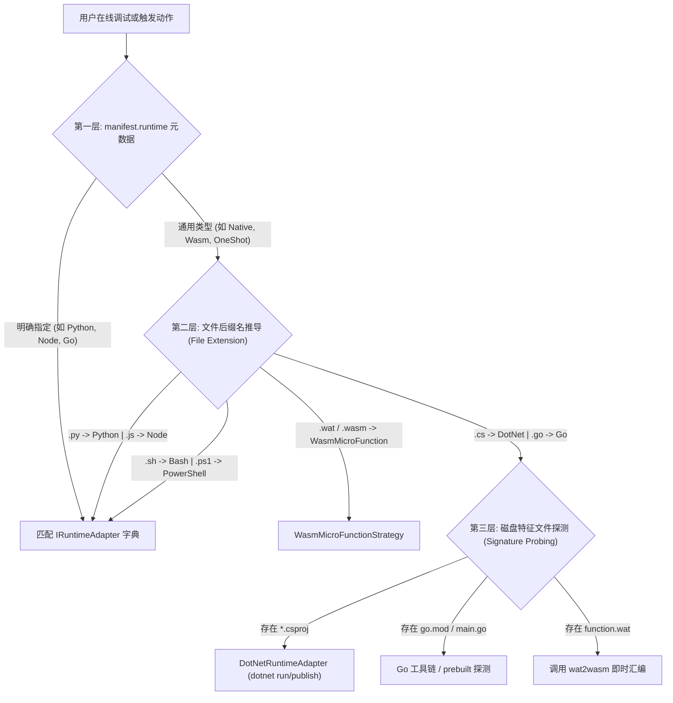
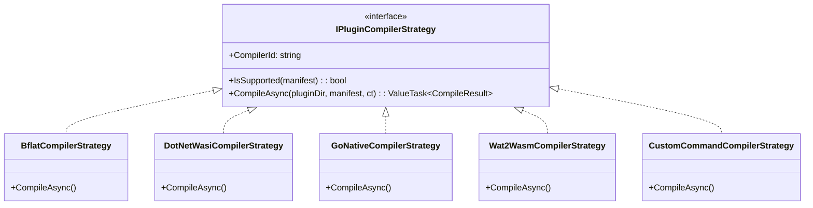

# 插件源码类型识别、在线热编译命令规范与调试架构演进方案

> 本文档针对 LinuxWebTool (LWT) 当前插件生态中 **“元信息未显式定义源码类型与热编译命令时，系统如何推导类型并支持调试”** 的现状进行全面技术复盘与代码走查，指出其隐式推导的瓶颈与欠缺，并结合业界最佳实践（VS Code Tasks、Cloud Native Buildpacks、Fermyon Spin），运用**策略模式、适配器模式与构建状态机**，设计一套规范化、高扩展、支持在容器内即时热编译（Hot-Compile on Save）的下一代架构。

---

## 1. 现状剖析：当前系统如何判断源码类型并支持调试？

### 1.1 源码类型判定的“三层启发式推导（Three-Tier Heuristic Inference）”

目前 `plugin.json` 中仅定义了高维的 `runtime`（枚举：Node=0, Python=1, DotNet=2, Bash=3, PowerShell=4, Native=5, Go=6, Wasm=7）与 `profile`（Resident=0, OneShot=1, Serverless=2, Wasm=3），并未显式声明 `sourceType` 或 `buildCommand`。

当前代码主要通过以下三层机制进行隐式推导：



#### 代码事实落地走查：
1. **第一层：元数据声明映射**：
   在 [`PluginManager.cs`](file:///e:/WorkProject/CSharp/PrivateProject/Web/WebToolForLinux/src/LinuxWebTool.Infrastructure/Features/Plugins/PluginManager.cs) 启动时，注册了 8 大运行时适配器（`NodeRuntimeAdapter`, `PythonRuntimeAdapter`, `DotNetRuntimeAdapter`, `ShellRuntimeAdapter`, `PowerShellRuntimeAdapter`, `NativeRuntimeAdapter`, `GoRuntimeAdapter`, `WasmRuntimeAdapter`）。
2. **第二层：入口与动作后缀动态覆盖**：
   在 [`OneShotExecutionStrategy.cs`](file:///e:/WorkProject/CSharp/PrivateProject/Web/WebToolForLinux/src/LinuxWebTool.Infrastructure/Features/Plugins/Strategies/OneShotExecutionStrategy.cs) 第 77~85 行：
   ```csharp
   var ext = Path.GetExtension(targetEntry).ToLowerInvariant();
   var runtime = ext switch
   {
       ".py" => PluginRuntime.Python,
       ".js" => PluginRuntime.Node,
       ".ps1" => PluginRuntime.PowerShell,
       ".sh" => PluginRuntime.Bash,
       _ => manifest.Runtime
   };
   ```
   如果一个插件元数据声明为通用脚本，但入口文件是 `.py`，系统会动态将其实际执行器提升为 Python 适配器。
3. **第三层：特征文件探测与内联特定逻辑**：
   - 在 [`PluginManager.Code.cs`](file:///e:/WorkProject/CSharp/PrivateProject/Web/WebToolForLinux/src/LinuxWebTool.Infrastructure/Features/Plugins/PluginManager.Code.cs)（第 66 行）在线加载文件树时，系统自动扫描并识别 `.js`, `.py`, `.sh`, `.ps1`, `.cs`, `.go`, `.wat`；
   - 在 [`WasmMicroFunctionStrategy.cs`](file:///e:/WorkProject/CSharp/PrivateProject/Web/WebToolForLinux/src/LinuxWebTool.Infrastructure/Features/Plugins/Strategies/WasmMicroFunctionStrategy.cs)（第 135~155 行），硬编码探测是否存在同名 `function.wat`，若存在且系统安装了 `wat2wasm`，则自动执行编译转为 `main.wasm`。

---

### 1.2 当前在线调试（Debug Run）的执行链路

前端代码编辑器 [`PluginCodeModal.js`](file:///e:/WorkProject/CSharp/PrivateProject/Web/WebToolForLinux/src/LinuxWebTool.WebHost/wwwroot/app/components/plugins/PluginCodeModal.js) 点击“调试运行”时的全链路如下：

```text
[Web 界面: PluginCodeModal.js]
  │ 点击 "调试运行" (带输入参数 debugInput)
  ▼
[POST /api/Plugins/{id}/Debug]
  │ 调用 PluginsController.DebugRun(id, request, ct)
  ▼
[PluginManager.Code.cs -> DebugRunAsync]
  │ 将调试请求转化为 PluginActionRequest (Action = request.Action ?? "status")
  ▼
[PluginManager.Actions.cs -> ExecuteActionAsync]
  │ 依据 manifest.Profile 分发到对应执行策略：
  ├─ ResidentExecutionStrategy   -> 探测并调用已编译常驻二进制
  ├─ OneShotExecutionStrategy    -> 匹配解释器并执行目标脚本，捕获 stdout/stderr
  ├─ ServerlessExecutionStrategy -> 动态冷拉起并执行 Action 转发
  └─ WasmMicroFunctionStrategy   -> 校验/编译 .wasm，喂入 Node V8 / Wasmtime 瞬态沙箱
  ▼
[返回 PluginDebugRunResultDto]
  │ 包含 Success, ExitCode, Output, Error, ElapsedMs
  ▼
[Web 界面展示退出码、耗时与标准控制台回执]
```

---

## 2. 现状技术欠缺与隐患诊断（Why it is incomplete）

尽管当前这套隐式推导机制能支撑基本开发，但在走向**复杂的编译型语言（Go、C#、Rust、NativeAOT-LLVM）与 Wasm** 时，暴露了以下显著技术欠缺：

1. **“运行时语言 (Runtime)” 与 “源码构建链 (Build Toolchain)” 严重混淆**：
   - 比如 `runtime: "Wasm"`，Wasm 只是执行目标（Target Architecture），它不是源码语言！源码可能是 C# (NativeAOT-LLVM / bflat)、可能是 Rust (`wasm32-wasip1`)、可能是 TinyGo、可能是 C++、也可能是纯手写 WAT；
   - 仅凭 `runtime: "Wasm"`，系统**无法确定应该调用 `bflat`、`cargo`、`tinygo` 还是 `wat2wasm` 来编译**。
2. **缺乏“保存后自动热编译（Hot-Compile on Save）”标准驱动**：
   - 目前在线编辑修改了 `Program.cs` 或 `main.go`，后端仅仅是将文本落盘，**并没有触发自动化构建管线**；
   - 目前 Go 原生插件的更新高度依赖宿主机外的部署脚本（如 `hot-update-mcp-bridge.ps1` 中的外部交叉编译），或者在 Dockerfile 中静态打包，**Web 端缺乏内生自愈与热编译能力**。
3. **特异性硬编码破坏架构纯粹性**：
   - 之前在 `WasmMicroFunctionStrategy` 中专门为 `wat2wasm` 写了一段探测与编译逻辑，如果以后引入了 `bflat`、`tinygo`、`cargo`，难道要在策略类里堆砌大量的 `if-else` 工具链探测？这违反了面向对象设计原则（开闭原则 OCP）。
4. **编译期安全脱敏与资源配额真空**：
   - 脚本执行有沙箱和脱敏，但如果在容器内直接 `exec(buildCommand)`，若构建命令被恶意篡改（例如注入 `rm -rf /` 或反弹 Shell），或者编译期消耗 100% CPU，主系统面临被击穿的风险。

---

## 3. 业界主流构建与热更新方案对比与借鉴

| 业界方案 | 核心设计哲学 | 元数据规范举例 | 对 LWT 的借鉴价值 |
| :--- | :--- | :--- | :--- |
| **Fermyon Spin (Wasm 领域的 Docker)** | 声明式组件构建契约；将源码与二进制产物显式映射。 | ```toml<br>[component.build]<br>command = "bflat build --target:wasm -o app.wasm Program.cs"<br>watch = ["*.cs"]<br>``` | **极高借鉴价值**：目前云原生 Wasm 标准规范，清晰解耦源码与 entrypoint。 |
| **VS Code Tasks (`tasks.json`)** | 将构建、运行抽象为可参数化的任务；支持工作区模式匹配。 | ```json<br>"tasks": [{ "label": "build", "command": "dotnet", "args": ["build"] }]<br>``` | 借鉴其对多种工具链参数化、问题匹配器（ProblemMatcher）的设计。 |
| **Cloud Native Buildpacks (CNB)** | `Detect`（探测）与 `Build`（构建）两阶段解耦；自动匹配镜像层。 | `buildpack.toml` 包含 `detect` 脚本与环境依赖声明。 | 适用于免配置的智能自适应构建推导。 |
| **Vite / Webpack / Esbuild** | 基于文件 Hash 的增量热重载（HMR）与内存缓存。 | `vite.config.js` 声明多 target 预编译。 | 借鉴其在 Inode 原子替换与变更防抖（Debounce）上的机制。 |

---

## 4. 下一代架构设计：插件热编译契约与设计模式优化

### 4.1 插件元数据 Schema 升级：引入声明式 `build` 区块

在插件清单 `plugin.json`（Schema v2.1）中扩展可选的强类型 **`build`** 描述块：

```json
{
  "manifestVersion": 2,
  "id": "demo-nativeaot-wasm",
  "name": "C# NativeAOT-LLVM 极速微函数",
  "profile": "Wasm",
  "runtime": "Wasm",
  "entrypoint": "demo-nativeaot-wasm.wasm",
  "build": {
    "sourceLanguage": "csharp",
    "compiler": "bflat",
    "buildCommand": "bflat build --target:wasm -o demo-nativeaot-wasm.wasm Program.cs",
    "fallbackCommand": "dotnet build -c Release -r wasi-wasm -o dist/ && cp dist/*.wasm demo-nativeaot-wasm.wasm",
    "watch": ["**/*.cs", "*.csproj"],
    "autoCompileOnSave": true,
    "timeoutSeconds": 60,
    "cleanTargets": ["demo-nativeaot-wasm.wasm", "*.tmp"]
  }
}
```

针对 Go 原生程序插件（如 `lxc-manager` 或 `mcp-bridge`）：
```json
{
  "id": "lxc-manager",
  "profile": "Resident",
  "runtime": "Go",
  "entrypoint": "lxc-manager",
  "build": {
    "sourceLanguage": "go",
    "compiler": "go",
    "buildCommand": "CGO_ENABLED=0 GOOS=linux go build -ldflags '-s -w' -o lxc-manager ./cmd/lxc-manager",
    "watch": ["**/*.go", "go.mod"],
    "autoCompileOnSave": false
  }
}
```

---

### 4.2 核心设计模式应用与重构

#### 1. 策略模式（Strategy Pattern）：统一热编译调度器
彻底消除 `WasmMicroFunctionStrategy` 中的硬编码 `wat2wasm`，抽取统一的编译器策略矩阵：



- **调度逻辑**：
  1. 若 `manifest.build.buildCommand` 存在，优先走 `CustomCommandCompilerStrategy`（在严格沙箱中执行）；
  2. 若未配置 `buildCommand`，根据源码后缀自动匹配专用编译器（如 `.wat` -> `Wat2Wasm`；`*.csproj` -> `DotNetWasi`；`main.go` -> `GoNative`）；
  3. 若所有编译器均未匹配，平滑回退至直接执行已有二进制。

#### 2. 状态机模式（State Machine Pattern）：增量编译生命周期
在 [`PluginStateMachine.cs`](file:///e:/WorkProject/CSharp/PrivateProject/Web/WebToolForLinux/src/LinuxWebTool.Infrastructure/Features/Plugins/Supervisor/PluginStateMachine.cs) 中扩展编译生命周期的细粒度状态管理：

```text
       [用户在线保存 Program.cs]
                  │
                  ▼
          【SourceDirty】 (源码发生变更)
                  │
                  ├────────────────────────┐
                  ▼ (触发调试或自动构建)   ▼ (外部流量到达)
       【Compiling / 编译构建中】 ─────────┘
         (单飞锁保护，防止连击)
                  │
       ┌──────────┴──────────┐
       ▼                     ▼
【CompileFailed】      【CompileSucceeded】
  (保留旧版产物,         (原子 Inode 覆盖，
   抛出语法错误行)        重置校验 Hash)
                             │
                             ▼
                     【Ready / Instant Run】
```

#### 3. 责任链式构建安全管道（Compiler Security Pipeline）
编译型语言代码执行构建时，调用链条必须依次穿透：
1. **指令敏感过滤**：拦截包含 `rm -rf /`、提权、篡改 host 的恶意注入；
2. **凭据脱敏管道**：调用 [`PluginEnvironmentSanitizer`](file:///e:/WorkProject/CSharp/PrivateProject/Web/WebToolForLinux/src/LinuxWebTool.Infrastructure/Features/Plugins/Adapters/PluginEnvironmentSanitizer.cs) 擦除所有平台管理密钥与私钥；
3. **内核资源配额隔离**：通过 [`PluginCgroupManager`](file:///e:/WorkProject/CSharp/PrivateProject/Web/WebToolForLinux/src/LinuxWebTool.Infrastructure/Features/Plugins/Supervisor/PluginCgroupManager.cs) 将编译器 PID 加入专属 cgroup，限制 CPU 核心（如最大 1 核心）与内存（如最大 512MB），构建超时硬切断（默认 60s）；
4. **Inode 原子替换与日志捕获**：编译产物使用 `temp.bin -> target.bin` 替换，消除 Linux `ETXTBSY` 报错，并将实时编译输出推入 [`PluginProcessRingBuffer`](file:///e:/WorkProject/CSharp/PrivateProject/Web/WebToolForLinux/src/LinuxWebTool.Infrastructure/Features/Plugins/Supervisor/PluginProcessRingBuffer.cs)。

---

## 5. LinuxWebTool 现有基础设施复用与演进路径

当前系统底座已高度完备，演进该架构只需复用现有组件，零冗余新增：

| 现有组件 | 源码位置 | 在在线热编译架构中的复用职责 |
| :--- | :--- | :--- |
| **标准进程管道** | [`NativeProcessRunner.cs`](file:///e:/WorkProject/CSharp/PrivateProject/Web/WebToolForLinux/src/LinuxWebTool.Infrastructure/Features/Plugins/Adapters/NativeProcessRunner.cs) | 调度 `go build`、`bflat`、`wat2wasm` CLI，捕获输出流与退出码。 |
| **凭据脱敏防火墙** | [`PluginEnvironmentSanitizer.cs`](file:///e:/WorkProject/CSharp/PrivateProject/Web/WebToolForLinux/src/LinuxWebTool.Infrastructure/Features/Plugins/Adapters/PluginEnvironmentSanitizer.cs) | 阻断宿主密钥泄露进编译器环境。 |
| **cgroup v2 控制器** | [`PluginCgroupManager.cs`](file:///e:/WorkProject/CSharp/PrivateProject/Web/WebToolForLinux/src/LinuxWebTool.Infrastructure/Features/Plugins/Supervisor/PluginCgroupManager.cs) | 施加编译期 CPU / 内存硬限额，防止多线程编译卡死主系统。 |
| **环形日志缓冲** | [`PluginProcessRingBuffer.cs`](file:///e:/WorkProject/CSharp/PrivateProject/Web/WebToolForLinux/src/LinuxWebTool.Infrastructure/Features/Plugins/Supervisor/PluginProcessRingBuffer.cs) | 编译输出实时推送到前端抽屉，便于用户排查编译语法错误。 |
| **代码编辑模态框** | [`PluginCodeModal.js`](file:///e:/WorkProject/CSharp/PrivateProject/Web/WebToolForLinux/src/LinuxWebTool.WebHost/wwwroot/app/components/plugins/PluginCodeModal.js) | 在编辑器底部新增 “🔨 编译生成” 与 “⚡ 保存时自动热编译” 切换勾选框。 |

---

## 6. 总结与落地规范

1. **当前现状解答**：
   当前系统通过 **`runtime 声明 -> 后缀名推导 -> 特征文件硬编码探测`** 三层机制推导语言类型；在线调试通过 `DebugRunAsync` 转发给对应的执行策略。解释型脚本直接由对应运行时执行，编译型/Wasm 依赖预置二进制或硬编码编译器（如 `wat2wasm`）。
2. **后续演进方向**：
   在 `plugin.json` 中正式确立 `build` 规范，引入可插拔的 `IPluginCompilerStrategy`，让 Go、NativeAOT-LLVM、C# WASI 与纯 WAT 统一享受**在线修改代码 -> 安全沙箱即时编译 -> 产物原子替换 -> 毫秒级重载调试**的完整开发者体验！
