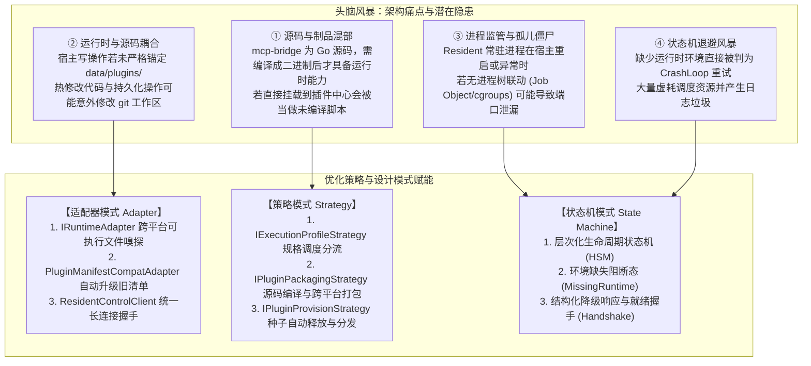
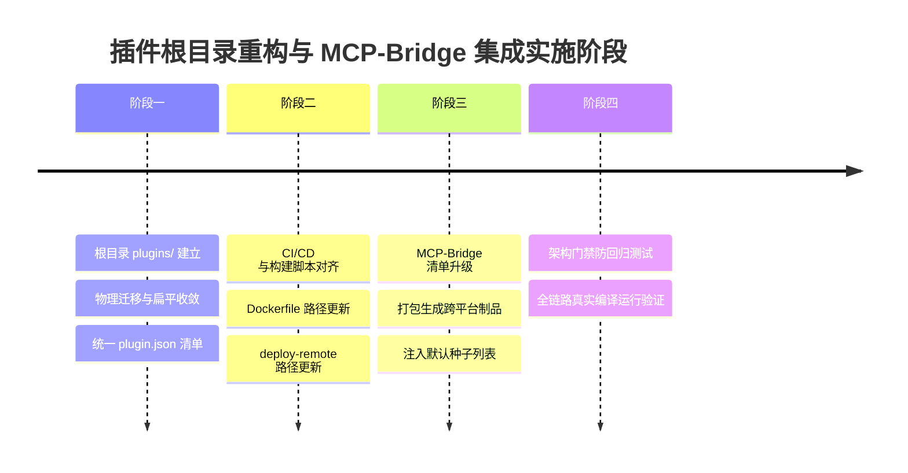

# 根目录 plugins 改造、示例扁平收敛与 MCP-Bridge 扩展中心集成调研与架构方案

> **文件标识**：`docs/plugins-directory-refactoring-and-mcp-bridge-integration-research.md`  
> **状态**：方案调研与落地设计  
> **核心目标**：回答根目录 `plugins/` 改造、`extensions` 与 `workers` 迁移、`workers/examples` 扁平化收敛的可行性与边界；排查 `mcp-bridge` 接入扩展中心的现状与断档原因；运用适配器模式、策略模式与状态机模式优化系统设计；参考业界主流实践并给出零回归落地实施方案。

---

## 1. 四大核心问题专项研判与现状核查

### 1.1 问题一：根目录能否创建 `plugins` 文件夹？
- **结论**：**完全可以，且在架构与规范层面上强烈推荐并势在必行**。
- **现状与架构诉求**：
  在系统前一阶段的重构中，后端领域模型与前端交互界面已经全面统一为 **`Plugins`（插件中心）**（参见 `PluginManager`、`PluginManifest`、`PluginProfile` [Resident/OneShot]、`PluginsController` 以及前端 `PluginsView.js`）。
  然而，仓库根目录依然遗留着上一代的 `extensions/` 与 `workers/` 两个独立文件夹，造成**代码概念（Plugins）与仓库物理目录（Extensions/Workers）的脱节与割裂**。
- **边界划分规范**：
  在根目录创建 `plugins/` 后，必须严格厘清两类目录的职责边界，避免运行时与源码混淆：
  - **根目录 `plugins/`**：定位为**「插件生态源码、模板与打包工作区 (Plugins Workspace & Source/Templates)」**，纳入 Git 版本控制，包含内置模板包、示例工程以及自研子项目源码（如 `mcp-bridge`）；
  - **运行时目录 `data/plugins/`**：定位为**「运行时可变沙箱数据目录 (Runtime Plugins Sandbox & Storage)」**，由 `DataPaths`（或环境变量 `Data__Directory`）指定，属于 Kestrel 宿主运行期动态解压 Zip、管理持久化配置、读写 SQLite/KV 与生成日志的目录，**严禁混入 Git 追踪的工作区**。

---

### 1.2 问题二：`extensions` 和 `workers` 能否移动到 `plugins` 文件夹？
- **结论**：**可以移动，但绝不能做简单的“文件夹套娃”（严禁无脑搬为 `plugins/extensions` 与 `plugins/workers`）**。
- **逻辑重构理由**：
  - `extensions`（如 `sample-healthcheck`, `ssh-access-guard`, `caddy-server-manager`, `native-command-demo`）和原 `workers/examples`（如 `native-resident`, `native-managed`）在本质上全部属于**「插件示例与模板包」**。
  - 在统一插件体系中，它们唯一的区别在于执行规格（`profile: "oneshot"` vs `profile: "resident"`），这一区别完全由清单中的属性声明，而不是由物理目录划分。如果在 `plugins/` 内部继续保留 `extensions` 与 `workers` 子目录，属于**换汤不换药的历史倒退**。
  - `workers/mcp-bridge` 则是一个基于 Go 语言开发的**独立源码级子工程**，不能与静态配置模板混为一谈。
- **全链路依赖影响面审计（Impact Matrix）**：
  经全仓库精确检索，移动相关物理文件夹后，必须同步原子化更新以下基础设施配置：

| 涉及文件 / 组件 | 原依赖路径 | 需调整为的新路径 | 影响说明 |
| :--- | :--- | :--- | :--- |
| `Dockerfile` | `COPY --chown=appuser:appgroup extensions ./extensions` | `COPY --chown=appuser:appgroup plugins ./plugins` | 生产镜像构建阶段内置插件文件的拷入 |
| `Dockerfile.dev` | `COPY extensions ./extensions` | `COPY plugins ./plugins` | 极速开发镜像内置插件文件的预热 |
| `scripts/deploy-remote.ps1` | `tar ... src extensions` / `-v ${devWorkdir}/extensions:/app/extensions` | 调整为包含 `plugins` 及对应卷挂载 | 开发容器远程部署与热挂载同步 |
| `scripts/package-native-tool-examples.ps1` | `Join-Path $repoRoot "extensions/$ext"` 与 `"workers/examples/$w"` | 统一为 `Join-Path $repoRoot "plugins/$item"` | 官方子功能自动化归档打包脚本 |
| `scripts/package-mcp-bridge.ps1` | `$PSScriptRoot\..\workers\mcp-bridge` | `$PSScriptRoot\..\plugins\mcp-bridge` | Go MCP Bridge 构建与跨平台打包脚本 |
| `scripts/verify-mcp-bridge.ps1` | `$PSScriptRoot\..\workers\mcp-bridge` | `$PSScriptRoot\..\plugins\mcp-bridge` | Bridge 独立测试与门禁验证脚本 |
| `.github/workflows/mcp-bridge.yml` | `workers/mcp-bridge/**` 及 `working-directory` | `plugins/mcp-bridge/**` | GitHub Actions CI/CD 自动构建工作流 |
| C# 运行时代码 (`src/`) | 无直接硬编码根路径引用 | 无需修改 C# 核心加载代码 | 后端已完全解耦，统一由 `data/plugins/` 驱动 |

---

### 1.3 问题三：为什么不要 `examples` 目录？直接作为“内置子功能”的架构跃迁

> **核心洞察**：**完全不需要 `examples` 目录！直接将它们作为系统的「第一方内置子功能 (Built-in First-Party Sub-features / Plugins)」平铺在 `plugins/` 根目录下，是产品认知与工程架构的重大跃迁。**

#### 1. 为什么“示例思维 (Examples Mindset)”必须被抛弃？
- **认知贬低与用户顾虑**：
  在生产级 Linux 运维面板中，如果目录或界面标记为 `examples/`，用户或管理员的第一反应是：*“这只是开发者的测试玩具/示例 Demo，不稳定，不能在生产机器上跑”*。
  但实际上，`ssh-access-guard`（SSH 登录爆破封禁看板）、`caddy-server-manager`（Web 反代管理）、`mcp-bridge`（AI MCP 安全网关）都是**实打实的生产级功能**。
- **目录扁平与概念统一 (DDD Ubiquitous Language)**：
  在成熟的工业级生态中（如 VS Code、Home Assistant、Grafana、WordPress、Obsidian）：
  - `plugins/` 或 `addons/` 目录下**每一个子目录就是一个功能插件**，绝不在官方核心仓库里嵌套一个 `examples/` 来存放自己的核心组件；
  - 嵌套 `examples/` 只是早期验证功能时为了偷懒而遗留的临时包装，属于架构技术债。

#### 2. 终态方案：全量扁平收敛为「官方内置子功能」
消除所有中间层与过度嵌套，在根目录 `plugins/` 下直接平铺交付系统核心插件：

```
plugins/                                    # 官方内置插件与子功能源码/模板根目录
├── caddy-server-manager/                   # [官方子功能] Caddy Web 反向代理与站点管理
│   ├── hooks/                              # start / stop / restart / status
│   └── plugin.json                         # 统一插件清单 (profile: oneshot, runtime: native)
├── ssh-access-guard/                       # [官方子功能] SSH 登录安全审计看板与恶意 IP 实时封禁
│   ├── hooks/                              # ban_ip / unban_ip / records / failed
│   ├── ui/                                 # 内嵌安全审计 Webview 看板
│   └── plugin.json                         # 统一插件清单 (profile: oneshot, runtime: bash)
├── system-healthcheck/                     # [官方子功能] 系统健康度自检巡检守护 (由 sample-healthcheck 正名)
│   ├── hooks/                              # status.sh / status.ps1
│   └── plugin.json                         # 统一插件清单 (profile: oneshot, runtime: bash)
├── system-command-runner/                  # [官方子功能] 系统底层原生命令直接调度 (由 native-command-demo 正名)
│   └── plugin.json                         # 统一插件清单 (profile: oneshot, runtime: native)
├── native-resident-daemon/                 # [官方子功能] 原生高性能常驻后台守护服务
│   └── plugin.json                         # 统一插件清单 (profile: resident, runtime: native)
├── native-managed-service/                 # [官方子功能] 原生受控常驻微服务 (支持 HTTP 握手与管理)
│   └── plugin.json                         # 统一插件清单 (profile: resident, runtime: native)
└── mcp-bridge/                             # [官方子功能] Go 单进程智能安全 MCP 网关与工具桥接
    ├── cmd/
    ├── internal/
    ├── packaging/
    ├── go.mod
    └── go.sum
```

#### 3. 设计模式升级：区分「内置子功能」与「第三方插件」
- **策略模式 (Strategy Pattern)**：
  系统构建统一的 `IPluginProvider`：
  - `BuiltinPluginProvider`：负责扫描与载入根目录 `plugins/`（或安装包内置的官方功能），不可被物理删除，支持“重置为出厂配置”；
  - `UserPluginProvider`：负责扫描与管理 `data/plugins/` 下用户上传 Zip 或在线创建的第三方插件，支持增删改查与沙箱隔离。
- **状态机模式 (State Machine Pattern)**：
  内置子功能同样享受完整的状态机调度：未开启时保持 `Disabled` 或 `Stopped` 状态，**零内存开销、零进程常驻**；管理员一键启用后转入 `Starting ➔ Running`。

---

### 1.4 问题四：`workers\mcp-bridge` 现在有添加到扩展中心吗？
- **确切答案**：**当前尚未正式添加到扩展中心（插件中心），处于“后端编排就绪，但元数据未升级、初始化种子缺失、前端无卡片入口”的半集成断档状态**。
- **四大关键断档证据**：
  1. **元数据清单规范不匹配（Schema Mismatch）**：
     `workers/mcp-bridge/packaging/worker.json` 依然是旧版格式：
     ```json
     {
       "id": "mcp-bridge",
       "runtime": 6,           // 旧版枚举，现行统一体系中 Native = 5
       "mode": "Service",      // 旧版属性，现行统一体系中为 profile: "resident"
       "entrypoint": "mcp-bridge"
     }
     ```
     而现行 `PluginManager.cs` 只扫描识别 `plugin.json`。即使将其预编译包解压到 `data/plugins/mcp-bridge/`，也会因为找不到 `plugin.json` 被加载器直接忽略。
  2. **内置初始化种子缺失（Missing Default Seed）**：
     在 `PluginManager.Defaults.cs` 中，`EnsureDefaultPluginsCreated()` 负责首次启动时在 `data/plugins/` 释放默认插件。当前内置了 10 个（`sample-healthcheck`, `ssh-access-guard`, `caddy-server-manager`, `native-command-demo`, `js-webhook-receiver`, `py-simple-api`, `dotnet-minimal-service`, `sh-backup-daemon`, `ps-monitor-daemon`, `chatgpt-channel`），**完全没有收录 `mcp-bridge`**。
  3. **前端插件中心未打通卡片与管理控制台（Missing UI View/Card）**：
     前端 `PluginsView.js` 依赖后端列表事实源展示卡片。当前由于缺少种子和自动安装，用户在「插件中心」默认看不到它；此外，系统只在 `/keys` 页面提供了直连系统的 `/mcp/sse` 配置复制，并未提供 `mcp-bridge` 专属的管理面板。
  4. **后端编排层虽已就绪但处于“空转”（Backend Orchestrator Hanging）**：
     后端在 `LinuxWebTool.Application.Features.McpBridge.McpBridgeOrchestrator` 与 `McpBridgeController` (`/api/McpBridge/*`) 已经实现了完整的状态探测与管理转发逻辑，且硬编码了 `BridgeWorkerId = "mcp-bridge"`。但一旦调用接口，因为 `_pluginManager.GetByIdAsync("mcp-bridge")` 返回 null，接口会直接返回：
     > `服务 'mcp-bridge' 尚未部署或安装。`

---

## 2. 头脑风暴：可行性、逻辑闭环与性能缺陷排查



### 2.1 逻辑闭环缺陷
1. **源码项目与即用型插件模板的边界混淆**：
   - 脚本型插件（如 Python、Node、Shell）可以直接“源码即插件”，改了即生效；
   - Go / C# Native 插件必须经过**交叉编译构建 (Cross Compilation)** 生成当前系统架构（`linux-amd64` / `linux-arm64` / `win-x64`）的二进制文件。
   - 解决方案：`plugins/mcp-bridge` 定位为源码工程，通过 `scripts/package-mcp-bridge.ps1` 编译构建为标准插件 Zip 包后，再发布到 `artifacts/` 或导入到 `data/plugins/`，严禁直接把未编译源码扔进运行目录。
2. **初始化释放与开发热重载脱节**：
   - 当前系统的 `PluginManager.Defaults.cs` 将 10 个插件的代码用 C# 字符串大文本硬编码在代码里，导致根目录下的 `extensions/` 实际上在运行时根本没有被读取；
   - 应该建立优雅的**供给策略（Provisioning Strategy）**：优先从 `plugins/examples/` 读取并同步到 `data/plugins/`，若不存在则回退至内嵌资源，方便开发人员直接编辑 `plugins/examples/` 本地文件即可调试生效。

### 2.2 性能与并发欠缺
1. **高频磁盘 I/O 目录遍历放大**：
   - `PluginManager.GetAllAsync()` 在每次被调用时，都会执行 `Directory.GetDirectories(_pluginsRoot)` 并对每个目录进行 `File.ReadAllTextAsync("plugin.json")` 反序列化。
   - 当插件较多时，并发读取造成磁盘 I/O 抖动。
   - 优化：引入内存感知缓存层（基于 `ConcurrentDictionary<string, PluginManifest>`）结合 `FileSystemWatcher` 或基于目录修改时间戳（mtime）的低成本校验。
2. **端口碰撞与未决进程回收**：
   - 常驻进程崩溃时，若套接字处于 `TIME_WAIT` 或进程被挂起（D-State），`PluginPortManager` 若立即复用原端口会导致 `EADDRINUSE` 启动崩溃。
   - 优化：在释放端口前增加套接字连通性静默检查，并采用动态端口池步进算法。

---

## 3. 设计模式优化与架构赋能方案

### 3.1 适配器模式 (Adapter Pattern)：抹平异构环境与历史规范
1. **`PluginManifestCompatAdapter`（清单向下兼容适配器）**：
   - 在加载插件或导入 Zip 时，若目录中只有 `worker.json` 或 `manifest.json`，适配器自动将其属性映射为标准的 `PluginManifest` 格式：
     - `runtime: 6` ➔ `PluginRuntime.Native (5)`；
     - `mode: "Service"` ➔ `PluginProfile.Resident (0)`；
     - `mode: "Daemon"` ➔ `PluginProfile.Resident (0)` 并设置 `Network.Mode = "none"`；
     - 自动升级后写入 `plugin.json`，实现零侵入旧包平滑升级。
2. **`NativeRuntimeAdapter` 跨平台可执行文件自愈适配**：
   - 抹平 Windows 与 Linux 差异：Windows 自动探测 `.exe` 扩展名；Linux 自动探测无后缀可执行程序，并在启动前通过 `Mono.Posix` 或 `chmod +x` 命令自愈赋予执行权限。

### 3.2 策略模式 (Strategy Pattern)：解耦生命周期调度与打包编译
1. **`IExecutionProfileStrategy`（规格调度策略）**：
   - 现有的 `ResidentExecutionStrategy`（守护监管、端口分配、HTTP 网关注入）与 `OneShotExecutionStrategy`（单次瞬态执行、退出码捕获）已经形成了清晰的策略分工。
2. **`IPluginPackagingStrategy`（多语言构建打包策略）**：
   - 抽取打包策略接口，定义 `PackageAsync(string pluginSourceDir, string outputDir, BuildTarget target)`：
     - `ScriptPackagingStrategy`：直接排除 `.git`、`node_modules` 等生成标准 ZIP；
     - `GoBinaryPackagingStrategy`：调用 `go build` 针对目标平台矩阵交叉编译，自动拷贝 `plugin.json` 与模板文档后打包。

### 3.3 状态机模式 (State Machine Pattern)：层次化生命周期与防雪崩熔断
1. **层次化状态机状态细化**：
   ```
   [Stopped] ──(Start)──> [CheckingDeps] ──(Missing)──> [MissingRuntime (阻断态)]
                               │ (Passed)
                               ▼
                        [Starting (进程拉起)]
                               │
                               ▼
                       [Probing / Handshaking (握手校验)]
                               │ (Ready)
                               ▼
                           [Running] ──(Exit 0)──> [Stopped]
                               │ (Exit != 0)
                               ▼
                       [CrashLoop / Backoff (退避重试)] ──(Exceed Max)──> [Degraded]
   ```
2. **自愈与防雪崩守卫**：
   - 区分**「环境依赖缺失（MissingRuntime）」**与**「运行时进程崩溃（CrashLoop）」**：
     - 若缺少 Python、Node 或 Native 动态库，直接进入 `MissingRuntime` 终态，**严禁触发 AutoRestart 重试**，并在界面显示自适应包管理器安装指南（Debian: `apt` / Alpine: `apk` / RedHat: `dnf`）；
     - 只有在运行中突发崩溃时才累加 `CrashCount` 并按指数退避（1s ➔ 3s ➔ 10s）重试。

---

## 4. 业界主流方案横向对标与现有库选型

### 4.1 业界主流插件架构横向对比

| 体系 / 平台 | 目录组织与源码划分 | 插件清单规范 | 进程与沙箱隔离 | 对 LinuxWebTool 的启示与借鉴 |
| :--- | :--- | :--- | :--- | :--- |
| **VS Code** | 源码工程与分发包解耦：<br/>源码在各自仓库开发，使用 `vsce package` 构建为单一 `.vsix` 制品发布。 | 单清单 `package.json`，通过 `contributes` 声明 commands 与 LSP 语言服务。 | Extension Host 独立进程，主 UI 与插件完全物理隔离，通过 JSON-RPC 通信。 | **单清单统一规范的最佳实践**。源码与运行制品必须解耦，所有形态统归一个清单。 |
| **Home Assistant** | 核心与插件完全正交：<br/>`core` 负责硬件与本地服务，外部应用全部放置在独立 `addons` 仓库中。 | `config.yaml` 声明架构、端口、ingress、持久化映射与启动配置。 | 每个 Add-on 独立容器，通过 Ingress 反向代理在宿主 Web 面板无缝嵌入。 | **证实系统运维与应用插件必须严格物理与逻辑正交**。Ingress 反代模式已在我们系统的 `/plugins/{id}/*` 完美实现。 |
| **Cockpit Linux** | 系统底层极其纯粹：<br/>核心仅提供主机硬件监控、存储卷、网络、Systemd。 | `manifest.json`，声明前端资源与后端 D-Bus 权限。 | 静态 HTML 托管 + 消息隧道通信，绝不直接让插件在核心进程中运行。 | 验证了 LinuxWebTool 剥离 Services 扩展端点、重构纯粹系统运维的绝对正确性。 |
| **HashiCorp Plugin** | 基于 `hashicorp/go-plugin`：<br/>插件为独立原生可执行程序。 | 命令行输出协议指纹与握手令牌。 | 跨进程通信（gRPC over stdio / loopback TCP），握手 token 鉴权，支持双向健康探测。 | 与当前 `mcp-bridge` 的 `ResidentControl` HTTP 握手协议逻辑完全吻合。 |

### 4.2 现有优秀开源库与工具调研

1. **.NET 生态**：
   - **`CliWrap`**：比原生 `System.Diagnostics.Process` 强大数倍的 C# 进程管理库，具备原生流式管道、异步超时、优雅信号退出（SIGINT/SIGTERM）与死锁防御能力，可作为后续执行策略的底层替换选型；
   - **`Stateless`**：业界公认的轻量级层次状态机（Hierarchical State Machine）库，支持守卫条件与状态转移回调，可用于替代手写 `switch-case` 状态机；
   - **`YARP (Microsoft.ReverseProxy)`**：系统当前反代依赖的核心引擎，负责动态反向代理路由。
2. **Go 生态（针对 MCP-Bridge）**：
   - **`github.com/mark3labs/mcp-go`**：Go 官方推荐与社区最活跃的 Model Context Protocol 标准 SDK，全面覆盖 JSON-RPC 2.0、stdio 与 sse 客户端/服务端；
   - **`github.com/google/renameio`**：用于原子化配置写入与状态持久化，防止并发写入导致配置文件损坏。

---

## 5. 当前系统已有基础设施复用审计（零重复造轮子）

本方案完全基于当前系统已有成熟资产进行收敛与打通，无需引入任何多余代码或重复构件：

1. **安全与路径沙箱**：
   - [`PluginSecurityGuard`](file:///e:/WorkProject/CSharp/PrivateProject/Web/WebToolForLinux/src/LinuxWebTool.Contracts/Shared/Support/PluginSecurityGuard.cs)：直接复用 `EnsureSafePluginDirectory`、`IsValidPluginId` 与 `ValidateZipArchiveEntries`（完整 ZipSlip 防护）；
2. **多语言进程构建与平台嗅探**：
   - [`PluginRuntimeAdapters.cs`](file:///e:/WorkProject/CSharp/PrivateProject/Web/WebToolForLinux/src/LinuxWebTool.Infrastructure/Features/Plugins/Adapters/PluginRuntimeAdapters.cs)：直接复用 `NativeRuntimeAdapter`、`ShellRuntimeAdapter`、`NodeRuntimeAdapter`、`PythonRuntimeAdapter`、`DotNetRuntimeAdapter`；
3. **环形日志缓冲与端口治理**：
   - [`PluginProcessRingBuffer.cs`](file:///e:/WorkProject/CSharp/PrivateProject/Web/WebToolForLinux/src/LinuxWebTool.Infrastructure/Features/Plugins/Supervisor/PluginProcessRingBuffer.cs) 与 `PluginPortManager.cs`；
4. **控制平面与反向代理网关**：
   - [`McpBridgeOrchestrator.cs`](file:///e:/WorkProject/CSharp/PrivateProject/Web/WebToolForLinux/src/LinuxWebTool.Application/Features/McpBridge/McpBridgeOrchestrator.cs) 与 `McpBridgeController.cs`：已有完整的 MCP 控制平面对接能力；
   - [`PipelineExtensions.cs`](file:///e:/WorkProject/CSharp/PrivateProject/Web/WebToolForLinux/src/LinuxWebTool.WebHost/Composition/PipelineExtensions.cs)：动态流式反代网关 `/plugins/{pluginId}/{**catch-all}`。

---

## 6. 具体实施路线图（Implementation Roadmap）



### 第一步：根目录目录重组与内置子功能扁平化
1. 创建根目录 `plugins/`，**不设置 `examples` 中间层**；
2. 将 `extensions/*`（4个目录：`caddy-server-manager`, `ssh-access-guard`, `sample-healthcheck`, `native-command-demo`）直接平铺移入 `plugins/`；
3. 将 `workers/examples/*`（2个目录：`native-resident`, `native-managed`）直接平铺移入 `plugins/`；
4. 将 `workers/mcp-bridge` 移动至 `plugins/mcp-bridge`；
5. 删除已被清空的 `extensions/` 与 `workers/` 历史遗留根目录；
6. 遍历 `plugins/` 下全部子功能目录，将内部旧版的 `manifest.json` 替换为符合统一规范的 `plugin.json`。

### 第二步：CI/CD、构建与部署脚本路径修正
1. 修改 `Dockerfile` 与 `Dockerfile.dev` 中的 `COPY extensions` 为 `COPY plugins ./plugins`；
2. 修改 `scripts/deploy-remote.ps1` 中的打包与卷挂载路径（`-v ${devWorkdir}/plugins:/app/plugins`）；
3. 修改 `scripts/package-native-tool-examples.ps1` 中的源目录扫描路径为 `plugins/`；
4. 修改 `scripts/package-mcp-bridge.ps1` 与 `scripts/verify-mcp-bridge.ps1` 中的工作目录为 `plugins/mcp-bridge`；
5. 修改 `.github/workflows/mcp-bridge.yml` 监控路径与执行目录为 `plugins/mcp-bridge/**`。

### 第三步：MCP-Bridge 清单升级与内置种子打通
1. 在 `plugins/mcp-bridge/packaging/` 下创建标准的 `plugin.json`，配置如下：
   - `id`: `"mcp-bridge"`
   - `name`: `"MCP 智能安全网关桥接服务"`
   - `profile`: `"resident"`
   - `runtime`: `"native"`
   - `entrypoint`: `"mcp-bridge"`
   - `network.mode`: `"path"`
   - `network.portEnv`: `"PORT"`
   - `network.pathPrefix`: `"/plugins/mcp-bridge"`
   - `supervision.autoRestart`: `false`
   - `ui.entry`: `"web"`（桥接其内置单页 UI）
2. 在 `PluginManager.Defaults.cs` 中增加 `EnsureMcpBridgeCreated()`，预置其清单模板；
3. 运行 `scripts/package-mcp-bridge.ps1` 生成对应平台的 Zip 包，可直接通过界面「导入 ZIP」或解压预热至 `data/plugins/mcp-bridge/`。

### 第四步：测试验证与架构门禁加固
1. 在 `ArchitectureTests.cs` 中补充断言：
   - 验证根目录不存在 `extensions/` 与 `workers/`；
   - 验证 `plugins/examples/` 下所有子目录均包含有效的 `plugin.json`；
2. 运行后端单测与架构测试：
   `dotnet test tests/LinuxWebTool.ArchitectureTests`
   `dotnet test tests/LinuxWebTool.UnitTests`
3. 确保全量自动化测试通过，零破坏性回归。
