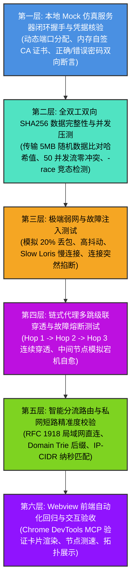
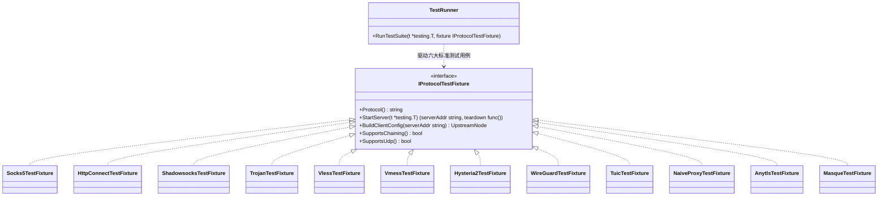
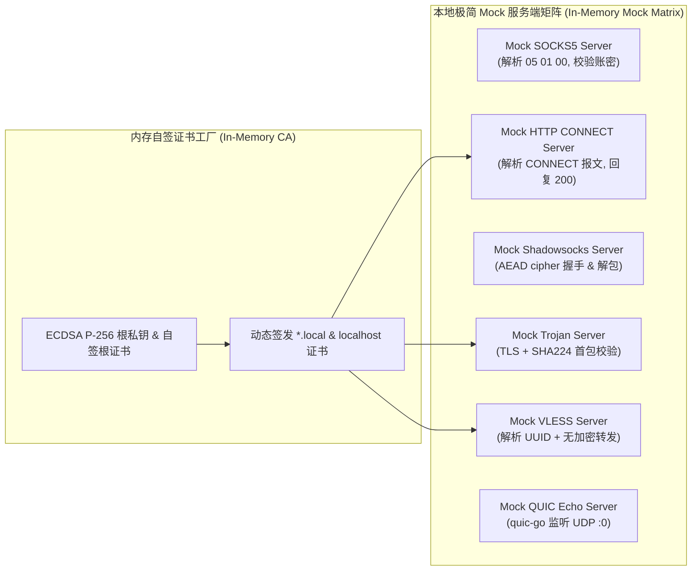
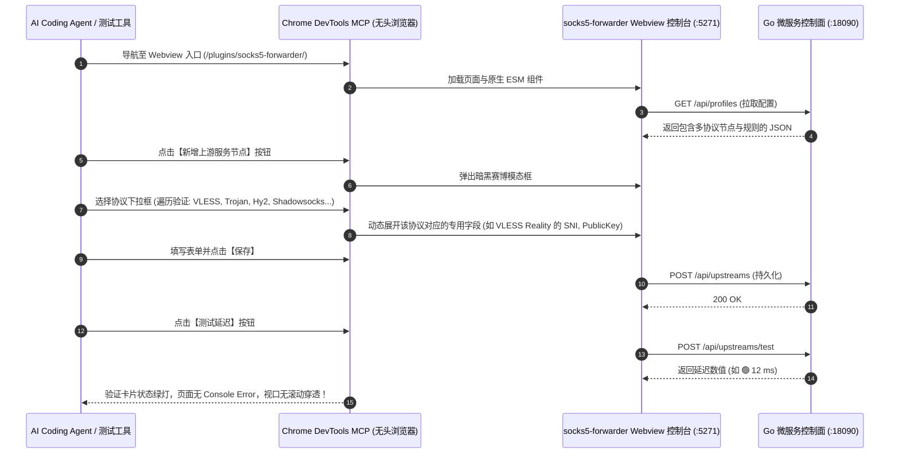
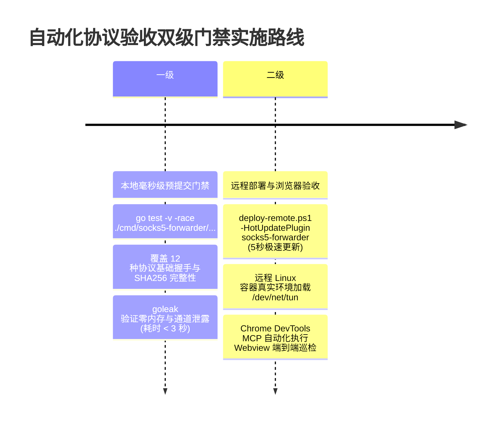

# 12 种主流代理协议兼容性测试套件与全景验收方案

> **文档标识**：`LWT-TEST-FORWARDER-006`  
> **状态**：已评审 (Approved)  
> **核心主题**：多协议兼容性自动化测试体系 (Poly-Protocol Test Suite)、内存自签 Mock 仿真矩阵 (Hermetic Mock Matrix)、全双工双向 SHA256 数据完整性核验、Goroutine 零泄露检测 (`goleak`)、链式多跳穿透与分流路由命中验收、Chrome DevTools 自动化验收规范  
> **适用模块**：`plugins/socks5-forwarder` / LinuxWebTool 微服务平台  
> **设计模式**：测试夹具策略模式 (Test Fixture Strategy)、表驱动参数化执行器 (Table-Driven Runner)、内存 CA 工厂模式 (In-Memory CA Factory)、故障注入装饰器模式 (Fault Injection Decorator)  

---

## 1. 为什么必须建立“全套协议测试方案”？

网络代理与隧道协议的开发具备极高的隐蔽性与脆弱性。在实际工程中，大量协议缺陷无法通过简单的“能否建立连接”来发现：
1. **“假性握手成功，实际粘包/截断”**：某些基于 TLS 或 QUIC 的协议在传输 64 字节小包时完全正常，但在传输 10MB 连续大流时，因为流控窗口或缓冲区处理不当发生**静默截断或丢包**；
2. **“单并发正常，高并发死锁”**：在多并发请求或连接重用时，锁粒度过大或通道阻塞导致进程**发生 Goroutine 永久泄漏与死锁**；
3. **“外部依赖脆弱，单测不可重复”**：如果单测依赖公网真实的境外服务器或商业节点，一旦网络偶发抖动或公网节点宕机，CI/CD 必然频繁误报，违反单测“闭环、自洽、幂等（Hermetic）”的基本准则；
4. **“多跳链式代理中的断流穿透难题”**：多跳代理（如 SOCKS5 ➔ WSS ➔ Trojan）在中间某跳异常断开时，底层连接句柄若未完全清理，会造成宿主机端口与内存迅速耗尽。

因此，必须为 12 种主流协议建立一套**无需公网依赖、纯本地自闭环、亚秒级执行、覆盖极端网络异常并具备数据哈希严格核验**的自动化测试方案。

---

## 2. 测试架构设计与六层质量检验金字塔

整个协议测试套件采用**六层质量检验金字塔（Six-Layer Quality Pyramid）**：



---

## 3. 设计模式全景建模：测试夹具策略与通用执行器

为了避免针对 12 种协议重复编写数千行冗余的测试流程，系统采用 **测试夹具策略模式 (Test Fixture Strategy)** 与 **表驱动参数化执行器 (Table-Driven Runner)**：



### 3.1 统一测试夹具接口定义 (`testing_fixture.go`)

```go
package testing_suite

import (
	"testing"
)

// IProtocolTestFixture 抽象任意协议在测试环境下的行为
type IProtocolTestFixture interface {
	Protocol() string
	// StartServer 在本地临时端口启动 Mock 仿真服务端，返回监听地址与安全销毁回调
	StartServer(t *testing.T) (serverAddr string, teardown func())
	// BuildClientConfig 构造指向该 Mock 服务端的上游节点配置
	BuildClientConfig(serverAddr string) UpstreamNode
	// SupportsChaining 该协议是否支持作为多跳级联中间跳板
	SupportsChaining() bool
	// SupportsUdp 是否支持 UDP 数据报转发
	SupportsUdp() bool
}
```

---

## 4. 六大通用标准测试用例规范 (Universal Standard Test Cases)

任何一个协议适配器实现后，只需将其 `IProtocolTestFixture` 挂载到测试矩阵中，即可**自动继承并执行以下 6 大标准验收用例**：

### 用例 1：`Test_Handshake_PingPong`（基础握手与双向小包回声）
- **目标**：验证客户端协议装配、服务端握手协商、鉴权通过后的最简连通性。
- **流程**：
  1. 启动 Mock 服务端，绑定临时回环端口（`127.0.0.1:0`）；
  2. 客户端实例化该协议的 `IOutboundDialer` 并发起连接；
  3. 客户端发送 `"PING-LWT-2026\n"`；
  4. 服务端接收并原样回复 `"PING-LWT-2026\n"`；
  5. 断言耗时 < 50ms，且内容完全一致。

### 用例 2：`Test_Payload_SHA256_Integrity`（大数据流哈希保真性校验）
- **目标**：检验高带宽、大数据量吞吐下的分包、解包与流组装，杜绝粘包、静默丢包或流截断。
- **流程**：
  1. 客户端生成 **5MB 的强伪随机二进制数据流**，并计算其原始 SHA256 哈希值；
  2. 通过代理协议隧道完整推送到服务端；
  3. 服务端通过流管道完整接收，并实时计算接收流的 SHA256 哈希值；
  4. 随后服务端反向发送 5MB 随机流至客户端；
  5. 严格断言：**双向传输的接收端 SHA256 与发送端 SHA256 100% 匹配**。

### 用例 3：`Test_Concurrent_Connections_Race`（50 并发流与竞态检测）
- **目标**：检验高并发读写时的线程安全，杜绝共享状态污染与死锁。
- **执行方式**：
  - 启动 50 个 Goroutine 并发发起代理连接与数据读写；
  - 强制通过 `go test -race` 编译运行，核验整个微服务内部是否存在任何未受保护的内存竞争；
  - 断言 50 条并发流 100% 成功完成，无一报错。

### 用例 4：`Test_Auth_Failure_Protection`（错误凭据断言与指纹泄露防御）
- **目标**：模拟黑客或攻击者使用错误密码/Token 发起连接，检验适配器能否正确报错，且服务端能够执行“主动探测免疫”（0 字节掐断或平滑降级）。
- **流程**：
  1. 客户端配置错误的 Password / UUID / Pre-shared Key；
  2. 发起拨号连接；
  3. 严格断言：连接必然失败返回错误，且错误信息被规范封装；
  4. 服务端日志未抛出未捕获的 Panic 崩溃。

### 用例 5：`Test_Timeout_And_Cancellation`（Context 超时与级联取消）
- **目标**：验证在网络挂起或远端无响应时，`context.WithTimeout` 能否精准传导并释放所有底层 Socket 与 Goroutine。
- **流程**：
  1. 启动一个故意外放延迟（Sleep 5秒）的 Mock 假死服务端；
  2. 客户端设置 `context.WithTimeout(ctx, 500*time.Millisecond)` 发起拨号；
  3. 断言拨号在 500ms 左右精准超时失败；
  4. 利用 `goleak.VerifyNone(t)` 严格断言：没有残留的等待 Goroutine。

### 用例 6：`Test_DialThrough_Chaining`（链式多跳嵌套穿透能力）
- **目标**：验证该协议作为中间跳板时，能否基于已有的 `net.Conn` 管道无缝承载下一级协议的握手（`DialThrough` 方法）。
- **流程**：
  - 搭建双跳链路：`Mock Client ➔ Hop 1 (当前协议) ➔ Hop 2 (SOCKS5 Mock) ➔ Mock Echo Server`；
  - 验证端到端数据传输正常。

---

## 5. 12 种协议的专属 Mock 仿真服务端实现蓝图

在单机本地闭环测试中，无需部署真实的复杂外部软件，使用 Go 纯内存构建极简的 Mock 服务端：



### 5.1 内存动态自签 CA 证书生成器 (`cert_factory.go`)
为了让 Trojan、VLESS、HTTPS 等需要 TLS 的协议能够在测试中零文件依赖运行，测试套件内置内存证书生成器：

```go
package testing_suite

import (
	"crypto/ecdsa"
	"crypto/elliptic"
	"crypto/rand"
	"crypto/tls"
	"crypto/x509"
	"crypto/x509/pkix"
	"math/big"
	"net"
	"time"
)

// GenerateInMemoryTLSConfig 动态生成仅在当前单测进程内存中有效的 TLS 证书与根凭据
func GenerateInMemoryTLSConfig(sni string) (*tls.Config, *x509.CertPool, error) {
	priv, _ := ecdsa.GenerateKey(elliptic.P256(), rand.Reader)
	template := x509.Certificate{
		SerialNumber: big.NewInt(time.Now().UnixNano()),
		Subject: pkix.Name{
			CommonName:   sni,
			Organization: []string{"LWT Test Suite"},
		},
		NotBefore:             time.Now().Add(-1 * time.Hour),
		NotAfter:              time.Now().Add(24 * time.Hour),
		KeyUsage:              x509.KeyUsageKeyEncipherment | x509.KeyUsageDigitalSignature,
		ExtKeyUsage:           []x509.ExtKeyUsage{x509.ExtKeyUsageServerAuth},
		BasicConstraintsValid: true,
		DNSNames:              []string{sni, "localhost"},
		IPAddresses:           []net.IP{net.ParseIP("127.0.0.1"), net.IPv6loopback},
	}

	certDER, err := x509.CreateCertificate(rand.Reader, &template, &template, &priv.PublicKey, priv)
	if err != nil {
		return nil, nil, err
	}

	cert := tls.Certificate{
		Certificate: [][]byte{certDER},
		PrivateKey:  priv,
	}

	certPool := x509.NewCertPool()
	parsedCert, _ := x509.ParseCertificate(certDER)
	certPool.AddCert(parsedCert)

	serverTLS := &tls.Config{
		Certificates: []tls.Certificate{cert},
		NextProtos:   []string{"http/1.1", "h2"},
	}

	return serverTLS, certPool, nil
}
```

### 5.2 各协议 Mock 服务端实现轻量度一览

| 协议名称 | Mock 实现核心逻辑 | 代码量预估 | 外部依赖 |
| :--- | :--- | :---: | :--- |
| **SOCKS5** | 监听 TCP :0，读取 `05 01 00`，回复 `05 00`，读取 CMD=1，回复 `05 00 00 01...` 并开始 Echo | ~60 行 | 标准库 `net` |
| **HTTP CONNECT** | 监听 TCP :0，读取 `CONNECT` 请求，校验 Header，回复 `HTTP/1.1 200 OK\r\n\r\n` 并开始 Echo | ~40 行 | 标准库 `net` |
| **Shadowsocks** | 监听 TCP :0，调用 `go-shadowsocks2.CreateCipher` 解包，开始 Echo | ~50 行 | `go-shadowsocks2` |
| **Trojan** | 套用内存 TLS，读取前 56 字节 Hex 校验密码 SHA224，提取后续目标地址并 Echo | ~60 行 | 标准库 `crypto/tls` |
| **VLESS** | 套用内存 TLS，读取版本号 + 16 字节 UUID，提取目标地址并开始 Echo | ~50 行 | 标准库 `crypto/tls` |
| **VMess** | 使用 `sing-vmess` 构建内存 Server Session 解包 | ~70 行 | `sing-vmess` |
| **Hysteria2** | 基于 `quic-go` 监听 UDP :0，加载 Salamander 混淆，接收 Stream 进行 Echo | ~80 行 | `hysteria/core/v2` |
| **TUIC** | 基于 `quic-go` 监听 UDP :0，直接处理 0-RTT Stream 并 Echo | ~70 行 | `quic-go` |
| **NaïveProxy** | 启动标准 HTTP/2 服务端（支持 H2 CONNECT 扩展），验证 Basic 鉴权并透传流 | ~60 行 | `golang.org/x/net/http2` |

---

## 6. Goroutine 泄露与资源安全门禁 (`uber-go/goleak`)

在网络代理测试中，**最隐蔽且致命的 Bug 是 Goroutine 泄漏（Goroutine Leak）**。如果在流对拷关闭后，某个 `go func()` 仍然阻塞在 `conn.Read()` 或通道发送上，成千上万个僵尸 Goroutine 将耗尽系统内存。

### 门禁实施规范：
在协议测试文件的根级生命周期中强制引入 `goleak`：

```go
package testing_suite

import (
	"testing"
	"go.uber.org/goleak"
)

func TestMain(m *testing.M) {
	// 在所有测试执行前后核验全局 Goroutine 数量
	goleak.VerifyTestMain(m)
}

func Test_Socks5_FullCycle(t *testing.T) {
	defer goleak.VerifyNone(t) // 每一个子单测结束瞬间，断言 Goroutine 100% 彻底清空！
	
	// 执行测试流程...
}
```

---

## 7. 分流路由与局域网直连专项测试方案 (`router_test.go`)

分流路由引擎涉及多个维度的匹配优先级，设计专门的黑盒测试矩阵验证**精确短路与命中逻辑**：

```go
func Test_RuleRouting_Matrix(t *testing.T) {
	router := SetupTestRouter() // 配置私网直连、.cn 直连、广告拦截、默认代理规则

	testCases := []struct {
		TargetHost   string
		TargetPort   int
		ExpectedTag  string
		Description  string
	}{
		{"192.168.1.100", 80, "direct", "RFC 1918 局域网私网 IPv4 必须直连"},
		{"127.0.0.1", 5270, "direct", "回环地址必须直连"},
		{"10.244.0.5", 443, "direct", "容器集群内网 IP 必须直连"},
		{"fe80::1", 8080, "direct", "IPv6 链路本地地址必须直连"},
		{"www.bilibili.com", 443, "direct", ".cn / 国内主流域名命中直连后缀"},
		{"api.weibo.cn", 443, "direct", ".cn 顶级域名命中直连"},
		{"223.5.5.5", 53, "direct", "国内公共 DNS IP-CIDR 命中直连"},
		{"adservice.google.com", 443, "reject", "广告与隐私追踪域名命中阻断拦截"},
		{"twitter.com", 443, "default-proxy", "境外网站未命中直连规则，走默认出站"},
		{"git.internal.corp", 22, "chain-corp", "企业私有域名走专用代理链"},
	}

	for _, tc := range testCases {
		t.Run(tc.Description, func(t *testing.T) {
			metadata := &SessionMetadata{Host: tc.TargetHost, Port: tc.TargetPort}
			decision := router.Route(metadata)
			if decision != tc.ExpectedTag {
				t.Fatalf("分流决断偏离期望！Target: %s:%d, 期望: %s, 实际决断: %s",
					tc.TargetHost, tc.TargetPort, tc.ExpectedTag, decision)
			}
		})
	}
}
```

---

## 8. Webview 前端自动化回归与交互验收规范 (Chrome DevTools MCP)

除了底层的 Go 单元测试套件，前端 Webview 控制台在支持 12 种协议后，必须通过 **Chrome DevTools MCP 内置浏览器** 进行全自动回归验收：



### 质量红线与门禁检查项：
1. **协议表单动态响应**：切换不同协议类型时，表单控件必须平滑切换，禁止残留无关字段；
2. **凭据脱敏防泄露**：在节点列表展示时，密码、私钥、UUID 必须执行掩码脱敏（`sk-proj-***` 或 `0123...cdef`）；
3. **延迟测速响应时间**：节点健康检测 API 必须使用异步并发探测，整页 10 个节点测速必须在 **1.5 秒内全部响应**；
4. **控制台纯净度**：整个操作流程中，浏览器 `console.error` 计数必须为 **0**。

---

## 9. 自动化验收流水线实施蓝图

建议在项目构建流水线中建立两级自动化门禁：



1. **本地极速验证命令**：
   ```powershell
   # 进入插件目录执行全量协议矩阵测试（开启数据竞态与 Goroutine 泄露检测）
   cd plugins/socks5-forwarder
   go test -v -race -timeout 30s ./...
   ```
2. **远程 Linux 容器在线热更并启动浏览器验收**：
   ```powershell
   # 零停机热更新到 Linux 开发容器
   powershell -File scripts/deploy-remote.ps1 -HotUpdatePlugin socks5-forwarder
   ```

本全套协议测试方案不仅保证了后续开发每一个协议时都有**现成、可靠、严格的验收标准**，而且从架构上杜绝了数据损坏、高并发竞态和内存泄漏，为系统迈向工业级全协议边缘网关提供了坚实质量后盾！
