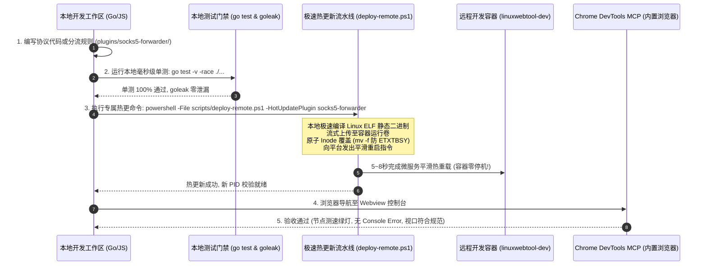

# 多协议智能分流中继网关全生命周期开发流程与实施路线图 (Development & Implementation Workflow)

> **文档标识**：`LWT-FLOW-FORWARDER-007`  
> **所属体系**：[LinuxWebTool 架构演进与插件开发指南](../docs/plugin-development-guide/README.md)  
> **前置依赖**：  
> - [架构全景方案 (LWT-ARCH-FORWARDER-004)](./socks5-forwarder-multi-upstream-chaining-routing-tproxy-architecture.md)  
> - [12 种主流协议矩阵 (LWT-ARCH-FORWARDER-005)](./poly-protocol-proxy-matrix-and-advanced-transport-architecture.md)  
> - [全协议测试与验收方案 (LWT-TEST-FORWARDER-006)](./poly-protocol-compatibility-test-suite-and-acceptance-plan.md)  
> **核心目标**：将四大功能诉求（多上游协议、链式代理、分流路由、透明网关）转化为标准化、阶段化、测试驱动（TDD）且与 LWT 极速热更管线深度绑定的**全生命周期工程开发流程规范**。

---

## 1. 全生命周期开发流程图 (End-to-End Workflow)

整个开发流程遵循 **“测试先行 (TDD) ➔ 微内核解耦 ➔ 分批递进 ➔ 毫秒级热更 ➔ 自动化双层验收”** 的工业级交付闭环：

```mermaid
flowchart TD
    subgraph 阶段 0: 基础设施与测试夹具先行 (Test & Harness Baseline)
        S0_1["1. 搭建本地 Mock 仿真服务器矩阵与内存自签 CA<br/>(零公网外部依赖，测试自闭环)"]
        S0_2["2. 落地六大通用标准测试用例执行器 (RunTestSuite)<br/>(PingPong / 5MB SHA256 / 50并发 / 凭据断言 / 级联 / 泄露)"]
        S0_3["3. 重构微内核基础抽象接口与注册表<br/>(IOutboundDialer, IDispatcher, IRoutingRule, OutboundRegistry)"]
    end

    subgraph 阶段 1: 高频主流协议与智能分流引擎 (Mainstream & Rule Routing)
        S1_1["1. 落地 SOCKS4/5, HTTP CONNECT, Shadowsocks AEAD, Trojan, VLESS"]
        S1_2["2. 入站增加 SOCKS5/HTTP 握手嗅探 (提取目标 Host:Port)"]
        S1_3["3. 落地 IsPrivateNetwork 局域网直连与 Domain Trie 规则分流"]
        S1_4["4. Webview 增加协议下拉选择与分流规则可视化编辑器"]
    end

    subgraph 阶段 2: 链式多跳代理与高抗封锁指纹拟态 (Chained Relays & Anti-Censorship)
        S2_1["1. 组合模式实现 ChainedCompositeOutbound 与 DialThrough 流嵌套"]
        S2_2["2. 引入 Yamux 多路复用连接池 (0-RTT) 与动态最优跳板池"]
        S2_3["3. 引入 uTLS 实现 VLESS Reality (免自建域名) 与 NaïveProxy (Chrome JA4 指纹)"]
        S2_4["4. Webview 拓扑画布呈现多级跳板流转状态"]
    end

    subgraph 阶段 3: 现代 QUIC 与 UDP 低时延矩阵 (Modern QUIC & UDP Matrix)
        S3_1["1. 集成 Hysteria 2 (定制 QUIC + BBRv2 + Salamander 混淆 + 端口跳跃)"]
        S3_2["2. 集成 TUIC v5 (0-RTT 极速握手) 与 WireGuard (用户态隧道)"]
        S3_3["3. 集成 MASQUE (IETF RFC 9298/9484 企业网关)"]
        S3_4["4. 开启 Linux UDP GSO/GRO 批处理与 UDP 缓冲区调优"]
    end

    subgraph 阶段 4: TUN 虚拟网卡与透明网关 (TUN Transparent Gateway)
        S4_1["1. 集成 water 管理 Linux /dev/net/tun 虚拟网卡"]
        S4_2["2. 引入 gVisor netstack 在用户态接管 TCP/UDP 数据报"]
        S4_3["3. 读取 LWT_HAS_TUN 落实特权探测与零崩溃优雅降级"]
        S4_4["4. Webview 控制台增加透明网关一键启用卡片"]
    end

    subgraph 交付与双轨门禁验收 (Verification & Delivery Pipeline)
        Gate1["代码与内存门禁: go test -race (3秒) & goleak 零泄露"]
        Gate2["凭据与前端门禁: security-gate.cjs & frontend-gate.cjs"]
        Deploy["极速在线热更新: scripts/deploy-remote.ps1 -HotUpdatePlugin socks5-forwarder (5~8秒)"]
        Accept["浏览器真实验收: Chrome DevTools MCP 验证无 Console Error、测速绿灯"]
    end

    S0_1 --> S0_2 --> S0_3
    S0_3 --> S1_1 --> S1_2 --> S1_3 --> S1_4
    S1_4 --> S2_1 --> S2_2 --> S2_3 --> S2_4
    S2_4 --> S3_1 --> S3_2 --> S3_3 --> S3_4
    S3_4 --> S4_1 --> S4_2 --> S4_3 --> S4_4
    S4_4 --> Gate1 --> Gate2 --> Deploy --> Accept

    style S0_1 fill:#4a90e2,stroke:#333,stroke-width:2px,color:#fff
    style S1_1 fill:#50e3c2,stroke:#333,stroke-width:2px,color:#000
    style S2_1 fill:#bd10e0,stroke:#333,stroke-width:2px,color:#fff
    style S3_1 fill:#f5a623,stroke:#333,stroke-width:2px,color:#000
    style S4_1 fill:#7ed321,stroke:#333,stroke-width:2px,color:#000
    style Accept fill:#9013fe,stroke:#333,stroke-width:2px,color:#fff
```

---

## 2. 阶段化工程任务拆解 WBS (Work Breakdown Structure)

### 阶段 0：测试先行底座与微内核重构 (Phase 0: Test Harness & Microkernel Core)
- **目标**：在不破坏当前任何现有功能的前提下，建立多协议测试底座，重构抽象接口。
- **任务分解**：
  1. **测试底座建设**：
     - 在 `plugins/socks5-forwarder/cmd/socks5-forwarder/` 下创建测试模块 `testing_suite_test.go` 与 `cert_factory_test.go`；
     - 实现内存自签 CA 证书生成器（`crypto/x509` 动态签发 ECDSA P-256 凭据）；
     - 引入 `go.uber.org/goleak`，配置全局 Goroutine 泄漏断言门禁；
     - 实现统一的测试夹具策略 `IProtocolTestFixture` 与 6 大通用标准用例执行器。
  2. **微内核抽象接口定义**：
     - 抽象 `IOutboundDialer` 接口（声明 `DialContext` 与 `DialThrough`）；
     - 抽象 `IDispatcher` 路由分发器与 `IRoutingRule` 规则链接口；
     - 落地并发安全的动态工厂注册表 `OutboundRegistry`。
  3. **验收标准**：
     - 现有 WSS 隧道协议包装为 `WssOutboundAdapter`，6 大通用标准单测 100% 通过；
     - 整体测试耗时 < 1 秒，无任何内存或 Goroutine 泄露。

---

### 阶段 1：高频主流协议与智能分流路由 (Phase 1: Mainstream Protocols & Rule Routing)
- **目标**：解决 85% 用户的核心出站需求，实现局域网私网智能直连，杜绝内网设备被误代理。
- **任务分解**：
  1. **第一批协议适配器落地**：
     - `Socks5Outbound`：支持标准 SOCKS4/5（无认证或 RFC 1929 账密），原生实现握手；
     - `HttpConnectOutbound`：支持 HTTP/1.1 与 HTTPS CONNECT，原生实现 (~40行)；
     - `ShadowsocksOutbound`：集成 `go-shadowsocks2`，支持 AEAD 与 SS-2022；
     - `TrojanOutbound`：标准 443 TLS + SHA224 鉴权首包序列化 (~100行)；
     - `VlessOutbound`：标准 TCP + TLS 1.3 极速无内层加密出站 (~200行)；
     - `DirectOutbound` & `RejectOutbound`：本地直连出站与 0 字节快速阻断。
  2. **入站应用层握手与目标嗅探 (Sniffer)**：
     - 改造 `InboundListener.handleClientConn`，解析客户端 SOCKS5 / HTTP CONNECT 首包，提取真实目标 `TargetHost` 与 `TargetPort`。
  3. **责任链智能分流引擎 (Router)**：
     - 实现 `IsPrivateNetwork` 位掩码匹配算法（RFC 1918 / RFC 3927 / RFC 4193），局域网/私网 IP **强制短路执行 DIRECT 直连**；
     - 构建双向 `DomainTrie` 树，支持 `.cn`、`.bilibili.com` 等国内域名后缀直连；
     - 构建 `IpCidr` 前缀匹配表，支持国内公共 DNS 与特定网段直连。
  4. **Webview 前端交互升级**：
     - “添加上游节点”模态框：新增协议下拉选择器，按协议动态呈现字段；
     - “分流规则配置”面板：支持用户可视化添加直连域名、拦截规则与默认出站；
     - 节点健康检测：支持不同协议的毫秒级测速与状态指示灯。
  5. **验收标准**：
     - 本地跑通 SOCKS5、HTTP、SS、Trojan、VLESS 5 套 Fixture 测试；
     - 局域网目标（`192.168.1.1`）访问实测直连，外部国际域名走代理。

---

### 阶段 2：链式多跳代理与高抗封锁指纹拟态 (Phase 2: Chained Relays & Anti-Censorship)
- **目标**：实现任意多级跳板级联穿透，消除自建域名门槛，模拟 Chrome 官方浏览器指纹对抗深度机器学习。
- **任务分解**：
  1. **组合模式落地多跳级联**：
     - 实现 `ChainedCompositeOutbound`，内部串联 `hops: []IOutboundDialer`；
     - 遍历跳板调用 `DialThrough` 流式嵌套升级（上一跳建立好的 TCP/WSS 流作为下一跳的底层载荷）；
     - 引入 `github.com/hashicorp/yamux`，在跨国长途跳板间启用单连接多路复用，消除多跳建连时延（实现 **0 RTT** 建立子流）。
  2. **动态跳板池与故障熔断漂移**：
     - 在链式配置中支持定义备选跳板池（Hop Pool）；
     - 结合健康度状态机，若跳板 1 探测失败，自动熔断并瞬间漂移至备选跳板，保障链路永不中断。
  3. **uTLS 浏览器指纹拟态与 Reality 借牌**：
     - 引入 `github.com/refraction-networking/utls`；
     - **VLESS Reality**：实现免自建域名借牌技术，SNI 伪装为权威大厂域名（如 `www.apple.com`），配合 X25519 临时密钥完成隐匿通信；
     - **NaïveProxy**：配置 `utls.HelloChrome_Auto` + H2 CONNECT，实现全网最高拟真度的 Chrome JA4 指纹；
     - 补齐 **Anytls** 通用四层 TLS 包装适配器与 **VMess** 兼容适配器。
  4. **Webview 链式拓扑可视化**：
     - 控制台新增“链式中继拓扑卡片”，直观呈现 `Hop 1 ➔ Hop 2 ➔ 目标` 的跳转链路与各跳耗时。
  5. **验收标准**：
     - 跑通 3 跳链式代理传输 5MB 随机数据，SHA256 校验完全一致；
     - 拔掉中间跳板，断言在 1.5 秒内自动漂移至备选跳板。

---

### 阶段 3：现代 QUIC 与 UDP 低时延矩阵 (Phase 3: Modern QUIC & UDP Matrix)
- **目标**：在 15%~30% 恶劣丢包网络下强制跑满带宽，实现移动漫游 0-RTT 极速握手与企业级 MASQUE 协议标准。
- **任务分解**：
  1. **Hysteria 2 适配器集成**：
     - 集成 `github.com/apernet/hysteria/core/v2`；
     - 配置 Salamander 载荷流密码混淆，抹杀标准 QUIC 头部特征；
     - 绑定 BBRv2 拥塞控制算法，根据带宽配置实现暴力吞吐驱动；
     - 落地客户端端口跳跃（Port Hopping）轮换调度器。
  2. **TUIC v5 适配器集成**：
     - 基于 `quic-go` 实现 TUIC v5 客户端协议栈；
     - 开启真正的 0-RTT 首包建连（利用 QUIC 会话 Ticket 消除额外握手）。
  3. **WireGuard 用户态隧道**：
     - 集成 `golang.zx2c4.com/wireguard/wireguard-go`；
     - 基于 Noise 协议框架配置对等公私钥，支持点对点内网穿透出站。
  4. **MASQUE 企业级标准**：
     - 基于 `quic-go/http3` 实现 IETF RFC 9298 `CONNECT-UDP` 报文封装；
     - 支持 HTTP/3 Datagram Capsule 传输。
  5. **系统级 UDP 性能调优**：
     - 在 Linux 容器内适配 UDP GSO/GRO（Generic Segmentation Offload）批处理，大幅降低软中断 CPU 消耗。
  6. **验收标准**：
     - 本地模拟 20% 随机丢包弱网，Hysteria2 依然保持稳定高速传输；
     - TUIC 首包在 0 毫秒内完成数据推流。

---

### 阶段 4：TUN 虚拟网卡与透明网关 (Phase 4: TUN Transparent Gateway)
- **目标**：局域网内所有终端（手机、电视、PC）无需任何客户端配置，网关即智能分流出海；特权不足时实现零崩溃平滑降级。
- **任务分解**：
  1. **虚拟网卡管理**：
     - 引入 `github.com/songgao/water` 纯 Go 操作 Linux 字符设备 `/dev/net/tun`；
     - 创建 `lwt-tun0` 接口，分配内网地址（如 `172.19.0.1/30`）。
  2. **Google gVisor 用户态协议栈接管**：
     - 引入 `gvisor.dev/gvisor/pkg/tcpip`；
     - 直接将 `lwt-tun0` 捕获的 IP 数据报送入用户态协议栈，在用户态完成 TCP 握手重组；
     - 将重组后的 TCP 连接无缝移交给 `RuleRoutingDispatcher` 进行分流。
  3. **特权探测与优雅降级状态机 (Zero-Panic Graceful Fallback)**：
     - 启动时自动读取宿主元数据 `LWT_HAS_TUN` 及 `/dev/net/tun` 文件权限；
     - 若未赋予容器特权，**绝对不可 Panic 崩溃**，而是将透明网关状态标记为 `Degraded`，记录 Warning 日志并在 Webview 弹窗友好提示，保障 10801~10815 等常规端口 100% 正常工作。
  4. **Webview 一键透明网关卡片**：
     - 增加“透明网关开关”卡片与网卡状态指示灯（🟢 Running / 🟡 Degraded / ⚪ Disabled）。
  5. **验收标准**：
     - 开启透明代理后，向虚拟网卡发送的数据包被准确拦截并按规则分流；
     - 在非特权测试环境中，服务平滑降级为纯端口中继，守护进程正常存活。

---

## 3. 日常敏捷开发与部署流水线规范 (Daily Agile Pipeline)

开发过程中，所有开发者及 AI Coding Agent **必须严格执行最小粒度更新策略，严禁破坏容器环境**：



### 敏捷开发三大铁律：
1. **统一使用插件专属热更**：
   ```powershell
   powershell -ExecutionPolicy Bypass -File scripts/deploy-remote.ps1 -HotUpdatePlugin socks5-forwarder
   ```
   **耗时仅 5~8 秒且容器全程不重启**。网络命名空间、FRP 穿透与 PTY 终端会话绝不丢失。严禁滥用全量容器重启（`-Mode Dev`）！
2. **代码提交前双重门禁**：
   ```powershell
   # 门禁 1: 全仓敏感凭据与香农熵扫描
   node .githooks/security-gate.cjs --full
   # 门禁 2: 前端架构与防变形门禁
   node src/LinuxWebTool.WebHost/wwwroot/frontend-gate.cjs
   ```
3. **架构行数限制**：单文件行数严格控制在 700 行以内，超过时使用分部类或策略模块进行拆分。

---

## 4. 各阶段完工验收标准 (Definition of Done - DoD)

每个阶段必须满足以下 **8 项硬性验收指标** 方可判定为完成并合并入主干：

| 验收维度 | 核心指标与判定准则 | 验证工具 / 方式 |
| :--- | :--- | :--- |
| **1. 基础单测覆盖** | 新增协议的 6 大标准用例（PingPong、SHA256、超时、鉴权等）100% 通过 | `go test -v ./...` |
| **2. 数据传输完整性** | 双向推流 **5MB 随机二进制数据，两端 SHA256 哈希值绝对一致**，零粘包截断 | `Test_Payload_SHA256_Integrity` |
| **3. 高并发线程安全** | 50 条并发流同时读写，开启 `-race` 竞态检测**绝对零 Data Race 报警** | `go test -race -parallel 4` |
| **4. 内存与 Goroutine 零泄露** | 单测执行结束后，全局 Goroutine 数量归零，无未关闭的底层 Socket | `uber-go/goleak` 自动断言 |
| **5. 局域网私网直连保真** | 访问 RFC 1918 私网 IP（`192.168.x.x`）**100% 走 DIRECT，绝不误走代理** | `Test_RuleRouting_Matrix` |
| **6. 远程热更耗时** | 部署至远程 Linux 开发容器耗时稳定在 **5~8 秒**，新旧 Inode 原子替换无 `ETXTBSY` | `deploy-remote.ps1 -HotUpdatePlugin` |
| **7. 凭据安全红线** | 代码、配置文件与测试日志中**严禁出现真实密钥**，100% 使用标准占位符 | `security-gate.cjs --full` |
| **8. 浏览器端到端体验** | Webview 界面平滑呈现，整页节点并发测速在 **1.5 秒内响应**，Console Error 计数为 **0** | Chrome DevTools MCP 自动化巡检 |

---

## 5. 总结与推进建议

通过本开发流程规范：
1. **将复杂的 12 种协议拆解为可度量、分批次的 4 个敏捷迭代周期**；
2. **通过“测试先行（TDD）”消除协议兼容性开发中的不可控风险**；
3. **与 LWT 平台的秒级热更新流水线无缝配合**，使开发、调试、测试、部署与浏览器自动化验收达到最高效率！
