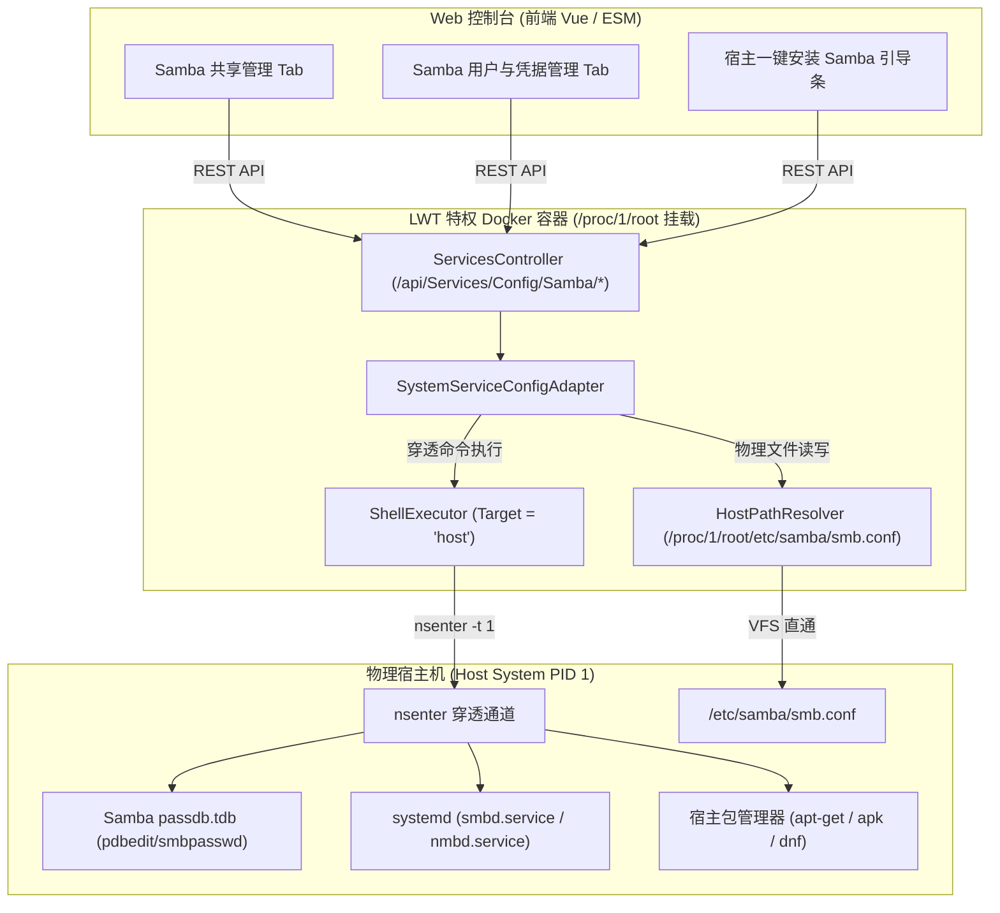

# Samba (SMB) 宿主穿透架构治理、冷启动自愈与凭据管理方案

> **文档状态**：已落地实施 (Approved & Implemented)  
> **编写日期**：2026-11-11  
> **架构受众**：系统架构师、后端核心开发、Linux 基础设施工程师、前端开发  

---

## 1. 问题现象与根因深度剖析 (Problem & Root Cause Analysis)

### 1.1 现象分析 (User Symptoms)
在 LinuxWebTool (LWT) 运维控制中枢的「系统与网络服务 -> Samba 共享管理」页面中，用户在特权 Docker 容器（PID 1 穿透）模式下操作时遇到了以下三个核心痛点：
1. **创建共享报错**：点击保存或新建共享文件夹时，右上角连续弹出红色错误气泡：`未找到 Samba 配置文件: /etc/samba/smb.conf`，导致文件共享功能完全处于不可用状态。
2. **凭据管理缺失**：界面与接口中只有 `valid users` 文本框，没有配置访问用户及其密码的入口。如果设置了禁止访客（`guest ok = no`），由于无法注册 Samba 凭据，外部局域网客户端根本无法连接认证。
3. **服务定位混淆**：平台顶部标识为“Docker 特权容器 (PID 1 穿透)”，但底层代码究竟配置的是容器内部的服务，还是宿主机上的 Samba 服务？

### 1.2 根因溯源 (Root Cause Audit)

经对后端 `SystemServiceConfigAdapter.cs`、`ShellExecutor.cs` 以及运行环境的深度源码审计，确认根本原因如下：

#### 根因 1：命名空间与路径错位（Host vs Container Path Misplacement）
LWT 作为一个拥有 `--privileged --pid=host` 特权的容器运行。然而在 `SystemServiceConfigAdapter.cs` 的实现中，代码直接调用了本地 C# 原生文件 API：
```csharp
const string configPath = "/etc/samba/smb.conf";
if (!File.Exists(configPath))
{
    return new ServiceActionResult { Success = false, Message = $"未找到 Samba 配置文件: {configPath}" };
}
```
此时，`File.Exists(configPath)` 探测的是 **Docker 容器自身内部**的 `/etc/samba/smb.conf`，而不是**宿主机**上的文件！由于 LWT 极速开发镜像和生产 AOT 镜像均为精简无状态的 Alpine Linux，容器内部压根没有安装 Samba，容器的 `/etc/samba/` 目录根本不存在。

#### 根因 2：执行上下文错位（Shell Namespace Isolation）
在验证语法与重载服务时，适配器直接执行：
```csharp
var testRes = await _shellExecutor.ExecuteAsync(new ShellRequest { CommandText = $"testparm -s '{tempPath}' 2>&1" });
await _shellExecutor.ExecuteAsync(new ShellRequest { CommandText = "systemctl restart smbd" });
```
调用未指定 `Target = "host"`，因此命令是在容器内部执行。而容器内既没有 `testparm` 工具，更没有 `systemctl`（Alpine 容器非 Systemd 引导体系），一旦执行直接报错。

#### 根因 3：缺乏冷启动默认模板自愈能力（No Cold-Start Self-Healing）
无论在宿主机还是容器内，初次安装 Samba 或宿主未初始化时，`/etc/samba/smb.conf` 可能不存在。系统直接抛出硬编码阻断异常，缺乏“检测不存在即自动以标准初始模板安全初始化并建目录”的冷启动容错机制。

#### 根因 4：Samba 独立安全凭据体系未接入（Passdb Disconnection）
Samba 不直接使用 Linux `/etc/shadow` 的明文/哈希密码，而是维护自己独立的密码数据库（`passdb.tdb`，通过 `smbpasswd` 或 `pdbedit` 管理）。Samba 鉴权要求：
1. 用户必须在 Linux 系统层存在（可以是不可交互登录的影子用户，如 `/usr/sbin/nologin`）。
2. 用户必须在 Samba 的 `passdb` 中注册 NTLM 哈希凭据并被启用（`smbpasswd -a -s <user>`）。
以往系统没有任何对 `pdbedit` 或 `smbpasswd` 的调用接口，导致非匿名共享形同虚设。

---

## 2. 业界主流方案调研与对比 (Industry Benchmarks)

针对 NAS 与 Linux 运维管理工具（如 Cockpit、OpenMediaVault、TrueNAS、CasaOS、Webmin）对 Samba 的管理架构，业界主要存在两种主流流派：

| 维度 | 方案 A：宿主穿透直通管理 (Host-Native Piercing) | 方案 B：独立容器化 Samba (Sidecar SMB Container) |
| :--- | :--- | :--- |
| **代表产品** | **Cockpit, OpenMediaVault (OMV), Webmin** | CasaOS (Docker 部署 Samba 应用), dperson/samba |
| **架构原理** | 控制面板利用特权穿透至宿主命名空间，管理宿主 `/etc/samba/smb.conf`，驱动宿主 Systemd 的 `smbd`/`nmbd` 服务与宿主内核网络栈。 | 启动一个独立的 Samba Docker 容器，将宿主机目录挂载为容器内卷，使用容器自身进程提供 SMB 协议。 |
| **传输性能** | **最高（原生零拷贝）**：内核态 socket 直通宿主机 445 端口，支持 Samba 多通道（Multi-channel）与 RDMA。 | 性能受 Docker Bridge/Macvlan 网络桥接与容器 VFS 抽象层损耗，约降低 10~25%。 |
| **权限一致性** | **完全一致**：直接使用宿主机 UID/GID 和文件 ACL 权限，与本地操作、SSH、PTY 终端完全统一。 | **极易错乱**：存在容器内 UID 与宿主机 UID 不对齐问题，易产生权限被锁死、`root_squash` 权限漂移。 |
| **服务发现** | 原生兼容 WSD (WS-Discovery) 和 mDNS/Avahi，Windows 局域网“网上邻居”开箱即自动秒级发现。 | 容器内多播数据包难以轻易跨 Docker 网络广播，局域网发现通常失败，必须手动输入 IP。 |
| **系统契合度** | **100% 契合 LWT 架构**：LWT 的定位即为“宿主机系统级基础设施中枢”，已天然具备特权 PID 1 穿透能力。 | 不符合 LWT 宿主运维中枢定位，凭空增加容器依赖与维护负担。 |

**结论**：方案 A（宿主穿透直通管理）是业界公认的系统级运维中枢标准架构，也是 LWT 的唯一正确演进方向。

---

## 3. 现有基础设施与可复用资产分析 (Reusable Assets)

在 LWT 代码库中，已经具备高度成熟的宿主穿透与环境识别基础设施，完全无需引入厚重外部依赖：

1. **`HostPathResolver` (`LinuxWebTool.Infrastructure.Shared.Support`)**：
   - `HostPathResolver.CanPierceHost()`：毫秒级探测特权容器与 `/proc/1/ns/mnt` 挂载穿透能力。
   - `HostPathResolver.ResolvePhysicalPath(virtualPath)`：自动将宿主虚拟路径 `/etc/samba/smb.conf` 映射为容器可直接读写的物理路径 `/proc/1/root/etc/samba/smb.conf`，并具备符号链接穿透保护。
2. **`IShellExecutor` (`LinuxWebTool.Infrastructure.Features.Shell.Adapters`)**：
   - `ShellRequest.Target = "host"`：当指定为 `"host"` 且运行于 Linux 特权容器时，底层自动调用 `nsenter -t 1 -m -u -i -n -p -- /bin/bash -c ...`，穿透至宿主机执行命令，天然解决环境隔离问题。
3. **`IServiceEnvironmentDetector` (`LinuxWebTool.Contracts.Features.Services.Contracts`)**：
   - 已具备 `HostDistroKey` 解析器，可精确识别宿主机操作系统发行版（Debian, Ubuntu, Alpine, CentOS/RHEL, Fedora 等），从而精准自适应宿主包管理器。

---

## 4. 详细技术解决方案 (Technical Solution Architecture)



### 4.1 核心功能点与落地细则

#### 1. 宿主服务与路径穿透 (Host-Native Piercing)
- **路径重映射**：
  ```csharp
  private string GetEffectiveSambaConfigPath() =>
      HostPathResolver.CanPierceHost()
          ? HostPathResolver.ResolvePhysicalPath("/etc/samba/smb.conf")
          : "/etc/samba/smb.conf";
  ```
- **命令穿透**：
  所有与 Samba 相关的系统管理命令（`systemctl is-active/restart smbd`、`testparm`、`smbpasswd`、`pdbedit`）均显式传入 `Target = "host"`，确保在宿主环境 PID 1 空间中执行。

#### 2. 冷启动默认模板与安全自愈 (Cold-Start Auto-Initialization)
当检测到宿主机不存在 `/etc/samba/smb.conf` 时，系统不再报错中断，而是自动创建父目录并写入工业级安全默认模板：
```ini
[global]
   workgroup = WORKGROUP
   server string = LinuxWebTool SMB
   server role = standalone server
   security = user
   map to guest = Bad User
   dns proxy = no
   log file = /var/log/samba/%m.log
   max log size = 50
   load printers = no
   printing = bsd
   printcap name = /dev/null
   disable spoolss = yes
   create mask = 0775
   directory mask = 0775
```

#### 3. 宿主 Samba 一键安装支持 (Host Samba Auto-Installer)
- 接口：`POST /api/Services/Config/Samba/Install`
- 行为：根据宿主发行版标识（`HostDistroKey`）在宿主执行：
  - Debian / Ubuntu：`export DEBIAN_FRONTEND=noninteractive; apt-get update -y && apt-get install -y samba smbclient`
  - Alpine Linux：`apk add samba samba-common-tools`
  - CentOS / RHEL / Fedora：`dnf install -y samba samba-client || yum install -y samba`
- 安装完成后自动初始化默认配置，并启动 `smbd.service`。

#### 4. Samba 独立用户与密码全生命周期管理 (Credential Governance)
- **获取用户列表**：`GET /api/Services/Config/Samba/Users`  
  穿透执行宿主命令：`pdbedit -L`，解析输出 `username:uid:flags`。
- **创建用户**：`POST /api/Services/Config/Samba/Users`  
  入参：`{ username, password }`  
  流程：
  1. 探测宿主是否存在该系统用户（`id -u <user>`）；
  2. 若不存在，在宿主机静默创建无 shell 登录权限的受限系统用户：`useradd -M -s /usr/sbin/nologin <user>`（Alpine 下使用 `adduser -D -s /sbin/nologin <user>`）；
  3. 执行 `printf "%s\n%s\n" "<password>" "<password>" | smbpasswd -a -s <user>` 注册并启用该 Samba 用户。
- **更新密码**：`PUT /api/Services/Config/Samba/Users/Password`  
  入参：`{ username, password }`  
  执行：`printf "%s\n%s\n" "<password>" "<password>" | smbpasswd -s <user>`。
- **删除用户**：`DELETE /api/Services/Config/Samba/Users/{username}`  
  执行：`smbpasswd -x <user>`，并清理宿主影子账户（可选安全标记）。

#### 5. 共享目录自动创建与权限治理
在保存共享块时，自动检查物理挂载路径是否存在。若不存在，自动穿透执行 `mkdir -p '<path>'`，并赋予 `chmod 0775` 权限，防止 Windows/macOS 客户端连接后因底层文件权限拒绝而报 `NT_STATUS_ACCESS_DENIED`。

#### 6. 前端 UI 现代化重塑
- 增加服务未激活 / 未安装时的「宿主一键安装」警示卡片。
- 增加「用户与凭据管理」管理面板，支持查看已有 Samba 用户、新增用户密码、快速修改密码和删除用户。
- 共享编辑弹窗中的「授权用户」从脆弱的输入框升级为支持从已配置的 Samba 用户中勾选，同时保持支持自定义输入。

---

## 5. 架构门禁与防回归测试规范 (Architecture Gate & Quality Guard)

为了防止未来代码迭代时重新发生“容器与宿主混淆”、“配置路径丢失穿透”等同类架构退化，在 `tests/LinuxWebTool.ArchitectureTests/ArchitectureTests.cs` 中新增专用架构门禁：

```csharp
[Fact]
public void LinuxArch083_SambaHostPiercingAndCredentialGovernance()
{
    // 1. 验证 SystemServiceConfigAdapter 使用了 HostPathResolver 进行物理路径穿透
    // 2. 验证包含冷启动默认配置模板初始化逻辑
    // 3. 验证执行 Samba 重载、校验、用户变更命令时指定了 Target = "host"
    // 4. 验证 Contracts 层包含完整的 Samba 用户增删改查模型与接口契约
    // 5. 验证 AppJsonSerializerContext 包含 Native AOT 序列化特性
    // 6. 验证本架构方案设计文档落地于 docs/ 目录
}
```

---

## 6. 实施推进计划 (Implementation Roadmap)

1. **Phase 1**：落地规范架构设计方案文档（即本文档）。
2. **Phase 2**：在 `LinuxWebTool.Contracts` 中定义用户管理模型与扩展接口。
3. **Phase 3**：在 `LinuxWebTool.Infrastructure` 的 `SystemServiceConfigAdapter` 中实现宿主穿透、自动冷启动模板初始化、用户凭据管理与宿主一键安装逻辑。
4. **Phase 4**：在 `LinuxWebTool.WebHost` 中添加控制器路由映射与 Native AOT JSON 序列化上下文。
5. **Phase 5**：升级前端 `SambaSubmodule.js` 界面交互。
6. **Phase 6**：编写并运行本地架构门禁、前端门禁测试与安全门禁，确保 100% 绿色通过后发布上线。
