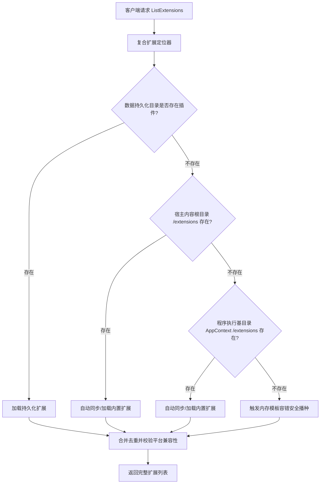
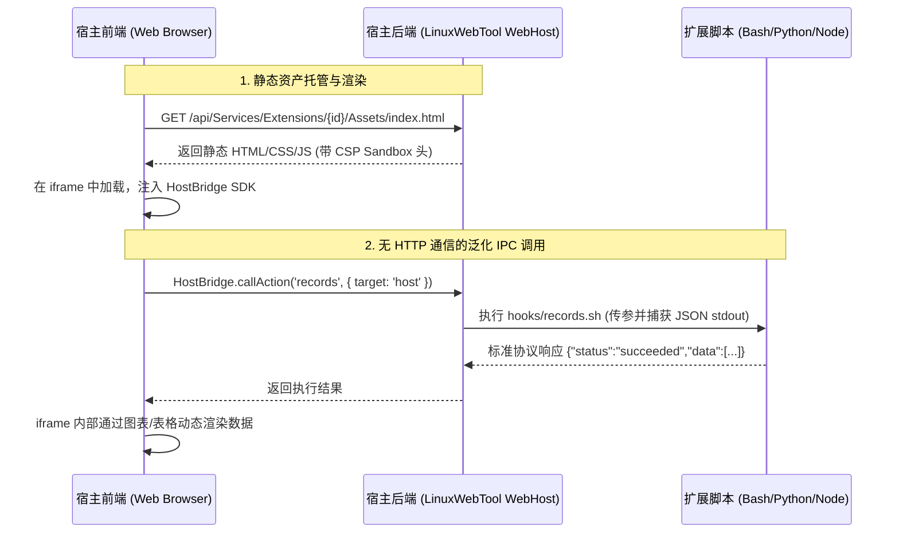

# 脚本扩展、ChatGPT 渠道 Worker、无 HTTP 前端扩展与指令 API Key 细粒度授权调研与设计方案

本文档针对系统使用中发现的 4 项关键问题与演进需求展开系统性调研、根因诊断与全栈架构设计：
1. **脚本扩展服务为什么为空？**
2. **函数服务（Workers）为什么没有 ChatGPT 渠道服务？**
3. **脚本扩展服务能否支持无 HTTP 方式前端扩展？**
4. **指令页面中的指令能否作为资源支持在 API Key 授权管理中批量选择控制访问？**

---

## 一、问题 1：脚本扩展服务为什么为空？根因诊断与修复方案

### 1. 根因深度诊断
通过代码审查与全流程调用链路追踪，发现导致 `http://<ip>:5270/app/#/services?module=extensions` 显示为空的根本原因有以下四点：

1. **路径解析脱节（Path Inconsistency）**：
   - 源码仓库中，示例扩展位于仓库根目录 `extensions/`（如 `sample-healthcheck`、`ssh-access-guard`、`caddy-server-manager`、`native-command-demo`）。
   - 后端 `ScriptExtensionManager.cs` 在 DI 注册时使用的是无参构造函数：
     ```csharp
     builder.Services.AddSingleton<IScriptExtensionManager, ScriptExtensionManager>();
     ```
     其内部默认路径为 `Path.Combine(AppContext.BaseDirectory, "data", "services", "extensions")`，并未接入系统统一的 `DataPaths`，也未探测项目源码目录或发布目录下的 `extensions/`。
2. **打包与发布流水线遗漏（Packaging Omission）**：
   - 在 `Dockerfile` 中：编译镜像仅打包了 `/app/publish` 产物，未将 `extensions/` 复制到运行时镜像；
   - 在 `desktop-release.yml` 与本地打包脚本中，仅生成了可执行文件，未将 `extensions/` 纳入发布归档中；
3. **默认扩展播种（Seed）与运行权限问题**：
   - `ScriptExtensionManager.Defaults.cs` 虽然包含硬编码的 3 个内置示例生成逻辑，但判断条件是 `!Directory.Exists(_baseExtensionsDir) || !Directory.EnumerateFileSystemEntries(_baseExtensionsDir).Any()`；
   - 在 Docker 容器环境挂载外部卷时，若宿主机挂载目录预先存在但缺少权限（容器内默认运行在 `appuser` 非 root 用户下），`Directory.CreateDirectory` 或写文件抛出异常，异常被 `catch (Exception ex) { _logger.LogWarning(...) }` 捕获后静默退出，导致目录为空且不重试；
   - 此外，内置播种代码中遗漏了最新升级的第 4 个扩展 `native-command-demo`。

### 2. 优化方案：多级目录探测与复合定位器（Composite Extension Locator）
采用**适配器与链式探测模式（Chain of Responsibility / Fallback Probing）**：


- **统一接入 `DataPaths`**：将基准工作目录定向至 `DataPaths.PathFor("services/extensions")`。
- **三级降级发现（Fallback Discovery）**：
  1. 首选探测 `data/services/extensions`；
  2. 其次探测 `<ContentRoot>/extensions`；
  3. 再次探测 `<AppContext.BaseDirectory>/extensions`；
- **全量播种修复**：将 4 个官方原生扩展（`sample-healthcheck`、`ssh-access-guard`、`caddy-server-manager`、`native-command-demo`）完整播种，并在打包流水线和 Dockerfile 中确保 `extensions/` 目录被打包。

---

## 二、问题 2：函数服务为什么没有 ChatGPT 渠道服务？根因诊断与修复方案

### 1. 根因深度诊断
1. **命名与业务定位映射脱节**：
   - 在先前的架构优化中，Go 语言编写的 OpenAI Secure MCP Tunnel 网关被实现为自治 Worker，项目名为 `mcp-bridge`，打包配置为 `workers/mcp-bridge/packaging/worker.json`。
   - 但是在 `WorkersManager.Defaults.cs` 中，`EnsureDefaultWorkersCreated()` 仅注册并播种了 5 个示例：
     - `demo-js-webhook` (Node.js)
     - `demo-py-api` (Python)
     - `demo-dotnet-service` (.NET C#)
     - `demo-sh-daemon` (Shell)
     - `demo-ps-daemon` (PowerShell)
   - **从未对 `chatgpt-channel` / `mcp-bridge` 进行内置播种与配置装载！**
2. **纯粹架构原则下的可插拔服务形态**：
   - 根据“坚持 Worker 是独立自治可插拔扩展服务”的原则，ChatGPT 渠道（MCP Bridge）应以标准 Worker 身份运行，既可以通过 `worker.json` 自动发现，也可以内置播种出厂预置模板；
   - 之前在 WebHost 前端剔除了硬编码的 McpBridge 特殊视图，但未在 Workers 默认服务中为其建立开箱即用的 Worker 预设。

### 2. 优化方案：开箱即用 ChatGPT 渠道 Worker 预置播种
在 `WorkersManager.Defaults.cs` 中增加 `EnsureChatGptChannelCreated()`：
- **Worker 标识**：`chatgpt-channel`（展示名称：`ChatGPT 渠道 (MCP Bridge)`）。
- **运行模式**：`WorkerServiceMode.Service`，原生可执行文件或跨平台脚本包装。
- **网络路由**：自动分配路由前缀 `/w/chatgpt-channel`，反向代理至 Go 自治进程。
- **驻留控制**：声明 `ResidentControl` 规范，健康检查端点 `/health`，管理端点 `/ui`。
- **自包含 Web 控制台**：通过 YARP 透明代理，用户点击进入即可访问 Go MCP Bridge 嵌入式单页控制台，完全符合零侵入的纯粹架构。

---

## 三、问题 3：脚本扩展服务能否支持无 HTTP 方式前端扩展？

### 1. 行业主流方案与可行性调研

| 方案类别 | 代表产品 | 通信机制 | 隔离性 | 实现复杂度 | 适用场景 |
| :--- | :--- | :--- | :--- | :--- | :--- |
| **Schema 驱动动态表单/视图** | Jenkins / GitHub Actions / Runbooks | 声明式 JSON Schema 定义输入参数与输出渲染组件 | 极高（宿主完全受控） | 低 | 参数化运维、批量操作、表格/状态报表 |
| **沙箱 Webview + 泛化 IPC Bridge** | VS Code Webview / Obsidian / Docker Desktop Extension | 静态 HTML/JS 托管 + `postMessage` RPC | 高（iframe sandbox + CSP 隔离） | 中 | 具有复杂仪表盘、交互图表、状态看板的前端扩展 |
| **Micro-Frontend / Web Components** | Grafana Panels / Backstage | ES 模块动态 import + Shadow DOM | 中（需共享基础依赖） | 较高 | 需与宿主深层样式融合的组件 |

**结论**：**完全可行**，且非常适合 LinuxWebTool。脚本扩展本身没有常驻 HTTP 服务器，但可以通过**宿主代理静态资产托管** + **泛化 IPC Bridge 消息传递**，实现免 HTTP 服务的富交互前端扩展！

### 2. 具体设计与架构实现



#### 规范与协议定义：
1. **Manifest 声明扩展 UI**：
   在 `manifest.json` 中增加 `ui` 属性：
   ```json
   {
     "id": "ssh-access-guard",
     "name": "SSH 访问安全卫士",
     "ui": {
       "entry": "assets/index.html",
       "title": "安全审计看板",
       "icon": "🛡️",
       "mode": "webview"
     }
   }
   ```
2. **后端静态资源安全代理**：
   - 增加接口：`GET /api/Services/Extensions/{id}/Assets/{*filePath}`
   - 严格进行抗路径穿透（`PluginSecurityGuard.EnsureSafePluginDirectory`）和 MIME 类型映射；
   - 注入安全头：`Content-Security-Policy: sandbox allow-scripts allow-forms allow-same-origin;`。
3. **轻量前端 HostBridge 通信 SDK**（嵌入在 HTML 中或通过宿主透明代理注入）：
   ```javascript
   window.HostBridge = {
     async callAction(action, params = {}) {
       const res = await fetch(`/api/Services/Extensions/${extId}/Action`, {
         method: 'POST',
         headers: { 'Content-Type': 'application/json' },
         body: JSON.stringify({ extensionId: extId, action, actionParams: params })
       });
       return await res.json();
     },
     async getLogs(lines = 100) { ... },
     async getStatus() { ... }
   };
   ```
4. **前端交互集成**：
   在 `ExtensionsSubmodule.js` 卡片上，若检测到 `ext.manifest.ui` 或本地存在静态入口，显示「🖥️ 打开控制台」按钮，以模态弹窗或抽屉视窗无缝展开，真正赋予脚本服务全功能前端自治能力。

---

## 四、问题 4：指令作为资源支持在 API Key 授权中批量选择控制访问

### 1. 行业主流对比与权限模型分析
- **AWS IAM Policy**：通过资源 ARN 匹配（如 `arn:aws:ec2:*:*:instance/*`），支持白名单与通配符。
- **HashiCorp Vault / Kubernetes RBAC**：基于资源命名空间与名字列表进行绑定。
- **系统当前现状**：
  - 目前 API Key 仅有粗粒度开关 `AllowTerminal`（指令与终端全量放行）；
  - 而远程主机管理已具备先进的细粒度模式：`AllowRemoteHosts` (开关) + `AllowedHostIds` (JSON ID 白名单数组或 `*`)；
  - MCP 工具管理也具备：`AllowMcp` (开关) + `AllowedTools` (工具名白名单数组)。
- **核心价值**：
  为 API Key 增加指令级资源白名单控制，可彻底杜绝第三方调用方或自动化脚本通过 API Key 执行未授权危险指令的安全风险，实现真正的**最小特权原则（Principle of Least Privilege）**。

### 2. 具体设计与架构实现

```mermaid
flowchart LR
    Caller[外部 API Key 调用] --> Middleware[ApiKeyMiddleware]
    Middleware --> Check1{路径为 /api/Commands/...?}
    Check1 -- 是 --> Check2{AllowTerminal 是否开启?}
    Check2 -- 否 --> Deny[403 拒绝访问]
    Check2 -- 是 --> Check3{AllowedCommandIds 为空或 * ?}
    Check3 -- 是 --> Allow[放行执行全部指令]
    Check3 -- 否 --> Check4{当前指令 ID 是否在白名单中?}
    Check4 -- 是 --> Allow
    Check4 -- 否 --> DenyDetail[403: 未授予执行指令 {id} 权限]
```

#### 数据模型与持久化变更：
1. **实体扩展 (`ApiKeyEntity.cs`)**：
   ```csharp
   public string? AllowedCommandIds { get; set; } // 逗号分隔或 JSON 字符串数组，null 或 "*" 表示全部指令
   ```
2. **数据库 DDL 升级**：
   在 SQLite 数据库表 `ApiKeys` 中增加 `AllowedCommandIds TEXT NULL` 列，保持向下兼容与无缝迁移。
3. **接口契约扩展**：
   - `CreateApiKeyRequest` / `UpdateApiKeyRequest` 增加 `AllowedCommandIds`。
   - `ApiKeyItemResponse` 增加 `AllowedCommandIds`。
4. **鉴权中间件矩阵增强 (`ApiKeyPermissionMatrix.cs` & `ApiKeyMiddleware.cs`)**：
   - 在拦截 `POST /api/Commands/{id}/Run`、`POST /api/Commands/Run` 或 `GET /api/Commands/{id}` 时，自动提取指令 ID；
   - 校验 `CanAccessCommand(allowedCommandIds, targetCommandId)`，不在授权范围内时直接中断并返回 `403 Forbidden`。
5. **MCP 工具联动过滤 (`CommandMcpToolProvider.cs`)**：
   - 当 API Key 调用 MCP 工具列表时，`CommandMcpToolProvider` 仅向该 API Key 暴露其获批的指令工具，未授权指令在工具目录中直接不可见。
6. **前端交互体验 (`ApiKeysView.js`)**：
   - 复用成熟的资源选择器范式：
     - 单选按钮：`全部指令 (默认)` vs `仅限指定指令 (Command Scoping)`；
     - 勾选指定指令时，展示支持搜索、分组筛选、全选/反选的高性能指令选择弹窗/抽屉；
     - 表格列表中直观显示徽章：`已勾选 X 条指令`。

---

## 五、实施计划与验证策略

1. **第一阶段：路径探测自愈与全量播种修复（解决问题 1 与问题 2）**
   - 升级 `ScriptExtensionManager`，引入复合路径发现逻辑；
   - 补全 `EnsureDefaultExtensionsCreated()` 与 `EnsureDefaultWorkersCreated()`（含 `chatgpt-channel`）；
   - 更新打包脚本与 Dockerfile，确保扩展与 Worker 随包分发。
2. **第二阶段：指令资源化 API Key 细粒度授权（实现问题 4）**
   - 扩展 `ApiKeyEntity`、DDL 迁移脚本与 DTO 序列化上下文；
   - 完善鉴权管线与 MCP 工具过滤逻辑；
   - 在 `ApiKeysView.js` 中构建批量指令选择器组件并集成测试。
3. **第三阶段：脚本扩展无 HTTP 前端扩展框架（实现问题 3）**
   - 增加 `/api/Services/Extensions/{id}/Assets/{*filePath}` 静态安全代理端点；
   - 在 `ExtensionsSubmodule.js` 中接入 Webview 模态控制台与 HostBridge 双向交互；
   - 为示例扩展（如 `ssh-access-guard`）提供现代化无 HTTP 前端控制台页面。
4. **第四阶段：质量门禁与端到端验证**
   - 运行单元测试、架构门禁与快速校验脚本。
