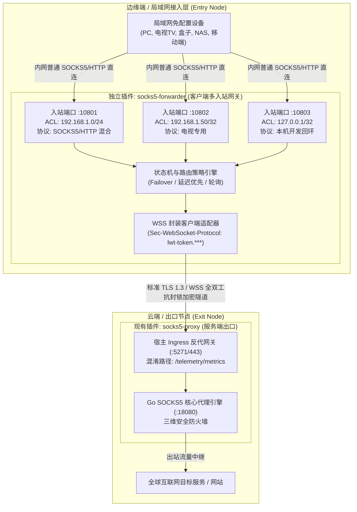
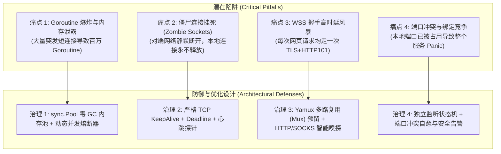
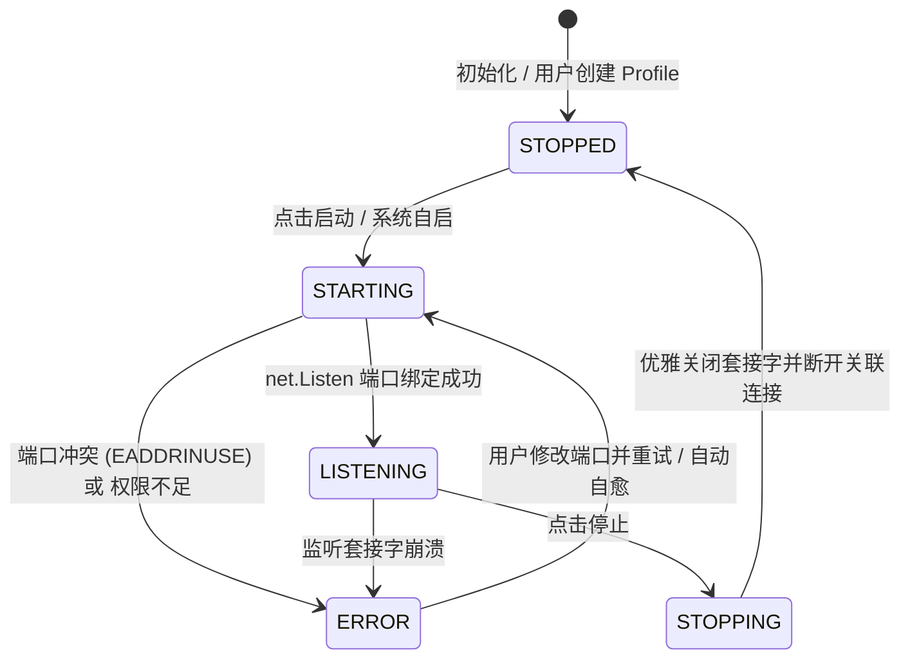
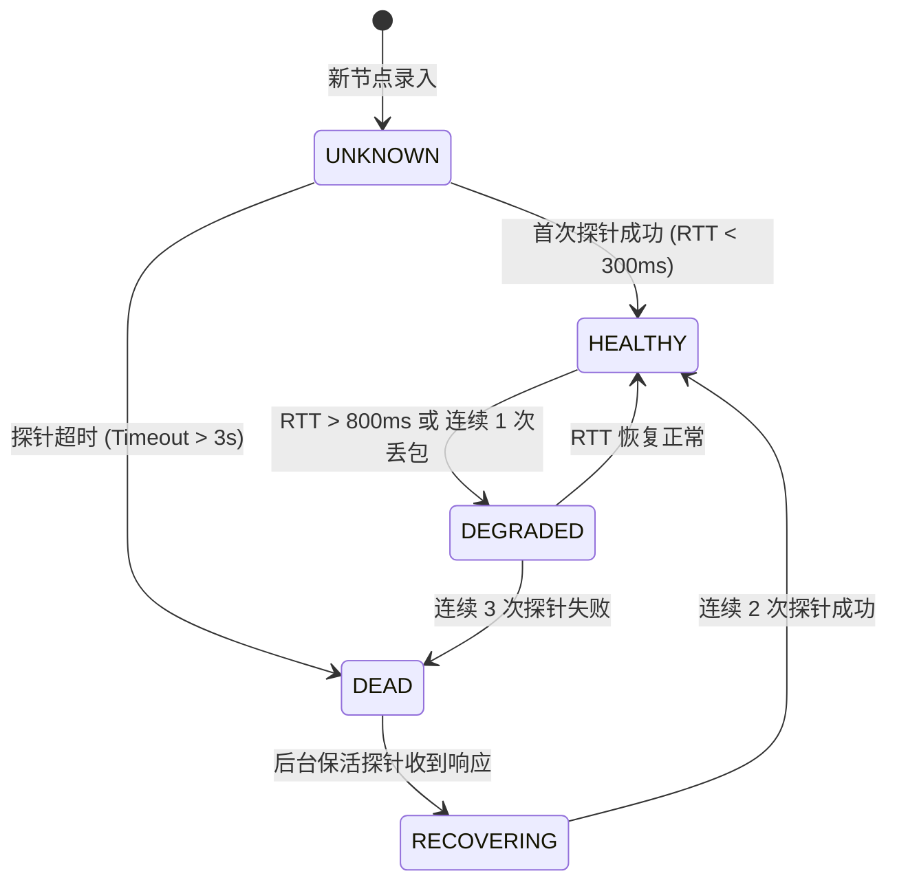
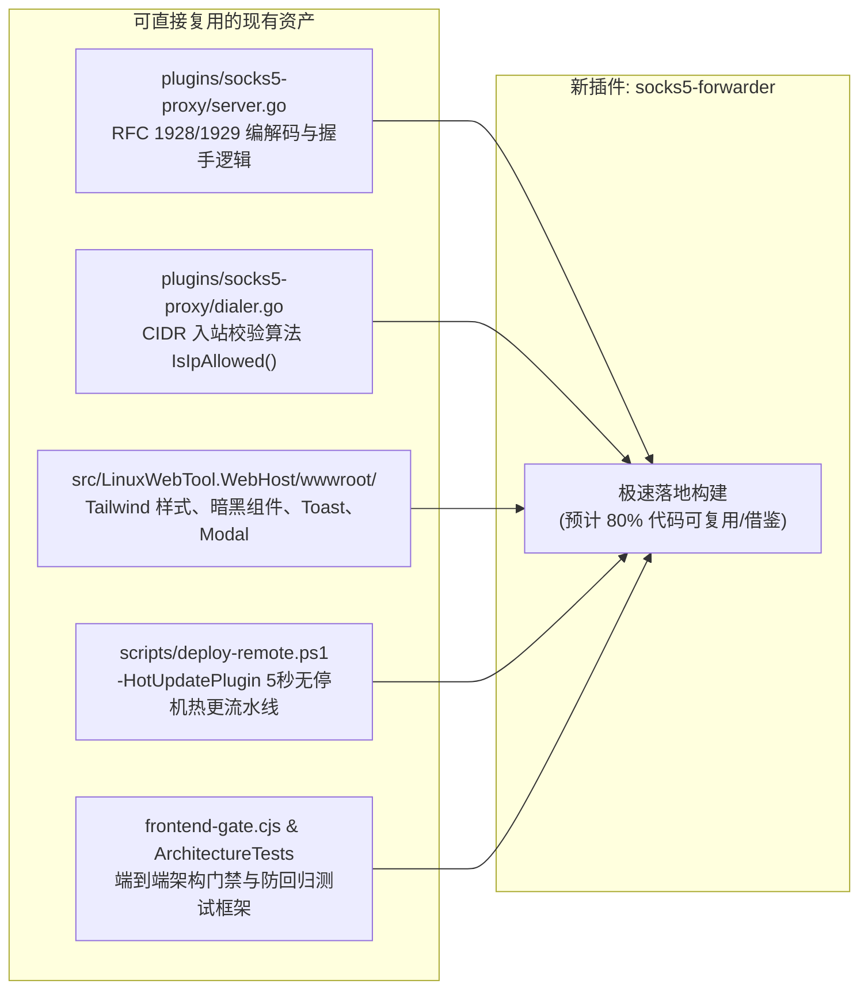

# SOCKS5 客户端中继转发器（SOCKS5 Forwarder）与多入站多节点边缘网关架构调研与深度设计

> **文档状态**：已就绪 / 架构研讨论证与设计方案规范  
> **核心命题**：  
> 1. 如何设计一款支持连接封装 SOCKS5 服务（SOCKS5 over WebSocket + TLS）的客户端转发插件？  
> 2. 能否在 Webview 视图中新增“服务端节点列表”，允许连接多个服务，并为每个服务独立配置“本地入站端口”和“入站客户端 IP 访问限制（CIDR）”？  
> 3. 架构决断：集成在现有 `socks5-proxy` 内，还是作为独立插件（如 `socks5-forwarder`）交付？  
> 4. 头脑风暴：可行性、并发性能、时延预算、设计模式（适配器模式、策略模式、有限状态机）优化、业界主流方案与开源库复用。

---

## 1. 核心架构决断与头脑风暴结论速览



### 1.1 关键问题回答与决策总结

#### 问题 1：支持连接封装 SOCKS5 服务的客户端转发插件应该怎么设计？
- **设计核心**：该插件是一个**本地多端口透明协议转换与隧道封装网关**。
- **数据流转**：
  1. 局域网设备连接本地暴露的普通 SOCKS5/HTTP 端口（如 `192.168.1.100:10801`）；
  2. 转发器截获连接并执行入站 CIDR 检查；
  3. 转发器作为 WebSocket 客户端向远端 LWT 宿主发起 WSS 握手（携带伪装 Path 如 `/telemetry/metrics` 与子协议 `Sec-WebSocket-Protocol: lwt-token.***`）；
  4. 握手完成后，将本地 TCP 字节流与远端 WSS 隧道进行双向无缝桥接（零拷贝 `io.Copy`）；
  5. 远端宿主 Ingress 解封并将流量注入其本地运行的 `socks5-proxy` 微服务，完成最终目标拨号出海。

#### 问题 2：能否在 Webview 视图中新增服务端列表，配置多端口与入站客户端 IP 限制？
- **完全可行，且具备极其巨大的实际生产价值**：
  - **局域网设备零负担接入（Zero Client Footprint）**：内网设备（电视盒子、打印机、iOS、老旧主机）完全无需安装任何翻墙或代理软件，只要在系统 Wi-Fi/网络设置中配一个本地 IP 和端口，即可直接拥有企业级抗封锁加密出海能力。
  - **多服务独立隔离**：不同部门、不同设备走不同入站端口，各自绑定不同的出口服务器（如端口 10801 绑定香港流媒体节点供电视看 Netflix，端口 10802 绑定美西大带宽节点供下载服务），互不影响。
  - **精细化 ACL 防火墙**：每个端口可独立配置 CIDR 白名单，彻底防止内网未授权设备蹭网。

#### 问题 3：架构决断——集成在现有 `socks5-proxy` 还是作为独立插件？
- **强烈推荐方案：作为独立插件交付（如 `socks5-forwarder`）**，理由如下：
  1. **单一职责原则 (SRP) 与对称拓扑模型**：
     - `socks5-proxy` 是 **出口节点（Exit Node / Server）**：运行在公网 VPS，职责是“接收入站 -> 解封 -> 访问互联网”。
     - `socks5-forwarder` 是 **入口节点（Entry Node / Client）**：运行在家庭软路由、内网 NAS 或本地开发机，职责是“接收局域网连接 -> 封装 -> 连向公网”。
     - 现实中，用户很少在同一台云服务器上既开服务端又当中继器；若强行做成 All-in-One，用户在 VPS 上会看到无用的“客户端配置”，在软路由上又会看到无用的“服务端配置”，徒增心智负担。
  2. **平台契约与端口模型适配**：
     - LWT 的 `plugin.json` 中的 `network.port` 通常声明的是该微服务自身的单一监听端口。服务端占用 18080，如果客户端又需要动态开辟 10801、10802、10803...，强塞进同一个 `plugin.json` 会导致宿主端口健康检查与 Ingress 路由严重歧义。
     - 独立插件 `socks5-forwarder` 可以将自身 Webview 设为 `mode: "path"`（如 `/plugins/socks5-forwarder/`），其管理的数据面端口由内部独立 Goroutine 池动态监听，完全不侵占宿主固定端口契约。
  3. **故障隔离与独立热更新**：
     - 客户端中继有频繁的重连、节点切换、延迟探测等操作，若发生偶发崩溃，绝不会拖垮出口端的稳定代理服务。
     - 依据《AGENTS.md》敏捷更新矩阵，开发人员可分别使用 `-HotUpdatePlugin socks5-proxy` 与 `-HotUpdatePlugin socks5-forwarder` 秒级独立迭代。
  4. **代码复用无障碍**：
     - 两者可在 Go 源码包级别共享相同的 SOCKS5 握手协议库与 CIDR 防火墙算法，既无冗余代码，又保持了架构上的物理隔离。

---

## 2. 可行性与潜在缺陷头脑风暴（Feasibility, Pitfalls & Optimization）

在高性能网络转发与中继场景下，如果不进行严谨的架构设计，系统极易遭遇资源枯竭与性能悬崖。以下是核心痛点与攻防解决方案：



### 2.1 缺陷剖析与攻防治理矩阵

| 潜在缺陷与风险 | 触发场景 | 潜在危害 | 架构优化治理策略 |
| :--- | :--- | :--- | :--- |
| **Goroutine 膨胀与 GC 停顿** | 浏览器并发加载大量小资源、爬虫高并发并发探测 | 每个连接 2 个 Goroutine + 32KB buffer，内存瞬间飙升数百 MB，触发频繁 GC STW | 1. 引入全局 `sync.Pool` 缓冲池，内存复用率 99% 以上；<br/>2. 针对每个 Profile 设置最大并发连接数熔断阈值（`maxConnections: 1024`）。 |
| **半开与僵尸连接挂死 (Zombie Sockets)** | 移动端设备休眠、内网 Wi-Fi 切换、公网链路静默丢包 | TCP 套接字与文件描述符（FD）耗尽，无法再接受新连接 | 1. 开启入站 TCP KeepAlive（30 秒探测周期）；<br/>2. 出站 WSS 链路设置 60 秒空闲无数据自动超时；<br/>3. 客户端转发器与服务端之间定期发送底层 WS Ping/Pong 探针。 |
| **WSS 握手高时延风暴** | 单次 HTTP 请求建立连接时，重复经历 TCP 握手 + TLS 1.3 协商 + WebSocket 101 升级（时延增加 100~300ms） | 浏览多图网页时首屏加载缓慢，时延累加明显 | 1. 预留 **Yamux 多路复用（Multiplexing）** 模式：单条 WSS 物理长连接内复用数百条逻辑虚拟流（Stream），实现后续连接零握手时延；<br/>2. 第一阶段提供高性能长连接复用（Keep-Alive 快速复用）。 |
| **端口已被占用导致服务 Panic** | 用户在 Webview 中配置了一个已被占用的端口（如 80、22 或已运行服务） | 微服务在 `net.Listen` 阶段直接抛异常崩溃退出 | 引入**独立监听实例状态机（Listener FSM）**：单端口绑定失败仅将该 Profile 标记为 `ERROR` 并在前端展示错误提示，绝不影响其他正常运行的端口。 |

---

## 3. 设计模式全景优化建模 (Design Patterns in Action)

为了使客户端转发器具备极高的扩展性（未来支持更多协议如 Trojan、VLESS、QUIC）、清晰的生命周期与高可测试性，系统深度应用 4 种经典设计模式：

```mermaid
classDiagram
    direction TB

    class InboundAdapter {
        <<interface>>
        +Start(port int, acl []string) error
        +Close() error
        +GetStats() InboundStats
    }

    class Socks5InboundAdapter {
        -listener net.Listener
        +HandleConn(conn net.Conn)
    }

    class HttpConnectInboundAdapter {
        -listener net.Listener
        +HandleConn(conn net.Conn)
    }

    class MixedInboundAdapter {
        -listener net.Listener
        +SniffProtocol(firstByte byte)
    }

    class OutboundAdapter {
        <<interface>>
        +Dial(ctx Context, targetAddr string) (net.Conn, error)
        +HealthCheck() (time.Duration, error)
    }

    class WssEncapsulationAdapter {
        -wsUrl string
        -token string
        -tlsConfig *tls.Config
        +Dial(ctx Context, targetAddr string)
    }

    class DirectSocks5Adapter {
        -serverAddr string
        +Dial(ctx Context, targetAddr string)
    }

    class RoutingStrategy {
        <<interface>>
        +SelectNode(nodes []UpstreamNode) *UpstreamNode
    }

    class FailoverStrategy {
        -activeNode *UpstreamNode
        +SelectNode(nodes []UpstreamNode)
    }

    class BestLatencyStrategy {
        -latencyCache map[string]Duration
        +SelectNode(nodes []UpstreamNode)
    }

    class RoundRobinStrategy {
        -counter uint64
        +SelectNode(nodes []UpstreamNode)
    }

    InboundAdapter <|.. Socks5InboundAdapter
    InboundAdapter <|.. HttpConnectInboundAdapter
    InboundAdapter <|.. MixedInboundAdapter

    OutboundAdapter <|.. WssEncapsulationAdapter
    OutboundAdapter <|.. DirectSocks5Adapter

    RoutingStrategy <|.. FailoverStrategy
    RoutingStrategy <|.. BestLatencyStrategy
    RoutingStrategy <|.. RoundRobinStrategy
```



### 3.1 适配器模式（Adapter Pattern）
- **入站适配器 (`InboundAdapter`)**：
  - `Socks5InboundAdapter`：标准 RFC 1928 / 1929 握手解析。
  - `HttpConnectInboundAdapter`：标准 RFC 9110 HTTP CONNECT 隧道代理解析。
  - `MixedInboundAdapter`（推荐默认）：**首字节自适应嗅探器**。根据客户端建立连接发送的第一个字节判断：
    - 若首字节为 `0x05`，转交 SOCKS5 引擎处理；
    - 若首字节为 `C` (`CONNECT`)、`G` (`GET`)、`P` (`POST`)，转交 HTTP 代理引擎处理；
    - **效果**：同一端口（如 10801）既能完美响应 `curl -x socks5://...`，又能响应 `curl -x http://...` 和浏览器直接配置！
- **出站适配器 (`OutboundAdapter`)**：
  - `WssEncapsulationAdapter`：负责 WebSocket 客户端拨号、注入 `Sec-WebSocket-Protocol: lwt-token.***` 与 TLS 伪装。
  - `DirectSocks5Adapter`：原生 TCP 直连传统 SOCKS5。

### 3.2 策略模式（Strategy Pattern）
当用户为一个入站端口配置了多个上游候选服务器（Node Pool）时，通过策略接口动态路由：
1. **主备故障自动转移策略 (`FailoverStrategy`)**：默认使用首选主节点；若心跳探测发现主节点失联，毫秒级无感漂移至备用节点；主节点恢复后平滑回切。
2. **最优延迟策略 (`BestLatencyStrategy`)**：后台定时任务（如每 60 秒）对候选节点进行 TCP Ping 或 HTTP Head 探测，动态将新连接调度至 RTT 最小的节点。
3. **轮询负载均衡策略 (`RoundRobinStrategy`)**：在多台节点间原子递增轮询分配出站连接，摊平各节点的出网带宽与算力压力。

### 3.3 有限状态机（Finite State Machine - FSM）

#### 监听端口实例状态机 (Listener Instance FSM)


#### 上游节点健康监测状态机 (Upstream Health FSM)


---

## 4. 业界主流方案与开源库深度调研

在自研开发前，全面盘点业界在“出站封装转发”、“多入站监听”与“反探测穿透”领域的成熟产品与开源资产：

### 4.1 业界主流产品对比矩阵

| 产品名称 | 主要定位与架构 | 多入站多端口支持 | WSS 伪装与子协议 | 局域网免客户端能力 | 优缺点对比 |
| :--- | :--- | :--- | :--- | :--- | :--- |
| **Xray-core** | 综合性代理框架 (Go) | ⭐⭐⭐⭐⭐ 支持无数 inbounds 独立绑定端口与 ACL | ⭐⭐⭐⭐⭐ 支持 WS/gRPC/H2/VLESS/Trojan | ⭐⭐⭐⭐ 强大但配置极其繁琐（复杂 JSON） | **优点**：生态极其成熟；**缺点**：体系过于庞大沉重，与 LWT 轻量底座不匹配。 |
| **sing-box** | 新一代轻量通用代理核心 (Go) | ⭐⭐⭐⭐⭐ 支持多 inbound 与路由分流 | ⭐⭐⭐⭐⭐ 支持标准 WS + TLS，内存极低 | ⭐⭐⭐⭐ 强，但学习成本高 | **优点**：性能与架构顶级；**缺点**：配置语法门槛高，不易直接嵌入定制 Webview。 |
| **Gost (GO Simple Tunnel)** | 链式隧道转发神器 (Go) | ⭐⭐⭐⭐ 支持多 `-L` 与多 `-F` 级联 | ⭐⭐⭐⭐ 原生支持 `wss://` 穿透转发 | ⭐⭐⭐⭐⭐ 命令行直拉极佳 | **优点**：核心设计与 LWT 需求最契合；**缺点**：v3 架构重构后配置模式复杂，无原生现代 UI。 |
| **wstunnel (Rust)** | 专精 WebSocket 穿透隧道 | ⭐⭐⭐ 仅支持单实例单转发 | ⭐⭐⭐⭐⭐ 专精 WS，支持自定义 Header 与子协议 | ⭐⭐⭐⭐ 简单但需启多个进程 | **优点**：时延低、单文件；**缺点**：多端口需拉起多个系统进程，难以统一状态监控。 |
| **LWT socks5-forwarder (拟自研)** | **LWT 平台原生嵌入式多节点中继网关** | ⭐⭐⭐⭐⭐ **Webview 视窗直观增删查改多 Profile** | ⭐⭐⭐⭐⭐ **100% 对齐 LWT 平台 Ingress 契约** | ⭐⭐⭐⭐⭐ **内网设备无感接入，单端口自适应 SOCKS5/HTTP** | **最优解**：与 LWT 平台深度融合，统一状态机、暗黑主题、一键诊断与热更。 |

### 4.2 核心开源 Go 依赖库选型

为确保插件“高性能、低内存、零冗余构建”，推荐依赖库矩阵如下：

1. **WebSocket 客户端库**：
   - 选型：`github.com/gorilla/websocket` (v1.5.3)
   - 理由：业界最稳健的标准库。具备成熟的 `websocket.Dialer`，原生支持自定义 `Proxy`、`TLSClientConfig`、`ReadBufferSize`、`WriteBufferSize`，以及完全自由控制的 `http.Header`（可直接注入 `Sec-WebSocket-Protocol: lwt-token.***`）。
2. **多路复用流协议库（预留扩展）**：
   - 选型：`github.com/hashicorp/yamux`
   - 理由：HashiCorp 官方开源，经受了 Consul 与 Nomad 海量生产验证。在单条 WSS 物理连接上复用轻量虚拟 Stream，完全不需要依赖外部服务。
3. **入站 CIDR IP 匹配与网络库**：
   - 选型：直接采用 **Go 官方标准库 `net` 与 `net/netip`**。
   - 理由：标准库的 `net.ParseCIDR` 与 `net.IPNet.Contains` 性能极高（纳秒级），无任何第三方依赖风险。

---

## 5. 当前系统可复用资产全景 (Existing Assets)

开发 `socks5-forwarder` 绝非从零起步，当前工程中已沉淀大量高价值资产可直接复用：



1. **协议层复用**：`plugins/socks5-proxy` 中的 SOCKS5 握手状态机、密码认证解析与错误码定义可直接迁移。
2. **安全层复用**：已在 `socks5-proxy` 验证通过的 CIDR IP 白名单逻辑（支持私网自动预设、单 IP、网段）可直接复用至各 Profile 的入站控制中。
3. **前端样式复用**：`plugins/socks5-proxy/ui/index.html` 中的深色卡片布局、Tab 切换器、CIDR 快捷标签和配置表单风格可直接复用，保持一致的极致 UI 体验。
4. **运维管线复用**：直接使用 `powershell scripts/deploy-remote.ps1 -HotUpdatePlugin socks5-forwarder` 享受 5~8 秒无停机热更。

---

## 6. `socks5-forwarder` 落地详细设计方案

### 6.1 插件物理目录结构规划

```text
plugins/socks5-forwarder/
├── plugin.json                 # 插件元数据清单
├── main.go                     # 主服务入口，加载配置并调度 ProfileManager
├── go.mod                      # 依赖管理 (gorilla/websocket)
├── internal/
│   ├── core/
│   │   ├── manager.go          # Profile 实例生命周期与并发控制管理器
│   │   ├── listener.go         # 单端口入站监听器 (支持 SOCKS5 / HTTP 嗅探)
│   │   ├── bridge.go           # 本地连接与远端 WSS 全双工桥接引擎 (sync.Pool)
│   │   └── acl.go              # CIDR 访问控制策略
│   ├── outbound/
│   │   ├── wss_dialer.go       # WSS 封装拨号器 (携带伪装与 Token)
│   │   ├── health.go           # 上游节点健康监测探针 (RTT & 丢包率)
│   │   └── balancer.go         # 路由策略 (Failover / BestLatency / RoundRobin)
│   └── store/
│       └── config.go           # 持久化存储 (读取/保存 profiles.json)
└── ui/
    ├── index.html              # 纯原生 ESM 控制台单页
    └── app.js                  # 节点列表管理、Profile 启停、实时监控
```

### 6.2 `plugin.json` 契约定义

```json
{
  "$schema": "https://raw.githubusercontent.com/csvkse/lwt/main/schemas/plugin.schema.json",
  "id": "socks5-forwarder",
  "name": "SOCKS5 客户端边缘中继网关",
  "version": "1.0.0",
  "author": "LWT Team",
  "description": "多端口、多节点 SOCKS5 over WSS 伪装中继网关，为局域网设备提供免客户端加密出海与访问控制",
  "type": "resident",
  "category": "Network",
  "icon": "🌐",
  "entry": "./socks5-forwarder",
  "args": ["-config", "/app/data/plugins/socks5-forwarder/config.json"],
  "autoStart": true,
  "restartPolicy": "on-failure",
  "network": {
    "mode": "path",
    "path": "/plugins/socks5-forwarder/",
    "scope": "standard",
    "supportHttp": true
  },
  "ui": {
    "hasWebview": true,
    "entry": "ui/index.html"
  }
}
```

### 6.3 持久化配置数据结构 (`profiles.json`)

配置文件保存在持久化隔离卷 `/app/data/plugins/socks5-forwarder/config.json`：

```json
{
  "upstreams": [
    {
      "id": "node-tokyo",
      "name": "东京优化节点 (VPS-1)",
      "url": "wss://jp.example.com:5271/telemetry/metrics",
      "token": "lwt_live_test_token_abcdef123456",
      "skipTlsVerify": false,
      "sni": "jp.example.com",
      "status": "healthy",
      "latencyMs": 48
    },
    {
      "id": "node-us",
      "name": "美西大带宽节点 (VPS-2)",
      "url": "wss://us.example.com:5271/telemetry/metrics",
      "token": "lwt_live_test_token_abcdef123456",
      "skipTlsVerify": false,
      "sni": "us.example.com",
      "status": "healthy",
      "latencyMs": 142
    }
  ],
  "inbounds": [
    {
      "id": "inbound-office-pc",
      "name": "办公电脑专用",
      "enabled": true,
      "listenPort": 10801,
      "protocol": "mixed",
      "allowedCidr": ["192.168.1.0/24", "127.0.0.1/32"],
      "upstreamStrategy": "best_latency",
      "upstreamNodes": ["node-tokyo", "node-us"],
      "activeConns": 4,
      "totalBytesTx": 1048576,
      "totalBytesRx": 8388608
    },
    {
      "id": "inbound-smart-tv",
      "name": "客厅智能电视",
      "enabled": true,
      "listenPort": 10802,
      "protocol": "socks5",
      "allowedCidr": ["192.168.1.50/32"],
      "upstreamStrategy": "single",
      "upstreamNodes": ["node-tokyo"],
      "activeConns": 1,
      "totalBytesTx": 524288,
      "totalBytesRx": 125829120
    }
  ]
}
```

### 6.4 Webview 视图控制台界面原型布局设计

Webview 采用双栏或卡片流式布局，提供极致直观的运维体验：

```text
+---------------------------------------------------------------------------------------+
| 🌐 SOCKS5 客户端边缘中继网关                        [+ 新建入站中继]  [+ 添加上游服务节点] |
+---------------------------------------------------------------------------------------+
| 【已连接上游服务器 (Upstream Nodes)】                                                   |
|  * 东京优化节点 (VPS-1)   | wss://jp.example.com:5271/telemetry/metrics | 🟢 48ms  | [编辑] |
|  * 美西大带宽 (VPS-2)     | wss://us.example.com:5271/telemetry/metrics | 🟢 142ms | [编辑] |
+---------------------------------------------------------------------------------------+
| 【本地入站中继服务列表 (Inbound Profiles)】                                             |
|                                                                                       |
|  [卡片 1] 办公电脑专用                                         状态: 🟢 运行中          |
|  -----------------------------------------------------------------------------------  |
|  * 本地监听端口: :10801 (SOCKS5 / HTTP 智能双模)                                       |
|  * 目标绑定节点: [东京优化节点] (策略: 最低延迟优先)                                     |
|  * 入站客户端白名单 (CIDR): 192.168.1.0/24, 127.0.0.1/32                                |
|  * 实时状态: 4 活跃连接 | 累计流量: ↑ 1.0MB / ↓ 8.0MB                                  |
|  * 连接指引: 在办公电脑网络代理设置中直接填: 192.168.1.100:10801                       |
|  [ ⏹ 停止 ]  [ ⚙ 编辑规则 ]  [ 🗑 删除 ]                                               |
|                                                                                       |
|  [卡片 2] 客厅智能电视                                         状态: 🟢 运行中          |
|  -----------------------------------------------------------------------------------  |
|  * 本地监听端口: :10802 (SOCKS5 代理)                                                  |
|  * 目标绑定节点: [东京优化节点] (策略: 固定单节点)                                       |
|  * 入站客户端白名单 (CIDR): 192.168.1.50/32 (仅允许电视机 IP)                           |
|  * 实时状态: 1 活跃连接 (正在串流) | 累计流量: ↑ 512KB / ↓ 120MB                         |
|  * 连接指引: 电视盒配置网络代理: 192.168.1.100:10802                                    |
|  [ ⏹ 停止 ]  [ ⚙ 编辑规则 ]  [ 🗑 删除 ]                                               |
+---------------------------------------------------------------------------------------+
```

---

## 7. 实施路线图与落地阶段规划 (Implementation Roadmap)

| 阶段 | 周期/耗时 | 核心交付物 | 质量门禁与验收指标 |
| :--- | :--- | :--- | :--- |
| **阶段一：核心转发引擎与 WSS 拨号器** | 1~2 天 | 1. 搭建 `plugins/socks5-forwarder/` 基础脚手架；<br/>2. 实现 `WssEncapsulationAdapter`（带子协议与伪装）；<br/>3. 实现本地单个端口转发与全双工数据桥接。 | 本地命令行通过 `curl -x socks5://127.0.0.1:10801` 成功走 WSS 穿透远端 `socks5-proxy` 并访问外网。 |
| **阶段二：多端口实例调度与 CIDR 防火墙** | 1 天 | 1. 落地 `ProfileManager` 与监听实例状态机；<br/>2. 针对每个端口落地 CIDR 白名单拦截（非授权 IP 立即掐断）；<br/>3. 实现 SOCKS5/HTTP 混合模式首字节自适应嗅探。 | 单元测试覆盖多端口并发、端口冲突自愈及非法 IP 拦截测试。 |
| **阶段三：Webview 控制台与 REST 控制面** | 1 天 | 1. 编写原生 ESM 控制台，实现上游节点与入站 Profile 的增删查改；<br/>2. 实时呈现各端口的活跃连接数与吞吐量；<br/>3. 一键生成内网局域网连接指令。 | Chrome DevTools MCP 验证控制台 0 报错，卡片交互流畅。 |
| **阶段四：故障自动转移与策略模式扩展** | 1~2 天 | 1. 落地 `FailoverStrategy` 与 `BestLatencyStrategy`；<br/>2. 后台健康探针定期上报延迟与可用状态；<br/>3. 节点失联自动切换出站。 | 模拟主节点断开，测试客户端连接在 500ms 内平滑漂移至备用节点。 |
