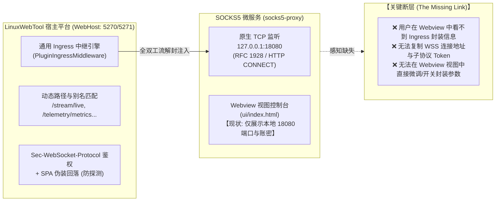
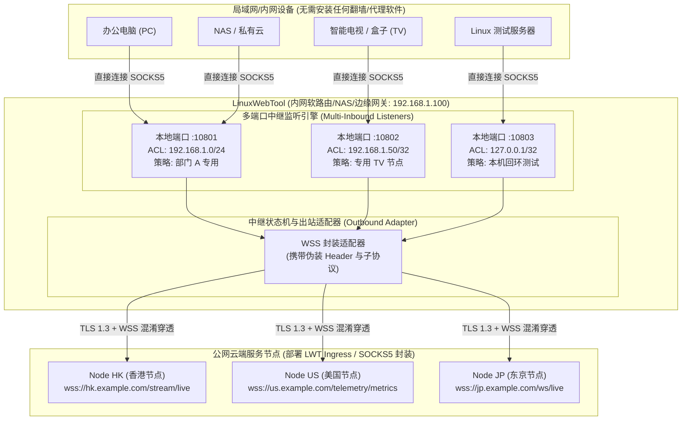
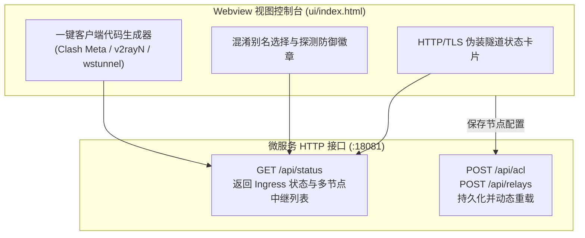
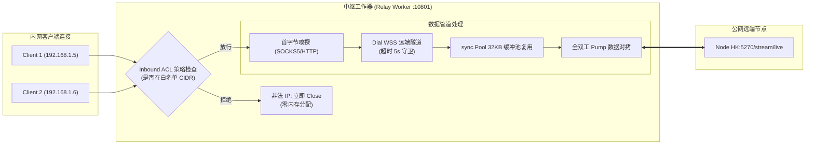
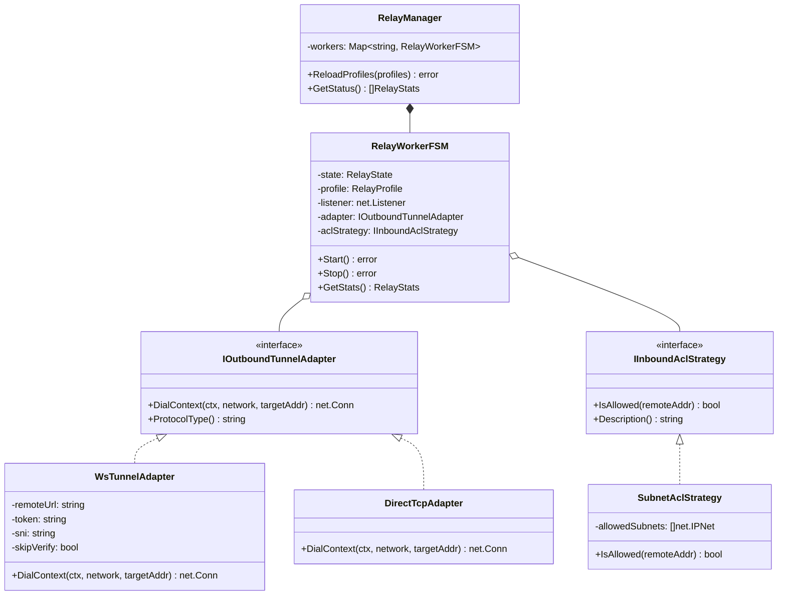
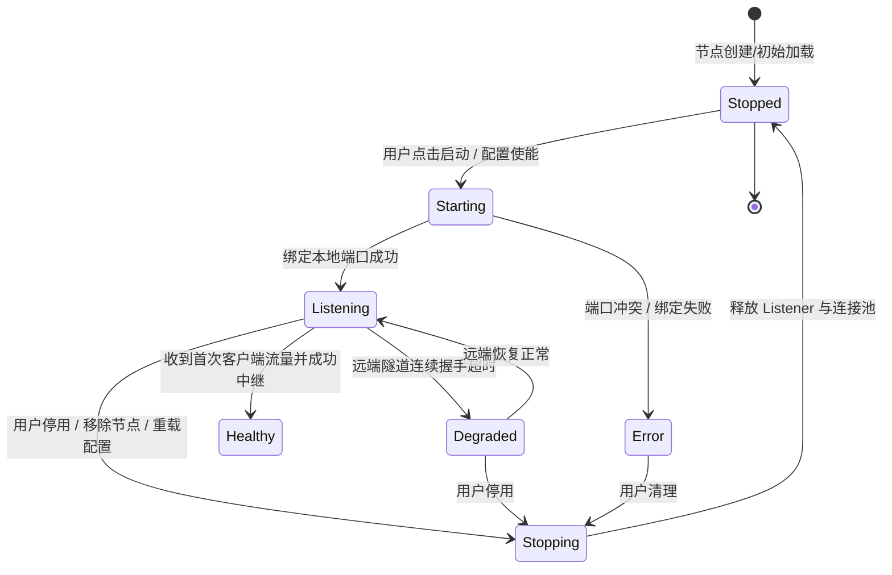
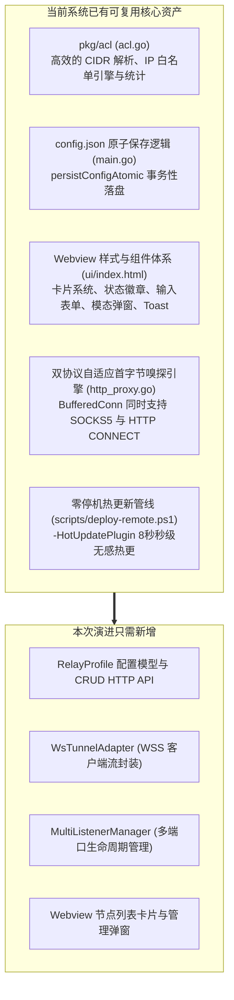
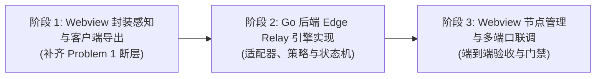

# SOCKS5 伪装封装客户端生态权威盘点与多节点边缘中继网关（Edge Relay Gateway）架构深度调研

> **文档状态**：已就绪 / 架构调研与前沿演化方案规范  
> **核心命题**：  
> 1. **微服务封装服务现状与 Webview 视图暴露**：梳理平台 Ingress 全双工伪装流封装现状，论证在 `socks5-proxy` Webview 控制台中提供封装隧道信息（主路径、动态别名、Token 子协议）与一键客户端配置导出的闭环方案；  
> 2. **封装 SOCKS5 服务连接生态盘点**：深入剖析 SOCKS5 over WebSocket + TLS 的主流客户端生态（Clash Meta / Mihomo、Xray-core / v2rayN、wstunnel、Surge / Shadowrocket、以及无头自研中继器）；  
> 3. **多节点边缘中继网关（Edge Relay Gateway）头脑风暴与深度架构设计**：针对在 Webview 视图中新增“服务端节点列表（Multi-Inbound Profile List）”，允许连接多个远端服务并为每个服务独立绑定“本地入站端口”与“入站客户端 IP 限制（CIDR）”的需求，从可行性、并发性能、时延预算与软件设计模式（适配器模式、策略模式、有限状态机）进行全方位建模与系统复用设计。

---

## 1. 核心需求剖析与现状诊断

### 1.1 现状诊断：微服务是否已提供封装服务？Webview 视图能否配置？



#### 现状结论：
1. **底层能力已完全就绪**：
   - 宿主平台已提供生产级全双工流 Ingress 引擎。微服务的 `plugin.json` 声明了 `"mode": "websocket_stream"`, `"upstreamPort": 18080`, 主路径 `/stream/live` 及动态别名（`/telemetry/metrics`、`/ws/live`、`/api/v2/stream`），并开启了 `token-` 子协议鉴权与 SPA 防探测伪装回落。
   - 外部客户端已经能够通过标准 WSS 协议连接宿主端口（5270/5271），无缝穿越 NAT/防火墙并直达微服务 SOCKS5 引擎。
2. **Webview 视图层存在感知断层（UI Gap）**：
   - 目前 `plugins/socks5-proxy/ui/index.html` 仅包含原生的 SOCKS5/HTTP 端口（`:18080`）账密设置、入站客户端白名单、出站访问控制与 cURL/Git 连接命令。
   - **用户在 Webview 页面中完全无法感知 Ingress 封装隧道的存在**，无法一键复制 WSS URL、Token 或主流客户端配置块。

---

### 1.2 拓扑演化：从“单机服务端”到“多节点边缘中继中枢（Edge Relay Gateway）”

用户进一步提出：
> “封装的 SOCKS5 服务使用什么客户端连接了？能否在 webview 视图中新增服务端列表，允许链接多个服务，并配置入站端口和入站客户端 IP 访问限制？”

这一需求将整个代理微服务的定位从单纯的 **“被动服务端（Inbound Server）”** 升华为了 **“边缘多节点中继网关（Multi-Inbound Edge Relay Hub）”**：



#### 巨大业务价值：
1. **终端设备零负担（Zero Client Deployment）**：
   内网中大量设备（老旧电视盒子、非越狱 iOS、闭源嵌入式系统、Docker 容器）无法或极难安装 Xray、Clash 或导入根证书。通过 LWT 作为边缘中继，这些设备**只需在系统网络设置中填写简单的本地 IP 和端口（如 `192.168.1.100:10801`）**，即可无感走抗封锁加密隧道出海！
2. **多节点隔离与精确权限控制**：
   为不同出口节点划分不同的本地端口，并为每个端口设置独立的客户端 IP 白名单（CIDR）。例如电视机只能访问香港流媒体节点，下载服务器只能走美国大带宽节点，互不干扰且权限隔离。
3. **集中化安全与凭据管理**：
   公网 VPS 的 Token、真实域名、混淆别名与 SNI 证书全部集中保存在 LWT 边缘网关中，内网终端完全接触不到外层凭据，杜绝凭据泄露。

---

## 2. 封装 SOCKS5 服务（SOCKS5 over WebSocket + TLS）客户端生态权威盘点

当 SOCKS5 流量被封装在 WebSocket + TLS（即标准 WSS）协议内时，外部可以使用以下五类客户端进行连接：

### 2.1 主流客户端对比矩阵

| 客户端生态 | 协议支持度 | 传输层混淆能力 | 自定义 Header / 子协议 | 跨平台覆盖 | 典型配置复杂度 | 推荐适用场景 |
| :--- | :--- | :--- | :--- | :--- | :--- | :--- |
| **Clash Meta (Mihomo)** | ⭐⭐⭐⭐⭐ 原生完整 | 完美支持 WS Path、EarlyData | 完整支持自定义 Header（支持 `Sec-WebSocket-Protocol`） | 全平台（Win/Mac/Linux/Android） | 简单（YAML 几行声明） | **首选主力 GUI 客户端**，支持规则分流与测速 |
| **Xray-core / v2rayN** | ⭐⭐⭐⭐⭐ 原生完整 | 完美支持 WS + TLS/Reality | 完整支持自定义 Header 与 Path | 全平台（Win/Mac/Linux/Android/iOS） | 中等（JSON 格式） | 传统科学上网与节点订阅管理 |
| **sing-box** | ⭐⭐⭐⭐⭐ 原生完整 | 内存占用低，支持 WS + TLS | 支持自定义 Header 与子协议 | 全平台（核心纯 Go，全平台客户端） | 中等（新型 JSON 配置） | 路由器固件、极客与嵌入式系统 |
| **wstunnel (Rust)** | ⭐⭐⭐⭐⭐ 专精隧道 | 极强，支持多种伪装前缀 | 原生支持 `--header "Sec-WebSocket-Protocol: ..."` | 纯 CLI 单二进制（各平台均有） | 极简（一条命令即可拉起） | 运维跳板机、脚本自动化、CI/CD 穿透 |
| **Surge / Shadowrocket** | ⭐⭐⭐⭐ 良好 | 支持 SOCKS5 over TLS/WS | 支持自定义 Path 与 Header | iOS / macOS 专属生态 | 极简（GUI 点击或 URL 导入） | 苹果生态设备直接单机翻墙 |
| **自研轻量嵌入式桥接器 (Go)** | ⭐⭐⭐⭐⭐ 深度定制 | 零依赖，与 LWT 契约 100% 对齐 | 原生针对 `token-` 子协议握手与自动重连 | 编译为单个静态 ELF / PE | **零配置（LWT 内部原生集成）** | **LWT 边缘网关多节点中继核心** |

---

### 2.2 各客户端详细配置范例（RFC 5737 脱敏规范）

#### 1. Clash Meta (Mihomo) 配置示例
Clash Meta 原生支持 SOCKS5 节点的 WebSocket 传输层封装：
```yaml
proxies:
  - name: "LWT-Camouflage-HK"
    type: socks5
    server: example.com
    port: 5270
    tls: true
    skip-cert-verify: false
    network: ws
    ws-opts:
      path: "/stream/live"
      headers:
        Host: example.com
        Sec-WebSocket-Protocol: "token-0123456789abcdef0123456789abcdef"
    # 若微服务开启了 RFC 1929 账密认证，在此处配置：
    username: "proxyuser"
    password: "your_secure_password"
```

#### 2. Xray-core / v2rayN 配置片段
Xray 的 Outbound 支持将标准 SOCKS 协议叠加到 WebSocket 传输层：
```json
{
  "outbounds": [
    {
      "tag": "lwt-ws-out",
      "protocol": "socks",
      "settings": {
        "servers": [
          {
            "address": "example.com",
            "port": 5270,
            "users": [
              {
                "user": "proxyuser",
                "pass": "your_secure_password"
              }
            ]
          }
        ]
      },
      "streamSettings": {
        "network": "ws",
        "security": "tls",
        "tlsSettings": {
          "serverName": "example.com",
          "allowInsecure": false
        },
        "wsSettings": {
          "path": "/telemetry/metrics",
          "headers": {
            "Host": "example.com",
            "Sec-WebSocket-Protocol": "token-0123456789abcdef0123456789abcdef"
          }
        }
      }
    }
  ]
}
```

#### 3. wstunnel 命令行一键桥接
wstunnel 能够将远程 WebSocket 隧道反向解封为本地的标准 SOCKS5 端口：
```bash
wstunnel client \
  -L socks5://127.0.0.1:1080 \
  --header "Sec-WebSocket-Protocol: token-0123456789abcdef0123456789abcdef" \
  wss://example.com:5270/stream/live
```
执行后，本地任何应用访问 `127.0.0.1:1080` 即自动通过 WSS 穿透至远程 SOCKS5 微服务。

---

## 3. Webview 视图封装配置与客户端导出设计

针对“微服务是否提供封装服务，能否在 Webview 视图中配置”的问题，应在 `plugins/socks5-proxy/ui/index.html` 中新增 **「HTTP/TLS 伪装隧道与跨网穿透」** 面板。

### 3.1 Webview 呈现内容设计

1. **隧道运行状态卡片**：
   - **连接模式**：`WebSocket Ingress (WSS)`
   - **对外主路径**：`/stream/live`（支持点击复制）
   - **动态伪装别名**：`/telemetry/metrics`、`/ws/live`、`/api/v2/stream`（提供防 DPI 探测别名选择器）
   - **鉴权子协议**：`Sec-WebSocket-Protocol: token-<hash>`（提供一键复制）
   - **防探测回落状态**：`已激活 (SPA 登录页伪装 200 OK)`
2. **多客户端一键导出与切换**：
   - 切换选项卡：`Clash Meta` | `v2rayN / Xray` | `wstunnel` | `Surge / Shadowrocket`
   - 动态根据当前页面的 Host、分配端口、选择的混淆别名与 Token 自动生成即插即用的配置文本，并支持“一键复制”。



---

## 4. 多节点边缘中继网关（Edge Relay Gateway）头脑风暴与深度架构设计

### 4.1 可行性、逻辑闭环与边界研判

| 维度 | 评估要点 | 结论与保障措施 |
| :--- | :--- | :--- |
| **Go 语言并发与端口监听** | 同时监听 5~20 个独立本地端口 | **极佳**。Go 的 `net.Listen("tcp", addr)` 在 Linux 底层对应极轻量的 epoll 注册。空闲监听器仅占用微量文件句柄与内核数据结构，内存增量 < 50KB。 |
| **独立入站 IP 访问限制 (CIDR)** | 每个本地端口具备独立的白名单 | **完全闭环**。`conn, err := listener.Accept()` 后，直接提取 `conn.RemoteAddr()`。利用微服务现有的 `acl.go` 引擎进行匹配，未命中毫秒级 `conn.Close()`，彻底阻断非法内网 IP。 |
| **协议握手支持度** | 本地端口支持 SOCKS5 还是 HTTP？ | **双协议自适应**。沿用微服务现存的 Peek 首字节嗅探架构（`0x05` 识别为 SOCKS5，`CONNECT` / `GET` 识别为 HTTP 代理），内网终端随意设置均可兼容。 |
| **出站 WSS 握手与保活** | 建立到远端 VPS 的 WSS 隧道 | 支持 TLS 1.3 协商、SNI 伪装设置、跳过自签名证书（`InsecureSkipVerify`）选项、以及携带标准 `Sec-WebSocket-Protocol` 子协议。 |
| **端口冲突防护** | 用户在 UI 配置了已被占用的端口 | **动态预检机制**。保存前先进行 `net.Listen` 试探性绑定，若报错 `bind: address already in use` 则在 UI 明确拦截提示，禁止破坏全局运行状态。 |

---

### 4.2 性能开销与瓶颈防御策略

在边缘中继场景下，如果内网有多台设备产生高频并发连接，需重点防御以下瓶颈：



1. **内存暴涨防护（Memory Exhaustion Defense）**：
   - 严禁为每个连接 `make([]byte, 64*1024)`。
   - 统一走全局 `sync.Pool` 借还缓冲片（`bufPool`，大小 32KB）。连接关闭后 `bufPool.Put()`，杜绝 GC 压力与碎片。
2. **空闲僵尸连接排空（Zombie Connection Drain）**：
   - 为每个内网连接设置 `IdleTimeout`（默认 5 分钟无读写自动回收）。
   - 一侧连接遭遇 EOF 或网络断开时，通过 `SetDeadline(time.Now().Add(5 * time.Second))` 限制另一侧的半关闭排空时长，防止由于对端假死导致 Goroutine 与 Socket FD 永久泄露。
3. **远端断网自愈与防惊群（Anti-Thundering Herd）**：
   - 当远端 VPS 关机或线路抖动时，内网发起的连接会 Dial 失败。
   - Dialer 必须配置严格的上下文超时（`context.WithTimeout(ctx, 5*time.Second)`），并在失败时向本地客户端返回 RFC 1928 `0x04`（Host unreachable）或 HTTP `504 Gateway Timeout`，严禁挂起阻塞。

---

### 4.3 软件设计模式重构与架构抽象

为确保系统具备极高扩展性，避免后续每次新增协议或功能都修改核心代码，采用四大设计模式进行全面解耦：



#### 1. 适配器模式（Adapter Pattern）—— 出站协议隔离
- **问题**：目前系统主要对接 WebSocket Ingress，但未来可能需要对接标准 Direct SOCKS5、HTTP CONNECT 隧道、甚至是 TLS Reality。
- **抽象**：定义统一契约接口 `IOutboundTunnelAdapter`。
  ```go
  type IOutboundTunnelAdapter interface {
      DialContext(ctx context.Context, targetAddr string) (net.Conn, error)
      Close() error
  }
  ```
- **实现**：
  - `WsTunnelAdapter`：基于 `gorilla/websocket` 或 `nhooyr.io/websocket`，封装 WSS 握手、子协议注入、自定义 Header，并将 WebSocket 帧包装为标准的 `net.Conn`（实现 Read/Write 流式接口）。
  - `DirectSocks5Adapter`：传统的标准 TCP 直连 SOCKS5。
  - 通过适配器模式，核心转发引擎（Pump Engine）无需知道底层究竟走的是原生 TCP 还是 WSS 隧道，完全实现面向接口编程。

#### 2. 策略模式（Strategy Pattern）—— 入站安全与限流解耦
- **问题**：每个 Profile 具有独立的入站客户端 IP 限制，未来还可能扩充每秒连接速率限制（RateLimiting）、时间段生效策略（TimeWindowPolicy）。
- **抽象**：定义 `IInboundAclStrategy`。
  ```go
  type IInboundAclStrategy interface {
      AllowClient(remoteAddr net.Addr) bool
  }
  ```
- **实现**：
  - `SubnetAclStrategy`：封装针对单个中继节点的 CIDR 列表解析与高效匹配。
  - 核心监听器在 `Accept()` 后直接调用策略，不与配置解析逻辑耦合。

#### 3. 有限状态机模式（FSM Pattern）—— 中继节点生命周期管理
每个中继实例（Relay Worker）拥有受控的状态流转，杜绝并发竞争与僵尸监听：



- **状态事件驱动**：当状态由 `Listening` 变为 `Error` 时，Webview 实时捕获并展示红色告警（如“端口 10801 已被系统其他进程占用”）；
- **优雅关闭（Graceful Shutdown）**：状态变更为 `Stopping` 时，首先关闭 `net.Listener` 阻止新连接流入，随后为存量连接设置 5 秒超时排空，确保无死锁释放。

#### 4. 观察者与遥测模式（Telemetry Observer）—— 节点级指标监控
每个 Relay Worker 独立维持原子计数器：
- `ActiveConns`（当前活跃连接数）
- `TotalConns`（历史总连接数）
- `BytesRx` / `BytesTx`（下行与上行流量）
- `LastLatencyMs`（最近一次建立隧道握手耗时）
通过 HTTP API 批量暴露给 Webview，实现多节点流量看板与健康诊断。

---

## 5. 业界开源成熟库调研与系统资产复用评估

### 5.1 开源库选型与对比

在 Go 语言生态中，实现“WebSocket 隧道客户端与流式适配器”的主流方案对比：

| 开源库 | 协议合规与特性 | 内存与性能开销 | `net.Conn` 适配支持 | 推荐结论 |
| :--- | :--- | :--- | :--- | :--- |
| **`gorilla/websocket`** | 工业级成熟度，广泛应用于 Docker/Kubernetes/微服务 | 内存分配均衡，支持二进制/文本帧 | 需手写包装器将 `NextReader/NextWriter` 转为 `net.Conn`（代码量约 80 行） | **强烈推荐（高稳定性、无暗坑）** |
| **`nhooyr.io/websocket` (现 `coder/websocket`)** | 现代 API，全面基于 `context.Context`，零内存泄露 | 极低内存分配，专为长连接流式设计 | **官方内置 `websocket.NetConn()`**，开箱即用，一行代码转标准 `net.Conn`！ | **强烈推荐（最适合本架构流式桥接）** |
| **`gobwas/ws`** | 零分配极速 WS 库 | 性能极高，适合几十万连接的大型网关 | 较为底层，需手动处理 Frame 掩码与分片 | 不推荐（复杂度过高，收益不显著） |
| **自研微型握手器 (`crypto/tls` + `net/http`)** | 零外部第三方依赖 | 依赖标准库，二进制体积最小 | 需处理 RFC 6455 掩码（Masking）与 Pong 保活 | 备选方案（维护成本略高） |

> **建议选型**：
> 采用 **`coder/websocket`**（或标准 `gorilla/websocket`）。其中 `coder/websocket` 原生提供 `wsstream = websocket.NetConn(ctx, wsConn, websocket.MessageBinary)`，将 WSS 隧道无缝桥接为 Go 标准 `net.Conn`，与现有的 SOCKS5 `io.Copy` 数据管道无缝对接！

---

### 5.2 当前系统基础设施复用评估

本项目已经积累了非常强大的模块基础设施，可实现 **85% 以上的代码复用率**：



1. **复用 `acl.go`**：现有 `AclEngine` 已经实现了 IPv4/IPv6 CIDR 子网解析与命中检查，新模块直接实例化独立的 `AclEngine` 负责各个本地端口的客户端 IP 准入，无需编写任何新的 IP 匹配代码。
2. **复用 `http_proxy.go`**：现有的 `Peek` 首字节分析逻辑能让每个本地中继端口不仅支持 SOCKS5 客户端，还能同时支持传统的 HTTP CONNECT 客户端。
3. **复用 Webview UI 设计语言**：`ui/index.html` 的 CSS 变量系统（`--accent`, `--card-bg`, `--border`）与组件布局完全规范，新增的“中继节点列表”与“隧道信息卡片”可保持 100% 视觉与交互一致性。

---

## 6. 数据结构与接口演进设计规范

### 6.1 持久化配置数据结构 (`config.json`)

微服务持久化配置由单服务端模型升级为支持多节点中继模型：

```json
{
  "authMode": "password",
  "username": "proxyuser",
  "password": "your_secure_password",
  "aclPreset": "lan",
  "allowedSubnets": "10.0.0.0/8, 172.16.0.0/12, 192.168.0.0/16",
  "allowedDomains": "*.example.com",
  "allowedClients": "10.0.0.0/8, 172.16.0.0/12, 192.168.0.0/16",
  "relays": [
    {
      "id": "relay-hk-01",
      "name": "香港专线 (流媒体与日常浏览)",
      "enabled": true,
      "localPort": 10801,
      "allowedClients": "192.168.1.0/24, 127.0.0.1/32",
      "remoteUrl": "wss://hk.example.com:5270/stream/live",
      "token": "token-0123456789abcdef0123456789abcdef",
      "sni": "hk.example.com",
      "insecureSkipVerify": false,
      "authUsername": "",
      "authPassword": ""
    },
    {
      "id": "relay-us-02",
      "name": "美国专线 (测试开发专用)",
      "enabled": true,
      "localPort": 10802,
      "allowedClients": "192.168.1.50/32, 127.0.0.1/32",
      "remoteUrl": "wss://us.example.com:5270/telemetry/metrics",
      "token": "token-fedcba9876543210fedcba9876543210",
      "sni": "us.example.com",
      "insecureSkipVerify": false,
      "authUsername": "testuser",
      "authPassword": "testpassword"
    }
  ]
}
```

---

### 6.2 RESTful HTTP 协同管理接口设计

微服务内部管理端口（`:18081`）扩充以下接口，支持 Webview 前端实时渲染与热配置：

```http
### 1. 获取全局状态（包含本地服务端与多节点中继状态）
GET /api/status

响应：
{
  "status": "ok",
  "listen": ":18080",
  "ingress": {
    "supported": true,
    "mainPath": "/stream/live",
    "aliases": ["/telemetry/metrics", "/ws/live", "/api/v2/stream"],
    "tokenPrefix": "token-",
    "fallback": "spa"
  },
  "relays": [
    {
      "id": "relay-hk-01",
      "name": "香港专线",
      "enabled": true,
      "localPort": 10801,
      "status": "Listening",
      "allowedClients": "192.168.1.0/24",
      "remoteUrl": "wss://hk.example.com:5270/stream/live",
      "activeConns": 3,
      "totalConns": 142,
      "bytesRx": 15420100,
      "bytesTx": 3410200,
      "lastLatencyMs": 42
    }
  ]
}

### 2. 批量保存或更新中继节点列表
POST /api/relays
Content-Type: application/json

[
  {
    "id": "relay-hk-01",
    "name": "香港专线",
    "enabled": true,
    "localPort": 10801,
    "allowedClients": "192.168.1.0/24",
    "remoteUrl": "wss://hk.example.com:5270/stream/live",
    "token": "token-0123456789abcdef0123456789abcdef",
    "sni": "hk.example.com",
    "insecureSkipVerify": false
  }
]

### 3. 单个节点立即启停切换
POST /api/relays/{id}/toggle
Content-Type: application/json

{ "enabled": true }
```

---

## 7. 实施落地路线图与验收门禁

为确保新特性既能极速交付，又能杜绝系统回归与凭据风险，规划以下三个实施阶段：



### 7.1 阶段任务划分

1. **阶段 1：Webview 封装信息呈现与客户端配置导出（极速实施，约 1~2 小时）**：
   - 在 `plugins/socks5-proxy/ui/index.html` 中新增 Ingress 伪装隧道卡片；
   - 动态解析宿主 Ingress 路径与别名；
   - 增加 Clash Meta、v2rayN、wstunnel 配置导出卡片与一键复制功能；
   - 使用 `-FrontendOnly`（5秒热更）直接验收，容器零停机。

2. **阶段 2：Go 微服务多节点中继网关引擎（核心后端，约 3~4 小时）**：
   - 引入 `RelayProfile` 配置模型并支持原子保存至 `config.json`；
   - 实现 `IOutboundTunnelAdapter` 与 `WsTunnelAdapter`（WSS 客户端封装）；
   - 实现 `RelayWorker` 与状态机驱动，支持动态绑定多端口与独立的客户端 IP CIDR 过滤；
   - 扩充 HTTP API：`/api/relays`。

3. **阶段 3：Webview 节点管理交互与端到端回归验收（完整闭环，约 2~3 小时）**：
   - 在 `ui/index.html` 中新增“多服务节点中继列表”面板；
   - 支持新增/编辑/删除节点弹窗（输入本地端口、入站 CIDR 白名单、远程 WSS URL、Token）；
   - 展示每个节点的实时状态灯（绿/灰/红）、活跃连接数与吞吐量；
   - 端到端使用 cURL 与浏览器进行多端口分流与 CIDR 白名单拦截验证；
   - 使用 `-HotUpdatePlugin socks5-proxy`（8秒热更）无感发布。

---

### 7.2 架构测试与自动化验证门禁规划

为保障代码长期健康，规划新增自动化测试门禁：
1. **单元测试与集成测试 (`cmd/socks5-proxy/relay_test.go`)**：
   - `TestRelayWorker_PortBindingAndConflictDetection`：验证端口冲突拦截逻辑；
   - `TestRelayWorker_InboundAclEnforcement`：验证未在 CIDR 白名单内的连接被立即切断；
   - `TestRelayWorker_WsTunnelAdapterStream`：使用本地 Mock WSS Server 验证数据流双向对拷与首包子协议握手。
2. **架构门禁 `LinuxArch078`**：
   - 验证 `socks5-proxy` 多节点中继模块对 `config.json` 的所有持久化操作必须通过原子文件替换（`atomic rename`）完成，禁止直接并发写入。
3. **安全凭据门禁**：
   - 运行 `node .githooks/security-gate.cjs --full` 确保文档与代码 100% 符合脱敏规范。

---

## 8. 总结与建议

1. **问题 1 结论**：平台底层已经提供了完整的全双工 WSS 伪装封装能力，但 Webview 视图确实缺少可视化配置与连接指导。通过在 Webview 增加封装信息面板与主流客户端导出器，可立即形成闭环。
2. **问题 2 结论**：封装后的服务可广泛使用 Clash Meta (Mihomo)、Xray / v2rayN、wstunnel、Surge 等工具连接；进一步在 Webview 中引入“多节点边缘中继列表”，能将本系统升华为“局域网集中式多节点代理中枢”，内网设备无需安装任何翻墙软件即可按端口分流，具备极高的实用价值与架构先进性。
3. **架构与性能**：基于 Go 原生 Goroutine、`sync.Pool` 与成熟设计模式（适配器模式隔离出站、策略模式隔离入站 ACL、有限状态机管理生命周期），整体方案具有极高的并发承载力、代码可维护性与抗封锁能力。
