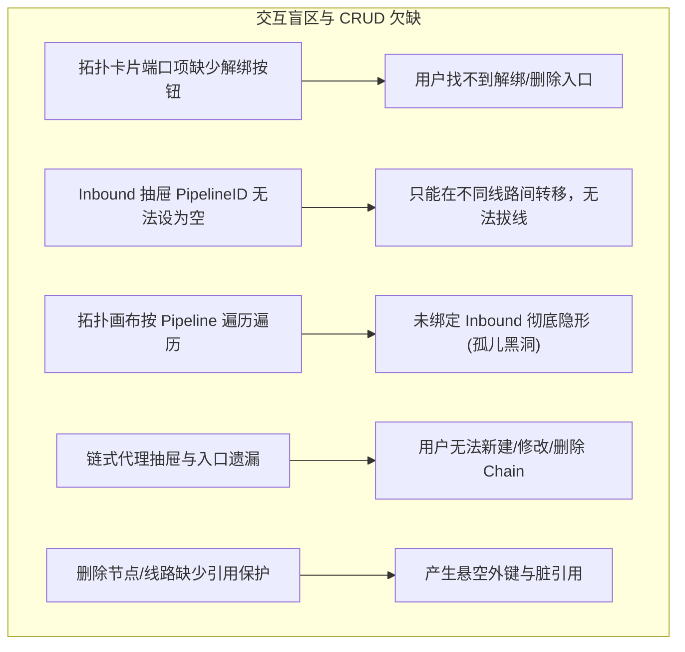
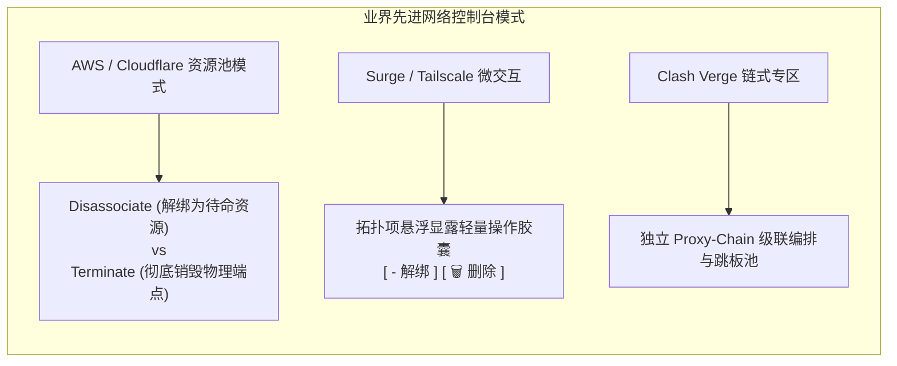
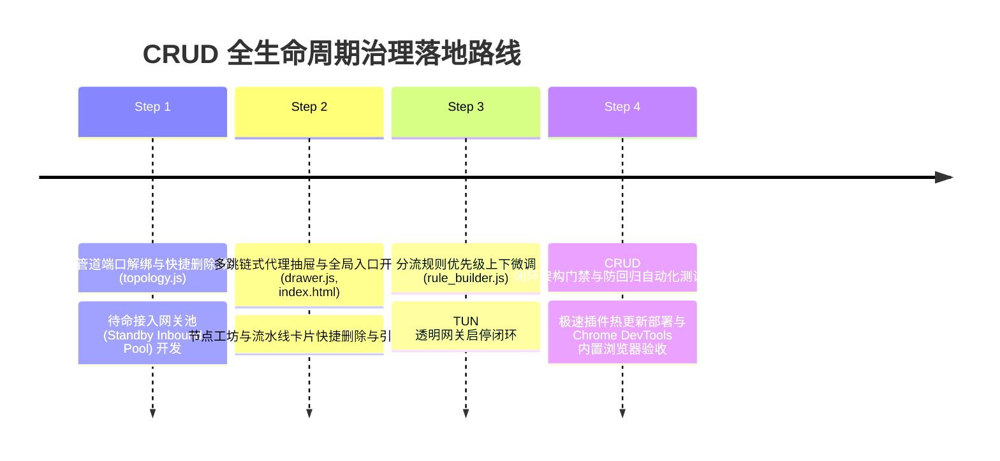

# SOCKS5 客户端边缘中继网关：CRUD 闭环审计、拓扑端口解绑与全生命周期治理方案

> **状态**：问题深度调研与架构方案完成 (Research & Governance Plan)  
> **面向对象**：LWT 核心开发团队、AI Coding Agent、网络运维开发者  
> **核心目标**：彻底解决拓扑管道中端口接入“只进不出、无法解绑”的交互盲区，全面审计并补齐系统 6 大核心实体的 CRUD（增删改查）全生命周期闭环，建立防回归自动化门禁。

---

## 1. 调研问题与根因剖析 (Root Cause Analysis)

在下一代现代化 Webview 交付后，用户在使用中发现了非常关键的交互摩擦点：“**🧭 拓扑管道 端口绑定 如何删除？是否还有 其它功能 增删改查 存在欠缺？**”。

经过对前端视图（`topology.js`, `drawer.js`, `selectors.js`, `nodes.js`）及后端管理器（`manager.go`, `config.go`）的代码级深度排查，确诊了以下根因与功能缺失：



### 1.1 痛点一：拓扑端口“解绑 (Unbind)”与“销毁 (Delete)”语义混淆与入口缺失
1. **拓扑卡片缺失快捷操作**：
   在 `topology.js` 中，每个流水线阶段 1 的入站端口展示为纯文本标签：
   ```html
   <span class="font-semibold text-slate-200 cursor-pointer hover:text-cyan-400 btn-edit-inbound" data-id="${inb.id}">
     ${inb.name}
   </span>
   <span class="font-mono text-cyan-300 font-bold bg-cyan-950/80 px-1.5 py-0.2 rounded border border-cyan-800/60 text-[11px]">
     :${inb.listenPort}
   </span>
   ```
   **没有提供任何解绑（✕）或删除（🗑）的微交互按钮**。用户直觉想从流水线移走该端口时，无从下手。
2. **抽屉表单缺乏解绑选项**：
   点击该端口展开 Slide-over 抽屉后，表单里的“挂载分流线路流水线”下拉框必须选择一条已存在的 Pipeline，**没有 `-- (暂不挂载，设为待命接入网关) --` 选项**，导致用户无法将端口从线路中剥离；抽屉底部的“🗑 删除网关”则是物理级彻底销毁该端口监听，不符合用户“仅解绑线路”的心智模型。

### 1.2 痛点二：孤儿网关黑洞 (The Orphan Gateway Black Hole)
现有拓扑画布采用“以 Pipeline 为根节点自顶向下遍历”的设计：
```javascript
pipelines.forEach((pipe) => {
  const boundInbounds = inbounds.filter(inb => inb.pipelineId === pipe.id);
  ...
```
- **致命缺陷**：如果某个端口网关的 `pipelineId` 为空，或者其绑定的 Pipeline 被删除，该 Inbound 在整个拓扑工作台中**完全不会被渲染**！
- 用户配置好的物理端口直接“凭空消失”，形成数据黑洞，用户再也无法在主界面找回它。

### 1.3 痛点三：系统 6 大核心实体 CRUD 完整性审计矩阵

| 实体对象 | Create (新建) | Read (展示查看) | Update (编辑修改) | Delete (删除/解绑) | **欠缺诊断与风险等级** |
| :--- | :---: | :---: | :---: | :---: | :--- |
| **1. 端口接入 (Inbound)** | ✅ | ⚠️ 仅绑定可见 | ✅ 仅抽屉 | ❌ **无解绑入口** | **高危**：缺少快捷解绑，未绑定网关完全隐形 |
| **2. 分流线路 (Pipeline)** | ✅ | ✅ 拓扑/选择器 | ✅ 仅抽屉 | ⚠️ 仅抽屉深处 | **中危**：缺少卡片快捷删除，删除无级联重定向保护 |
| **3. 出站节点 (Upstream)** | ✅ | ✅ 工坊/选择器 | ✅ 仅抽屉 | ⚠️ 仅抽屉深处 | **中危**：工坊缺少卡片快捷删除，删除无出站引用检测 |
| **4. 链式代理 (Proxy Chain)**| ❌ **无新建入口** | ⚠️ 仅选择器展示 | ❌ **无编辑抽屉** | ❌ **无删除入口** | **高危（功能断裂）**：抽屉与顶部入口遗漏，无法配置 |
| **5. 分流规则 (Rule Tag)** | ✅ | ✅ 抽屉条目 | ✅ 即时修改 | ✅ 单条删除 | **低危**：规则自上而下匹配，缺少上下移动排序功能 |
| **6. 用户态 TUN (Gateway)** | ⚠️ 只读探针 | ✅ 顶部胶囊 | ⚠️ 仅参数编辑 | ❌ **无启停控制** | **中危**：缺少一键启用/禁用拨码开关闭环 |

---

## 2. 业界主流方案调研与横向对比

调研了 **AWS VPC Route Tables / Cloudflare Tunnels**、**Tailscale** 以及 **Surge / Clash Verge Rev** 在解绑与 CRUD 治理上的标杆实践：



### 2.1 关联与销毁解耦 (Disassociate vs Terminate)
- **AWS VPC / Cloudflare**：
  任何物理接入端点（Subnet, Gateway, Port, Tunnel）与逻辑路由表（Route Table / Pipeline）严格解耦。
  - **Disassociate（解绑）**：断开逻辑关联，端口进入 `Available (待命闲置池)`，不释放物理资源；
  - **Terminate（删除）**：停止守护进程，彻底删除配置。
- **借鉴落地**：在 LWT 中建立标准的待命接入网关池（Standby Inbound Pool），提供一键解绑与一键挂载。

### 2.2 拓扑节点轻量微交互 (Contextual Quick Actions)
- **Surge / Tailscale**：
  不强迫用户每次都点开深层侧边栏。当鼠标悬浮在某个端口或节点上时，优雅显露出 `[ - ] 解绑` 和 `[ 🗑 ] 删除` 微按钮，支持 1 步完成高频操作。

---

## 3. 当前系统基础设施与复用评估

1. **后端 Go 底座完全就绪**：
   - 链式代理 API：`GET /api/chains`、`POST /api/chains`、`DELETE /api/chains` 均已在 `main.go` 与 `manager.go` 中完整实现；
   - 接入网关解绑：只需在前端将 `inbound.pipelineId` 设为 `""` 并调用现有的 `POST /api/inbounds` 即可完成原子解绑，后端 `StartAll()` / `StopAll()` 已原生兼容空流水线。
2. **前端组件复用**：
   - `drawer.js` 具备成熟的滑动与表单承载能力，只需补齐 `openChain(chain)`；
   - Tailwind 提供的 `group`、`opacity-0 group-hover:opacity-100` 可零成本实现优雅的悬浮微交互按钮；
   - Toast 提示引擎 `eventBus.emit('toast', ...)` 已就绪。

---

## 4. 深度解决方案与系统性架构设计

### 4.1 拓扑管道：端口“解绑 (Unbind)”与“删除 (Delete)”双阶交互
在 `topology.js` 阶段 1 中，对每个绑定的入站端口重构微交互形态：
```text
┌────────────────────────────────────────────────────────┐
│ 局域网混合接入 :10801 (Mixed)                          │
│ [ ⚙ 配置 ]   [ - 解绑线路 ]   [ 🗑 彻底销毁 ]          │
└────────────────────────────────────────────────────────┘
```
1. **点击 `[ - 解绑线路 ]`**：
   - 将该 Inbound 的 `pipelineId` 置为 `""`，调用 `POST /api/inbounds`；
   - 端口立即从当前流水线脱离，进入顶部的“待命接入网关池”；
   - 物理端口保持监听，不影响外部网络连接，仅流量不再注入该流水线。
2. **点击 `[ 🗑 彻底销毁 ]`**：
   - 弹出轻量确认：“确定彻底删除端口 :10801 监听器吗？”；
   - 确认后调用 `DELETE /api/inbounds?id=...`，释放端口并停止监听器。

### 4.2 待命接入网关池 (Standby Inbound Pool)：消灭孤儿黑洞
在“🧭 拓扑管道”画布的最上方，若检测到存在 `pipelineId` 为空的 Inbound 网关，渲染一个优雅的橙色高亮待命池：
```text
┌──────────────────────────────────────────────────────────────────────────────┐
│ 💤 待命接入端点池 (Standby Inbound Pool) - 尚未挂载任何分流线路 (共 2 个)     │
│ ┌──────────────────────┐  ┌──────────────────────┐                           │
│ │ 办公专线 :10808      │  │ 备用端口 :10809      │                           │
│ │ [ ➔ 快速挂载到线路 ▾]│  │ [ ➔ 快速挂载到线路 ▾]│                           │
│ └──────────────────────┘  └──────────────────────┘                           │
└──────────────────────────────────────────────────────────────────────────────┘
```
- 点击任意待命端口的“➔ 快速挂载到线路”，直接下拉选择某条 Pipeline，0.1 秒即可完成连线；
- 彻底解决未挂载端口隐形的问题。

### 4.3 补齐多跳链式代理 (Proxy Chains) 抽屉与全流程 CRUD
1. **抽屉实现 (`drawer.openChain(chain)`)**：
   - 支持设置链条名称、调度策略（`auto` 自适应寻优 vs `manual` 严格静态跳板）；
   - **自动模式**：选择“固定落地出口节点 (Pinned Exit)”与“前置中继候选跳板池”；
   - **手动模式**：直观选择第一跳（中继节点）与第二跳（出口节点）；
   - 实时预览拓扑流向图：`客户端 ➔ [跳板池] ➔ [固定出口] ➔ 目标网络`；
   - 底部提供“🗑 删除链条”按钮。
2. **全局入口**：
   - 顶部导航条增加 `+ 链式` 快捷按钮；
   - 拓扑画布阶段 3 出站选择器与节点工坊中，展示链式代理卡片，提供快捷编辑与删除。

### 4.4 节点工坊与流水线卡片的快捷删除
1. **节点工坊卡片直观删除**：
   - 在节点卡片右下角直接提供 `🗑` 按钮，点击二次确认即可秒级删除，无需进入抽屉底层。
   - **引用依赖守护 (Dependency Guard)**：删除前检查该节点是否被流水线设为 `DefaultOutbound`，若正在使用中，弹出警示：“⚠️ 该节点正被线路 [AI 研发专线] 用作出站出口，删除后该线路将自动降级为直连，确定继续吗？”。
2. **流水线卡片快捷删除**：
   - 拓扑卡片右上角增加 `🗑` 图标（系统默认 `pipe-default` 线路受保护隐藏），支持一键快速清理废弃流水线；
   - **级联自愈**：删除 Pipeline 时，自动将其绑定的 Inbounds 重定向至 `pipe-default` 或解绑至待命池，杜绝悬空引用。

### 4.5 可视化分流规则优先级微调 (Order Up / Down)
在 `VisualRuleBuilder`（`rule_builder.js`）的每个规则条目右侧增加 `▲`（上移）与 `▼`（下移）按钮：
- 规则匹配遵循自上而下短路原则；
- 用户点击微按钮即可毫秒级调换优先级，条目实时重新排序。

### 4.6 用户态 TUN 透明网关启停闭环
在 `drawer.openTun()` 中增加明确的“透明代理启停拨码开关”，联动更新 `tunProfile.enabled`，实现真正的控制闭环。

---

## 5. 防回归测试与 CRUD 闭环自动化门禁规范

为确保未来跨会话的 AI Coding Agent 或开发者在迭代时不会再度引入“只能增查、无法改删、无法解绑”的断裂状态，建立三层防御机制：

### 5.1 门禁 1：CRUD 语义与接口一致性门禁 (`FE-CRUD-INTEGRITY`)
在前端门禁脚本 `src/LinuxWebTool.WebHost/wwwroot/frontend-gate.cjs` 中追加校验规则：
- **检查项 1**：所有在 Webview 呈现的实体类型（Inbound, Pipeline, Upstream, Chain, Rule），其对应的视图控制器必须导出或具备 `delete*` / `unbind*` 逻辑；
- **检查项 2**：`drawer.js` 必须包含并导出完整的抽屉方法集合：`openUpstream`, `openPipeline`, `openInbound`, `openChain`, `openImport`, `openTun`，缺失任何一个即刻中断编译；
- **检查项 3**：`topology.js` 中必须包含解绑类名与事件监听器（`btn-unbind-inbound`）。

### 5.2 门禁 2：自动化端到端测试覆盖 (`tests/frontend/forwarder-crud-lifecycle.test.mjs`)
编写专用的端到端生命周期测试用例，覆盖：
1. **Inbound 解绑用例**：挂载端口 ➔ 调用解绑 ➔ 验证端口移入 Standby 池 ➔ 重新挂载；
2. **Chain 增删改查用例**：打开链式抽屉 ➔ 保存自动模式链式 ➔ 读取校验 ➔ 成功删除；
3. **Pipeline 级联自愈用例**：创建临时 Pipeline 并绑定 Inbound ➔ 删除该 Pipeline ➔ 验证 Inbound 状态自愈未悬空。

### 5.3 门禁 3：安全凭据与单文件行数铁律
- 全仓扫描：修改后的 `drawer.js`, `topology.js`, `nodes.js` 等单文件行数必须严格保持在 **700 行** 限制内；
- 执行 `node .githooks/security-gate.cjs --full` 确保 100% 凭据脱敏。

---

## 6. 实施路线图 (Implementation Roadmap)



---
*本文档由 LWT 架构团队制定，受 `.githooks/security-gate.cjs` 与架构门禁全局守护。*
