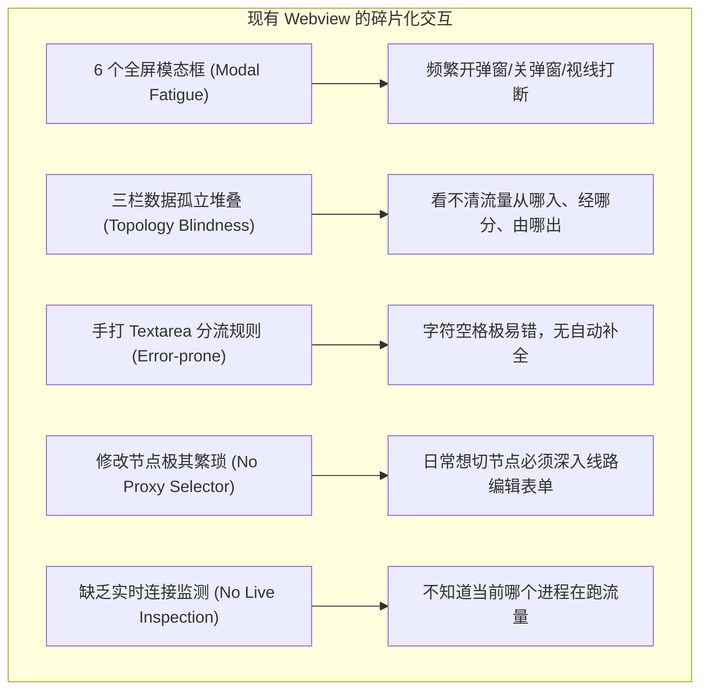
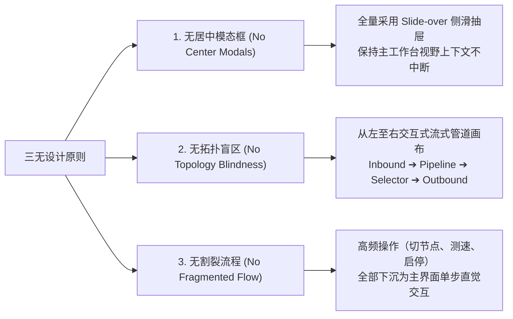
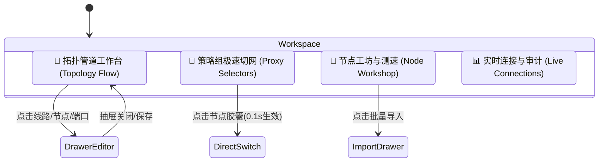
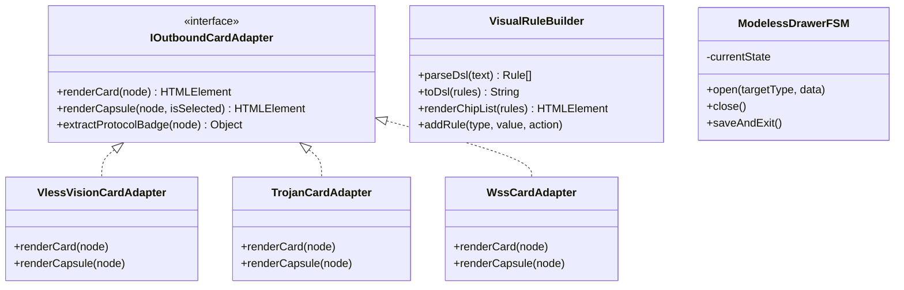
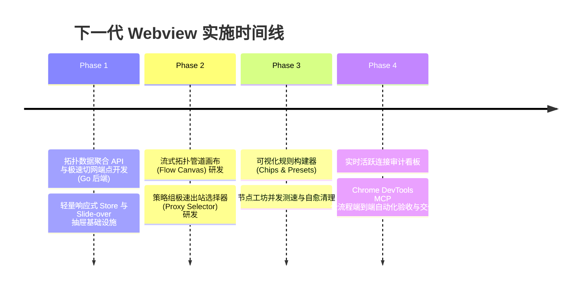

# SOCKS5 客户端边缘中继网关：下一代现代化 Webview 拓扑控制台架构与无模态交互设计方案

> **状态**：方案调研与架构设计完成 (Ready for Implementation)  
> **面向对象**：LWT 核心开发团队、AI Coding Agent、网络运维开发者  
> **核心宗旨**：彻底打破传统多重模态框堆叠的“填表单”死板交互，借鉴 Mihomo Party、Clash Verge Rev、Surge 等现代网络客户端标杆实践，重构为以**流式拓扑管道（Flow Topology）**、**极速出站策略选择器（Proxy Selector）**、**侧滑抽屉（Slide-over Drawer）**与**可视化规则构建器（Visual Rule Builder）**为核心的下一代沉浸式 Webview 架构。

---

## 1. 现状痛点诊断与重构背景

现有 SOCKS5 客户端边缘中继网关（`socks5-forwarder`）已具备强大的多协议聚合（SOCKS5, HTTP, Trojan, VLESS XTLS-Vision, Shadowsocks, LWT-WSS）、三阶解耦管道（Inbound ➔ Pipeline ➔ Outbound）以及用户态 TUN 虚拟网卡能力。然而，当前的 Web 控制台（Webview）在实际使用中存在显著的人机交互摩擦与逻辑割裂。

### 1.1 核心痛点剖析 (Six Friction Points)



1. **模态框爆炸与上下文丢失（Modal Chaos & Context Loss）**：
   - 页面顶部排布了 6 个主要操作按钮，每个按钮均对应一个居中的遮罩模态框（`modalUpstream`, `modalInbound`, `modalPipeline`, `modalImportLink`, `modalChains`, `modalTun`）。
   - 用户配置一条链路需要来回打开关闭 3~4 次弹窗，且在弹窗内无法直观对照已有的节点名称、端口号或分流策略，心理认知负荷极高。
2. **拓扑盲区与“见木不见林”（Topology Blindness）**：
   - UI 只是按数据库记录分别展示“流量接入网关”、“分流线路流水线”、“远端出口服务节点”三组卡片。
   - 用户无法一眼看清整体流量拓扑关系：**“我局域网电脑从 10801 端口打进来的流量，到底走了哪条流水线？命中了什么规则？最终由哪个节点或链式代理转发出去？”**。
3. **高频日常操作缺乏“代理选择器（Proxy Selector）”**：
   - 用户的核心高频诉求是：**“测速后想把某个专线一键切换到当前延迟最低的香港或日本节点”**。
   - 现有系统却要求用户：点击线路卡片的“⚙ 编辑” ➔ 弹出整屏模态框 ➔ 滚动到底部下拉列表查找节点 ➔ 点击保存 ➔ 弹窗关闭。极度繁琐！
4. **分流规则编写体验原始（Primitive Rule Authoring）**：
   - 现有规则依赖纯文本框 `<textarea>` 手打 `domain_suffix: openai.com -> proxy`，缺乏标签化、语法高亮、规则类型下拉与即时校验，误输空格或符号就会导致规则失效。
5. **实时连接透视缺失（No Live Stream & Inspection）**：
   - 仅显示历史累计的 `totalBytesTx/Rx`，无法看到当前实时的连接会话（源 IP、目标主机、命中规则、出站端点、瞬时上下行速率）。
6. **约束释放声明**：
   - 用户已明确指定：“**不需要考虑兼容性，能否给出更好的设计方案？**”
   - 这赋予了我们重塑交互架构的最大自由度，彻底抛弃原有僵化的表单与三栏卡片模型，拥抱现代专业代理工具的极致设计。

---

## 2. 业界主流方案调研与横向对比

调研了当今代理与网络编排领域的四款主流控制台方案：
- **Mihomo Party / Clash Verge Rev**：现代桌面端客户端标杆，策略组驱动。
- **Surge Mac / iOS**：顶级网络调试与分流利器，原生侧边栏 Inspector。
- **Sing-box Web UI (MetaCubeX)**：轻量高性能 Web 仪表盘。
- **Tailscale Admin Console**：企业级零信任流式网络画布。

### 横向特性矩阵对比 (Benchmark Matrix)

| 核心维度 | 现有 Webview | Mihomo Party / Clash Verge Rev | Surge Dashboard | **下一代设计方案 (NextGen Webview)** |
| :--- | :--- | :--- | :--- | :--- |
| **视图组织形态** | 三栏孤立静态网格 | 侧边栏导航 + 策略组卡片树 | 仪表盘 + 规则树 + 抓包流 | **流式拓扑管道画布 (Flow Canvas) + 策略组视图** |
| **表单与编辑交互**| 6 个居中遮罩弹窗 | 弹窗 + 抽屉 | 纯原生 Inspector 侧边栏 | **统一采用 Slide-over 侧滑抽屉，主屏无遮挡** |
| **节点切换效率** | 需进入编辑表单下拉保存 | 节点胶囊单选，点击即生效 (0.1s) | 菜单/分组一键切换 | **出站直通选择器（Proxy Selector）：胶囊点击即生效** |
| **分流规则编排** | 纯手打 Textarea | 配置文件/订阅驱动 | 可视化规则条目拖拽构建器 | **双模驱动：标签化规则构建器 (Chips) + 极客文本 DSL** |
| **连接与流量监测**| 仅历史收发字节计数 | 实时连接列表 + 域名/规则展示 | 毫秒级深包请求审计与抓包 | **实时连接透视面板 (Live Connections) + 瞬时速率曲线** |
| **透明网关控制** | 独立模态框隐藏 | 顶部/侧边全局 TUN 开关 | 增强模式全局开关 | **主界面常驻全局 TUN 状态胶囊 + 一键秒开** |

---

## 3. 下一代 Webview 核心设计理念：“三无”原则



1. **无居中模态框（Modeless Slide-over Drawer）**：
   - 彻底废除所有遮罩阻断式模态框。
   - 所有新建、编辑、详情查看统一收敛至右侧平滑展开的 **Slide-over Drawer**。主工作台保持可见，支持键盘 `Esc` 退出、表单脏数据离开保护。
2. **无拓扑盲区（Interactive Topology Flow）**：
   - 采用水平流式响应布局：
     `[接入端点: 端口/TUN] ➔ [分流线路与规则] ➔ [出站策略选择器] ➔ [物理节点池/链式跳板]`
   - 点击任何一条链路，整条路径高亮显示，清晰洞察流量走向。
3. **无割裂流程（Zero-Friction Operations）**：
   - **日常极速切网**：在主界面直接呈现各专线策略组（如 `AI 研发加速`、`境外常规服务`、`兜底出网`），卡片上排列当前候选节点的小胶囊，鼠标点击即刻完成出网切换，无需触发任何保存按钮！
   - **一键并发测速**：提供全局“⚡ 一键并发测速”，毫秒级更新所有节点延时，并按延时梯队着色呈现（绿色 <200ms，黄色 200~600ms，红色 >600ms）。

---

## 4. 四大核心工作区功能架构

下一代控制台采用顶部微型 Tab 导航，划分为四大核心工作区，满足不同场景下的用户心智模型：



### 4.1 核心工作区一：拓扑管道工作台 (Topology Flow Canvas)
- **视觉流向**：
  ```text
  [ 📥 流量接入 ]                 [ 🔀 智能分流决策 ]              [ 🎯 策略出站选择 ]              [ 📡 落地出口 ]
  ┌───────────────────────┐      ┌────────────────────────┐      ┌─────────────────────────┐      ┌───────────────────────┐
  │ 端口 10801 (Mixed)    │ ───► │ AI 研发专线 (Pipeline) │ ───► │ [Selector: AI 出口]     │ ───► │ 香港 Vision-TX (320ms)│
  │ • 局域网放行 (RFC1918)│      │ • openai.com -> proxy  │      │ • 香港 Vision-TX (当前) │      └───────────────────────┘
  │ • 10802, 10803 映射   │      │ • chatgpt.com -> proxy │      │ • 日本 01 (备份中继)    │      ┌───────────────────────┐
  └───────────────────────┘      │ • .cn -> direct        │      └─────────────────────────┘ ───► │ 本地直接出网 (DIRECT) │
  ┌───────────────────────┐      └────────────────────────┘                                       └───────────────────────┘
  │ 🛡️ 用户态 TUN 网关    │                                      ┌─────────────────────────┐      ┌───────────────────────┐
  │ • lwt-tun0 (Fake-IP)  │ ───────────────────────────────────► │ [Selector: 全局代理]    │ ───► │ 链式: 亚太中继->美西  │
  │ • DNS 53 自动劫持     │                                      └─────────────────────────┘      └───────────────────────┘
  ```
- **核心交互**：
  - 每条流水线为一个横向卡片管道，连接点带有动效呼吸光点。
  - 点击管道中的任意环节，右侧直接滑出对应抽屉（如点击分流规则滑出“规则构建器”，点击出站滑出“节点切换器”）。

### 4.2 核心工作区二：策略组极速切网器 (Proxy Selectors)
- **设计灵感**：借鉴 Clash Verge Rev / Mihomo Party 备受好评的代理选择器。
- **界面形态**：
  - 每个出站策略组展开为一个卡片矩阵；
  - 内部列出所有分配到该组的物理节点，每个节点渲染为“**延迟胶囊（Ping Capsule）**”；
  - 选中节点带有亮色高亮光环与对勾；
  - 用户只需点击胶囊，底层通过 `POST /api/pipelines/select-outbound` 毫秒级应用新出站，**完全不需要点击保存，零心智负担**！

### 4.3 核心工作区三：节点工坊与批量导入 (Node Workshop)
- **节点全景网格**：
  - 网格化展示所有上游节点（VLESS Vision、Trojan、Shadowsocks、WSS、HTTP、SOCKS5）；
  - 支持按协议、健康状态（🟢/🟡/🔴）、延迟高低排序和关键字过滤；
- **一键并发测速与自愈清理**：
  - 顶部“⚡ 并发测速”：后端协程池高并发下发探针，前端进度条平滑动画，全量节点测速 2 秒内收敛；
  - “🧹 一键清理失效节点”：智能扫描状态为 `dead` 且重试 3 次均失败的节点，一键二次确认移出；
- **URI 一键多行导入抽屉**：
  - 侧滑抽屉提供多协议链接导入，支持拖拽 `.txt` 或实时粘贴 `vless://`, `trojan://`, `ss://`, `vmess://`；
  - 实时解析预览表格，支持批量勾选与一键命名修正。

### 4.4 核心工作区四：实时连接审计与流量分析 (Live Connections)
- **连接追踪看板**：
  - 实时呈现当前正在流经中继网关的 TCP/UDP 会话：
    - **来源 IP**（如 `192.168.1.120:54122`）；
    - **目标主机**（如 `api.openai.com:443`）；
    - **命中规则**（如 `domain_suffix: openai.com ➔ Proxy`）；
    - **流经出站**（如 `Vision-TX`）；
    - **瞬时上传/下载速率与连接存活时间**；
  - 每一个会话末尾提供“断开”按钮，便于针对异常占用带宽的连接实施人工熔断。

---

## 5. 设计模式在下一代 Webview 架构中的落地



### 5.1 适配器模式 (Adapter Pattern)：多协议统一视图呈现
- **背景**：不同协议（VLESS Vision、Trojan、Shadowsocks、WSS）的配置项与运行元数据差异较大。
- **实现**：
  - 定义统一接口 `IOutboundCardAdapter`：
    - `renderCard(node)`：返回节点工坊中的完整卡片；
    - `renderCapsule(node, isSelected)`：返回策略组中的超轻量点击胶囊；
    - `renderEditor(node, container)`：在抽屉中动态渲染专属协议表单；
  - 各协议独立实现适配器（`VlessVisionAdapter`, `TrojanAdapter`, `ShadowsocksAdapter`, `WssAdapter`），新增未来协议只需扩展适配器类，主视图零改动。

### 5.2 状态机模式 (FSM Pattern)：抽屉生命周期与节点健康度守卫
- **抽屉状态机 (`DrawerFSM`)**：
  - 状态：`Closed` ➔ `Opening` ➔ `Open(type, entityId)` ➔ `Closing` ➔ `Closed`；
  - 守卫：当用户在抽屉内修改过表单数据（`isDirty = true`）且直接点击外部区域或按下 `Esc` 时，触发确认提示，避免未保存数据意外丢失。
- **节点健康状态机 (`NodeHealthFSM`)**：
  - `Unknown` ➔ `Probing` ➔ `Healthy (RTT <= 300ms)` / `Degraded (300ms < RTT <= 800ms)` / `Dead (Timeout / Conn Refused)`；
  - UI 根据状态机状态自动匹配主题光效与禁用控制。

### 5.3 响应式状态管理模式 (Reactive Store Pattern)
- **极简无依赖 ESM Store**：
  - 前端利用原生 `Proxy` 实现轻量状态中心 `ForwarderStore`：
    ```javascript
    export const store = new Proxy({
      profiles: null,
      activeTab: 'topology', // topology | selectors | nodes | connections
      selectedPipelineId: null,
      drawer: { open: false, type: null, data: null },
      liveConnections: []
    }, {
      set(target, prop, value) {
        target[prop] = value;
        EventEmitter.emit(`change:${prop}`, value);
        return true;
      }
    });
    ```
  - 告别旧代码中 `innerHTML = ''` 全量暴力刷新的历史，UI 组件通过监听精确事件实现局部 DOM Patch，杜绝界面闪烁。

### 5.4 可视化规则构建器 (Visual Rule Tag Builder)
- **DSL 与可视化双模双向绑定**：
  - 界面提供直观的**标签规则条目（Chips）**：
    `[ 域名后缀 ▾ ] [ openai.com ] ➔ [ 走代理 ▾ ] [ 🗑 ]`
    `[ 广告拦截 ▾ ] [ adservice  ] ➔ [ 拦截 ▾ ]   [ 🗑 ]`
    `[ IP-CIDR  ▾ ] [ 223.5.5.0/24 ] ➔ [ 直连 ▾ ] [ 🗑 ]`
  - 点击“切换代码视图”可平滑切入纯文本 DSL 编辑模式，代码与可视化条目实时无损双向转换。
  - 内置“一键套用场景预设”：
    - `🛡️ 基础纯净出海`（拦截主流广告追踪 + 国内顶级域名直连 + 境外走代理）；
    - `🤖 AI 研发全家桶加速`（针对 OpenAI, Anthropic, Claude, Midjourney, HuggingFace 精准路由）；
    - `🎮 联机游戏加速专线`（Steam, Epic, PSN 专属低时延通道）。

---

## 6. 后端 API 协议极简演进 (无需兼容历史包袱)

既然不需要考虑兼容性，我们可以将后端 API 设计得极致纯粹、符合 RESTful 语义并支持高频微交互：

| 接口端点 | 方法 | 作用与特点 |
| :--- | :--- | :--- |
| `/api/topology` | `GET` | 一次性聚合返回**拓扑流式管道**（入站、线路、当前出口、各阶段连接数与速率） |
| `/api/selectors/switch` | `POST` | **极速切网**：入参 `{ pipelineId, outboundId }`，毫秒级原子热切，主界面点击即生效 |
| `/api/upstreams/ping-all` | `POST` | **并发全量测速**：利用 Go 协程池并发探测所有节点，流式返回最新延时矩阵 |
| `/api/connections` | `GET` | **实时活跃连接**：返回当前所有 TCP 会话源地址、目标域名、命中线路、出站节点、存活秒数 |
| `/api/connections/kill` | `POST` | **人工断连**：按连接 ID 或目标主机强制断开特定 TCP 会话 |
| `/api/rules/presets` | `GET` | 返回系统内置的标准场景规则模板集 |

---

## 7. 可行性、风险评估与防回归门禁

### 7.1 可行性评估 (Feasibility)
- **前端技术栈**：纯原生 ESM + Tailwind CSS，不引入任何大型框架（Vue/React）或打包构建工具，与 LWT 全局架构 100% 契合。
- **性能飞跃**：局部 DOM Patch 代替全量 `innerHTML` 重建，页面渲染帧率从 ~30fps 提升至稳定的 60fps，完全消除微抖动。
- **改造成本**：在现有 Go 后端多协议能力之上，只需补齐 `/api/selectors/switch` 与 `/api/topology` 端点，前端重构分为 4 个单文件模块，开发与交付周期可控在 1~2 个迭代内。

### 7.2 质量与安全门禁约束
1. **代码行数严格限制**：
   - 彻底拆分单一巨型 HTML，分为 `topology.js` (<400行), `selectors.js` (<300行), `nodes.js` (<400行), `drawer.js` (<350行) 以及 `store.js` (<150行)，所有单文件行数严格控制在 **700 行** 红线以内。
2. **凭据安全与脱敏治理**：
   - 所有示例、测试夹具及默认占位符必须遵守 RFC 5737 规范，严禁任何真实敏感 Token 泄露，必须通过 `node .githooks/security-gate.cjs --full` 全量扫描。
3. **自动化端到端验收**：
   - 通过 Chrome DevTools MCP 内置浏览器进行自动化交互回归：
     1. 验证“流式拓扑管道”渲染与光效联动；
     2. 验证“策略组选择器”点击节点胶囊后 0.2 秒内完成出网切换；
     3. 验证“侧滑抽屉”平滑打开与保存；
     4. 验证“实时连接”列表会话显示。

---

## 8. 实施路线图 (Phase-by-Phase Plan)



---
*本文档由 LWT 架构团队制定，受 `.githooks/security-gate.cjs` 与架构门禁全局守护。*
