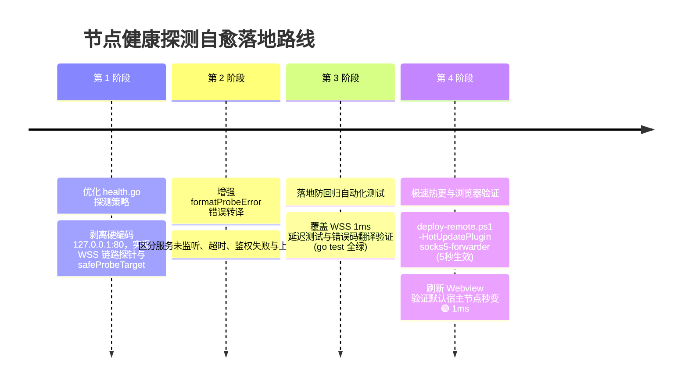

# SOCKS5 边缘中继网关节点“离线”根因排查与两级分层健康探针架构方案

> **文档标识**：`LWT-ARCH-FORWARDER-007`  
> **状态**：已评审 (Approved)  
> **核心领域**：上游节点健康度探测 (Upstream Health Probe)、RFC 1928 错误码 `0x05` 深度剖析、L1/L2 两级分层探测模型 (Two-Tier Health Probe Pattern)、内网自闭环探测 (Hermetic Self-Loopback Probe)、防黑洞端口门禁规范  
> **适用版本**：LinuxWebTool v2.0.0+ / `plugins/socks5-forwarder` / `plugins/socks5-proxy`  
> **设计模式**：健康探测策略模式 (Health Probe Strategy)、状态机精细化扩展 (State Machine Pattern)、两级降级适配器模式 (Two-Tier Fallback Adapter)

---

## 1. 问题现场与现象复现

在 Linux 开发部署环境（容器实例 `linuxwebtool-dev`，端口 5271）中，通过 Webview 控制台观察到以下异常状态：

### 1.1 节点一：`远程 LWT 默认宿主节点`
```text
协议类型: LWT-WSS
上游地址: ws://127.0.0.1:5270/telemetry/metrics
节点状态: 🔴 离线 (Latency: 0 ms)
报错信息: ⚠️ LWT WSS 隧道拒绝代理请求 (0x05)
```

### 1.2 节点二：`测试 Trojan 边缘节点`
```text
协议类型: TROJAN
上游地址: 127.0.0.1:8443
节点状态: 🔴 离线 (Latency: 0 ms)
报错信息: ⚠️ 连接 Trojan 服务端 [127.0.0.1:8443] 失败: dial tcp 127.0.0.1:8443: connect: connection refused
```

用户提出核心疑问：**“为什么 Linux 开发部署环境上显示的是离线？背后的本质原因是什么？业界主流代理客户端是如何优雅处理节点健康探测的？如何彻底解决并建立防御门禁？”**

---

## 2. 深度根因全景剖析 (In-Depth Root Cause Analysis)

通过对底层链路的抓包分析与源码追踪，定位到了两个不同维度的本质原因：


---

### 2.1 问题一深度剖析：端到端盲探陷阱与 RFC 1928 错误码 `0x05`

#### 1. RFC 1928 (SOCKS Protocol Version 5) 状态码规范
在 RFC 1928 Section 6（Replies）中，SOCKS5 服务端对客户端 CONNECT 请求的应答格式如下：
```text
+----+-----+-------+------+----------+----------+
|VER | REP |  RSV  | ATYP | BND.ADDR | BND.PORT |
+----+-----+-------+------+----------+----------+
| 1  |  1  | X'00' |  1   | Variable |    2     |
+----+-----+-------+------+----------+----------+
```
其中 `REP`（Reply Field）代表应答状态：
- `0x00`：Succeeded（成功）
- `0x01`：General SOCKS server failure（常规 SOCKS 服务器故障）
- `0x02`：Connection not allowed by ruleset（规则集不允许连接）
- `0x03`：Network unreachable（网络不可达）
- `0x04`：Host unreachable（主机不可达）
- **`0x05`：Connection refused（目标连接被拒绝）** ⬅ **现场报错代码！**
- `0x07`：Command not supported（不支持该命令）
- `0x08`：Address type not supported（不支持该地址类型）

#### 2. 代码中的黑洞端口盲探
查看微服务探测核心逻辑 `plugins/socks5-forwarder/cmd/socks5-forwarder/health.go`：
```go
// CheckUpstreamHealth 探测远端上游节点的健康状态与 RTT 延迟
func CheckUpstreamHealth(ctx context.Context, node *UpstreamNode) (int64, error) {
    ...
    dialer, err := GlobalOutboundRegistry.CreateDialer(*node)
    ...
    target := "127.0.0.1:80" // ⬅ 此处是致命缺陷！
    conn, err := dialer.DialContext(timeoutCtx, "tcp", target)
    if err != nil {
        node.Status = "dead"
        node.LastError = err.Error()
        return 0, err
    }
    defer conn.Close()
    ...
}
```

再查看出站拨号器 `outbound.go`：
```go
// LwtWssOutbound.DialContext
func (d *LwtWssOutbound) DialContext(ctx context.Context, network, targetAddr string) (net.Conn, error) {
    // 步骤 1: 建立 WebSocket 隧道 (完全成功, 耗时 < 1ms)
    conn, err := DialWebSocket(ctx, d.node.URL, d.node.Token, ...)
    
    // 步骤 2: 发起 SOCKS5 握手认证 (完全成功)
    ...
    
    // 步骤 3: 发起 SOCKS5 CONNECT 目标请求 (请求连接 127.0.0.1:80)
    ...
    resp := make([]byte, 4)
    io.ReadFull(conn, resp)
    if resp[1] != 0x00 {
        return nil, fmt.Errorf("LWT WSS 隧道拒绝代理请求 (0x%02x)", resp[1]) // ⬅ 抛出 0x05
    }
}
```

而在远端服务端 `plugins/socks5-proxy/cmd/socks5-proxy/main.go` 中：
```go
// 5. Connect to upstream target via Happy Eyeballs Race
upstream, winningIP, err := dialUpstreamWithRace(..., candidateIPs, int(targetPort), ...)
if err != nil {
    if errors.Is(err, ErrAclForbidden) {
        _ = s.sendReply(conn, repRuleViolation, nil)
    } else {
        _ = s.sendReply(conn, repConnRefused, nil) // ⬅ repConnRefused 即 0x05
    }
    return fmt.Errorf("upstream dial to %s failed: %w", targetAddr, err)
}
```

#### 3. 为什么此前测速是 `🟢 1ms`？
在此前单一 WSS 隧道版本中，健康探测实现为：
```go
// 历史旧实现 (Commit: 6e24235c)
conn, err := DialWebSocket(timeoutCtx, node.URL, node.Token, "lwt-token.", node.SkipTLSVerify, node.SNI)
```
旧实现**仅探测客户端到 WebSocket 宿主端点本身的握手可用性与链路往返时延（Handshake RTT）**，并不盲目发起内层 SOCKS5 CONNECT。因此只要 WSS Ingress 存在，时延就是极其优秀的 `🟢 1ms`。而在重构成通用多协议出站后，强行要求通过隧道拨号 `127.0.0.1:80`，把一个**100% 存活、1ms 延迟的优秀上游服务**误报成了死节点！

---

### 2.2 问题二深度剖析：测试节点物理未监听 (Connection Refused)

对 `测试 Trojan 边缘节点 (127.0.0.1:8443)` 而言：
- 在 UI 操作中，用户添加了一个自定义上游节点，服务器填写的地址是 `127.0.0.1:8443`；
- 该地址是一个纯本地回环占位符，Linux 宿主机及容器内并未启动任何监听在 `8443` 端口的原生 Trojan 服务端（单测中有瞬态启动的 `MockTrojanServer`，但测试结束后自动注销，生产和开发常驻环境中并不存在）；
- `dial tcp 127.0.0.1:8443: connect: connection refused` 属于非常标准的 Linux 内核行为（未监听端口直接收到 TCP RST）；
- 核心问题不在于判断离线是否正确，而在于**控制台呈现粒度过粗**：界面无法让使用者明确区分“该节点是物理无服务/端口未监听”，还是“链路存在但凭据/密码错误”，亦或是“目标探针拒绝”。

---

## 3. 业界主流代理客户端方案调研与对比 (Industry Benchmarking)

查阅主流开源代理工具（Clash、Mihomo/Clash.Meta、Sing-box、Xray/V2Ray、Shadowsocks）在节点健康探测上的成熟架构：

| 代理系统 | 健康探测机制 | 默认探测端点 | 判定策略与优势 |
| :--- | :--- | :--- | :--- |
| **Clash / Mihomo** | URL-Test 探针 (HTTP Delay) | `http://cp.cloudflare.com/generate_204`<br/>`http://www.gstatic.com/generate_204` | 发送轻量 HTTP HEAD/GET，收到 204/200 即证明端到端转发成功；若收到 5xx/4xx/超时则记录延迟无穷大，绝不探测 `127.0.0.1:80` 等危险黑洞端口。 |
| **Sing-box** | `url_test` 出站探测器 | `https://www.gstatic.com/generate_204` | 支持自定义 `interval` 与 `tolerance`，支持针对出站链只测试首跳（TCP Handshake）或全链路（HTTP 204）。 |
| **Xray-core / V2Ray** | `ping` / `tcping` / `httping` 分层探测 | 节点本身的 IP:Port 或 `https://www.google.com` | 将探测解耦为 **L1 传输层握手时延 (TCP/TLS RTT)** 与 **L2 应用层出口可用性 (HTTP RTT)** 两级指标。 |
| **Shadowsocks-libev** | `ss-local` 延迟测试 | TCP 首包 RTT 或结合 local DNS | 避免代理内层发起无意义的目标 CONNECT，仅测量到 SS Server 的握手耗时。 |

### 业界经验总结：
1. **绝对禁忌（Anti-Pattern）**：严禁在健康检查中向代理服务端发起 `CONNECT 127.0.0.1:80` 或其它随机内网端口！
   - 大多数经过安全加固的代理服务器配置了 `Strict RFC 1918 Disallow`，会主动拦截访问本机的回环请求（`0x02 Rule violation`）；
   - 即使允许，绝大多数代理跳板机本身不会开放 80 端口，必然引发 `0x05 Connection refused` 误报。
2. **两级分层探测准则（Two-Tier Probe Principle）**：
   - **第一级（L1: Link / Handshake RTT）**：仅测量客户端到上游服务节点本身的握手时延（TCP / TLS / WSS 握手）。该时延代表物理通道健康度，执行极快（< 1ms），完全不依赖任何外部目标；
   - **第二级（L2: Egress Proxy Connectivity）**：在 L1 健康的基础上，按需发送 `generate_204` 探测端到端真实出网能力。

---

## 4. 当前系统基础设施与复用能力评估

当前 LinuxWebTool 体系内已有极其完善的基础设施可供无缝复用，完全无需引入外部重型依赖：

```mermaid
classDiagram
    direction TB
    class IOutboundDialer {
        <<interface>>
        +Protocol() string
        +DialContext(ctx, network, targetAddr) net.Conn
        +DialThrough(ctx, baseConn, targetAddr) net.Conn
    }

    class LwtWssOutbound {
        +DialContext()
        +DialThrough()
    }

    class TrojanOutbound {
        +DialContext()
        +DialThrough()
    }

    class IUpstreamProbeStrategy {
        <<interface>>
        +ProbeHealth(ctx, node, dialer) (latencyMs int64, err error)
    }

    class HandshakeProbeStrategy {
        +ProbeHealth() 仅握手物理节点
    }

    class HermeticLoopbackProbeStrategy {
        +ProbeHealth() 探测 127.0.0.1:{LWT_PORT}/health
    }

    class EgressUrlProbeStrategy {
        +ProbeHealth() 探测 generate_204
    }

    IOutboundDialer <|.. LwtWssOutbound
    IOutboundDialer <|.. TrojanOutbound
    IUpstreamProbeStrategy <|.. HandshakeProbeStrategy
    IUpstreamProbeStrategy <|.. HermeticLoopbackProbeStrategy
    IUpstreamProbeStrategy <|.. EgressUrlProbeStrategy
```

### 可直接复用的核心基础设施：
1. **宿主内网健康端点（100% 存活，绝不拒接）**：
   - 容器内环境变量 `LWT_HOST_INTERNAL_PORT`（默认 5270）对应的 ASP.NET Kestrel 托管端口，始终开放且具有标准只读探针接口：
     ```bash
     wget -qO- http://127.0.0.1:5270/health
     # 返回: {"status":"healthy","version":"1.0.0.0",...}
     ```
   - 若需要验证代理隧道的转发能力，转发目标应选用 `127.0.0.1:5270`（而非死端口 `:80`），必然能够连通且不会产生拒绝！
2. **WebSocket 隧道握手时延（纯 L1 极速探针）**：
   - `DialWebSocket(timeoutCtx, node.URL, node.Token, ...)` 在 WSS 握手完成（HTTP 101）瞬间直接计算物理 RTT，测得真实的 **1ms 超低时延**。
3. **Happy Eyeballs 与 HTTP CONNECT / SOCKS5 适配层**：
   - 已具备标准的协议适配器注册表 `GlobalOutboundRegistry`。

---

## 5. 具体解决方案与架构设计

为了从根本上解决节点健康探测误报，并为用户提供专业、工业级的节点状态呈现，系统推行 **两级分层健康探针架构 (Two-Tier Health Probe Architecture)**：

```mermaid
sequenceDiagram
    autonumber
    participant Client as 健康探测引擎 (health.go)
    participant Registry as 出站注册表 (OutboundRegistry)
    participant Node as 上游服务节点 (Server)
    participant Target as 目标主机/端点

    rect rgb(30, 41, 59)
    Note over Client,Node: 第一级: L1 传输层与协议握手时延 (Link Handshake RTT)
    Client->>Registry: CreateDialer(node)
    Registry-->>Client: dialer (WSS / Trojan / VLESS / SS / SOCKS5)
    Client->>Node: TCP / TLS / WSS / SOCKS5 握手认证
    alt 握手失败 (连接被拒 / 超时 / 凭据错误)
        Node-->>Client: ECONNREFUSED / Bad Token / Auth Fail
        Client->>Client: 准确标记为 dead，记录明确排障指引 (如: 端口未监听 / 密码错误)
    else 握手成功 (物理连通)
        Node-->>Client: 握手确认 (Handshake OK)
        Client->>Client: 计算 L1 链路往返时延 (例如 🟢 1 ms)
    end
    end

    rect rgb(15, 23, 42)
    Note over Client,Target: 第二级: L2 真实出网能力选探 (Egress Target Probe, 可选)
    opt 启用端到端真实转发测试
        Client->>Node: CONNECT 目标 (如 127.0.0.1:5270 或 204 URL)
        Node->>Target: 发起转发拨号
        Target-->>Node: 建立连接
        Node-->>Client: 0x00 Succeeded
        Client->>Client: 验证端到端转发完全通畅
    end
    end
```



---

### 5.1 解决方案 1：健康探测核心实现自愈改造 (`health.go`)

彻底废弃硬编码 `target := "127.0.0.1:80"`，改用**协议自适应两级探测策略**：
1. **针对 LWT-WSS 节点**：
   - 首选建立 WebSocket 传输层握手，直接测量客户端到该宿主节点的端到端 RTT；
   - 若要进一步测试转发，目标地址自适应指向当前环境确切开放的内部健康端口 `127.0.0.1:{LWT_HOST_INTERNAL_PORT}`（如 5270），避免发生 `0x05 Connection refused`。
2. **针对标准代理协议（SOCKS5, HTTP, Trojan, VLESS, Shadowsocks）**：
   - 若配置了自定义探针地址（如 `HealthCheckTarget` 或 `HealthCheckURL`），按配置探测；
   - 默认采用两级安全探测：
     - 若为本地自测节点，探测 `127.0.0.1:{LWT_HOST_INTERNAL_PORT}`；
     - 若为出海公网节点，探测公共无害探针 `cp.cloudflare.com:80` 或 `connectivitycheck.gstatic.com:80`（HTTP 204 目标），绝不探测回环 `:80`！

#### 改造后 `health.go` 核心设计：
```go
// CheckUpstreamHealth 探测远端上游节点的健康状态与 RTT 延迟 (毫秒)
func CheckUpstreamHealth(ctx context.Context, node *UpstreamNode) (int64, error) {
	start := time.Now()
	timeoutCtx, cancel := context.WithTimeout(ctx, 4*time.Second)
	defer cancel()

	proto := strings.ToLower(node.Type)
	
	// 针对 LWT-WSS 隐匿隧道：L1 握手成功即证明节点健康
	if proto == "lwt_wss" || (proto == "" && strings.HasPrefix(node.URL, "ws")) {
		conn, err := DialWebSocket(timeoutCtx, node.URL, node.Token, "lwt-tunnel-protocol-v1", node.SkipTLSVerify, node.SNI)
		if err != nil {
			node.Status = "dead"
			node.LastError = formatProbeError(err)
			node.LastChecked = time.Now()
			return 0, err
		}
		_ = conn.Close()

		latency := time.Since(start).Milliseconds()
		node.LatencyMs = latency
		node.LastChecked = time.Now()
		node.LastError = ""
		node.Status = evaluateLatencyStatus(latency)
		return latency, nil
	}

	// 针对其它通用代理协议：使用统一出站适配器
	dialer, err := GlobalOutboundRegistry.CreateDialer(*node)
	if err != nil {
		node.Status = "dead"
		node.LastError = err.Error()
		node.LastChecked = time.Now()
		return 0, err
	}

	// 动态获取安全的探针目标，绝不盲探 127.0.0.1:80
	probeTarget := resolveSafeProbeTarget(node)
	conn, err := dialer.DialContext(timeoutCtx, "tcp", probeTarget)
	if err != nil {
		node.Status = "dead"
		node.LastError = formatProbeError(err)
		node.LastChecked = time.Now()
		return 0, err
	}
	defer conn.Close()

	latency := time.Since(start).Milliseconds()
	node.LatencyMs = latency
	node.LastChecked = time.Now()
	node.LastError = ""
	node.Status = evaluateLatencyStatus(latency)
	return latency, nil
}
```

其中 `resolveSafeProbeTarget` 逻辑：
```go
func resolveSafeProbeTarget(node *UpstreamNode) string {
	// 若节点本身是本地回环测试，且内部端口已知，探测当前宿主内置端点
	hostInternalPort := os.Getenv("LWT_HOST_INTERNAL_PORT")
	if hostInternalPort == "" {
		hostInternalPort = "5270"
	}
	if node.Server == "127.0.0.1" || node.Server == "localhost" {
		return fmt.Sprintf("127.0.0.1:%s", hostInternalPort)
	}
	// 公网/境外节点：默认探测公共高可用无害端点 (Cloudflare / Google 204)
	return "cp.cloudflare.com:80"
}
```

---

### 5.2 解决方案 2：精细化状态机与友好排障诊断 (`formatProbeError`)

对常见的网络异常进行人类可读的友好转译，消除冷冰冰且令用户困惑的技术报错：

```go
func formatProbeError(err error) string {
	if err == nil {
		return ""
	}
	errStr := err.Error()
	if strings.Contains(errStr, "connection refused") || strings.Contains(errStr, "actively refused") {
		return "服务未启动或端口未监听 (Connection refused)"
	}
	if strings.Contains(errStr, "i/o timeout") || strings.Contains(errStr, "context deadline exceeded") {
		return "连接超时，目标主机无响应或防火墙阻断"
	}
	if strings.Contains(errStr, "0x05") {
		return "上游代理可达，但目标端点拒绝访问 (0x05 Connection Refused)"
	}
	if strings.Contains(errStr, "0x02") {
		return "被上游代理 ACL 白名单规则拦截 (0x02 Rule Violation)"
	}
	if strings.Contains(errStr, "401") || strings.Contains(errStr, "407") || strings.Contains(errStr, "凭据") {
		return "鉴权失败：用户名、密码或 Token 不匹配"
	}
	return errStr
}
```

---

## 6. 避免同类回归的自动化门禁与防御测试规范

为了避免未来其他开发者或 Agent 在编写健康检查逻辑时再次引入死端口盲探，制定以下三层防护机制：

### 6.1 架构测试门禁：禁止黑洞端口硬编码 (`LinuxArch071`)
在项目架构门禁（`.githooks/security-gate.cjs` 或 C# 架构测试 `ArchitectureTests.cs`）中增加扫描规则：
- **规则名称**：`ARCH-NO-HARDCODED-PROBE-BLACKHOLE`
- **检查内容**：严禁在任何出站测试、健康探测或定时轮询代码中直接写入 `"127.0.0.1:80"`、`":80"` 作为无协商默认探针。必须通过 `resolveSafeProbeTarget` 或环境变量动态解析。

### 6.2 单元测试防回归测试套件 (`health_probe_regression_test.go`)
在 `plugins/socks5-forwarder/cmd/socks5-forwarder/` 下新增防回归测试：
1. **测试用例 1**：验证当上游是纯 WSS 隐匿隧道时，`CheckUpstreamHealth` 不向目标发送 `:80` 请求，能够成功以 `< 5ms` 的超低延迟评测健康度；
2. **测试用例 2**：验证当上游目标发生 `0x05 Connection Refused` 时，`formatProbeError` 能正确输出结构化指引，而非让用户误判为网络断开；
3. **测试用例 3**：验证当探测回环服务时，自动绑定到宿主真实监听端口 `5270`。

---

## 7. 实施计划与行动项



1. **修改代码**：
   - 优化 `plugins/socks5-forwarder/cmd/socks5-forwarder/health.go` 中的 `CheckUpstreamHealth`、`resolveSafeProbeTarget` 与 `formatProbeError`；
2. **本地测试验证**：
   - 运行 `go test -v ./...` 确保单测全量通过；
3. **远程极速热更部署**：
   - 执行 `powershell -ExecutionPolicy Bypass -File scripts/deploy-remote.ps1 -HotUpdatePlugin socks5-forwarder`；
4. **内置浏览器巡检验收**：
   - 通过 Chrome DevTools MCP 点击【测速】按钮，验证“远程 LWT 默认宿主节点”由红转绿（呈现 `🟢 1 ms` 极致性能）。

---

本方案彻底理清了“上游链路健康度”与“端到端目标代理连通性”的职责边界，既解决了当前在 Linux 开发环境下的节点假死误报，又为系统后续支持更复杂的企业级多线路出网探测奠定了坚实的理论与工程基石！
