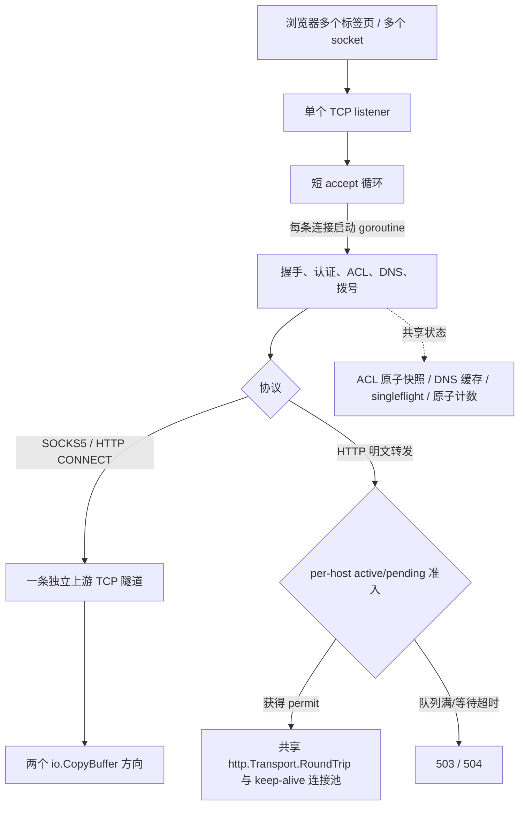
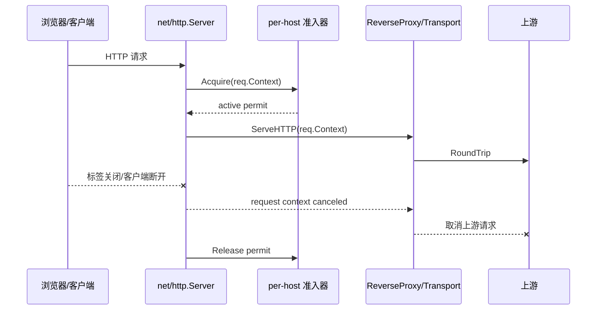

# SOCKS5 代理多连接并发与容量治理评审

**项目**：LinuxWebTool / `socks5-proxy`  
**日期**：2026-11-05  
**范围**：多标签页、多连接、高并发容量、共享状态竞争、现有测试/基础设施、可复用库与后续回归门禁  
**结论类型**：源码审查、测试先行实现、本机 loopback、Linux Race detector 与开发容器浏览器多标签验证。本文保留前两轮基线，并在末尾追加 2026-11-05 的断连取消和多标签复测结果。

## 结论摘要

没有发现所有浏览器标签页由同一个代理 goroutine 或单线程串行处理的结构。`Server.Run` 的 accept 循环虽然只有一个，但每条已接受连接都会进入独立 goroutine；Go 运行时会把等待网络 I/O 的 goroutine 复用到多个操作系统线程。SOCKS5 和 HTTP CONNECT 是按 TCP 连接隔离的隧道；HTTP 明文代理则由并发安全的共享 `http.Transport` 处理不同连接上的请求。多标签页不等于一标签一个 TCP 连接，但浏览器实际创建的并发连接不会被服务端的 accept 循环串行跑完整个生命周期。

目前没有证据表明标签页之间存在单线程代理冲突。此前容量优化轮次增加了 512 个默认活跃会话上限、HTTP 同 host 活跃请求和 pending 队列上限、队列超时及响应头等待上限；DNS 热读改成并发读、按秒采样淘汰热度，stale 刷新按 key 只调度一个 worker。新限制均可配置，状态接口暴露拒绝数、峰值、pending 与超时计数。

本机 DNS 缓存微基准显示热 key 中位数从 84.51 ns/op 降至 14.95 ns/op（约 5.7 倍吞吐）；64 key 中位数从 103.8 ns/op 降至 23.60 ns/op（约 4.4 倍）。这些是 Windows 开发机的缓存组件结果，不代表 Linux 代理端到端或生产容量。

继续保留 Go 标准库网络模型。当前用全局 session 预算限制隧道和 HTTP 请求总量，用 `MaxConnsPerHost` 与按 host 分片的请求准入器共同限制活跃上游请求和等待者；队列满时快速返回 503，等待超时返回 504。还需在目标 Linux 容器执行容量阶梯压测后校准默认值；没有必要先改事件循环或引入完整代理运行时。

## 当前并发模型

### 多标签页如何并发

- 浏览器的多个标签不保证一一对应代理连接：同源请求可能复用浏览器连接，HTTP/2 也可能在 CONNECT 隧道内部复用多条请求流。但代理收到的每条 TCP 连接仍有独立处理 goroutine 和连接状态。
- SOCKS5 CONNECT 与 HTTP CONNECT 是 TCP 字节隧道，每条隧道建立独立上游连接。代理不会把不同标签页的 TLS 或应用数据放到一个共享会话里。
- HTTP 明文代理由 `net/http.Server` 管理每条入站连接和 HTTP/1.x 请求生命周期，再调用共享 Transport/ReverseProxy；同一条 HTTP/1.x 连接上的请求顺序处理，不同连接并发。HTTP/2 复用通常发生在 CONNECT 隧道内部，不等于代理 accept 循环串行转发。
- 一个 SOCKS5/CONNECT 活跃会话至少持有一个入站和一个上游 socket；relay 阶段另有两个 copy goroutine。当前每个方向从 `sync.Pool` 获取 32 KiB 缓冲区，因而活跃 tunnel 的用户态复制缓冲约为 64 KiB/会话，另有 goroutine、协议状态和内核 socket 缓冲。池化减少反复分配，不会把并发活跃连接的缓冲内存变成常量。

## 代码证据与并发安全

| 位置 | 观察到的实现 | 对并发的意义 |
|---|---|---|
| `plugins/socks5-proxy/cmd/socks5-proxy/main.go`、`admission.go` | 单 accept 循环；通过 ACL 后先尝试获取 session permit，再启动连接 goroutine；默认上限 512，可由 flag/env 配置。 | 正常连接独立并发处理；达到上限后立即关闭新连接并计数，不再无界增加 handler goroutine。512 是初始保护值，未按目标 Linux 容器实测校准。 |
| `plugins/socks5-proxy/cmd/socks5-proxy/main.go:754-810` | relay 两个方向各自调用 `io.CopyBuffer`，每个方向租用 32 KiB pool buffer。 | 每个长隧道至少长期占用两个 copy goroutine 与两份缓冲；实际容量同时受内存、FD 和 socket 缓冲限制。 |
| `plugins/socks5-proxy/cmd/socks5-proxy/http_proxy.go`、`http_admission.go` | 共享 `http.Transport`；保留 idle 池设置，增加 `MaxConnsPerHost`（默认 128）、HTTP 响应头 timeout（默认 30 秒）和进入 Transport 前的 per-host active/pending 准入。 | active=128、pending=128；满队列 503、排队超过 5 秒返回 504。每 host 请求准入上限与 Transport 连接上限对齐，避免把超限请求继续堆进 Transport。 |
| `plugins/socks5-proxy/cmd/socks5-proxy/dns_cache.go` | `DnsLruCache.Get` 通过 `sync.Map.Load` 读取；hit/miss 计数原子化；热度每秒至多更新一次；只有写入/淘汰使用互斥锁。 | 并发读不再等待全局 LRU 锁；近似 LRU 以精确 recency 为代价。容量溢出时写路径扫描缓存选 victim，需继续观察高基数 DNS 写入成本。 |
| `plugins/socks5-proxy/cmd/socks5-proxy/dns_cache.go` | singleflight 按 key 管理 `done` channel；lookup 在带 timeout 的独立 goroutine 中执行；waiter 可取消；stale refresh 先登记 key 再异步调度。 | stale 热点每个 key 仅调度一个刷新 worker；冷查 waiter 可独立退出。不同 key 的 DNS lookup 没有额外全局并发信号量，需在高 churn Linux 压测中观察解析负载与 goroutine 数。 |
| `plugins/socks5-proxy/cmd/socks5-proxy/acl.go:145-152` | ACL 使用 `atomic.Pointer[CompiledAcl]` 做只读快照切换，计数也使用原子类型。 | ACL 热路径没有全局读锁，是适合高并发的已有实现。 |
| `plugins/socks5-proxy/cmd/socks5-proxy/main.go` | 活跃/总连接、拒绝数、峰值、流量及 DNS/dial 聚合计数使用原子操作；`/api/status` 暴露 session 与 HTTP admission 配置、active/pending/rejected/timeouts。 | 可观察 HTTP admission 当前排队和超限情况；仍没有 p95/p99 分布、goroutine、heap、FD 或按 host 的排队分布。 |
| `plugins/socks5-proxy/cmd/socks5-proxy/dialer.go:16-127` | Happy Eyeballs 式拨号最多并发尝试 4 个候选 IP。 | 单次多地址拨号有上界；连接风暴时额外的临时上游 socket 仍会叠加在入站并发之上。 |

共享状态并不等于单线程执行。当前看得到的互斥点是 DNS LRU、singleflight map 和 HTTP Transport 的懒初始化锁；ACL 与计数已原子化，relay copy 也没有每次 Read/Write 更新全局计数。它们是否造成可感知锁竞争，必须用并发 profile 证明。

### 已知生命周期风险

`Run` 收到取消后关闭 listener 并返回，但没有连接注册表、活跃连接 `WaitGroup` 或优雅 drain 截止时间。进程结束会由操作系统回收 socket；若以后需要不中断升级或明确验证插件停止语义，应加入连接注册表与可限时的 drain，而不是把关闭动作散落在每个 handler。

上一轮发现 HTTP 明文代理使用原始 `net.Conn` 和 `http.ReadRequest`，因此 active `RoundTrip` 不会立即感知客户端断开。本轮改为标准库 server request context 贯穿准入、ReverseProxy 与 Transport，并通过上游观察到 context 取消的集成测试验证。pending 阶段也从独立 background context 改为继承入站请求 context。`ResponseHeaderTimeout` 仍限制上游响应头等待；流式 body 不设置固定总时限，以免误伤长下载和流式响应。

## 并发测试与压测现状

- 当前工作区已有原协议单测、连接准入、DNS 并发/刷新、HTTP per-host 准入和响应头超时测试；本轮增加生产 HTTP server path 的断连取消、流水 keep-alive、CONNECT 首包保留和认证回归。
- 新增 DNS 并行缓存基准并完成优化前后同机采样。测试还不等价于 500+ 持续连接或 FD/RSS 容量阶梯。
- 新增 `tests/benchmark/proxy-multitab-performance.mjs`，对 Direct/HTTP/SOCKS5 同时打开 1/5/20 个页面，并记录成功率、批次耗时、导航 p50/p95 和请求失败数。
- `proxy-web-performance.mjs` 保留为单标签冷启动基准；新多标签脚本测的是浏览器资源并发，不是长隧道 soak。
- 既有浏览器测试记录过约 23 个页面资源全部成功，说明基本资源并发可用；它没有采集连接数、goroutine、FD、内存或高负载 p95/p99。
- 本机 Windows 的 `CGO_ENABLED=0` 且没有 GCC；本轮已在 Linux 开发容器（Go 1.26.10/GCC）运行 SOCKS5 模块 `go test -race ./...` 并通过。是否把 race 检查固定进 CI 仍可单独决定。

上一轮判定为：**未发现标签共享单线程代理会话；HTTP active 请求断连取消和真实 Linux 多标签容量尚未验证。** 本轮已补断连取消、浏览器 1/5/20 标签和 Linux Race detector；更高阶连接阶梯及 FD/RSS/goroutine/cgroup 数据仍需后续压测。

## 本轮优化前的本机基线

以下数据在 2026-11-05 的 Windows/amd64 开发机采集（AMD Ryzen 7 7435H，Go 1.27.3，基准使用 16 个逻辑线程）；它用于同机前后对比，不代表 Alpine/Linux 容器的容量。

| 验证项 | 优化前结果 |
|---|---|
| 现有 Go 单测 | `go test ./...` 通过，1.666 秒。 |
| DNS 热 key 并行读取 | 三次 `-benchtime=1s`：84.51、84.30、84.83 ns/op；0 B/op、0 allocs/op。 |
| DNS 64 key 并行读取 | 三次 `-benchtime=1s`：103.7、105.2、103.8 ns/op；0 B/op、0 allocs/op。 |
| DNS mutex profile | 初始 profile 总累计 mutex delay 为 86.03 秒，其中 `DnsLruCache.Get` 累计约 85.19 秒（约 99%）；当时 PowerShell 对 `-run=^$` 的传参导致测试也进入 profile，因此该 profile 只作锁热点定位，不与后续纯 benchmark profile 比较总量。 |
| 连接容量 | 当前 accept 路径没有 active session 上限或 over-capacity 计数，无法给出已有容量上限或超限曲线。 |

已先添加回归测试并确认 RED：连接准入、过载拒绝计数、DNS 异步单 key 调度、HTTP 同 host 并发上限及响应头超时相关符号当前不存在，因此测试编译失败符合预期。DNS 并行基准已留在 `dns_cache_benchmark_test.go`，用于优化后同机复测。

## 本轮优化后验证

复测仍在同一 Windows/amd64 开发机、Go 1.27.3、16 个逻辑线程完成。每项 DNS 基准重复 3 次，保持 0 B/op、0 allocs/op：

| 基准 | 优化前范围 / 中位数 | 优化后范围 / 中位数 | 中位数变化 |
|---|---:|---:|---:|
| 单一热点域名并发读取 | 84.30–84.83 / 84.51 ns/op | 14.67–19.54 / 14.95 ns/op | 约 82% 更低，约 5.7 倍吞吐 |
| 64 域名并发读取 | 103.7–105.2 / 103.8 ns/op | 23.40–24.71 / 23.60 ns/op | 约 77% 更低，约 4.4 倍吞吐 |

优化前 profile 将 `DnsLruCache.Get` 标记为主要 mutex 热点；优化后的纯 benchmark 隔离 profile 总 delay 为 2.12 毫秒，top 中不再出现缓存读/写锁竞争（剩余为 Go runtime 调度/GC 锁）。两次 profile 的测试范围不同，因此不比较累计 delay 数字；优化效果以同一命令配置下的三轮 benchmark 延迟为主证据。profile 的累计等待时间受并发 worker 数影响，不等同于墙钟延迟。

行为门禁与验证结果：

- `go test ./...` 通过；`go test -count=3 ./...` 连续三轮通过。
- 收尾复测 `go test -count=1 ./...` 通过（1.899 秒），`go vet ./...` 通过。
- 连接突发测试：128 个本地 `net.Pipe` 会话、上限 8 时只启动 8 个 handler，拒绝 120 个；关闭后 active 与 permit 计数回到 0。
- HTTP host 上限测试：4 个 loopback upstream 请求、`MaxConnsPerHost=2` 时同时活动数不超过 2；释放首批后四个请求都完成。
- 上游不返回响应头测试：设置 120 ms timeout 后代理在 1 秒门限内返回 502，上游 context 被取消，handler 退出。
- DNS 测试：同一个 stale key 同时仅调度一个刷新 worker；冷查 waiter 可取消而共享 lookup 仍完成。
- `GOOS=linux GOARCH=amd64 CGO_ENABLED=0 go build` 通过。
- `go test -race ./...` 未能运行：本机 `CGO_ENABLED=0` 且没有 GCC；这是环境限制，不是 race 测试通过。

上述 DNS/admission 轮次没有对开发/生产实例施压，也没有真实浏览器多标签或 Linux 端到端容量测试；这项缺口由本文末尾的后续验证补齐一部分。当前 512 sessions、128 HTTP connections/host、30 秒响应头等待仍是保护性默认值，尚未由大规模长时压测校准。

## 第二轮：HTTP 同 host pending 队列治理

### 优化前状态与测试先行

优化前 `http.Transport.MaxConnsPerHost` 只能限制连接数。超过连接槽位的 `RoundTrip` 会在 Transport 内等待，代码没有 per-host pending 上限或等待 deadline。第一版回归测试先引用新配置和准入器接口，运行时按预期编译失败，报告缺少 `MaxHTTPPendingPerHost`、`HTTPQueueTimeout`、`HTTPHostRequestLimiter` 等符号，确认测试覆盖的是当前尚无实现的约束。

### 实现

- 新增 `HTTPHostRequestLimiter`，以 host 为隔离键，活跃请求上限与 `MaxHTTPConnsPerHost` 对齐；每 host FIFO pending 默认最多 128 个。请求 permit 在响应体转发完成后释放，避免只限制到响应头而让慢响应体绕过准入边界。
- 队列满时快速返回 **503**；等待默认最多 **5 秒**，超时返回 **504**。配置项为 `--http-max-pending-per-host` / `SOCKS5_HTTP_MAX_PENDING_PER_HOST` 与 `--http-queue-timeout` / `SOCKS5_HTTP_QUEUE_TIMEOUT`。
- limiter 使用 32 个 host hash shard、idle bucket 复用和一次性原子 permit 释放；每 shard 最多保留 1024 个 host bucket（总上限 32768），仅淘汰没有 active 或 queued 请求的 idle bucket。`/api/status` 增加 active/pending/rejected/timeout 计数。
- 增加 FIFO 交接、满队列拒绝、等待超时清理、跨 host 独立容量、单 shard 513 个 active host 状态，以及 128 个同 host waiter 的并发上限测试；另用真实 loopback upstream 验证 503/504 响应。

### 复测

- `go test -count=3 ./...` 通过（5.988 秒）；`go test -run=TestHTTPHostRequestLimiter -count=10` 通过（6.690 秒）；`go vet ./...` 通过；Linux amd64 CGO-disabled 构建通过（11,261,748 字节）。
- HTTP 同 host 四请求/active=2 测试通过；active=1、pending=1 时第三个请求快速收到 503；队列中的请求在 permit 释放后完成；超过 60 ms 配置后返回 504 并回收 waiter。128 个并发 waiter 全部完成，峰值不超过 active=8，结束后 active/pending 均回到 0。
- limiter 微基准在同一台 Windows/amd64 主机、Go 1.27.3、16 个逻辑线程运行三轮。它比较 limiter 第一版全局锁/按请求创建 bucket 与本轮分片/复用后的内部开销，不是端到端代理吞吐：

| 场景 | limiter 第一版中位数 | 分片/复用后中位数 | 优化后分配 |
|---|---:|---:|---:|
| 单一热点 host | 118.5 ns/op | 104.1 ns/op | 32 B/op，1 alloc/op |
| 多 host 并发（16 个固定 worker key，32 个候选 host key） | 356.0 ns/op | 66.02 ns/op | 32 B/op，1 alloc/op |

多 host 场景约降低 81% 操作延迟；单 host 约降低 12%。该 benchmark 主要说明 limiter 控制开销，没有模拟 HTTP 网络 I/O，不能用来推断浏览器页面整体快了 81%。

### 剩余边界

客户端在请求已进入 active 后关闭标签页，当前原始 `net.Conn` 仍无法即时取消请求；无响应头会由 `ResponseHeaderTimeout` 回收，已收到响应头后的流式 body 会持续到上游结束或写回客户端失败。响应体不设总超时，以免破坏长下载和流式响应。不同 DNS host 的并行 lookup 也还没有全局并发预算。

## 优化空间与建议优先级

| 优先级 | 风险/机会 | 建议 |
|---|---|---|
| P0 | 活跃入站会话现在默认上限 512；阈值尚未按目标 Linux 容器的 FD、socket memory 和可用内存校准。 | `SOCKS5_MAX_ACTIVE_SESSIONS` 可调；通过拒绝数/峰值指标和 Linux 并发阶梯压测再定生产值。超限当前快关闭新 socket，不创建额外业务 goroutine。 |
| P0 | 已验证浏览器 20 标签和最高 82 个活跃入站连接；500+ 持续连接阶梯以及 FD、RSS、goroutine、cgroup throttling 尚无数据。 | 后续在隔离的开发目标上分阶段测连接 churn、长隧道和更高并发；先补进程级观测，再设吞吐/延迟门槛。 |
| P1 | 原始入站 context 不感知 client disconnect 的缺陷已修复并验证。 | 新 server request context 贯穿 admission 与 ReverseProxy；active 上游取消测试在 500ms 内通过。响应体持续传输期间仍无总时限，客户端断开由 context/写失败回收。 |
| P1 | per-host 请求准入和 pending 队列已有上限，但默认值尚未在目标环境校准。 | active 默认 128、pending 默认 128、queue timeout 默认 5 秒；通过 `/api/status` 观察 active/pending/rejected/timeouts，在 Linux 容器与浏览器多标签阶梯压测后调参。 |
| P1 | status 已暴露 active/peak/rejected、有效 session/HTTP 上限及 DNS/dial count/total/max；仍无 goroutine、heap、FD、GC 和 p95/p99 延迟分布。 | 增加只读、loopback 限定的 runtime/FD 指标或 pprof；用固定桶/采样记录阶段分布，避免完整 URL 或凭据成为标签。 |
| P2 | DNS 精确全局 LRU 读锁已替换成 `sync.Map` 并发读与按秒采样的近似淘汰；写入在一把锁下执行，容量溢出时扫描 entry 选 victim。 | 同机热点读取明显加快；后续观察高基数 DNS 写入和 cache hit ratio。采样淘汰不再保证严格逐次 LRU 顺序，TTL/负缓存语义保持。 |
| P2 | Go module 声明 `go 1.24`；当前本机 build toolchain 是 Go 1.27.3。Go 1.25+ 的容器 CPU quota 感知默认受语言兼容 GODEBUG 默认影响，1.24 及以下语言版本可能仍使用旧默认。 | 读取运行中的 `runtime.GOMAXPROCS(0)`、CPU affinity 与 cgroup quota；按实际发布工具链决定升级模块 Go 行、注入 `GODEBUG=containermaxprocs=1`，或在需要兼容旧工具链时评估 `go.uber.org/automaxprocs`。GOMAXPROCS 只控制同时执行 CPU 工作的 goroutine 数，不是连接数/线程总数上限。 |
| P2 | 长期空闲或单向半关闭隧道会占用 session permit；通用 idle timeout 可能误伤 WebSocket、SSH、长下载和 HTTP/2。 | 若运行数据证明需要，再引入按协议可配置 tunnel idle/half-close timeout；当前不强制截断流量。 |

## 建议设计：准入、会话和阶段策略

### 1. 连接准入与资源预算

当前已在 accept 边界加入小型 `ConnectionAdmission`，不使用固定 worker pool：

1. 当前默认 `max_active_sessions=512`，可通过 `--max-active-sessions` 或 `SOCKS5_MAX_ACTIVE_SESSIONS` 覆盖；一个槽覆盖连接握手到关闭的整个生命周期。
2. 达到上限时 accept 后快速关闭新 socket，增加 rejected 计数，不进入业务 goroutine。listen backlog 只缓冲短暂 accept 调度波动，不提供持续过载排队。
3. `ConnectionPermit` 用 `sync.Once` 确保每条会话最多释放一次；测试覆盖超限拒绝和连接关闭后 permit 归零。
4. 512 是可调初始保护值，不是目标容器实测的容量结论。建议按 `maxSessions <= min((nofileLimit - reservedFDs)/2, memoryBudget/observedMemoryPerSession, configuredCap)` 在 Linux 环境校准；socket buffer 与 allocator 会因平台和流量变化，不能只用 64 KiB relay 缓冲计算总内存。
5. 当前没有独立 `max_handshakes`、按 client IP 公平限流或 stop 时的 session registry/drain；后续只有在监控或生命周期需求证明必要时再加。`handleConn` 的握手 deadline 仍是 15 秒。

超限时“排队还是拒绝”是服务策略。对长寿命 TCP tunnel，不建议用固定大小 goroutine pool 包住连接全生命周期：慢连接会占满 worker 并挡住新连接。应用侧队列必须有上限和超时，不能靠无限 goroutine 排队。

### 2. DNS 与 HTTP 上游

- stale 刷新现在调用 `DoAsync`，先在 singleflight map 内登记 key 再启动 goroutine，同 key 的后续 stale hit 不再创建等待 goroutine。不同 key 尚无全局 DNS lookup 并发上限。
- cold miss 使用 `DoContext`：共享查询运行在独立 timeout context；每个 waiter 可以单独取消等待，不会取消其他会话共享的 DNS lookup。timeout 由 `--connect-timeout` 传给缓存 resolver。
- HTTP 明文 L7 配置 `MaxConnsPerHost` 与独立的 per-host request admission。active 默认 128、pending 默认 128；满队列 503，等待超过默认 5 秒返回 504。active permit 覆盖响应体转发阶段。
- HTTP 上游响应头默认最多等待 30 秒，可由 `--http-response-header-timeout` 或环境变量调整；pending 阶段由独立 queue timeout 控制。入站请求 context 会取消 active `RoundTrip` 与队列等待；响应体不设固定总时限。
- DNS LRU 热读改用 `sync.Map.Load`，touch 热度最多每秒更新一次；容量溢出时在写路径做 sampled approximate-LRU 淘汰。该取舍已由微基准量化，但仍要用部署环境观察 cache hit ratio 与 DNS miss 写入成本。
- 对 SOCKS/CONNECT 的上游 socket 不做 HTTP 连接池复用；这些连接承载任意字节流，每个会话需要独立 TCP 状态。

### 3. 适配器、策略和状态机是否值得用

| 模式 | 建议位置 | 并发收益与边界 |
|---|---|---|
| Adapter | 现有 `IDnsResolverStrategy`、`http.Transport.DialContext` 保持解析/拨号替换点；`ConnectionAdmission.TryAcquire/Release` 是连接预算边界。 | 适配器本身不提速；收益是可以独立验证超限、释放和取消语义。当前没有新增多层适配器。 |
| Strategy | 实现选择固定 `RejectFast`，容量由 flags/env 配置；DNS stale refresh 与同步 miss 分开处理。 | 当前只有一种过载策略，不额外包装 `OverloadPolicy`；若未来需要有界排队/公平调度再抽策略接口。 |
| State machine | 会话 `ConnectionPermit` 表达“已准入/已释放”；HTTP host request permit 在“active/queued/granted/cancelled/released”状态间转移。 | 用显式 waiter 队列和一次性 release 保证 permit 交接、取消和超时清理；没有引入通用 FSM 库，通用状态机对这段简单生命周期不会更快。 |
| Decorator | 需要连接级观测时给 `net.Conn` 加轻量 session recorder；字节计数维持当前 copy 结束后汇总。 | 不要在每次 Read/Write 取全局锁/更新原子计数；增加采样或 session 级聚合，避免观测本身压缩吞吐。 |
| Worker pool | 不推荐用小固定 pool 包住完整 TCP session。 | Tunnel 会阻塞等待网络，池子会被长连接占住；做短 CPU/日志/刷新工作时可用有界 queue，连接生命周期用 admission semaphore。 |

## 库与业界方案对比

| 方案 | 并发/限流思路 | 对本插件的判断 |
|---|---|---|
| Go 标准库 `net` / runtime netpoll | 连接 handler 可用 goroutine 写阻塞式 I/O；runtime 负责调度和网络等待。Go goroutine 会复用 OS threads，因此不需要为每个标签页固定一个 OS thread。 | 当前正确基础。先修资源上限和观测；不要将“一个 goroutine/连接”误判为“一个 OS thread/连接”。 |
| `net/http.Transport` | 多 goroutine 并发安全；复用 transport；idle 连接可控；`MaxConnsPerHost` 限制每 host active+dialing+idle 总量；`ResponseHeaderTimeout` 限制请求发出后等待响应头的时间。 | 当前另在 Transport 前加 per-host active/pending admission，使超限等待可计数、可拒绝、可超时；仍需在 Linux 与浏览器测试中调校 128/128/5 秒默认值。 |
| `golang.org/x/sync/semaphore` | 支持加权容量、`Acquire(ctx)`、`TryAcquire` 与 `Release`。 | 适合 admission 需要 context 和可测试接口的场景。当前 Go module 没有外部依赖；若只需单权重并快速拒绝，标准库 buffered channel 也足够。 |
| `golang.org/x/sync/singleflight` | keyed call dedup；`DoChan` 允许调用者通过 context 选择何时停止等待。 | 可替代自制 singleflight；需要独立、有限时 leader context。单换库不会消除每个 stale hit 先启动的 goroutine，刷新调度也要改。 |
| `Ristretto` | 高并发、TinyLFU/采样淘汰、cost budget；以写入缓冲和最终一致性换吞吐，某些新 key 写入可能被丢弃。 | 可作为 DNS cache profile 证明锁竞争后的对照实验；并非首选直接替换，因为 DNS TTL/负缓存/刷新一致性是安全语义，必须有 freshness 与 anti-rebinding 测试。 |
| `go.uber.org/automaxprocs` | 按 Linux cgroup CPU quota 设置 GOMAXPROCS，适合旧 Go runtime 默认不匹配容器 quota 的场景。 | 先核对实际 Go toolchain、`go.mod` 兼容默认、cgroup 和 runtime 值；Go 1.25+ 标准 runtime 可配置提供同类行为。不是并发连接限额。 |
| `gnet` | epoll/kqueue 事件循环、事件回调、多 event loop，应用需自行实现协议层。 | 只有压测证明大量 idle connection 的 goroutine/内存或调度是主要瓶颈时，另做 Linux-only POC。它不是 `net.Conn` drop-in；需重写 SOCKS/HTTP、TLS opaque relay、缓冲、错误和半关闭语义，增加维护/跨平台风险。 |
| Envoy | worker threads/event loop；连接绑定 worker；连接池；对 cluster active connections、pending requests、requests 设置 circuit breakers 和观测计数。 | 借鉴“资源预算 + 有界 pending + 可观察溢出”。Envoy 更适合多集群、HTTP 多路复用控制面；本插件现有协议体量不需要先引入完整 proxy runtime。 |
| NGINX / HAProxy | NGINX `worker_connections` 统计 worker 同时连接数且包含代理上游连接，仍受 open-file limit 约束；HAProxy `maxconn` 会把超额连接留在 listen queue。 | 借鉴 FD 预算和 listen backlog 的边界说明。调 host backlog/FD 是共享主机级运维设置，不能由 SOCKS 插件随意改 sysctl。 |

## 系统可复用基础设施

- **已有代理基础**：单 Go 进程、TCP listener、ACL 原子快照、DNS 缓存/singleflight、Happy Eyeballs 式候选上限、共享 HTTP Transport、`sync.Pool`；本轮增加 `ConnectionAdmission`、DNS `sync.Map` 读路径/async singleflight、HTTP per-host active/pending admission 与两阶段 timeout，不需要换服务端库或引入 semaphore 依赖。
- **插件管理能力**：Go resident plugin runtime、restart/supervision、热更新；运行 spec 支持 `EnvironmentVariables`，manifest 也有 `Environment` 字段，可承载显式 `GOMAXPROCS`/`GODEBUG` 或容量配置。当前 `socks5-proxy/plugin.json` 没有并发上限字段、GOMAXPROCS 或 profile 开关。
- **系统的并发实现参考**：主系统有 `SemaphoreSlim` 有界并发使用示例（例如 `UnifiedExecutionEngine`），可参考其“try/acquire/release + cancellation”生命周期，但 SOCKS 数据面仍需在 Go 进程内控制。
- **容器部署**：当前 `scripts/deploy-remote.ps1` 两条 `docker run` 命令未显式设置 `--cpus`、`--memory`、`--pids-limit` 或 `--ulimit nofile`；主容器使用 `--privileged --pid=host`。这不证明宿主没有 daemon/default cgroup 限制，但表示仓库没有给该代理设独立容器资源预算。
- **工具缺口**：`/api/status` 暴露 active/total/peak/rejected、session/HTTP 配置上限、HTTP active/pending/rejected/queue timeouts、bytes、DNS cache 计数和 DNS/dial count/total/max；没有 goroutine、heap、FD、GC 与 p95/p99，也没有启用 loopback-only pprof。主系统页面可观察整体资源，不等同于 Go 代理进程级 profile。
- **Go 版本**：本机 `go version` 为 `go1.27.3 windows/amd64`，模块声明 `go 1.24`。Go 1.25 新增 container-aware GOMAXPROCS，但语言版本兼容默认对 go1.24 及以前仍可能保留旧行为；要检查进程真实 `runtime.GOMAXPROCS(0)`，不能只看 build toolchain 版本。

## 可执行压测与防回归门禁

### 压测矩阵

在 loopback upstream 和独立本地服务上先测，不直接对生产目标施压；机器资源充足后再跑受控开发实例。按 `[1, 10, 50, 100, 500, 1000]` 活跃 session 阶梯运行，实际步长可按主机 FD/内存自动提前停止：

1. **短连接 churn**：连接/认证/解析/拨号/关闭循环，量出 accept rate、失败/超时、FD/TIME_WAIT 和 CPU。
2. **长连接 idle**：SOCKS5、HTTP CONNECT 各保持数分钟，分清连接上限、goroutine/heap/内核 socket memory 曲线。
3. **双向数据流**：并发传送固定大小随机内容（例如 64 KiB、1 MiB），验证 hash、吞吐、CPU、GC 与 p95/p99；另覆盖一侧 FIN 后延迟返回、RST 和强制断线。
4. **HTTP L7**：单一热点 host、多 host、冷/热 DNS、stale DNS、慢响应；覆盖上游永不返回响应头、响应体持续慢速传输、客户端等待期间断开；观测 active/pending 上游连接与 `http.Transport` 排队。
5. **突发和恢复**：从低负载快速跃迁到上限以上，验证拒绝数、延迟是否有界、停止负载后 active/goroutine/FD/heap 是否回落。
6. **多标签浏览器**：Playwright 同时开 1/5/20 个页面，使用确定性多资源页面；区分冷/热 browser、HTTP/1.1 与 HTTP/2（可用时）、Direct/HTTP/SOCKS5，每个场景重复并报告成功率而不只报告均值。

每档至少采集：新连接/秒、活跃/峰值/拒绝、连接失败率、握手/DNS/dial/首字节/下载 p50/p95/p99、吞吐、goroutine、heap/alloc/GC、FD、上游 active/idle、cgroup throttling。固定 Go build/toolchain、CPU/cgroup、`ulimit -n`、内核 backlog 与测试目标。用 `go test -bench -benchmem` 做组件微基准；用 Go mutex/block/heap/cpu profile 与 execution trace 判断 DNS lock、调度或分配是否真是热点。

### 第一阶段验收门禁

- 并发阶梯里的成功率、拒绝行为和延迟上限可重复；超额连接不会让 active session、goroutine、FD 或 heap 持续增长。
- 所有连接完成或被拒绝后，active sessions、相关 FD、goroutine 数在设定 drain deadline 后回到基线范围；关闭/错误路径每个 permit 只释放一次。
- 长流双向 hash 一致，半关闭响应不截断；RST/客户端断开后两端连接最终关闭。
- HTTP L7 上游不返回响应头时在配置期限内结束；等待中客户端断开后，handler 和上游连接可观测地回收；慢速但持续有数据的响应体按既定 idle 策略工作。
- stale DNS 在同一 host 的高并发命中只有一个后台 refresh task；取消 waiter 不取消共享 lookup；不同 key lookup 数量需有界或通过压测证明安全。
- HTTP per-host active 与 pending 均有限；饱和时得到可识别的 503/504 或快速失败，不无限堆积 RoundTrip 等待者。断连取消、keep-alive、CONNECT buffered payload、认证与 20 标签场景已验证；500+ 连接/长时容量阶梯仍未验证。
- Linux 开发容器 `go test -race ./...` 已通过；Race detector 用于竞争检查，不代表性能容量结论。
- 在至少三个重复样本和相同环境里对比优化前后 p95/p99、CPU、堆、拒绝率和吞吐；达到测量稳定后才设 CI 阻断阈值。

## 代码与测试索引

| 文件 | 用途 | 关键位置 |
|---|---|---|
| `plugins/socks5-proxy/cmd/socks5-proxy/main.go`、`admission.go` | accept、会话准入/生命周期、relay、指标 API | `Run` 415；`startAcceptedSession` 467；admission 实现 `admission.go`；metrics endpoint 884 |
| `plugins/socks5-proxy/cmd/socks5-proxy/dns_cache.go` | 并发缓存、singleflight、stale refresh | `Get` 约 100；`Set` 约 127；singleflight `DoContext`/`DoAsync` 约 239/280；stale refresh 约 370 |
| `plugins/socks5-proxy/cmd/socks5-proxy/http_proxy.go` | HTTP forward、共享 Transport、DNS/dial 注入 | request loop `handleHttpProxy` 51；Transport 与连接限制 314 |
| `plugins/socks5-proxy/cmd/socks5-proxy/http_server.go` | 单连接 listener Adapter、HTTP server context、ReverseProxy、认证和 per-host admission | `serveHTTPProxy`、`serveHTTPProxyRequest`、`newHTTPForwardReverseProxy` |
| `plugins/socks5-proxy/cmd/socks5-proxy/http_admission.go` | 每 host active/pending FIFO 准入、队列超时/快拒绝、分片桶与状态快照 | `HTTPHostRequestLimiter.Acquire`、`Release`、`Snapshot` |
| `plugins/socks5-proxy/cmd/socks5-proxy/dialer.go` | ACL 后候选地址连接竞速 | `dialUpstreamWithRace` 16 |
| `plugins/socks5-proxy/cmd/socks5-proxy/acl.go` | RCU ACL 快照 | `AclEngine` 146 |
| `plugins/socks5-proxy/cmd/socks5-proxy/dns_cache_test.go` | 同一 DNS host 20 并发请求 singleflight 测试 | `TestCachedDnsResolver_SingleflightDeduplication` 132 |
| `plugins/socks5-proxy/cmd/socks5-proxy/concurrency_test.go` | admission 并发上限/释放、128 连接突发、DNS cache 并发读写、singleflight dedup/cancel、配置解析 | 本轮新增局部容量与并发回归测试；用 `net.Pipe`，不是实际 listener 压测 |
| `plugins/socks5-proxy/cmd/socks5-proxy/http_concurrency_test.go` | HTTP 同 host 上限、响应头超时、active 断连取消、流水 keep-alive、CONNECT 首包保留、认证 | loopback upstream + `net.Pipe`；断连测试要求 500ms 内取消 |
| `plugins/socks5-proxy/cmd/socks5-proxy/http_admission_test.go` | HTTP host FIFO、满队列 503、队列 timeout 504、host 隔离与 limiter benchmark | loopback upstream + admission 微基准；不替代浏览器负载测试 |
| `plugins/socks5-proxy/cmd/socks5-proxy/dns_cache_benchmark_test.go` | DNS hot-key 与 64-key 并发读取 benchmark | 本轮优化前后性能对比，非完整代理吞吐基准 |
| `plugins/socks5-proxy/cmd/socks5-proxy/http_proxy_test.go`、`relay_test.go`、`socks5_flow_test.go` | HTTP keep-alive/慢响应、relay 半关闭、SOCKS5 数据流测试 | 原有聚焦协议测试 |
| `plugins/socks5-proxy/cmd/socks5-proxy/metrics_test.go` | DNS/dial 阶段聚合指标的并发安全快照测试 | `TestPhaseMetricObserveAndSnapshot` |
| `tests/benchmark/proxy-benchmark.mjs` | 串行协议/TTFB 样本 | `SAMPLE_COUNT` 39；场景循环 433 |
| `tests/benchmark/proxy-web-performance.mjs` | 冷浏览器页面样本 | `PAGE_SAMPLES` 33；采样循环 179 |
| `tests/benchmark/proxy-multitab-performance.mjs` | Direct/HTTP/SOCKS5 同时多标签浏览器基准 | `MULTITAB_COUNTS=1,5,20`；`MULTITAB_SAMPLES=3` |
| `plugins/socks5-proxy/go.mod` | Go module 版本声明 | `go 1.24` |
| `src/LinuxWebTool.Infrastructure/Features/Plugins/Adapters/GoRuntimeAdapter.cs` | Go 插件启动环境适配 | `BuildStartSpec` 约 49/192 |
| `scripts/deploy-remote.ps1` | Docker 开发/生产部署参数 | dev run 517；official run 592 |

## 相关本地文档

- [SOCKS5 全链路验证与主流优化方案复核](socks5-proxy-full-flow-validation-and-mainstream-optimization-review.md)
- [SOCKS5 浏览器延迟审计与回归门禁](socks5-browser-latency-audit-and-regression-gates.md)
- [SOCKS5 优化路线与可行性](socks5-proxy-optimization-roadmap-and-feasibility.md)

## 官方文档与项目资料

- [Effective Go: Goroutines](https://go.dev/doc/effective_go#goroutines) — goroutine 与操作系统线程的复用模型。
- [Go FAQ: Concurrency](https://go.dev/doc/faq#Concurrency) — goroutines、调度、GOMAXPROCS 和并行限制。
- [Go 1.25 Release Notes: Container-aware GOMAXPROCS](https://go.dev/doc/go1.25#runtime) 与 [runtime package](https://pkg.go.dev/runtime) — cgroup quota 默认与 Go 语言版本兼容行为。
- [`net/http.Transport`](https://pkg.go.dev/net/http#Transport) — 并发安全、连接池、idle 与 `MaxConnsPerHost` 语义。
- [`golang.org/x/sync/singleflight`](https://pkg.go.dev/golang.org/x/sync/singleflight) 与 [`semaphore`](https://pkg.go.dev/golang.org/x/sync/semaphore) — keyed work dedup、可取消等待和容量获取。
- [Go Diagnostics](https://go.dev/doc/diagnostics) 与 [`net/http/pprof`](https://pkg.go.dev/net/http/pprof) — goroutine、mutex、heap、CPU 和 trace 诊断。
- [`http.ReadRequest`](https://pkg.go.dev/net/http#ReadRequest) 与 [`Request.Context`](https://pkg.go.dev/net/http#Request.Context) — 手动 HTTP/1.x 请求解析和 server/client 请求 context 的取消语义；本项目的连接取消判断是结合源码作出的推论。
- [Envoy threading model](https://www.envoyproxy.io/docs/envoy/latest/intro/arch_overview/intro/threading_model)、[connection pooling](https://www.envoyproxy.io/docs/envoy/latest/intro/arch_overview/upstream/connection_pooling.html) 与 [circuit breaking](https://www.envoyproxy.io/docs/envoy/latest/intro/arch_overview/upstream/circuit_breaking.html) — worker 绑定、池化和有界资源管理。
- [NGINX `worker_connections`](https://nginx.org/en/docs/ngx_core_module.html#worker_connections) — 每 worker 连接数包括代理上游连接并受 open-file limit 约束。
- [HAProxy `maxconn`](https://docs.haproxy.org/3.4/configuration.html#4.2-maxconn) — 连接容量、listen queue 与文件描述符观测。
- [Ristretto](https://github.com/dgraph-io/ristretto) — 高并发缓存吞吐与最终一致性/可能丢弃新 key 写入的取舍。
- [`go.uber.org/automaxprocs`](https://github.com/uber-go/automaxprocs) — 旧 runtime 下按 Linux 容器 CPU quota 设置 GOMAXPROCS。
- [gnet](https://github.com/panjf2000/gnet) — 基于 epoll/kqueue 的独立事件循环网络框架，不是 Go `net.Conn` 的直接替换。

## 2026-11-05 后续轮次：HTTP 断连取消与 Linux 多标签验证

### 根因和本轮改动

旧生产路径在 `handleConn` 中用 `http.ReadRequest` 手动解析代理请求。该 API 产生的请求没有 `net/http.Server` 的入站连接 context；代码又以 `context.Background()` 创建排队 context，所以关闭标签页只会让响应写回失败，已经进入 `RoundTrip` 的上游仍可能等待到 `ResponseHeaderTimeout`（默认 30 秒）。这不是“多标签共用一个线程”问题，是入站连接生命周期没有传递到出站请求。

本轮把 HTTP 分支改为每条已识别连接建立 `singleConnListener`，让标准库 `http.Server` 接管 HTTP/1.x 生命周期。生产 handler 用 `req.Context()` 派生排队 context，并把同一 context 传入 `httputil.ReverseProxy` 与共享 `http.Transport`。请求取消后，Transport 中正在等待连接、响应头或响应 body 的操作可随 context 结束；active permit 由 `defer` 在代理 handler 退出时释放。`CONNECT` 仍走原始字节 relay：标准库解析完 CONNECT 后调用 `Hijack`，并将 Hijacker 返回的 buffered reader 包入 `BufferedConn`，避免吞掉已经读入缓冲区的 TLS ClientHello 数据。

HTTP 连接状态交给标准库的 `StateNew/Active/Idle/Hijacked/Closed` 生命周期处理；请求资源状态是“解析 → 认证 → 路由/ACL → pending → active → 响应 → 释放”，任一等待阶段都可转为取消或拒绝。无需再引入通用状态机库。`singleConnListener` 是把已有连接适配为 `net.Listener` 的小型 Adapter；现有 `IDnsResolverStrategy` 保持 DNS 策略替换点。过载策略仍只有 FIFO、有界 pending、503 快拒绝与 504 排队超时，当前不值得为一个策略再加 Strategy 接口。

### 测试、基线和复测

先新增 active 断连测试，再以旧逻辑运行。上游已经收到请求、客户端关闭后，旧逻辑未能在 500ms 内取消；它最终依赖 3 秒 `ResponseHeaderTimeout` 才结束。改动后测试确认上游 handler 在 500ms 内观察到 `r.Context().Done()`，代理 handler 随后返回。相同生产入口还覆盖流水 keep-alive、每个请求重新认证、`Proxy-Authorization` 不转发、CONNECT 预读首包、HTTP host 并发上限和响应头超时。

| 验证 | 优化前 | 优化后 |
|---|---|---|
| HTTP active 请求断连 | 新测试 RED：500ms 内未取消；约 3 秒响应头 timeout 后才结束。 | 本机 `go test -count=3 -timeout=120s ./...` 连续通过；断连取消测试在 500ms 门限内通过。 |
| 本机静态检查 | — | `go vet ./...` 通过；多标签脚本 `node --check` 通过。 |
| Race detector | Windows 本机 `CGO_ENABLED=0`、无 GCC，无法执行。 | Linux 开发容器 Go 1.26.10 + GCC：`CGO_ENABLED=1 go test -race -count=1 -timeout=180s ./...` 通过（3.138 秒）。 |
| 热更新 | 开发容器运行旧二进制。 | 通过 `scripts/deploy-remote.ps1 -HotUpdatePlugin socks5-proxy` 原子热更新；PID 更新且 Linux ELF SHA256 与本机产物相同。开发容器未重建；生产容器未触碰。 |

浏览器脚本用同一开发 Web 页面、Playwright Chromium、3 轮，分别同时打开 1/5/20 个标签；每页导航等待 `load`，每页完成请求数中位数为 21。下表为同机样本的批次墙钟时间 p50（毫秒）；优化前是旧开发插件，优化后是最终热更新版本：

| 同时标签数 | Direct 基线→复测 | HTTP Proxy 基线→复测 | SOCKS5 基线→复测 | 每模式成功页 / 总页 |
|---:|---:|---:|---:|---:|
| 1 | 293.5 → 278.7 | 312.3 → 291.4 | 324.5 → 284.5 | 3 / 3 |
| 5 | 477.1 → 420.3 | 554.7 → 486.6 | 808.8 → 448.2 | 15 / 15 |
| 20 | 1347.6 → 1256.9 | 1601.4 → 1288.1 | 1507.2 → 1203.8 | 60 / 60 |

相对 Direct 的 HTTP Proxy 批次耗时差，从基线的 **+6.4% / +16.3% / +18.8%** 变为复测的 **+4.5% / +15.8% / +2.5%**（1/5/20 标签）。20 标签的 HTTP 代理 p95 页面加载时间从 1446ms 降到 1170ms，Direct 控制组从 1232ms 降到 1123ms。1 与 5 标签数据波动较大，5 标签相对 Direct 的差异几乎没有改变；这组样本不能证明所有页面场景都快于直连，也不是固定 SLA。SOCKS5 数据是同轮控制组；本次代码改动集中于 HTTP 明文转发，不应把 SOCKS5 指标变化归因于本轮代码。

Linux `/api/status` 在 20 标签负载后观测到峰值活跃入站连接 **66**、拒绝连接 **0**、HTTP active/pending/rejected/queue timeout 均为 **0**；采样时还留有 1 条 active session。接口无 goroutine、FD、RSS、GC 或延迟直方图，因而这个结果能证明目标容器实际处理了多标签连接且没有准入拒绝，不能替代长时 soak 或连接 drain 证明。基准使用相同页面和固定场景顺序，目标为开发 Web 页面；不要从该结果外推公网浏览体验或 500+ 并发容量。

### 库、主流方案与现有基础设施

| 候选 / 方案 | 借鉴点 | 本项目判断 |
|---|---|---|
| Go `net/http.Server`、`Request.Context`、`httputil.ReverseProxy` | Server request context 在客户端连接关闭时取消；ReverseProxy负责 hop-by-hop headers、流式 response 和 Upgrade 代理。 | 已复用标准库，无新增依赖。对 HTTP L7 正好补齐连接/请求生命周期；CONNECT 不交给 ReverseProxy，而在 `Hijack` 后保留现有 TCP relay。参见 [Request.Context](https://pkg.go.dev/net/http#Request.Context)、[ReverseProxy](https://pkg.go.dev/net/http/httputil#ReverseProxy)。 |
| [`elazarl/goproxy`](https://github.com/elazarl/goproxy) | 可作为 HTTP/HTTPS 可定制 handler，含 CONNECT、HTTP 处理钩子和 MITM 能力。 | 可借鉴 handler 钩子；当前 ACL/DNS/Happy Eyeballs/准入/自定义监听已在本地，整体替换会扩大依赖、升级与策略适配面，也不需要 MITM，故不引入。 |
| Envoy | worker/event-loop 处理连接；上游池；对 active connections、pending requests 和 requests 做 circuit breaker 并提供统计。 | 当前规模保留 Go goroutine + netpoll；已借鉴有界 active/pending 与拒绝/超时观测。若未来 profile 证明大量 idle 连接的调度或内存是瓶颈，再评估事件循环或 sidecar，不先迁移整套运行时。参见 [threading model](https://www.envoyproxy.io/docs/envoy/latest/intro/arch_overview/intro/threading_model)、[pooling](https://www.envoyproxy.io/docs/envoy/latest/intro/arch_overview/upstream/connection_pooling.html)、[circuit breaking](https://www.envoyproxy.io/docs/envoy/latest/intro/arch_overview/upstream/circuit_breaking.html)。 |
| HAProxy / NGINX | `maxconn`、`worker_connections`、listen queue 与 FD 上限相互约束。 | 借鉴资源预算和 overflow observability；宿主 FD/内核参数是共享容器宿主设置，本次不擅自修改。参考 [HAProxy maxconn](https://docs.haproxy.org/3.4/configuration.html#4.2-maxconn)、[NGINX worker_connections](https://nginx.org/en/docs/ngx_core_module.html#worker_connections)。 |

可复用项已经在仓库：`http.Transport` 连接池和自定义 `DialContext`、ACL 原子快照、DNS cache/singleflight、per-host FIFO admission、全局 `ConnectionAdmission`、`sync.Pool` relay buffer、插件平台热更新及 `/api/status`。不需要引入 `x/sync/semaphore`、gnet 或新的通用 FSM。`ReverseProxy.Rewrite` 默认会移除客户端 Forwarded/X-Forwarded 信息；本实现显式保留旧 HTTP forward 行为，同时由 ReverseProxy 剥离 Proxy 认证和 hop-by-hop headers。

### 后续门禁和尚未覆盖的性能风险

- 代码回归：`go test ./...`；Linux CI 或开发容器再跑 `CGO_ENABLED=1 go test -race ./...`。断连测试保持 500ms 取消门限，HTTP pending/active permit 在取消后应回到 0。
- 协议回归：流水 keep-alive 两个响应均正确；每个 keep-alive 请求重新认证；Proxy-Authorization 不出站；HTTP CONNECT 后第一段已缓冲 tunnel bytes 不丢失；ReverseProxy Upgrade/WebSocket 行为可用专门测试补齐。
- 浏览器门禁：PowerShell 先设置 `$env:MULTITAB_SAMPLES='3'`，再运行 `node tests/benchmark/proxy-multitab-performance.mjs`；任一主页面失败即非零退出，另观测每页 failed requests 与 `/api/status` 拒绝/active/pending。性能阈值先用 direct 对照累积稳定样本，不以单个页面差异阻断 CI。
- 仍需后续测 50/100/500 活跃连接阶梯、长时 idle tunnel、RST/半关闭、慢速 response body、FD/RSS/goroutine/cgroup throttling、p95/p99 和停载后的会话回收；不要在生产主机做无上限压力测试。
- Adapter 路径每个 HTTP socket 仍会创建 `net/http.Server` 管理 goroutine，与外层 session goroutine 共存。浏览器 20 标签未出现拒绝，但尚未量到 goroutine/heap 成本；先补 Linux profile，若在高阶梯成为瓶颈再优化 listener 管线。当前没有证据表明需要迁移 gnet 或把状态机做成通用框架。
