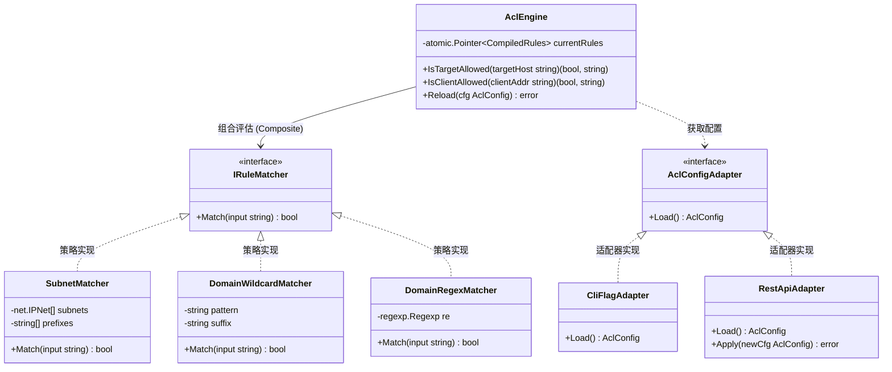
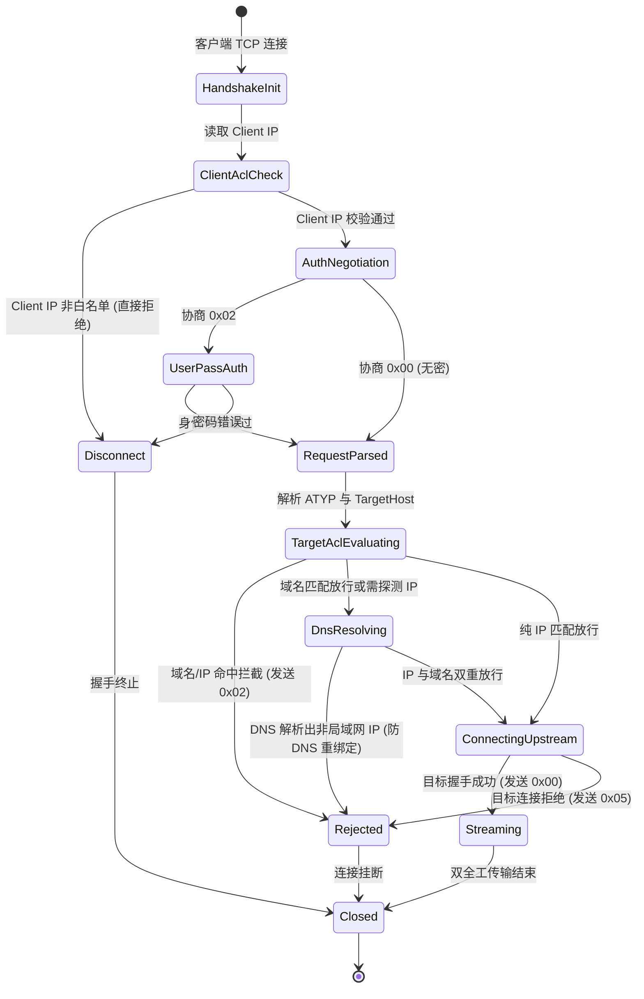

# SOCKS5 代理网段白名单控制与域名通配符/正则过滤架构设计方案

> **文件标识**：`docs/socks5-proxy-subnet-whitelist-and-domain-filter-design.md`  
> **创建日期**：2026-11-02  
> **责任领域**：插件运行时生态、微服务网络安全、RFC 1928 访问控制（ACL）  
> **适用组件**：`plugins/socks5-proxy`、`GoRuntimeAdapter`、`LinuxWebTool.Infrastructure`、`LinuxWebTool.WebHost`

---

## 1. 需求背景与业务场景

在轻量级私有 Linux 面板及边缘微服务场景中，SOCKS5 代理微服务（基于 Go 引擎实现）常用于内网运维穿透、跨 VPC 纳管及跳板通道。默认“全网透明转发”存在严重的安全性隐患：
1. **内网未授权跳板风险**：若监听端口对外暴露且无 ACL 控制，外部客户端可借助此 SOCKS5 代理任意扫描并渗透云主机内网 VPC 其他高危资产；
2. **公网滥用与 SSRF 放大**：代理可能被作为公开代理滥用，向公网发起恶意爬虫或攻击，导致宿主 IP 被云厂商封禁；
3. **配置繁琐与认知门槛**：标准 CIDR 语法（如 `10.0.0.0/8`, `192.168.0.0/16`）对日常运维不够轻量，用户迫切需要**“只允许 10.、127.、192.168. 等前缀”**的直观快速配置，以及**“域名通配符（如 `*.internal`）与正则表达式”**的精细化规则放行。

---

## 2. 头脑风暴：可行性、逻辑缺陷与高并发性能瓶颈分析

### 2.1 可行性论证 (Feasibility)
- **协议契约兼容性**：SOCKS5 协议规范（RFC 1928）定义了原生的握手与请求报文结构。当客户端发起 `CONNECT` 时，协议层通过 `ATYP`（地址类型）明确传递 `0x01` (IPv4)、`0x03` (Domain) 或 `0x04` (IPv6)。针对未授权目标的拦截，协议明确保留了响应状态码 `repRuleViolation (0x02 - Connection not allowed by ruleset)`，可在传输层握手期间毫秒级优雅拦截，完全符合 RFC 规范；
- **语言生态匹配度**：Go 语言标准库（`net`, `regexp`, `strings`, `sync/atomic`）具备工业级的网络套接字操作与线性时间复杂度正则表达式引擎，无需引入任何第三方库即可在纯标准库体系下完整实现。

### 2.2 逻辑缺陷与安全性暗坑分析 (Logic & Security Pitfalls)

| 潜在风险/逻辑暗坑 | 现象与后果 | 深度防御对策 |
| :--- | :--- | :--- |
| **DNS 重绑定绕过<br>(DNS Rebinding)** | 攻击者配置私有域名（如 `evil.internal`）通过了域名白名单，但其 DNS 权威解析临时指向公网恶意 IP，绕过了 IP 白名单限制。 | **出站二次校验（Dual-Check / Egress Enforcement）**：<br>在域名匹配通过后、调用 `net.DialTimeout` 之前，必须对 DNS 实际解析出的目标 IP 再次进行 IPFilter 校验。若解析出禁用网段，立即熔断阻断。 |
| **内网 DNS 探测泄露<br>(DNS Information Leak)** | 客户端恶意发起大量未授权域名的 SOCKS5 请求，若代理盲目发起上游 DNS 查询，会导致内网 DNS 服务器成为放大器或暴露内网服务拓扑。 | **域名规则前置静态过滤**：<br>优先评估域名规则（通配符/正则）。未命中放行名单的域名，在 SOCKS5 握手层立即回复 `0x02`，**绝对不发起上游 DNS 查询**。 |
| **IPv4 映射的 IPv6 逃逸<br>(IPv4-Mapped IPv6)** | 客户端使用 `::ffff:10.0.0.1` 形式请求。若代码仅做字符串匹配或纯 IPv6 比对，将无法匹配 `10.` 前缀。 | **IP 规整化**：<br>在所有 IP 检查前执行 `if ip4 := ip.To4(); ip4 != nil { ip = ip4 }`，保证 IPv4/IPv6 语义纯净。 |
| **正则回溯拒绝服务<br>(ReDoS Attack)** | 用户若输入了灾难性回溯的复杂正则（如 `(a+)+$`），恶意构造的超长域名可能导致 CPU 100% 挂死。 | **Go RE2 引擎线性安全保证**：<br>Go 内置 `regexp` 采用 RE2（有限状态自动机，DFA/NFA），时间复杂度强保证为 $O(N)$，天生免疫 ReDoS。同时结合预编译缓存避免运行时开销。 |
| **子域名包含歧义** | 用户配置 `*.internal` 时，根域 `internal` 本身是否放行？ | **业界统一语义规范**：<br>`*.domain` 规则标准化匹配 `sub.domain` 与 `domain` 本身；若仅允许子域，支持使用前缀或显式正则。 |

### 2.3 性能瓶颈与高并发优化分析 (Performance & Concurrency)

1. **零分配快速通道（Fast-Path）**：
   - 避免将所有通配符盲目转换为正则表达式；
   - 针对最频繁的 `*.domain` 规则，提取后缀执行 `strings.HasSuffix`，比正则匹配快 15~20 倍，且零堆内存分配；
2. **预编译缓存与热路径零分配**：
   - 严禁在每个请求的处理热路径中调用 `regexp.Compile` 或 `net.ParseCIDR`；
   - 所有规则在配置加载或热重载时一次性完成编译，以不可变（Immutable）结构体提供服务；
3. **DNS 结果有界缓存（Bounded DNS Cache）**：
   - 针对高频内网服务域名，内置并发安全的轻量级 DNS 缓存（TTL 60s），避免并发短连接代理重复消耗系统 `getaddrinfo` 线程池与网络 RTT。

---

## 3. 业界主流方案对比与深度借鉴

调研对比当前主流代理与网关的 ACL 规则体系：

```
┌────────────────────────────────────────────────────────────────────────┐
│                        业界成熟 ACL 方案横向对比                        │
├─────────────┬─────────────────┬─────────────────┬──────────────────────┤
│ 方案名称    │ 规则表达能力    │ 性能与实现机制  │ 对本工程的借鉴价值   │
├─────────────┼─────────────────┼─────────────────┼──────────────────────┤
│ Clash /     │ DOMAIN-SUFFIX   │ Trie 树域名匹配 │ 借鉴其前缀与后缀极简 │
│ Mihomo      │ DOMAIN-KEYWORD  │ Radix-Tree IP   │ 规则分类体系；支持   │
│             │ DOMAIN-REGEX    │ 快速路由分流    │ no-resolve 避免无谓  │
│             │ IP-CIDR         │                 │ DNS 查询             │
├─────────────┼─────────────────┼─────────────────┼──────────────────────┤
│ V2Ray /     │ domain: (suffix)│ strmatcher 引擎 │ 借鉴其全域名与正则的 │
│ Xray        │ full: (exact)   │ 多模式匹配      │ 标识前缀语法         │
│             │ regex: (RE2)    │                 │ (如 `regex:...`)     │
│             │ geoip:private   │                 │                      │
├─────────────┼─────────────────┼─────────────────┼──────────────────────┤
│ Squid Proxy │ dstdomain       │ 链式 ACL 评估   │ 借鉴其 RFC 规范状态码│
│             │ dstdom_regex    │ 进程级静态加载  │ 映射机制与来源/目标  │
│             │ src (客户端 IP) │                 │ 分离控制思路         │
├─────────────┼─────────────────┼─────────────────┼──────────────────────┤
│ Envoy Proxy │ direct_remote_ip│ RBAC Network    │ 借鉴其无锁原子配置   │
│             │ safe_regex      │ Filter，零拷贝  │ 热更新机制 (RCU)     │
│             │ prefix / suffix │ 状态快照更新    │                      │
└─────────────┴─────────────────┴─────────────────┴──────────────────────┘
```

---

## 4. 当前系统既有基础设施与复用评估

1. **Go 运行时引擎（`GoRuntimeAdapter`）**：
   - 已具备 JIT 增量编译（`.cache/bin/app`）、毫秒级热启动与 Macro 参数解析能力（`{port}` 等）；
   - 微服务新增参数无需调整引擎核心调度，直接在 `plugin.json` 的 `arguments` 中声明即可生效；
2. **微服务内置 HTTP 观测端口（Metrics/Management Channel）**：
   - `main.go` 中已预留基于 Loopback 的 HTTP 服务框架（`startMetricsHttp`）；
   - 可直接就地复用并扩展：
     - `GET /api/config`：读取当前白名单与拦截计数；
     - `POST /api/config`：动态提交网段与域名白名单，触发无锁原子热更新；
3. **Webview 控制台与现代化前端组件**：
   - `plugins/socks5-proxy/ui/index.html` 采用 Vue 3 CDN / Cyber-Dark 风格；
   - 现存结构已具备实时状态轮询与指标展示，可直接无缝嵌入“安全访问控制（ACL）”可视化卡片与快捷预设药丸。

---

## 5. 设计模式与软件架构设计

为确保高内聚、低耦合与高扩展性，本方案综合运用以下设计模式：



### 5.1 策略模式（Strategy Pattern）与组合模式（Composite Pattern）
- 抽象统一匹配契约 `IRuleMatcher`；
- 分别实现 `SubnetMatcher`（网段前缀+CIDR）、`DomainWildcardMatcher`（通配符/后缀）与 `DomainRegexMatcher`（RE2 正则）；
- `AclEngine` 作为组合根，统一按顺序编排执行规则过滤，支持任意规则的无缝扩充。

### 5.2 状态机模式（State Machine Pattern）
SOCKS5 连接生命周期状态转移模型扩展为 7 态受控转移：



### 5.3 RCU 原子读写与无锁热更新（Read-Copy-Update Pattern）
- 配置热更新（通过 Webview 切换预设或修改文本框）时，微服务内部不加重量级排他互斥锁；
- 新配置在后台线程完成校验、解析与正则编译后，生成全新的不可变 `CompiledRules` 实例；
- 通过 `atomic.Pointer[CompiledRules].Store()` 实现原子指针替换；现存正在通信的代理会话继续使用原有规则，新发起的连接瞬间无感知读取最新规则，达成零中断、零锁竞争。

---

## 6. 具体实现方案与核心规范

### 6.1 规则表达语法规范

输入字符串采用逗号分隔（支持换行符），引擎自动识别并分类：

1. **IP 与网段规则**：
   - 快捷前缀：`10.`（匹配 `10.0.0.0/8`）、`127.`（匹配本机回环）、`192.168.`、`172.16.`；
   - 标准 CIDR：`10.126.0.0/16`、`192.168.1.0/24`、`fc00::/7`；
   - 单点 IP：`127.0.0.1`、`::1`。
2. **域名规则**：
   - 通配符：`*.internal`、`*.corp.local`、`api-*.lan`；
   - 精确匹配：`router.local`、`gateway.internal`；
   - 正则表达式：以 `regex:` 为前缀，如 `regex:^([a-z0-9-]+\.)?corp$`。
3. **快捷预设（Presets）**：
   - `preset:lan`（默认推荐）：
     - IP：`10.0.0.0/8, 172.16.0.0/12, 192.168.0.0/16, 127.0.0.0/8, ::1/128, fc00::/7, fe80::/10`
     - 域名：`*.local, *.internal, *.lan, *.home.arpa, localhost`
   - `preset:loopback`：仅允许 `127.0.0.0/8, ::1/128, localhost`
   - `preset:all`：允许所有（`0.0.0.0/0, ::/0, *`）

### 6.2 核心模块代码骨架 (`cmd/socks5-proxy/acl.go`)

```go
package main

import (
	"fmt"
	"net"
	"path"
	"regexp"
	"strings"
	"sync/atomic"
)

type RuleMatcher interface {
	Match(target string, ip net.IP) bool
	String() string
}

type SubnetRule struct {
	cidr   *net.IPNet
	prefix string
}

func (r SubnetRule) Match(target string, ip net.IP) bool {
	if ip == nil {
		return false
	}
	if ip4 := ip.To4(); ip4 != nil {
		ip = ip4
	}
	if r.cidr != nil {
		return r.cidr.Contains(ip)
	}
	if r.prefix != "" {
		s := ip.String()
		return strings.HasPrefix(s, r.prefix+".") || s == r.prefix
	}
	return false
}

type WildcardDomainRule struct {
	pattern string
	suffix  string
}

func (r WildcardDomainRule) Match(target string, ip net.IP) bool {
	d := strings.ToLower(target)
	if r.suffix != "" {
		return strings.HasSuffix(d, r.suffix) || d == r.suffix[1:]
	}
	matched, _ := path.Match(r.pattern, d)
	return matched
}

type RegexDomainRule struct {
	raw string
	re  *regexp.Regexp
}

func (r RegexDomainRule) Match(target string, ip net.IP) bool {
	return r.re.MatchString(target)
}

type CompiledAcl struct {
	AllowAll       bool
	Subnets        []SubnetRule
	DomainRules    []RuleMatcher
	BlockedTargets uint64
	AllowedTargets uint64
}

type AclEngine struct {
	rules atomic.Pointer[CompiledAcl]
}
```

### 6.3 SOCKS5 `handleConnect` 双重门禁集成

```go
// 1. 优先对域名与目标主机进行匹配
allowed, needDnsCheck := acl.EvaluateTarget(targetHost)
if !allowed && !needDnsCheck {
    s.logger.Warn("connect target rejected by domain whitelist", "target", targetHost)
    _ = s.sendReply(conn, repRuleViolation, nil) // RFC 1928: 0x02
    return fmt.Errorf("target %s blocked by ACL policy", targetHost)
}

// 2. 解析实际出站目标 IP
var resolvedIP net.IP
if ip := net.ParseIP(targetHost); ip != nil {
    resolvedIP = ip
} else {
    // 域名需解析并进行防 DNS 重绑定校验
    ips, err := net.LookupIP(targetHost)
    if err != nil || len(ips) == 0 {
        _ = s.sendReply(conn, repHostUnreach, nil)
        return fmt.Errorf("dns lookup failed for %s", targetHost)
    }
    resolvedIP = ips[0]
}

// 3. 终审出站 IP 校验 (出站 Egress 双检)
if !acl.IsIpAllowed(resolvedIP) {
    s.logger.Warn("connect target blocked: resolved IP disbarred by subnet policy",
        "target", targetHost, "resolvedIp", resolvedIP.String())
    _ = s.sendReply(conn, repRuleViolation, nil)
    return fmt.Errorf("resolved IP %s is disbarred by subnet policy", resolvedIP.String())
}
```

---

## 7. 架构安全门禁规划

为杜绝后续迭代发生降级或逻辑回归，规划新增架构自动化测试断言：

- **`LinuxArch044`：SOCKS5 代理网段白名单与域名过滤安全门禁**：
  1. `main.go` 必须实现 RFC 1928 `repRuleViolation (0x02)` 拦截状态码，严禁静默吞掉或错误回复通用异常；
  2. 匹配器必须支持便捷前缀（如 `10.`、`127.`、`192.168.`）与通配符 `*.` 快速通道；
  3. 必须包含 DNS 重绑定二次校验，防止通过恶意域名将流量导向公网或被拦截地址；
  4. Webview 控制台与微服务交互必须具备 ACL 规则状态与拦截指标上报。

---

## 8. 总结与落地路线

| 阶段 | 核心任务 | 交付产物 |
| :--- | :--- | :--- |
| **阶段 1** | 实现核心 ACL 规则引擎与解析器（CIDR、前缀、通配符、RE2 正则） | `plugins/socks5-proxy/cmd/socks5-proxy/acl.go` |
| **阶段 2** | 在 SOCKS5 握手阶段集成客户端与目标端双重门禁 | 更新 `plugins/socks5-proxy/cmd/socks5-proxy/main.go` |
| **阶段 3** | 扩展 HTTP 管理接口并升级 Webview 控制面板 | 更新 `plugins/socks5-proxy/ui/index.html` 与 `plugin.json` |
| **阶段 4** | 编写架构门禁与端到端自动化测试用例 | 新增 `LinuxArch044` 门禁 |
| **阶段 5** | 远程 Linux 环境发布部署与 Chrome DevTools MCP 实机验收 | 验收截图与报告 |
