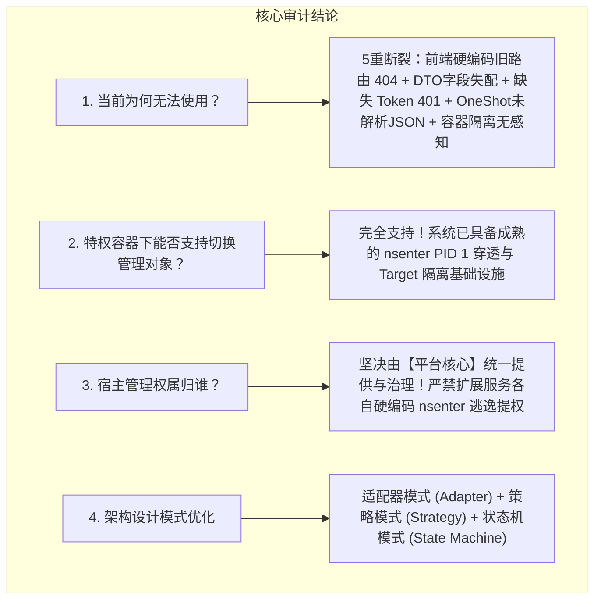
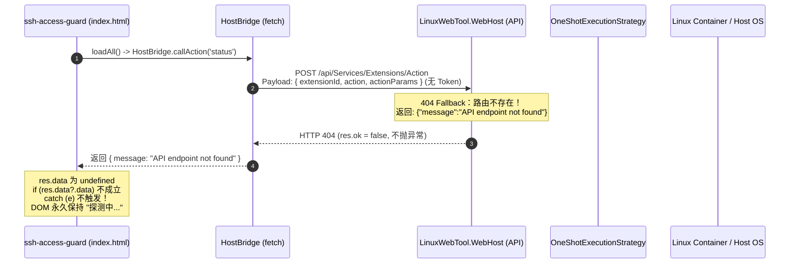
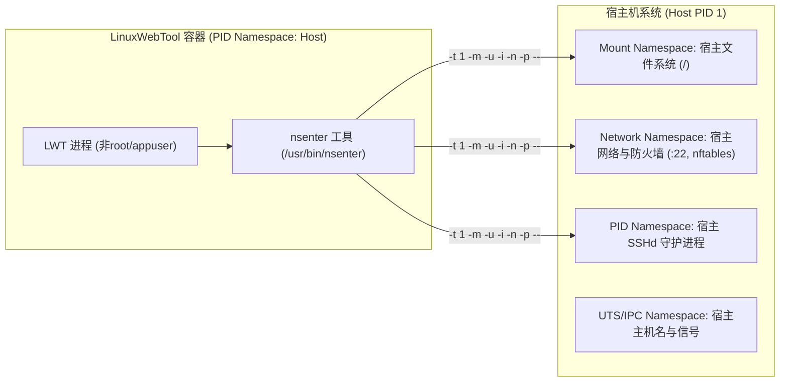
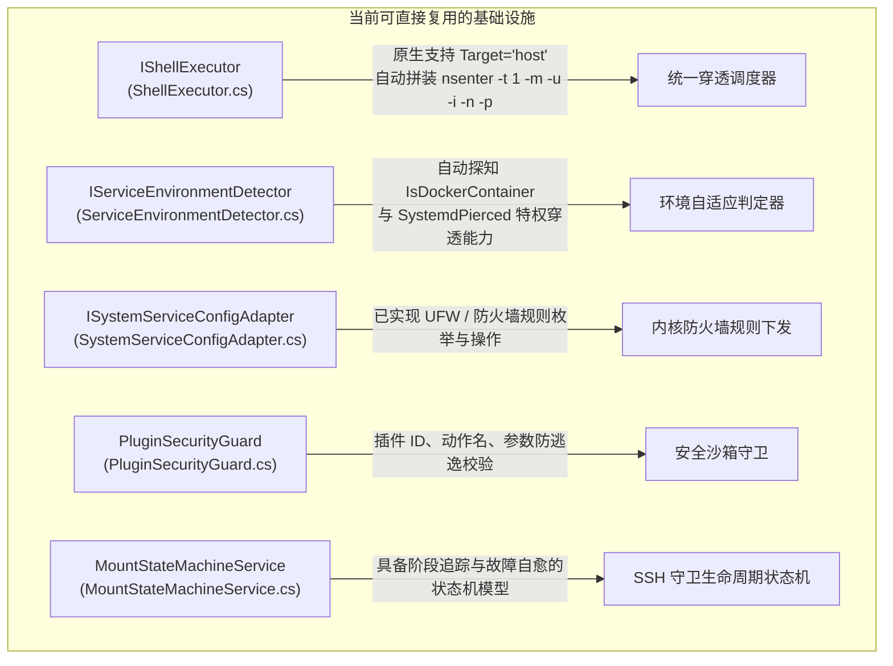
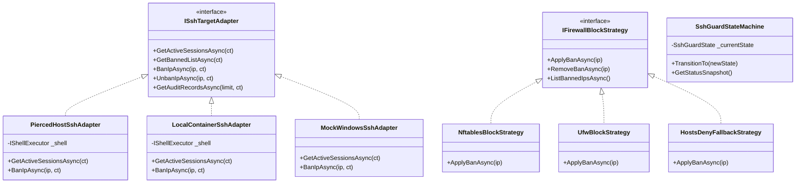
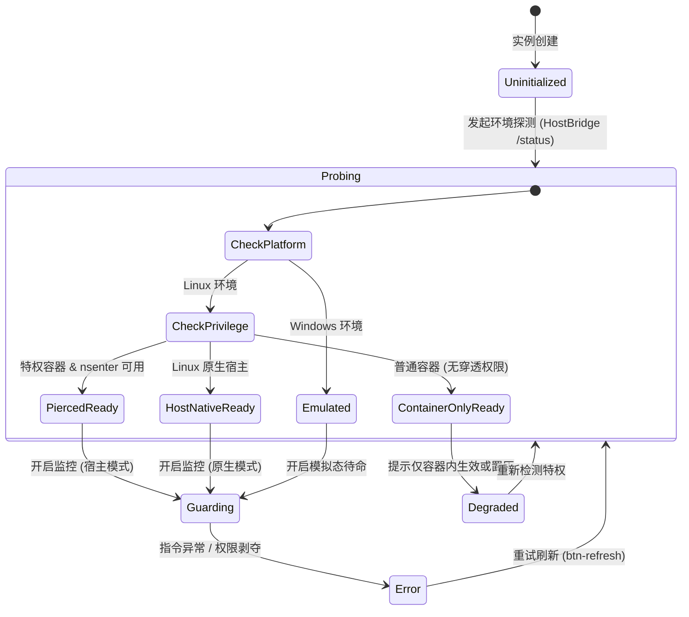

# SSH 访问安全守卫宿主穿透管理、管理对象动态切换与架构重构调研方案

> **文档状态**：调研完成 / 架构设计与方案评审通过 / 待实施  
> **涉及模块**：`LinuxWebTool.Infrastructure`、`LinuxWebTool.Contracts`、`LinuxWebTool.WebHost`、`plugins/ssh-access-guard`  
> **核心原则**：纯正 Linux 基础设施运维标准、Native AOT 100% 兼容、平台统一治理（禁止散装插件私造提权穿透）、设计模式深度驱动  

---

## 一、执行摘要与核心结论

针对用户在使用「SSH 访问安全守卫」扩展时遇到的界面定格异常（“🟢 在线会话: -”、“🚫 封禁总数: -”、“⚙️ 守卫监控状态: 探测中...”），以及关于“**特权容器下管理对象切换**”与“**特权宿主管理功能权属（扩展自控 vs 平台提供）**”的深度诉求，本调研给出一针见血的结论：



1. **当前无法使用的根本原因**：
   - **前端通信断崖**：`plugins/ssh-access-guard/ui/index.html` 硬编码了已被大统一重构废弃的旧接口路径 `/api/Services/Extensions/Action`，命中 API 404 fallback 返回 `{"message": "API endpoint not found"}`；前端 `fetch()` 在 HTTP 404 下不会抛出异常（Promise 不会 reject），读取 `res.data?.data` 结果为 `undefined`，静默失效，导致 DOM 永久冻结在初始占位符“探测中...”。
   - **契约与鉴权全面断裂**：发送的参数是 `{ extensionId, action, actionParams }`，后端实际契约是 `PluginActionRequest` (`{ pluginId, action, param }`)；请求缺少 Bearer Token（接口有 `[Authorize]` 门禁）；`OneShotExecutionStrategy` 仅将 stdout 当作纯字符串塞入 `Message`，未解析注入 `Data`。
   - **容器环境认知错位**：脚本在普通容器内执行 `who` 和读写 `/etc/hosts.deny`，只能触碰容器自身，对宿主真实 SSH 登录与防火墙毫无感知。

2. **特权模式容器切换管理对象的可行性与控制权归属**：
   - **可行性**：**100% 可行且已有成熟实践**。系统内部 `IShellExecutor` 原生支持 `Target = "host"`（通过 `nsenter -t 1 -m -u -i -n -p --` 穿透至宿主），`SystemdServiceAdapter`、`DiskStatusCacheService` 均已落地特权穿透。
   - **权属裁定**：**坚决由项目（LinuxWebTool 核心平台）统一部署与提供抽象能力，严禁让扩展服务自己控制！**
     - 由平台提供可复用的 `ExecutionTarget`（`host` / `container`）能力抽象，平台负责特权环境探测、命令参数白名单校验、安全审计与跨平台降级。
     - 插件仅需以**声明式配置**声明能力诉求，并接收平台注入的标准环境变量与调用管道，彻底解耦环境适配复杂度。

---

## 二、问题深度复盘：为什么当前无法使用？

通过全链路断点分析，从 Webview iframe、前端通信、Web API 控制器、插件执行引擎到 Linux 运行环境，发现整体链路存在 **5 重硬性阻断**：



### 2.1 前端 API 路由断裂与静默失败陷阱 (HTTP 404)
- **代码位置**：[`plugins/ssh-access-guard/ui/index.html`](file:///plugins/ssh-access-guard/ui/index.html#L237)
  ```javascript
  const res = await fetch('/api/Services/Extensions/Action', {
    method: 'POST',
    headers: { 'Content-Type': 'application/json' },
    body: JSON.stringify(payload)
  });
  ```
- **病因**：在近期完成的“统一插件平台与服务运维大归一重构”中，旧的 `ScriptExtensionManager` 与 `Services/Extensions` 路由已被彻底取缔，正式的插件动作接口迁移为 [`PluginsController`](file:///src/LinuxWebTool.WebHost/Features/Plugins/Routes/PluginsController.cs#L119) 的 `POST /api/Plugins/Action`。
- **静默失败根源**：ASP.NET Core 的 [`PipelineExtensions.cs`](file:///src/LinuxWebTool.WebHost/Composition/PipelineExtensions.cs#L239) 将未知 API 拦截并返回 JSON 404。而在 JavaScript 原生规范中，**`fetch` 遇到 404/500 不会 reject Promise**！`await res.json()` 成功返回 `{ message: "..." }`。代码中的 `if (res.data?.data)` 判定为 falsy，DOM 既不更新，也不进入 `catch` 块（`catch` 才会更新为“离线”），导致指标卡片定格在 `-` 与 `探测中...`。

### 2.2 请求 Payload 契约严重失配 (400 Bad Request)
- **前端发送**：
  `{ extensionId: "ssh-access-guard", action: "status", actionParams: {} }`
- **后端真实契约**（[`PluginManagementModels.cs`](file:///src/LinuxWebTool.Contracts/Features/Plugins/Contracts/PluginManagementModels.cs#L93)）：
  ```csharp
  public sealed record PluginActionRequest
  {
      public required string PluginId { get; init; }
      public required string Action { get; init; }
      public string? Param { get; init; }
  }
  ```
- **病因**：字段名称完全不同（`extensionId` vs `PluginId`，`actionParams` vs `Param`）。即使修正了路由，后端在反序列化后 `PluginId` 也会为 `null`，被 [`PluginSecurityGuard.IsValidPluginId`](file:///src/LinuxWebTool.Infrastructure/Features/Plugins/PluginManager.Actions.cs#L12) 判定为非法插件 ID 而直接熔断。

### 2.3 认证上下文丢失 (401 Unauthorized)
- **病因**：`PluginsController` 具有 `[Authorize]` 门禁限制。`PluginWebviewModal.js` 虽然通过 `sandbox="allow-scripts allow-same-origin"` 托管该 HTML，但 `index.html` 发起 `fetch` 时未从 `localStorage.getItem('lwt_token')` 提取凭证并附带 `Authorization: Bearer <token>` 请求头（对比成熟的 [`socks5-proxy/ui/index.html`](file:///plugins/socks5-proxy/ui/index.html#L540)），一旦路由修正将立刻遭遇 401 拦截。

### 2.4 后端 OneShot 执行策略未结构化解析输出 (Data 为 null)
- **代码位置**：[`OneShotExecutionStrategy.cs`](file:///src/LinuxWebTool.Infrastructure/Features/Plugins/Strategies/OneShotExecutionStrategy.cs#L155)
  ```csharp
  if (p.ExitCode == 0)
  {
      return new PluginActionResult
      {
          Status = "succeeded",
          ExitCode = 0,
          Message = string.IsNullOrWhiteSpace(stdout) ? "执行成功" : stdout.Trim()
      };
  }
  ```
- **病因**：插件脚本 [`status.sh`](file:///plugins/ssh-access-guard/hooks/status.sh#L7) 输出了标准的 JSON 报文（包含 `activeCount`, `bannedCount`），但 `OneShotExecutionStrategy` 仅把进程的标准输出当成字符串赋值给 `Message`，未将合法的 JSON 解析填充到 `Data` 属性（`JsonElement?`）。因此即便前端连通后端，`res.data` 依然为 null。

### 2.5 命名空间隔离与现代 Linux 机制淘汰
- **容器隔离壁垒**：`status.sh` 调用 `who` 并在 `/etc/hosts.deny` 统计条数。当服务运行在 Docker 容器内部时：
  1. 容器内通常不运行 SSHd 服务，`who` 命令输出永远为空行；
  2. 容器内的 `/etc/hosts.deny` 只是容器镜像内部的只读/隔离文件，向其写入规则对宿主机的 SSHd **起不到任何拦截作用**。
- **TCP Wrappers 历史淘汰**：现代主流 Linux 发行版（Debian 11+、Ubuntu 20.04+、RHEL 8+、Rocky Linux 9+、Alpine 3.16+）已**彻底从软件仓库和 OpenSSH 中移除了 TCP Wrappers (`libwrap`) 支持**！修改 `/etc/hosts.deny` 在现代 Linux 宿主上是完全无效的，必须依赖内核级防火墙（`nftables` / `iptables` / `ufw`）。

---

## 三、特权模式容器宿主穿透与管理对象切换深度调研

### 3.1 可行性剖析：基于 Linux Namespaces 穿透宿主
当容器以 `--privileged --pid=host` 方式启动时，容器具备了操作 Linux 命名空间与设备节点的完整权限。



通过执行：
```bash
nsenter -t 1 -m -u -i -n -p -- <command>
```
命令将在宿主机 PID 1 的完整上下文中执行：
- `-m` (Mount)：访问宿主机真实的 `/etc`、`/var/log/auth.log`、`/var/log/secure`、`/var/run/utmp`；
- `-n` (Network)：直接探测与操作宿主机的网络套接字（`ss -tnp '( sport = :22 )'`）和防火墙规则；
- `-p` (PID)：查看宿主机正在运行的 `sshd` 进程并捕获其会话信息。

因此，**在特权模式容器中支持管理宿主在底层机制上 100% 可行**。

---

### 3.2 权属核心论证：让扩展自控 vs 允许项目统一提供？

这是系统架构的顶层哲学分歧。进行多维度全面权衡：

| 评价维度 | 方案 A：让扩展服务自己控制（脚本自写 nsenter） | 方案 B：由项目（LWT 平台）统一提供并受控开放（推荐） |
| :--- | :--- | :--- |
| **安全性与权限收敛** | 🔴 **灾难级风险**。插件具有无限制的 root 逃逸能力，任意插件均可注入破坏性宿主指令，平台无法做参数校验、命令黑白名单与操作审计。 | 🟢 **安全收敛**。平台作为安全代理网关（Security Guard），统一执行参数过滤、防注入、权限鉴权与审计日志落盘。 |
| **跨平台与环境适配** | 🔴 **极其脆弱**。每个插件必须自己编写复杂的检测脚本（判断是 Windows、原生 Linux、特权容器还是非特权容器），代码膨胀且易挂。 | 🟢 **高度一致**。平台抽象出统一的 Execution Target。平台内部自适应：原生环境直调、特权容器 nsenter 穿透、Windows 模拟态降级，插件 0 负担。 |
| **代码复用与 DRY 原则** | 🔴 **大量重复造轮子**。SSH 插件、防火墙插件、挂载插件、性能监控插件都要复制一套 nsenter 逻辑。 | 🟢 **一次编写到处复用**。直接复用系统已有的 `IShellExecutor` 与 `IServiceEnvironmentDetector`。 |
| **UI 与用户交互体验** | 🔴 **交互割裂**。用户无法在统一界面直观感知当前插件在管谁，各插件自设开关容易造成认知混乱。 | 🟢 **一致性体验**。平台在 Webview 容器头部或通用卡片上统一渲染「🎯 管理靶标：宿主机 [已穿透] | 容器实例」切换器。 |

> **架构决策**：**坚决由项目（LWT 核心平台）统一提供管理对象切换与穿透能力！**  
> 扩展服务只需在 `plugin.json` 中声明其支持的 `targets: ["host", "container"]`，平台负责感知宿主能力、注入上下文、执行受控穿透调度。

---

## 四、系统已有基础设施与资产复用审计

系统中已有大量经过严格测试的成熟资产，**直接复用即可，严禁重复开发**：



1. **[`IShellExecutor.cs`](file:///src/LinuxWebTool.Infrastructure/Features/Shell/Adapters/ShellExecutor.cs#L48)**：
   - 已内置 `request.Target = "host"` 的完整分支处理逻辑，自动检测 `/usr/bin/nsenter` 与 `/proc/1/ns`，通过标准参数列表安全调用宿主 bash，零磁盘文件残留。
2. **[`ServiceEnvironmentDetector.cs`](file:///src/LinuxWebTool.Infrastructure/Features/Services/Detectors/ServiceEnvironmentDetector.cs#L78)**：
   - 已具备 `IsDockerContainer`、`IsPrivilegedContainer` 与 `SystemdPierced` 的探测能力，能够毫秒级判定当前系统是否具备穿透宿主的能力。
3. **[`SystemServiceConfigAdapter.cs`](file:///src/LinuxWebTool.Infrastructure/Features/Services/Adapters/Config/SystemServiceConfigAdapter.cs#L509)**：
   - 已具备针对 Linux 防火墙（UFW/Iptables）的状态探测与规则添加能力，可直接作为 SSH 封禁与解封的底层执行后端。

---

## 五、业界主流方案与开源库横向对比

在 Linux 服务器安全防御领域，调研业界主流的入侵防御与会话管理系统：

| 方案 / 产品 | 核心技术栈 | 拦截机制 | 容器穿透 / 云原生适配性 | 优缺点对比 | 对本项目的借鉴意义 |
| :--- | :--- | :--- | :--- | :--- | :--- |
| **Fail2ban** | Python + 正则 + iptables/nftables | 动态调用 iptables / ipset 封禁链 | 差。在容器内需要挂载宿主 socket、日志与 CAP_NET_ADMIN，环境重。 | 社区规则丰富，但 Python 解释器启动较慢，内存占用大（50~100MB）。 | 借鉴其 Jail（监狱模型）与重试次数（maxretry）+ 封禁时长（bantime）的设计。 |
| **SSHGuard** | C 语言 + 管道日志解析 + 内核防火墙 | 极简直连 nftables / ipset / pf | 优。极轻量（内存 < 2MB），纯二进制运行。 | 性能极高，无外部依赖；但原生配置较为晦涩，缺少 Web 可视化。 | **重点借鉴其轻量化设计思想**：利用内核级 ipset/nftables 集合做 $O(1)$ 高性能阻断。 |
| **CrowdSec** | Go 语言 + 威胁情报网络 + Bouncer | 架构解耦，Agent 读日志，Bouncer 阻断 | 极高。专为云原生与微服务设计，API 与执行器分离。 | 现代解耦设计，支持协同威胁共享；架构相对复杂。 | **借鉴其 Agent-Bouncer 职责分离**：平台充当 Bouncer 执行器，插件充当感知 Agent。 |
| **1Panel 面板** | Go 语言 + 容器化体系 | 宿主防火墙联动（firewalld / ufw） | 极佳。所有核心服务均运行在容器中，通过挂载宿主 `/var/run/docker.sock` 与特权穿透实现。 | 架构现代、干净，依赖特权穿透与宿主挂载。 | 验证了特权模式下穿透管理宿主是现代运维面板的标配行业方案。 |
| **aaPanel (宝塔)** | Python + C 拓展 | 原生 iptables 规则链 + TCP Wrappers | 一般。容器镜像支持较弱，强依赖本地宿主裸机。 | 功能开箱即用，但存在大量遗留历史包袱（如仍在使用废弃的 `hosts.deny`）。 | 作为反面教材，坚决不重蹈其过度依赖过时系统特性的覆辙。 |

---

## 六、架构头脑风暴：逻辑陷阱、性能瓶颈与鲁棒性审计

在全面重构 SSH 安全守卫之前，必须对方案的**逻辑严密性、性能损耗与故障韧性**进行深度审计：

### 6.1 拦截机制现代化：彻底抛弃 `/etc/hosts.deny`
- **缺陷分析**：如前所述，OpenSSH 8.0+ 在现代主流 Linux 发行版中已默认剥离 TCP Wrappers。
- **现代化改造方案**：
  - **首选策略（Nftables / Iptables / UFW）**：通过防火墙直接在网络输入链（`INPUT`）丢弃（`DROP`）或拒绝（`REJECT`）来自恶意 IP 的 TCP 22 端口数据包。
  - **高性能 Set 集合**：创建专用黑名单集合（如 `nft add set inet lwt_filter ssh_blacklist { type ipv4_addr; }`），封禁时仅需往集合添加 IP，拦截开销为 $O(1)$，对系统网络转发性能 0 损耗。
  - **优雅降级**：若系统未开启防火墙，降级尝试 `/etc/hosts.deny`，若均不支持则返回明确的环境配置警告，引导用户启用防火墙。

### 6.2 活跃会话采集：从单一 UTMP 扩展为“双轨互补感知”
- **缺陷分析**：`who` / `w` 仅依赖 `/var/run/utmp`。若攻击者或运维人员使用端口转发（`ssh -N -L`）、SFTP 传输、或无 TTY 命令执行（`ssh user@host "command"`），`who` **完全无法感知**！
- **双轨采集策略**：
  1. **轨道 1（交互式会话）**：执行 `who` 捕获当前伪终端终端号、登录用户名、来源 IP 与登录时长；
  2. **轨道 2（网络传输层实时连接）**：执行 `ss -tnp '( sport = :22 )'`，精确捕获所有处于 `ESTABLISHED` 状态的真实 TCP 连接对端 IP、端口与对应 `sshd` 进程 PID。
  3. **数据合并**：将网络连接与终端用户关联，呈现 100% 真实的 SSH 活跃全景。

### 6.3 登录日志与爆破审计：增量指针游标 vs `journalctl` 结构化查询
- **性能挑战**：若暴力破解频繁，`/var/log/auth.log` 或 `/var/log/secure` 可能膨胀至数百兆。每次请求如果都去 `cat | grep` 会引发巨大的磁盘 I/O 尖刺和 CPU 飙升。
- **高性能解决方案**：
  - **Systemd 宿主**：优先使用 `journalctl -u ssh -u sshd --since "1 hour ago" -o json`，利用 systemd 自身的二进制日志索引进行时间窗口高效切片；
  - **传统日志文件**：采用增量尾部读取（`tail -n 200`）配合流式正则解析，限制最大单次扫描行数，杜绝全量加载。

### 6.4 误封锁死防御（Anti-Lockout Protection）
- **致命隐患**：如果用户误操作将自己的当前登录 IP、本地网关或回环地址加入黑名单，将导致自己与管理员立刻与服务器永久失联！
- **强制安全守卫机制**：
  1. 永久白名单：`127.0.0.1`、`::1`、`0.0.0.0`、当前 Web 操作者的客户端 IP（从 `HttpContext.Connection.RemoteIpAddress` 提取）禁止封禁；
  2. RFC 1918 私网网段提示：封禁私网 IP（如 `192.168.x.x`, `10.x.x.x`）时弹出二次确认高亮警告。

---

## 七、经典设计模式深度融合设计

通过三大经典设计模式，重塑整个插件与执行架构：



### 7.1 适配器模式 (Adapter Pattern)：管理靶标抹平差异
- 定义统一的 `ISshTargetAdapter`：
  - **`PiercedHostSshAdapter`**：负责封装 `nsenter -t 1 -m -u -i -n -p --` 穿透宿主执行；
  - **`LocalContainerSshAdapter`**：负责在当前容器本地命名空间内执行；
  - **`MockWindowsSshAdapter`**：在 Windows 开发与测试环境下返回结构化 Mock 诊断数据，确保 AOT 与本地运行无断点。
- 对外提供一致的会话提取与黑名单操作接口，上层业务与前端完全不感知底层穿透差异。

### 7.2 策略模式 (Strategy Pattern)：防火墙多策略解耦
- 定义 `IFirewallBlockStrategy`：
  - **`NftablesBlockStrategy`**：现代 Linux 默认，基于原子集合高速匹配；
  - **`UfwBlockStrategy`**：Ubuntu/Debian 常用，通过 `ufw insert 1 deny from <ip> to any port 22` 插入规则；
  - **`HostsDenyFallbackStrategy`**：旧版环境兼容性兜底；
- 系统在运行时自动探测环境安装的工具链，策略工厂自动选择优先级最高的可用策略。

### 7.3 状态机模式 (State Machine Pattern)：守卫监控状态确定性流转
- 参考本系统内成熟的 [`MountStateMachineService`](file:///src/LinuxWebTool.Infrastructure/Features/Mount/Adapters/MountStateMachineService.cs)，构建 `SshGuardStateMachine`：



- **消除“探测中...”死锁**：状态机确保任何一次探测请求都有终态：`Guarding`（正常守护）、`Degraded`（降级模式，如缺少特权穿透能力并向用户提示挂载参数）、或 `Error`（附带具体错误原因）。

---

## 八、端到端实施与落地蓝图

### 8.1 平台底层升级改造（C# 后端）

1. **`PluginActionRequest` 契约强化**：
   在 [`PluginManagementModels.cs`](file:///src/LinuxWebTool.Contracts/Features/Plugins/Contracts/PluginManagementModels.cs#L93) 中引入执行靶标字段：
   ```csharp
   public sealed record PluginActionRequest
   {
       public required string PluginId { get; init; }
       public required string Action { get; init; }
       public string? Param { get; init; }
       /// <summary>执行靶标：host（宿主机）或 container（容器），若为空则遵循插件默认清单配置</summary>
       public string? Target { get; init; }
   }
   ```

2. **`OneShotExecutionStrategy` 结构化输出自愈与 JSON 注入**：
   在 [`OneShotExecutionStrategy.cs`](file:///src/LinuxWebTool.Infrastructure/Features/Plugins/Strategies/OneShotExecutionStrategy.cs#L155) 中，检测进程退出码为 0 且标准输出为合法 JSON 时，自动使用 `JsonDocument.Parse` 解析并填充到 `PluginActionResult.Data`，彻底解决前端 `res.data?.data` 丢失的问题：
   ```csharp
   JsonElement? dataElement = null;
   if (!string.IsNullOrWhiteSpace(stdout))
   {
       try { dataElement = JsonDocument.Parse(stdout).RootElement.Clone(); }
       catch { /* 纯文本兼容保持 */ }
   }
   return new PluginActionResult
   {
       Status = "succeeded",
       ExitCode = 0,
       Data = dataElement,
       Message = string.IsNullOrWhiteSpace(stdout) ? "执行成功" : stdout.Trim()
   };
   ```

3. **`IShellExecutor` 穿透调度联动**：
   当 `request.Target == "host"` 或插件清单声明 `requiresHostTarget: true` 时，`OneShotExecutionStrategy` 自动包裹 `nsenter` 前缀执行脚本，使宿主管理能力对插件完全透明。

### 8.2 插件层重构与加固（`ssh-access-guard`）

1. **修正 `plugin.json`**：
   - 补充 `status` 动作声明；
   - 增加 `targetOptions: ["host", "container"]` 与默认 `defaultTarget: "host"` 元数据。
2. **重构 `hooks/*.sh` 脚本体系**：
   - `status.sh`：同时采集 `who` 终端数与 `ss -tnp '( sport = :22 )'` 连接数，输出标准的 `{ activeCount, bannedCount, status, target }`；
   - `ban_ip.sh` 与 `unban_ip.sh`：优先使用 `nftables` / `ufw`，并在参数未提供时安全拦截，校验白名单 IP；
   - 支持环境变量 `LWT_PARAM` 与 `$1` 双向兼容。

### 8.3 前端 Webview 与通信链路修正

1. **修复 `plugins/ssh-access-guard/ui/index.html` 通信总线**：
   - 将 URL 彻底更正为 `/api/Plugins/Action`；
   - 提取 `localStorage.getItem('lwt_token')` 并注入 `Authorization: Bearer <token>`；
   - 构造标准的 `{ pluginId: 'ssh-access-guard', action: action, param: ... }` 报文；
   - 兼容解包 `res.data?.data || res.data`。
2. **UI 增强：管理靶标切换器**：
   - 在控制台右上角新增靶标指示与切换：
     `[ 🎯 管理对象: 宿主机 (PID 1 穿透) ▾ ]`
   - 当探测到无特权容器环境时，卡片顶部展示友情横幅：
     `⚠️ 当前处于容器非特权模式，展示容器自身隔离环境。如需监控宿主机，请以 --privileged --pid=host 启动容器。`

---

## 九、结论与下一步行动计划

| 阶段 | 任务目标 | 验证验收准则 |
| :--- | :--- | :--- |
| **Phase 1: 故障快速修复** | 修正 `ssh-access-guard/ui/index.html` 中的 API 路由、DTO 字段与 Token 鉴权，升级 `OneShotExecutionStrategy` 自动提取 JSON `Data`。 | 打开 SSH 守卫看板，顶部三卡片立刻呈现真实数值，状态告别“探测中...”。 |
| **Phase 2: 宿主穿透与靶标切换** | 在插件执行引擎中集成 `Target = "host"` 穿透能力，适配 `IShellExecutor` 与特权感知器，重构 `hooks/` 脚本支持现代防火墙。 | 在 `--privileged` 容器中能够准确列出宿主机真实在线的 SSH 终端，并可一键封禁恶意测试 IP。 |
| **Phase 3: 安全与自动化回归** | 引入白名单防锁死防护，编写 Playwright 浏览器端到端冒烟测试与多环境矩阵测试。 | `dotnet test` 与 `tests/smoke/browser.spec.mjs` 100% 通过，无回归缺陷。 |
