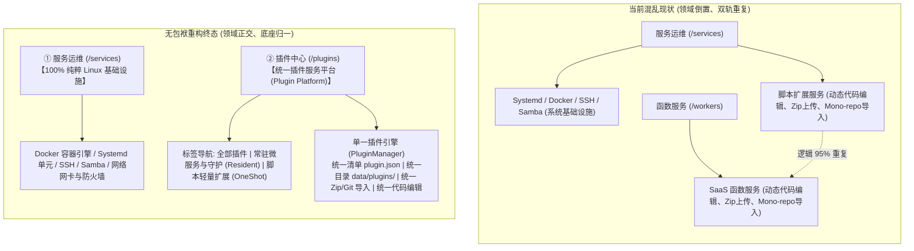
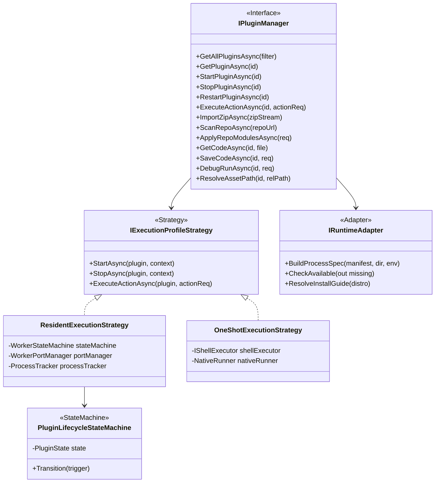

# 统一插件平台彻底重构与纯粹服务运维架构设计方案

> **核心原则**：项目尚未正式上线，**无需背负任何历史兼容性包袱或维护过渡别名**。直接大刀阔斧重构：将动态扩展服务与动态函数服务**彻底合并为统一的插件服务体系**，统一使用 `plugin.json` 与 `data/plugins/` 存储；服务运维页面彻底剥离非系统业务，回归 100% 纯粹的 Linux 基础设施运维；仓库内既有的 10 个示例直接迁移为统一插件格式。

---

## 1. 架构现状审计与痛点根源

在当前的演进状态中，系统存在显而易见的**概念倒置**与**代码重复**：



### 1.1 痛点诊断
1. **领域职责混淆 (Domain Pollution)**：
   - 「服务运维 (`/services`)」本应是操作系统的基石（内核级守护、Docker、网络与共享）。塞入一个支持在线写代码、装 Zip、拉 Git 的“脚本扩展”，严重混淆了系统底层设施与上层应用插件的界限；
2. **严重的双轨代码重复 (Massive Code Duplication)**：
   - `WorkersManager` (620行 + 4个分部类) 与 `ScriptExtensionManager` (643行 + 4个分部类) 存在超过 90% 的业务重叠：
     - Zip 包上传解压与 ZipSlip 校验逻辑完全复制；
     - GitHub Mono-repo 递归探测与批量应用逻辑完全复制；
     - 在线代码文件树枚举、2MB 限制、`.bak` 备忘录快照回滚、调试执行完全复制；
     - 静态资产托管与路径穿越防御完全复制；
3. **用户认知与交互割裂**：
   - 用户要装一个轻量脚本要去 `/services?module=extensions`；要装一个常驻微服务要去 `/workers`。本质上两者都是“自开发或第三方的插件”，不应该分居两处。

---

## 2. 彻底归一化设计：执行规格 (Execution Profile) 与单清单规范

打破历史概念壁垒，将所有“扩展”与“Worker”抽象为**同一种插件模型**，仅通过一个枚举字段区分其生命周期调度策略：

### 2.1 统一插件清单规范 (`plugin.json`)

在插件根目录下，只保留一个规范文件：`plugin.json`。废弃并删除旧版的 `worker.json` 与 `manifest.json`：

```json
{
  "manifestVersion": 1,
  "id": "chatgpt-channel",
  "name": "ChatGPT 渠道网关服务",
  "version": "1.0.0",
  "description": "聚合多渠道大模型网关微服务，支持动态负载均衡与流式代理",
  "icon": "🤖",
  "category": "AI",
  "isEnabled": true,

  "profile": "resident",
  "runtime": "python",
  "entrypoint": "worker.py",
  "arguments": ["--config", "config.json"],

  "network": {
    "mode": "path",
    "port": 8000,
    "portEnv": "PORT",
    "pathPrefix": "/plugins/chatgpt-channel"
  },

  "storage": {
    "enableSqlite": true,
    "enableKv": true
  },

  "supervision": {
    "autoRestart": true,
    "flappingThresholdSec": 10,
    "maxCrashRetries": 5
  },

  "ui": {
    "entry": "index.html",
    "title": "渠道网关控制台",
    "icon": "🖥️"
  },

  "customActions": [
    {
      "action": "test_connection",
      "label": "测试连通性",
      "icon": "⚡",
      "requireParam": false
    }
  ],

  "configForm": [
    {
      "field": "api_key",
      "label": "OpenAI API 密钥",
      "type": "password",
      "required": true
    }
  ],

  "dependencies": {
    "runners": ["python3"],
    "binaries": ["curl"]
  },

  "installGuide": {
    "debian": "apt update && apt install -y python3 python3-pip",
    "redhat": "dnf install -y python3",
    "windows": "winget install Python.Python.3.11"
  }
}
```

### 2.2 两种运行规格 (Execution Profile) 的行为矩阵

| 行为特性 | 常驻服务规格 (`profile: "resident"`) | 一次性脚本规格 (`profile: "oneshot"`) |
| :--- | :--- | :--- |
| **典型代表** | 原 SaaS Workers（如 Node Webhook、Python 接口、Go MCP Bridge、Daemon 巡检） | 原 Script Extensions（如 SSH 安全封禁、健康检查脚本、Caddy 语法校验器） |
| **进程生命周期** | 长时运行、受控监管（Process Supervisor / CrashLoop 熔断防护） | 单次触发执行、即用即走、执行完收集退出码与日志产物 |
| **端口与网络** | 支持 `mode: "path"`（网关反代 `/plugins/{id}/*`）或 `mode: "port"`，独占端口 | 默认无端口（若自身为提供 HTTP 的外部原生工具如 Caddy，亦可声明网关端口） |
| **专属沙箱存储**| 宿主自动挂载专属独立 `data.db` (SQLite) 与 `kv.db` (KV) | 读写自身物理扩展目录 |
| **前端交互能力**| **三套 UI 模式全量支持**：<br/>① 快捷动作栏 (`customActions`)；<br/>② 外部网关访问 (`AccessUrl`)；<br/>③ 内嵌 Webview 沙箱 (`ui/`)。 | **三套 UI 模式全量支持**：<br/>① 快捷动作栏 (`customActions`)；<br/>② 外部网关访问 (`AccessUrl`)；<br/>③ 内嵌 Webview 沙箱 (`ui/`)。 |
| **代码在线编辑**| 支持文件树浏览、在线保存、`.bak` 备忘录快照回滚、瞬时调试运行 | 支持文件树浏览、在线保存、`.bak` 备忘录快照回滚、瞬时调试运行 |

---

## 3. 设计模式优化与系统重构落地

摒弃繁冗的多重包装，使用四种经典设计模式构建轻量、纯粹、高内聚的统一插件平台：



### 3.1 策略模式 (Strategy Pattern)：运行规格执行策略
- 定义统一的 `IExecutionProfileStrategy`，彻底收敛两类插件调度差异：
  - `ResidentExecutionStrategy`：长时常驻调度，负责端口动态分配、YARP 网关路由动态注入、守护进程树、CrashLoopBackoff 状态机保护；
  - `OneShotExecutionStrategy`：短暂执行调度，根据当前操作系统与插件语言选择解释器，执行指定 action 脚本，捕获退出码并结构化解析输出。
- `PluginManager` 只需持有这两个策略单例，根据 `manifest.Profile` 一行分发：
  ```csharp
  var strategy = manifest.Profile == PluginProfile.Resident ? _residentStrategy : _oneShotStrategy;
  return await strategy.ExecuteActionAsync(manifest, actionRequest, ct);
  ```

### 3.2 适配器模式 (Adapter Pattern)：多语言运行时适配
- 统一保留已成熟的 `IWorkerRuntimeAdapter`，统一重命名为 `IRuntimeAdapter`：
  - `NodeRuntimeAdapter` (node / npm)
  - `PythonRuntimeAdapter` (python3 / python / pip)
  - `DotNetRuntimeAdapter` (dotnet CLI)
  - `ShellRuntimeAdapter` (sh / bash)
  - `PowerShellRuntimeAdapter` (pwsh / powershell)
  - `NativeRuntimeAdapter` (原生已编译二进制，免解释器直接执行)
- 无论是 OneShot 脚本还是 Resident 微服务，底层构造 `ProcessStartInfo`、环境探测与安装命令生成的逻辑 100% 共用。

### 3.3 状态机模式 (State Machine Pattern)：生命周期统一状态机
- 将 `WorkerStateMachine` 升级为全局统一的 `PluginLifecycleStateMachine`：
  - 针对 `Resident` 插件：`Stopped ➔ Starting ➔ Running ➔ Crashed ➔ Backoff ➔ Degraded`；
  - 针对 `OneShot` 插件：`Stopped ➔ Executing ➔ Stopped (成功) / Degraded (非零退出码)`；
  - 通用状态：`Disabled`（显式禁用）、`MissingRuntime`（缺失依赖）。
- 前端使用统一的 `PluginStatusBadge` 渲染，消除两种插件的状态视觉差异。

---

## 4. 业界主流方案对标与实证分析

| 平台名称 | 核心运维与外部应用架构划分 | 插件表现形态 | 对 LinuxWebTool 的启示 |
| :--- | :--- | :--- | :--- |
| **Home Assistant** | **完全正交**：<br/>• **Integrations (集成)**：运行于 Core 内部，负责硬件/系统级通信，呈现在「设备与服务」；<br/>• **Add-ons (应用)**：独立 Docker 进程容器，呈现在「应用商店 (App Store)」。 | 独立应用，通过 Ingress 反代无缝嵌入宿主 UI。 | **最强架构范例**。系统运维 (`/services`) 只负责系统集成（Systemd, Docker, SSH, Samba），插件中心 (`/plugins`) 专注外部独立扩展。 |
| **VS Code** | **统一 Extensions 市场**：<br/>单一扩展视图，内部通过 `package.json` 的 `contributes` 声明 commands、views、languages。 | 统一卡片流，统一管理，复合功能共存。 | **完全证明了单清单 (`plugin.json`) + 复合功能并存模式**的优越性。 |
| **Cockpit Linux** | **极其纯粹的 Linux 管理**：<br/>核心仅提供主机硬件监控、存储卷、网络、Systemd。第三方插件完全外挂在独立的「Applications」面板。 | 静态 HTML 托管 + 消息通信。 | 验证了 Linux 运维面板中，系统核心服务决不能被动态安装脚本污染的工程原则。 |
| **1Panel / TrueNAS** | 严格划分「主机运维」与「应用/插件中心」。 | 独立应用卡片，统一的本地 Zip 导入与远程应用商店。 | 证明了在现代化面板中，必须提供统一的包管理、配置编辑与备份还原入口。 |

---

## 5. 当前系统基础设施复用审计（零重复造轮子）

本次彻底归一化重构，不仅不增加复杂度，反而大量复用已有成熟资产，大幅精简代码：

1. **安全沙箱与文件防护**：
   - [`PluginSecurityGuard`](file:///e:/WorkProject/CSharp/PrivateProject/Web/WebToolForLinux/src/LinuxWebTool.Contracts/Shared/Support/PluginSecurityGuard.cs)：直接复用 `IsValidPluginId`、`IsValidActionName`、`EnsureSafePluginDirectory`、`ValidateZipArchiveEntries`（完整 ZipSlip 防护）；
2. **单文件纳秒解析**：
   - [`SingleFileHeaderParser`](file:///e:/WorkProject/CSharp/PrivateProject/Web/WebToolForLinux/src/LinuxWebTool.Infrastructure/Features/Workers/SingleFileHeaderParser.cs)：直接复用 JSDoc / 行注释中提取 `@name`、`@profile`、`@runtime`、`@port` 的纳秒解析器；
3. **动态流式网关反代**：
   - [`PipelineExtensions.cs`](file:///e:/WorkProject/CSharp/PrivateProject/Web/WebToolForLinux/src/LinuxWebTool.WebHost/Composition/PipelineExtensions.cs)：将 `/w/{id}/*` 与 `/ext/{id}/*` 合并为 `/plugins/{id}/{**catch-all}` 统一反向代理管道；
4. **长任务协调与控制协议**：
   - [`ResidentControlSpec`](file:///e:/WorkProject/CSharp/PrivateProject/Web/WebToolForLinux/src/LinuxWebTool.Contracts/Features/Plugins/Contracts/IPluginToolServices.cs) 与 `IResidentControlClient`：常驻进程 HTTP 管理协议；
5. **Native AOT 序列化生成**：
   - 删除大量重复的 Extension/Worker 互转 DTO，统一登记 `PluginManifest` 与 `PluginInstanceDto`。

---

## 6. 仓库内既有 10 个示例插件直接迁移方案

由于不考虑历史外部调用兼容性，直接将仓库现存的 10 个内置/示例服务重命名并更新为统一的 `plugin.json`：

### 6.1 原 4 个 Extension 示例（迁移至 `profile: "oneshot"`）
1. **`sample-healthcheck`**（系统健康守护脚本）：
   - 清单改为 `plugin.json`，`profile: "oneshot"`, `runtime: "bash"`，声明 `status` 钩子脚本；
2. **`ssh-access-guard`**（SSH 安全访问守卫）：
   - 清单改为 `plugin.json`，`profile: "oneshot"`, `runtime: "bash"`，声明 `records`, `ban_ip` 等 `customActions`，带模式 3 Webview 看板；
3. **`caddy-manager`**（Caddy 网关管理扩展）：
   - 清单改为 `plugin.json`，`profile: "oneshot"`, `runtime: "native"`, `entrypoint: "caddy"`, 声明 `network.port: 2019`；
4. **`native-command-demo`**（原生命令行执行演示）：
   - 清单改为 `plugin.json`，`profile: "oneshot"`, `runtime: "native"`。

### 6.2 原 6 个 Worker 示例（迁移至 `profile: "resident"`）
5. **`demo-js-webhook`**（Node.js Webhook 服务）：
   - 清单改为 `plugin.json`，`profile: "resident"`, `runtime: "node"`, `network.mode: "path"`；
6. **`demo-python-data-processor`**（Python 数据处理后台守护）：
   - 清单改为 `plugin.json`，`profile: "resident"`, `runtime: "python"`, `network.mode: "none"`；
7. **`demo-dotnet-service`**（C# 迷你微服务）：
   - 清单改为 `plugin.json`，`profile: "resident"`, `runtime: "dotnet"`, `network.mode: "path"`；
8. **`demo-shell-daemon`**（Shell 轮询守护进程）：
   - 清单改为 `plugin.json`，`profile: "resident"`, `runtime: "bash"`, `network.mode: "none"`；
9. **`demo-powershell-monitor`**（PowerShell 运维巡检）：
   - 清单改为 `plugin.json`，`profile: "resident"`, `runtime: "powershell"`, `network.mode: "none"`；
10. **`chatgpt-channel`**（ChatGPT 渠道网关微服务）：
    - 清单改为 `plugin.json`，`profile: "resident"`, `runtime: "python"`, `network.mode: "path"`, 带模式 3 Webview 控制台与模式 1 快捷动作。

---

## 7. 页面重构与落地执行计划

```
+----------------------------------------------------------------------------------------------------+
| 前端导航与页面重组 (Navigation & Views)                                                             |
+----------------------------------------------------------------------------------------------------+
|  1. /services (服务运维) ───────────────> 纯粹 Linux 基础设施: Docker / Systemd / SSH / Samba / 网卡防火墙 |
|                                          (彻底删除 ExtensionsSubmodule 及其所有相关代码与 API)      |
|                                                                                                    |
|  2. /plugins (插件中心) ────────────────> 全新统一插件平台看板 (PluginsView.js)                     |
|                                          ├─ 标签 1: 全部插件 (All Plugins)                         |
|                                          ├─ 标签 2: ⚡ 常驻微服务与守护 (profile === 'resident')   |
|                                          └─ 标签 3: 🔌 脚本轻量扩展 (profile === 'oneshot')        |
|                                          统一导入弹窗 / 统一代码编辑 / 统一 Webview 控制台          |
+----------------------------------------------------------------------------------------------------+
```

### 步骤清单（敏捷分步执行）：

1. **第 1 步：契约与模型彻底合并 (`Contracts`)**：
   - 在 `LinuxWebTool.Contracts` 中创建 `PluginModels.cs` 与 `IPluginManager.cs`；
   - 彻底废除 `ScriptExtensionModels.cs`、`ScriptExtensionRepoModels.cs`、`WorkerModels.cs`；
   - 在 `IServicesHubContracts.cs` 中移除 `IScriptExtensionManager`，`Services` 相关契约仅保留 Systemd、Docker、SSH、Samba、Network；
2. **第 2 步：基础设施与引擎彻底合并 (`Infrastructure`)**：
   - 将 `WorkersManager` 与 `ScriptExtensionManager` 合并为单一引擎 `PluginManager.cs`；
   - 数据存储统一收敛至 `data/plugins/{id}/`；
   - 实现 `ResidentExecutionStrategy` 与 `OneShotExecutionStrategy`；
   - 统一 Zip 导入解压与 Git Mono-repo 扫描探测；
   - 更新 10 个内置默认示例为统一 `plugin.json`；
3. **第 3 步：宿主端点与路由重构 (`WebHost`)**：
   - 新增 `PluginsController.cs`（挂载 `/api/Plugins`），提供完整的 CRUD、启停、代码编辑、动作执行与静态资产端点；
   - 在 `ServicesController.cs` 中删除全部扩展接口，恢复服务控制器的绝对纯洁；
   - 在 `PipelineExtensions.cs` 中挂载统一反代 `/plugins/{pluginId}/{**catch-all}`；
   - 重新生成 `EndpointsMapper.g.cs` 并更新 `AppJsonSerializerContext.cs`；
4. **第 4 步：前端页面全新构建 (`Frontend`)**：
   - 创建 `PluginsView.js`，包含三段式标签导航（全部 / 常驻微服务 / 脚本扩展）；
   - 抽取公共组件：`PluginCard.js`、`PluginWebviewModal.js`、`PluginCodeModal.js`、`PluginImportModal.js`；
   - 更新 `AppLayout.js` 导航栏：`/services`（服务运维）与 `/plugins`（插件中心）；
   - 从 `ServicesView.js` 中彻底移除 `ExtensionsSubmodule.js`，删除该冗余组件；
   - 更新 `config.js`：声明 `API.plugins.*` 端点集合，移除分散的旧端点；
5. **第 5 步：架构门禁与测试覆盖更新**：
   - 更新架构测试：验证 `ServicesController` 不包含任何动态插件逻辑，验证 `PluginsController` 严格符合单一职责与 Native AOT 映射；
   - 更新单元测试：针对 `PluginManager` 验证 Resident 守护自愈、OneShot 脚本执行、ZipSlip 拦截、代码备忘录快照。
