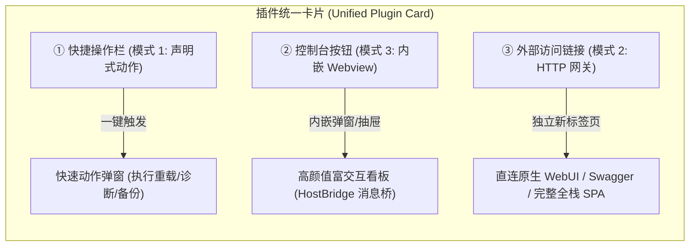
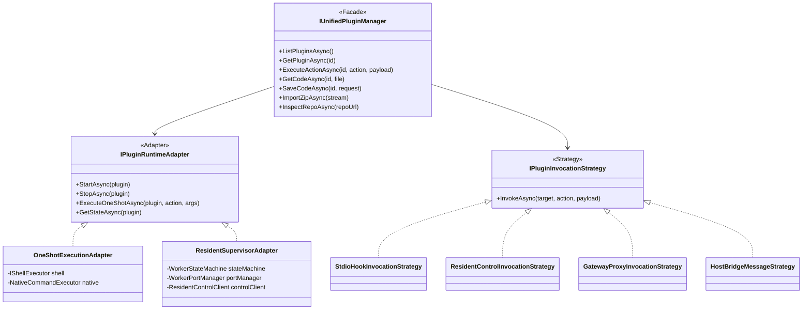

# 统一插件运行时体系与三套 UI 注入模式演进调研与方案设计

## 1. 调研背景与核心问题

在 LinuxWebTool 的当前版本中，系统内部并存两套扩展机制：
1. **动态脚本扩展服务 (Script Extensions)**：侧重于轻量、单次或松散的脚本/原生命令行执行（如 SSH 安全卫士、健康巡检、Caddy 语法预检），无需独占网络端口；
2. **SaaS 函数微服务 (Workers)**：侧重于长时运行、受控监管（Process Supervisor / CrashLoopBackoff）的自治进程（如 Node.js、Python、C#、Go MCP Bridge），多用于提供后台 HTTP 服务或长时 Daemon。

随着业务场景的发展，用户提出了两个直击系统顶层架构的核心问题：
- **问题 1**：三种前端 UI 模式（声明式表单弹窗、HTTP 网关反代、无 HTTP 静态沙箱与消息桥）能否让两边都完整支持？能否统一抽象优化？能否在一个插件中同时组合使用？
- **问题 2**：两边除了“一次性调用”和“长时常驻/HTTP 端口”这两个运行特征外，是否还存在其它本质差异？能否共用非差异的底层逻辑，避免系统演化出两套平行重复的庞大子系统？

本报告对上述问题展开全面头脑风暴、逻辑与性能审视、业界主流方案对标，并提出基于**适配器模式、策略模式、状态机模式与门面模式**的统一插件架构演进蓝图。

---

## 2. 问题一：三种 UI 模式全量支持、统一优化与并存可行性分析

### 2.1 三套模式的定义与互通性审计

当前系统已演进出三套前端呈现范式：

| 模式编号 | 模式名称 | 核心机制 | 扩展服务现状 | 函数服务现状 | 互通可行性 |
| :--- | :--- | :--- | :--- | :--- | :--- |
| **模式 1** | **声明式表单与动作弹窗** (Schema-driven Modal UI) | 依靠 JSON 配置声明 `configForm` 与 `customActions`，宿主以模态框呈现输入项并捕获执行结果。 | ✅ 原生支持 (`ExtensionActionModal`, `ExtensionConfigModal`) | ❌ 未暴露动作按钮（仅支持标准启停与代码编辑） | **100% 可行**。Worker 也可声明快捷动作（如“清理缓存”、“重载配置”、“导出诊断包”），免去用户单独编写页面的成本。 |
| **模式 2** | **HTTP 网关反向代理模式** (Reverse Proxy Gateway UI) | 进程监听本地端口，宿主反向代理暴露 `/w/{id}/*`，浏览器在新标签页独立访问。 | ❌ 未提供官方动态代理映射 | ✅ 原生支持 (`WorkerServiceMode.Service`) | **100% 可行**。像 `caddy-server-manager` 这种自身提供 HTTP Admin API/WebUI 的脚本，完全可通过声明端口被网关代理。 |
| **模式 3** | **无 HTTP 静态沙箱与双向消息桥** (Sandboxed Webview & HostBridge UI) | 扩展提供静态 `ui/` 资产，宿主安全托管，内嵌 Iframe 沙箱通过 `postMessage` 与宿主消息桥通信。 | ✅ 原生支持 (`ExtensionWebviewModal`, `GET Assets/*`) | ❌ Daemon 模式目前无 UI 入口 | **100% 可行**。Daemon 模式（如 Go MCP Bridge）放入静态 `ui/`，即可在宿主内嵌弹出独立交互看板。 |

### 2.2 三种模式能否在一个插件中“同时组合使用”？

**结论：完全可以，且这是现代业界顶级插件系统（如 VS Code、Portainer、TrueNAS、Cockpit）的标准架构。**

三者在维度上并非互斥关系，而是对应**不同交互频次与交互深度的阶梯组合（Composite Plugin UI）**：

#### 典型并存场景举例：
1. **网络网关插件（如 Caddy 或 Nginx 扩展）**：
   - **模式 1**：卡片上保留快捷按钮「重载配置」、「语法校验」（点开填参数即跑，无需进大页面）；
   - **模式 3**：卡片提供「🖥️ 流量仪表盘」，在宿主内弹出基于 Echarts 的实时 QPS 与错误率监控看板；
   - **模式 2**：若用户开启了第三方 Web 管理界面，提供「🔗 打开管理页」，跳新标签页进入全功能独立后台。
2. **AI MCP Bridge / 渠道网关插件**：
   - **模式 1**：快捷动作「重置 Tunnel 连接」、「导出审计日志」；
   - **模式 3**：内嵌模态窗管理本地 MCP Server 聚合列表、开关工具过滤规则；
   - **模式 2**：提供 OpenAI 兼容的代理对外 HTTP 端点。

### 2.3 统一优化的方向：通用 Webview 容器 (Universal Plugin Webview)
目前 `ExtensionWebviewModal` 仅为扩展设计。优化方案为抽象一个**通用插件沙箱组件**：
- 输入：`pluginId`, `pluginType ('extension' | 'worker')`, `uiConfig`；
- 行为分支：
  * **模式 3 静态沙箱**：加载 `/api/{Type}/{id}/Assets/{entry}`，激活 `HostBridge`；
  * **模式 2 内嵌网关**：直接在 Iframe 内加载 `/w/{id}/` 或 `/plugins/{id}/`，消除强制跳出新标签页的割裂感；
  * 支持一键切换全屏、弹窗与抽屉模式。

---

## 3. 问题二：脚本扩展与函数服务的深度差异审计与共用底层设计

两套体系代码审查对比显示，除了显式的生命周期不同，其余大量逻辑存在实质性重叠。

### 3.1 全维度差异对比表

| 对比维度 | 动态脚本扩展服务 (Script Extensions) | SaaS 函数微服务 (Workers) | 是否为本质差异？ | 重构与共用结论 |
| :--- | :--- | :--- | :--- | :--- |
| **进程生命周期** | **一次性短暂执行 (One-shot)** 通过 Shell/Native 调用，执行完即退出并收集 ExitCode。 | **长时受控常驻 (Supervised Long-running)** 由进程监管器常驻维护，监控退出与崩溃熔断。 | **是 (核心本质差异 1)** | 保留两种调度适配器，底层进程执行共用同一基础库。 |
| **通信与控制协议** | **Stdio / ExitCode / CLI 参数** 输出结构化文本、JSON 或产物文件。 | **HTTP 端口反代 / HTTP Resident Control** 动态端口映射或 HTTP 控制协议 (`/control/*`)。 | **是 (核心本质差异 2)** | 抽象为统一的调用策略（Strategy）。 |
| **端口生命周期** | 无端口（无需管理） | `WorkerPortManager` 动态端口池（10000-20000） | 否（派生差异） | 仅在声明需要 HTTP 时按需分配，可共用。 |
| **持久化存储沙箱** | 读写自身物理扩展目录 | 宿主自动注入独立 SQLite 与 KV 存储文件 | 否（功能差异） | 完全可以统一为可选的插件存储扩展能力。 |
| **安全目录防穿越** | `PluginSecurityGuard.EnsureSafePluginDirectory` | `PluginSecurityGuard.EnsureSafePluginDirectory` | **否 (100% 相同)** | 已共用基础设施。 |
| **在线代码编辑** | 文件树扫描、2MB 限制、`.bak` 备份管理、安全保存 | 文件树扫描、2MB 限制、`.bak` 备份管理、安全保存 | **否 (95% 逻辑重复)** | **必须抽取为统一的 CodeEditingService**。 |
| **代码调试运行** | 临时执行 status hook 并捕获前 50 行输出 | 临时启动进程并捕获前 15 秒 stdio 日志 | 否 (逻辑等价) | 统一抽象为 `IDebugExecutionStrategy`。 |
| **Zip 包导入防穿越** | `ZipArchive` 校验、ZipSlip 拦截、原子解压与覆盖 | `ZipArchive` 校验、ZipSlip 拦截、原子解压与覆盖 | **否 (99% 逻辑重复)** | **必须抽取为统一的 PluginPackageService**。 |
| **GitHub 仓库扫描** | 临时 clone/fetch、Mono-repo 目录递归扫描、manifest 解析 | 临时 clone/fetch、Mono-repo 目录递归扫描、worker.json 解析 | **否 (95% 逻辑重复)** | **必须抽取为统一的 MonoRepoInspectionService**。 |
| **热更新与备份回滚** | `CheckUpdateAsync` / `HotUpdateAsync` | `CheckUpdateAsync` / `HotUpdateAsync` | **否 (90% 逻辑重复)** | 统一为原子更新管道。 |
| **前端展现与交互** | 卡片流、状态徽标、启停、日志、更新、代码、控制台 | 卡片流、状态徽标、启停、日志、更新、代码、外链打开 | **否 (前端结构高度镜像)** | 可沉淀统一的 `PluginCard` 展现模式。 |

### 3.2 结论：避免两套方案的“大一统”分层架构

两边不应是两个隔离的业务孤岛，而是**同一插件平台底座之上的两种不同“运行规格（Execution Profile）”**：
- **底座层 (Common Plugin Substrate)**：包管理、文件编辑、Mono-repo 扫描、静态资产托管、安全沙箱、权限鉴权、声明式表单引擎；
- **调度层 (Runtime Dispatcher)**：通过统一的执行上下文分发给：
  * `OneShotExecutionAdapter`（针对脚本与 CLI 任务）
  * `ResidentSupervisorAdapter`（针对长时守护与微服务进程）

---

## 4. 设计模式在系统优化中的应用

### 4.1 适配器模式 (Adapter Pattern)
- **运行调度适配**：
  定义 `IPluginRuntimeAdapter`，分别实现 `OneShotExecutionAdapter` 与 `ResidentSupervisorAdapter`。上层管理中枢不需要感知一个插件到底是用 Bash 一次性跑完还是由 Kestrel 常驻监听，统一调用 `Start/Stop/Execute`。
- **UI 展示适配**：
  定义通用前端 `UniversalPluginModal`，根据插件声明的 UI 特性（`mode: 'declarative' | 'webview' | 'gateway'`）自适应呈现为配置表单、Iframe 沙箱还是嵌入式网关。

### 4.2 策略模式 (Strategy Pattern)
- **通信调用策略**：
  当用户或 MCP 请求触发插件动作时，通过 `IPluginInvocationStrategy` 根据插件的声明形态动态切换调用渠道：
  * 若为普通脚本扩展 -> 路由至 `StdioHookInvocationStrategy`；
  * 若为带 Resident Control 的常驻原生微服务 -> 路由至 `ResidentControlInvocationStrategy`；
  * 若为外部 HTTP 服务 -> 路由至 `GatewayProxyStrategy`；
  * 若为前端 Webview 请求 -> 路由至 `HostBridgeMessageStrategy`。

### 4.3 状态机模式 (State Machine Pattern)
- 将现有的两个孤立状态流整合为统一的生命周期状态契约：
  * **短暂任务状态机**（基于现有 `IPluginOperationCoordinator`）：`Queued -> Running -> Succeeded / Failed / TimedOut / Cancelled`；
  * **长时常驻状态机**（基于现有 `WorkerStateMachine`）：`Stopped -> Starting -> Running -> Crashed -> Backoff -> Degraded`；
- 前端统一映射为：`Active` (绿色/正常), `Idle/Stopped` (灰色/停止), `RunningTask` (青色/运行中), `Error/Degraded` (橙红色/异常)。

### 4.4 门面模式 (Facade Pattern)
- 现有的 `ServicesController` 与 `WorkersController` 很多端点重复（如 Code 编辑、Zip 导入、日志获取）。
- 抽取统一的 `PluginStorageSubstrateFacade` 与 `PluginPackageSubstrateFacade`，消灭重复的底层实现。

---

## 5. 业界主流方案对标与借鉴

### 5.1 VS Code 插件体系 (VS Code Extension Architecture)
- **多模式并存**：VS Code 插件可以同时贡献：
  1. `commands`（快捷指令，相当于模式 1）；
  2. `customEditors / webviewView`（内嵌 HTML 画布，相当于模式 3）；
  3. `debugAdapters / languageServer`（独立后台进程通信，相当于模式 2）。
- **借鉴点**：VS Code 的 `acquireVsCodeApi()` 与 `postMessage` 消息桥设计，与我们刚实现的 `HostBridge` 理念高度契合。宿主掌握绝对安全控制权，插件在沙箱内通过受限消息与宿主交互。

### 5.2 Kubernetes 资源模型 (K8s Resource Abstraction)
- **一次性与长时并存**：K8s 有 `Job/CronJob`（一次性跑完退出）和 `Deployment/DaemonSet`（长时保活常驻），但它们**共享完全相同的 `PodTemplateSpec`、镜像拉取机制、环境变量、卷挂载和日志系统**。
- **借鉴点**：LinuxWebTool 应当吸取这一架构哲学，无论是一次性脚本还是常驻 Worker，共享相同的插件包目录结构、代码编辑器、版本热更与权限模型。

### 5.3 Cockpit Linux & TrueNAS SCALE Apps
- **Cockpit Bridge**：Cockpit Web 控制台不强制底层工具开发 HTTP 服务，而是通过 `cockpit.js` 的 `cockpit.spawn()` 在网页中直接执行本地 shell/python 命令，极大降低了轻量运维插件的开发门槛。
- **借鉴点**：验证了“无 HTTP 脚本插件配合 Webview 前端化”是运维管理系统中最轻量、最高效的工程实践。

---

## 6. 当前系统基础设施复用清单

在接下来的统一重构中，完全复用现有成熟资产，绝不重复造轮子：

1. **安全边界底座**：
   - [`PluginSecurityGuard`](file:///e:/WorkProject/CSharp/PrivateProject/Web/WebToolForLinux/src/LinuxWebTool.Contracts/Shared/Support/PluginSecurityGuard.cs)：ID 合法性、安全目录边界核验、路径穿越拦截、ZipSlip 检验。
2. **长任务与异步操作协调器**：
   - [`IPluginOperationCoordinator`](file:///e:/WorkProject/CSharp/PrivateProject/Web/WebToolForLinux/src/LinuxWebTool.Contracts/Features/Plugins/Contracts/IPluginToolServices.cs)：支持进度跟踪、产物关联、任务取消与状态机持久化。
3. **原生常驻控制客户端**：
   - [`IResidentControlClient`](file:///e:/WorkProject/CSharp/PrivateProject/Web/WebToolForLinux/src/LinuxWebTool.Contracts/Features/Plugins/Contracts/IPluginToolServices.cs) & `ResidentControlSpec`：标准的内部管理 HTTP 通信协议。
4. **单文件元数据纳秒解析器**：
   - [`SingleFileHeaderParser`](file:///e:/WorkProject/CSharp/PrivateProject/Web/WebToolForLinux/src/LinuxWebTool.Infrastructure/Features/Workers/SingleFileHeaderParser.cs)：已原生支持从 JS/Py/Sh 注释中提取 `@name`、`@mode`、`@target` 等标签。
5. **动态反向代理管道**：
   - [`PipelineExtensions.cs`](file:///e:/WorkProject/CSharp/PrivateProject/Web/WebToolForLinux/src/LinuxWebTool.WebHost/Composition/PipelineExtensions.cs)：现有的动态反向代理模块成熟稳定。
6. **Native AOT 代码生成序列化器**：
   - `ServiceJsonContext` 与 `WorkerJsonContext`：保持高性能零反射。

---

## 7. 演进路线图与实施计划

### 阶段一：前端 UI 容器统一与双向能力补齐（零破坏性改动）
1. **函数服务支持模式 3（无 HTTP Webview）**：
   - 在 `WorkersController` 增加 `GET Workers/{id}/Assets/{**filePath}` 端点；
   - 在 `WorkersView.js` 卡片上，当 Worker 包含 `ui/` 时，点亮「🖥️ 控制台」并呼出 Webview 模态窗。
2. **扩展服务支持模式 2（HTTP 反向代理）**：
   - 若脚本扩展在 `manifest.json` 中声明了 `port`，管道反代自动支持 `/ext/{id}/*`，卡片上点亮「🔗 打开外部访问」按钮。
3. **支持三种模式在同一卡片上自由组合显示**。

### 阶段二：底层通用管理基础设施下沉与去重（重构共享层）
1. **抽离通用包管理服务 (`IPluginPackageSubstrate`)**：
   - 合并 `WorkersManager.Imports.cs` 与 `ScriptExtensionManager.Repo.cs`，统一 Zip 上传解压与 GitHub Mono-repo 扫描。
2. **抽离通用在线编辑与热更新服务 (`IPluginStorageSubstrate`)**：
   - 合并两边的 `GetCodeAsync`、`SaveCodeAsync`、`.bak` 回滚与版本探测逻辑。
3. **保持对外 REST API 契约不变**，通过 Facade 代理到共享底层，保证前端平滑无感知。

### 阶段三：统一插件契约与模型融合（Plugin Platform 2.0）
1. 建立统一的 `PluginManifest` 契约，以 `runtimeProfile: 'oneshot' | 'resident'` 代替生硬的扩展与函数服务割裂；
2. 开发者只需编写一个 `plugin.json`，即可自由选择是否启用长驻进程、是否开放 HTTP 端口、是否挂载前端 Webview、是否提供声明式动作。
