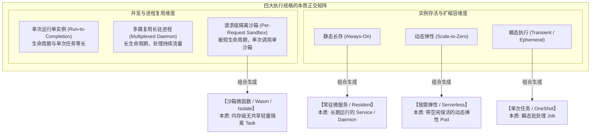
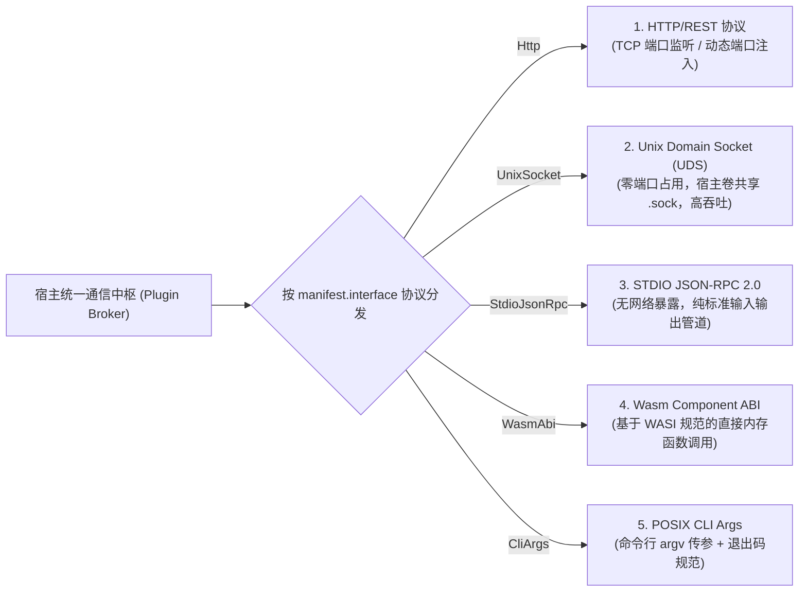
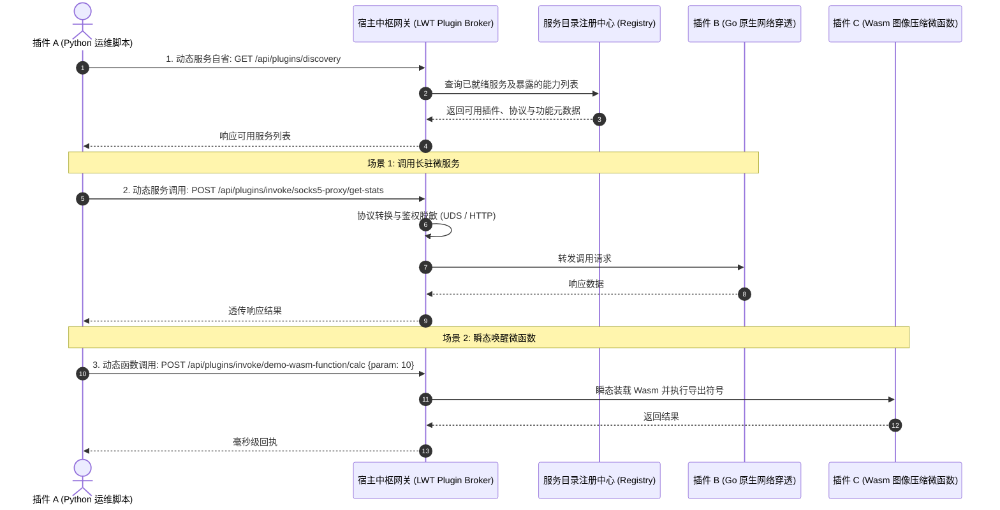
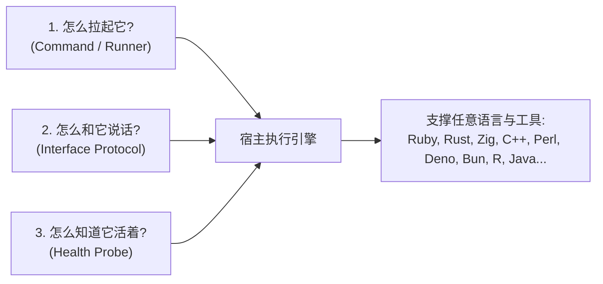
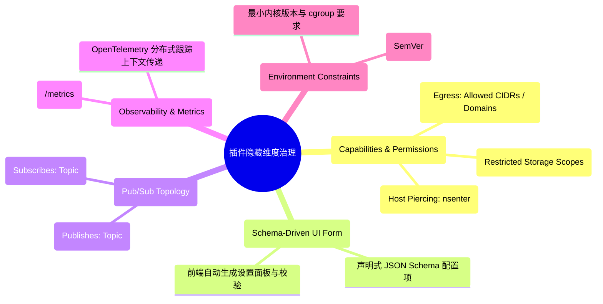
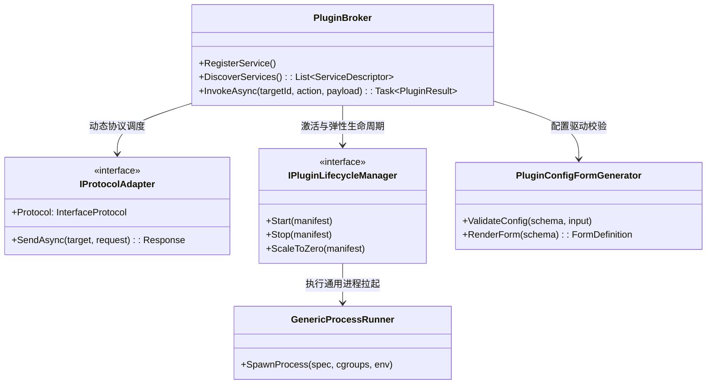

# 通用插件多维本质抽象、动态服务发现与完全语言解耦架构规划

> 本文档针对 LinuxWebTool (LWT) 插件系统进行最高抽象维度的系统性推演，深度解答关于**四大执行轮廓的本质抽象、对接协议标准化、服务动态发现与相互调用、文件夹结构规范化、非编译语言动态接入、完全语言解耦机制**以及**潜在遗漏维度**的 8 大核心命题，构建一套真正通用、工业级、语言无关（Language-Agnostic）的微服务与函数计算底座。

---

## 1. 八大核心命题深度剖析与头脑风暴

### 1.1 命题 1：单次方法扩展、微服务长时、函数服务、Serverless 四类型的本质抽象是什么？

在计算机科学与分布式系统（如 Kubernetes、Knative、AWS Lambda）中，这四种类型**并不是业务概念，而是“生命周期模型（Lifecycle）”与“并发资源调度策略（Concurrency & Resource Scheduling）”的数学正交组合**：



#### 本质抽象模型：
在系统内部，四种类型可统一收敛为一组纯粹的元数据调度算子：
- **`ActivationMode`（激活模式）**：
  - `AlwaysOn`（长驻守护，由 Supervisor 维持生命周期）；
  - `OnDemand`（随调随起，由请求路由或网关触发）；
  - `Scheduled`（定时任务驱动，由 Cron 调度器唤醒）；
  - `EventDriven`（事件总线驱动，有特定消息到达时唤醒）。
- **`InstanceLifecycle`（生命周期与扩缩容）**：
  - `Transient`（单次执行完毕即强制回收子进程，退出码指示完成）；
  - `Persistent`（长期存活，具备健康检查与崩溃自愈重启）；
  - `ElasticIdleTimeout(TTL)`（请求到来拉起，闲置超时自动缩容释放内存）。
- **`IsolationBoundary`（隔离边界）**：
  - `ProcessBoundary`（基于操作系统独立进程与 Linux cgroup v2 隔离）；
  - `MemoryBoundary`（基于 WebAssembly / V8 Isolate 的进程内纯内存硬隔离）。

---

### 1.2 命题 2：插件与宿主对接协议是否需要标准化与元数据配置化？

**答案：必须标准化且必须元数据配置化。**

#### 现状痛点：
目前宿主与插件交互逻辑分散在各个策略内：有的靠 HTTP 反向代理，有的靠命令行参数 `argv`，有的往 `stdin` 写 JSON，有的调 Wasm 内存导出表。**这导致宿主调用插件时充满特异性代码。**

#### 标准化方案 —— 插件标准通信协议集 (Standard Plugin Protocol, SPP)：
在元数据中引入统一的 `interface` 契约，支持以下 5 种标准传输协议：



1. **`Http` 协议**：适用于大型微服务，元数据配置 `portEnv: "PORT"`, `pathPrefix: "/plugins/{id}"`, `healthPath: "/health"`；
2. **`UnixSocket` 协议（云原生主流优化）**：
   - 彻底解决多插件并发运行时的**端口冲突与被外部端口扫描**的隐患；
   - 宿主与插件共享运行时卷 `/run/plugins/{id}.sock`，吞吐比本地 TCP 回环提速 **30%~50%**；
3. **`StdioJsonRpc` 协议（借鉴 MCP 与 LSP）**：
   - 遵循标准 JSON-RPC 2.0，宿主向插件 `stdin` 推入请求，插件向 `stdout` 输出响应；
   - 极其适合 Python、Node.js 编写的轻量无网络微函数。

---

### 1.3 命题 3：能否支持服务动态发现与动态调用（Dynamic Service Discovery & Invocation）？

**答案：完全可行，且能够借鉴 Dapr 与 Envoy 的服务网格（Service Mesh）思想实现透明互通。**

#### 架构设计：
在宿主中枢建立 **“插件服务目录与透明调用网关 (Plugin Service Mesh Mesh-Gate)”**：



#### 关键收益：
- **微服务彻底解耦**：插件 A 永远不需要关心插件 B 的实际监听端口、IP 地址甚至编写语言；
- **全链路观测与审计**：所有插件间的动态交互均经过宿主 Broker，系统能自动采集插件调用链追踪（Distributed Tracing）、调用耗时统计并施加访问权限白名单。

---

### 1.4 命题 5：插件文件夹、源码和执行目录是否需要规范化？

**答案：必须规范化。混合存放是引发环境污染与备份异常的核心根源。**

#### 现状问题：
当前插件目录下源码（`main.go`, `Program.cs`）、编译中间产物（`obj/`, `bin/`）、不可变清单（`plugin.json`）、运行期数据（`*.db`）与日志全部扁平混在根目录，导致备份同步时体积失控、代码与数据无法隔离挂载。

#### 规范化标准物理拓扑（Standardized Plugin Anatomy）：

```text
plugins/<plugin-id>/
├── plugin.json               [不可变] 插件元数据事实源 (只读)
├── src/                      [源码目录] 供在线编辑、查看与增量编译
│   ├── main.go / Program.cs / handler.py
│   └── ...
├── bin/                      [产物目录] 编译生成的独立二进制 (可被 .gitignore 忽略)
│   ├── app.elf / main.wasm
├── hooks/                    [扩展动作] 单次任务钩子脚本 (status.sh, backup.py)
├── ui/ / assets/             [静态资源] 前端 Webview 页面、CSS、图标资源
├── storage/ / data/          [持久数据] 插件独占存储 (SQLite 数据库、KV 缓存文件)
└── run/                      [瞬态运行时] 运行时套接字与锁 (app.sock, daemon.pid, 临时文件)
```

#### 治理收益：
- **只读沙箱挂载**：在特权容器中，可将 `plugin.json`、`src/` 与 `bin/` 挂载为只读（`ro`），仅将 `storage/` 与 `run/` 挂载为读写（`rw`），从内核层面防止恶意插件篡改自身源码；
- **增量构建隔离**：编译工具链的输出目录强制锁定在 `bin/`，彻底消除编译产物与源码的混淆。

---

### 1.5 命题 6：非编译构建的语言和方案，能否通过运行时直接调用？元数据能否支持？

**答案：原生完全支持，且通过元数据配置能消除一切冗余逻辑。**

对于 Python、Node.js、POSIX Shell、PowerShell、Lua、Ruby、Deno、Bun 等**解释型或即时解释型（JIT）语言**：
- **生命周期声明为 `lifecycle: "Interpreted"`**；
- 编译器战略直接匹配为 `NoOpBuilder`（跳过任何编译步骤）；
- **元数据直接声明运行时调度器与入口**：
  ```json
  "runtime": {
    "engine": "python3",
    "args": ["-u"],
    "sourceEntry": "src/main.py"
  }
  ```
- 宿主直接执行命令：`python3 -u src/main.py`，无需进行任何假装的“构建过程”。

---

### 1.6 命题 7：能否实现完全语言解耦，通过元数据和对接协议支持任意语言和工具？

**答案：完全可以，这也是 Unix 哲学与 OCI/容器哲学的核心思想。**

#### 解耦核心机制：
系统底座不需要为每种编程语言硬编码一个 `enum PluginRuntime { Python, Node, Ruby, Rust, Lua, Zig... }`！
只要把抽象下沉到 **“操作系统进程契约 + 协议抽象”**，任何语言和工具只要满足以下三要素，均可开箱即用：



1. **可执行性（Command）**：宿主只认 `executable + args + workingDir`，管你是 Python、Ruby 还是 Zig 编译出来的二进制；
2. **通信协议（Protocol）**：宿主只认 `Http`、`UnixSocket`、`StdioJsonRpc` 或 `CliArgs`；
3. **健康核验（Probe）**：宿主只认 `TCP 端口开放`、`HTTP 200`、`Socket 文件存在` 或 `命令返回 0`。

通过上述抽象，**`Runtime` 枚举在后端彻底降级为纯粹的“前端展示标签（UI Badge）”与“依赖包管理器指引”，而内核调度器彻底实现 100% 语言无关！**

---

### 1.7 命题 8：还有哪些关键的“隐藏维度”没有考虑到？

在企业级微服务与现代化插件生态（参考 Dapr、Kubernetes、VS Code、Chrome Extensions）中，还有以下 **5 大隐藏维度** 必须纳入顶层设计：



1. **权限与安全能力清单（Capabilities & Permissions / Least Privilege）**：
   - 显式声明插件需要哪些权限（如 `network:egress:lan`、`storage:host-mount`、`host:nsenter`），宿主审批或自动施加防火墙；
2. **声明式动态配置表单（Schema-Driven UI Form）**：
   - 许多插件需要管理员填写配置（如上游代理 IP、第三方 API Key、监听端口）；
   - 在元数据中配置标准 **JSON Schema**，前端通过标准组件**自动渲染输入框、开关与下拉菜单**，彻底告别“为每个插件写专用 Vue 配置页”的代码膨胀；
3. **事件驱动拓扑声明（Event Topology）**：
   - 插件声明 `events.publishes` 与 `events.subscribes`，系统自动建立总线路由表；
4. **统一可观测性度量（Prometheus Metrics）**：
   - 插件声明指标暴露端点（如 `/metrics`），宿主监控中心自动定时抓取 CPU、QPS 与错误率；
5. **宿主基线约束（Host Compatibility）**：
   - 声明 `constraints: { "minLwtVersion": "2.0.0", "cgroups": "v2", "arch": ["x86_64", "aarch64"] }`，防止在不兼容环境中误装。

---

## 2. 业界主流云原生与插件体系对比矩阵

| 架构 / 平台 | 生命周期与进程模型 | 通信协议标准 | 服务发现与互调 | 配置驱动与 UI |
| :--- | :--- | :--- | :--- | :--- |
| **Kubernetes** | Pod / Deployment / Job / CronJob | HTTP / gRPC / TCP | CoreDNS + Kube-Proxy | ConfigMap + CRD |
| **Dapr (分布式应用运行时)** | Sidecar 统一拦截与抽象 | gRPC / HTTP / Dapr PubSub | 服务间透明调用 (Direct Invocation) | YAML Component 契约 |
| **Fermyon Spin (Wasm 架构)** | Component 纯内存沙箱 | Wasm Component Model (WIT) | 基于 Inbound/Outbound HTTP 路由 | `spin.toml` 声明变量与配置 |
| **Model Context Protocol (MCP)** | 本地进程 / 远程端点 | Stdio JSON-RPC / SSE | Tools / Resources 动态列举与调用 | JSON Schema 描述入参工具 |
| **VS Code Extensions** | Extension Host 隔离进程 | JSON-RPC (IPC 管道) | 注册 Commands 与 Providers | `package.json` contributes 动态渲染 |
| **LinuxWebTool (目标设计)** | **四维抽象 (Resident / Job / FaaS / Wasm)** | **SPP 协议集 (Http / UDS / Stdio / Wasm)** | **Broker 透明互调与自省网关** | **JSON Schema 动态表单 + SPP** |

---

## 3. 下一代元数据契约规范：Schema v3.1 终极设计

结合上述全部推演，确立 **LinuxWebTool Schema v3.1** 终极规范：

```json
{
  "$schema": "https://linuxwebtool.local/schemas/v3.1/plugin.json",
  "manifestVersion": "3.1",
  "id": "socks5-proxy",
  "name": "SOCKS5 安全代理微服务",
  "version": "1.2.0",
  "description": "高性能企业级 SOCKS5 代理网关，支持域名白名单与动态认证",
  "icon": "🛡️",
  "category": "Network",

  "archetype": {
    "profile": "Resident",
    "lifecycle": "SourceCompiled",
    "protocol": "UnixSocket",
    "language": "go"
  },

  "layout": {
    "sourceEntry": "src/cmd/proxy/main.go",
    "targetArtifact": "bin/socks5-proxy",
    "storageDir": "storage",
    "runtimeDir": "run"
  },

  "build": {
    "toolchain": "go",
    "command": "CGO_ENABLED=0 GOOS=linux go build -ldflags '-s -w' -o bin/socks5-proxy ./src/cmd/proxy",
    "watch": ["src/**/*.go", "go.mod"],
    "autoCompileOnSave": true,
    "timeoutSeconds": 60
  },

  "interface": {
    "protocol": "UnixSocket",
    "socketPath": "run/socks5-proxy.sock",
    "publicPorts": [10808],
    "healthEndpoint": "/health"
  },

  "resources": {
    "limits": { "cpu": "1.0", "memory": "256Mi", "pids": 50 },
    "requests": { "cpu": "0.1", "memory": "32Mi" }
  },

  "permissions": [
    "network:bind:10808",
    "network:egress:any",
    "storage:local:storage"
  ],

  "configSchema": {
    "type": "object",
    "properties": {
      "port": { "type": "integer", "default": 10808, "title": "代理监听端口" },
      "authEnabled": { "type": "boolean", "default": false, "title": "开启密码认证" },
      "allowedSubnets": { "type": "string", "default": "0.0.0.0/0", "title": "允许访问的子网" }
    },
    "required": ["port"]
  },

  "events": {
    "publishes": ["proxy.connection.opened", "proxy.connection.closed"],
    "subscribes": ["system.firewall.updated"]
  },

  "probes": {
    "liveness": { "type": "SocketFileCheck", "target": "run/socks5-proxy.sock" },
    "readiness": { "type": "HttpCheck", "url": "http://unix/health" }
  }
}
```

---

## 4. 设计模式重构与系统级应用



1. **中介者模式（Mediator Pattern）—— `PluginBroker`**：
   - 充当所有插件间动态交互与服务自省的中枢，插件之间不直接建立硬编码依赖，均通过 Broker 进行命名空间隔离寻址与通信；
2. **抽象工厂与适配器模式（Abstract Factory & Adapter）—— `IProtocolAdapter`**：
   - 屏蔽底层网络传输的差异（不管是标准 HTTP、Unix Socket 还是 Stdio 管道），统一向上暴露通用的 `SendAsync(target, request)` 契约；
3. **解释器与数据驱动模式（Data-Driven Form Generator）**：
   - 前端接收后端的 `configSchema`，通过通用表单渲染器动态渲染设置面板，无需编写插件专属页面。

---

## 5. 现有系统基础设施复用分析

该通用架构 100% 根植于 LinuxWebTool 现有成熟基础设施：
- **进程生命周期与管道**：复用 [`NativeProcessRunner.cs`](file:///e:/WorkProject/CSharp/PrivateProject/Web/WebToolForLinux/src/LinuxWebTool.Infrastructure/Features/Plugins/Adapters/NativeProcessRunner.cs)（已具备交叉平台进程创建、环境变量脱敏与退出码捕获）；
- **内核配额隔离**：复用 [`PluginCgroupManager.cs`](file:///e:/WorkProject/CSharp/PrivateProject/Web/WebToolForLinux/src/LinuxWebTool.Infrastructure/Features/Plugins/Supervisor/PluginCgroupManager.cs)（直接对接 `resources.limits`）；
- **凭据脱敏防火墙**：复用 [`PluginEnvironmentSanitizer.cs`](file:///e:/WorkProject/CSharp/PrivateProject/Web/WebToolForLinux/src/LinuxWebTool.Infrastructure/Features/Plugins/Adapters/PluginEnvironmentSanitizer.cs)；
- **事件总线系统**：复用 [`PluginEventBus.cs`](file:///e:/WorkProject/CSharp/PrivateProject/Web/WebToolForLinux/src/LinuxWebTool.Infrastructure/Features/Plugins/Supervisor/PluginEventBus.cs)（无缝对接 `events.publishes` 与 `events.subscribes`）；
- **版本快照与路由回滚**：复用 [`PluginRevisionManager.cs`](file:///e:/WorkProject/CSharp/PrivateProject/Web/WebToolForLinux/src/LinuxWebTool.Infrastructure/Features/Plugins/Supervisor/PluginRevisionManager.cs)（构建成功后生成不可变快照与金丝雀别名）。

---

## 6. 演进路线图与阶段性落地规划

- **Phase 1（规范与数据模型升级）**：
  在 `LinuxWebTool.Contracts` 中引入 Schema v3.1 数据契约，更新 `PluginModels.cs`，实现规约验证门禁；
- **Phase 2（目录规范化与构建解耦）**：
  将插件工程迁移为 `src/` 与 `bin/` 隔离规范，提取 `IPluginBuildStrategy` 统一处理容器内即时热构建；
- **Phase 3（服务发现与 Broker 动态调用）**：
  在 WebHost 中开放 `GET /api/Plugins/Discovery` 与 `POST /api/Plugins/Invoke/{id}/{action}` 动态服务网关，支持微服务间透明互调；
- **Phase 4（JSON Schema 动态配置表单）**：
  在前端通用组件库中引入 `PluginConfigFormModal.js`，实现插件参数配置界面的 100% 零代码动态生成。
