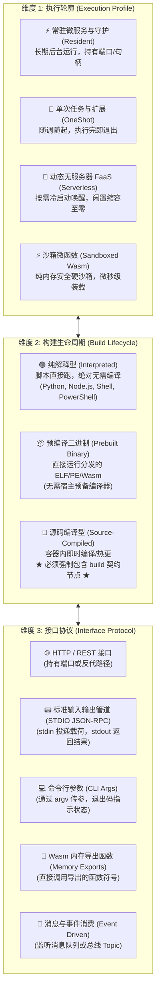
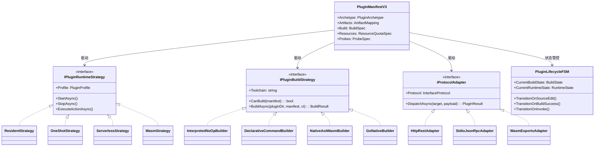

# 通用插件多维分类、显式热编译契约与元数据架构去隐式化方案

> 本文档针对 LinuxWebTool (LWT) 插件中心从“特化 Wasm”走向**高维通用抽象架构**进行头脑风暴与深度系统设计。
> 确立基于**执行轮廓（Profile）、构建生命周期（Build Lifecycle）、接口协议（Protocol）**的三维分类模型，提出**强类型显式元数据 Schema v3 契约**，彻底根除隐式启发式推测，并结合业界最佳实践（Kubernetes Pod Spec、Fermyon Spin、VS Code Extension、Tauri）进行设计模式重构与落地论证。

---

## 1. 核心问题复盘：为什么必须打破特化，走向通用多维抽象？

在先前的演进中，系统针对 Wasm 微函数和 Go 原生插件各自引入了一些特定的探测与编译逻辑（例如针对 `.wat` 的 `TryCompileWatToWasm`、针对 Go 的交叉编译检查）。然而，这种**按具体语言或具体技术特化（Ad-hoc Specialization）**的做法存在严重的架构瓶颈：

1. **维度交织导致的语义混乱**：
   - “Wasm” 既可以是一个计算规格（Profile），也可以是一种二进制产物（Artifact），还可以是一种沙箱运行时（Runtime）。如果插件直接写 `runtime: "Wasm"`，系统根本不知道它的源码是 C#、Rust、Go 还是 WAT，更不知道如何去构建它。
   - 同理，“Go” 既可以作为一个常驻微服务运行（Resident），也可以作为一个单次命令行工具运行（OneShot），或者作为事件总线消费者运行。
2. **“猜代码”的隐式推导具有脆弱性**：
   - 当前系统靠扫描文件后缀（`.cs`、`.go`、`.py`、`.js`）和特征文件（`*.csproj`、`go.mod`）去“猜测”应该用什么工具链，一旦工程结构稍微复杂（例如同时存在 `README.md`、`build.sh`、`main.go` 与 `tool.py`），推导就会失灵或产生歧义；
   - 缺乏编译命令的显式约束，导致在线源码编辑后**无法在容器内部实现标准化的闭环构建与平滑重载**。

---

## 2. 插件三维正交分类模型（Three-Dimensional Orthogonal Matrix）

为了建立一套适用所有技术栈（Node/Py/Sh/Ps 脚本、Go/Rust/C# 原生二进制、Wasm 微函数、Caddy/Nginx 配置型插件）的通用底座，我们将插件抽象为 **三个完全正交的维度**：



### 铁律规则（Architectural Rule）：
> **构建约束规约（The Mandatory Build Contract Rule）**：
> 凡是生命周期标记为 `SourceCompiled`（即提供了源码，需要生成可执行产物）的插件，**其元数据清单中必须强制存在且合法声明 `build` 定义节点！**
> 任何缺少 `build` 节点的源码插件在加载时将被**编译防御门禁直接拦截阻断**，彻底消灭“靠文件名盲猜构建指令”的隐患。

---

## 3. 插件元数据 Schema v3 优化全景（去隐式化设计）

为了彻底杜绝隐式推测，我们设计下一代 **Schema v3** 元数据规范，将所有原本靠系统推导的模糊字段全面显式化：

```json
{
  "$schema": "https://linuxwebtool.local/schemas/v3/plugin.json",
  "manifestVersion": 3,
  "id": "demo-nativeaot-wasm",
  "name": "C# NativeAOT-LLVM 极速微函数",
  "version": "1.0.0",
  "description": "基于 NativeAOT-LLVM 无解释器纯静态编译的纳秒级微函数",
  "icon": "⚡",
  "category": "Wasm",

  "archetype": {
    "profile": "Wasm",
    "lifecycle": "SourceCompiled",
    "protocol": "WasmExports"
  },

  "artifacts": {
    "sourceEntry": "Program.cs",
    "targetArtifact": "bin/demo-nativeaot-wasm.wasm"
  },

  "build": {
    "toolchain": "bflat",
    "command": "bflat build --target:wasm -o bin/demo-nativeaot-wasm.wasm Program.cs",
    "fallbackCommand": "dotnet build -c Release -r wasi-wasm -o bin/",
    "watch": ["**/*.cs", "*.csproj"],
    "autoCompileOnSave": true,
    "timeoutSeconds": 45,
    "cleanTargets": ["bin/*.wasm", "obj/"]
  },

  "resources": {
    "limits": {
      "cpu": "1.0",
      "memory": "256Mi",
      "pids": 30
    },
    "requests": {
      "cpu": "0.1",
      "memory": "32Mi"
    }
  },

  "probes": {
    "readiness": {
      "type": "WasmModuleCheck",
      "target": "bin/demo-nativeaot-wasm.wasm"
    }
  },

  "dependencies": [
    {
      "id": "wasmtime",
      "name": "Wasmtime 沙箱引擎",
      "kind": "runner",
      "required": false
    },
    {
      "id": "bflat",
      "name": "bflat 编译器",
      "kind": "toolchain",
      "required": true
    }
  ]
}
```

### 元数据去隐式化优化对照表：

| 过去隐式推断的痛点 | Schema v3 显式化解决方案 | 带来的收益 |
| :--- | :--- | :--- |
| **到底是源码还是编译产物？** | 显式拆分 `sourceEntry`（源码入口）与 `targetArtifact`（产物路径）。 | 消除 `entrypoint: "main.wasm"` 时找不到源码的困惑；明确知道编译前后的映射关系。 |
| **是用 Python 解释还是用 C# 编译？** | 显式声明 `lifecycle: "Interpreted"` / `"SourceCompiled"`。 | 纯脚本插件无需配置 `build`；编译型插件若漏配 `build` 直接在注册期精准拦截报错。 |
| **怎么和插件通信？** | 显式声明 `protocol`: `HttpRest` / `StdioJsonRpc` / `WasmExports`。 | 执行策略不再盲猜是否需要监听端口，或者是否往 `stdin` 喂 JSON，协议行为 100% 确定。 |
| **内核配额怎么设置？** | 显式 `resources.limits`（类 K8s 规范）。 | 消除代码里根据插件类型随意 hardcode 配额的做法，让 cgroup v2 配置完全声明化。 |
| **怎么判定插件健康/就绪？** | 显式 `probes.readiness`（支持 TCP/HTTP/Exec/WasmCheck）。 | 消除就绪探针盲测端口或盲测 PID 导致的虚假就绪。 |

---

## 4. 工业界主流架构对比与借鉴

| 平台 / 框架 | 核心元数据模型 | 构建与运行解耦方式 | 对 LinuxWebTool 的启示 |
| :--- | :--- | :--- | :--- |
| **Fermyon Spin** (`spin.toml`) | `[component]` 包含 `source` (wasm) 与 `[component.build]` (command + watch)。 | 极其严谨地将“Wasm 二进制”作为运行时单元，而将语言编译收敛在 `build` 区块。 | **直接借鉴**：我们的 `archetype` 与 `build` 完全对齐 Spin 的清晰模型。 |
| **Kubernetes** (Pod Spec) | `containers[].resources.limits`, `livenessProbe`, `ports`。 | 声明式资源契约，运行环境与硬件规格严格定义。 | **借鉴配额契约**：将 cgroup v2 参数统一按 Kubernetes 标准的 `cpu: "1.0", memory: "256Mi"` 解析。 |
| **VS Code Extension** (`package.json`) | `main` (运行时入口), `scripts.build` (构建命令), `activationEvents`。 | 插件生命周期事件驱动激活，构建交给类型化 tasks。 | 借鉴其对前端/多语言生命周期 hooks 的事件调度设计。 |
| **Tauri** (`tauri.conf.json`) | `build.beforeBuildCommand`, `build.devPath`。 | 将 Rust 原生后端构建与 Webview 前端打包解耦。 | 借鉴其在多语言混合插件（如 LXC Manager 的 Go 后端 + HTML 前端）的双轨构建设计。 |

---

## 5. 设计模式重构与架构落地推演

为实现上述通用抽象，代码库应当通过以下三种经典设计模式进行重构：



### 5.1 双轨策略模式（Dual-Track Strategy Pattern）
将原本杂糅在 Runtime 内部的逻辑彻底切分为两套独立的策略族：
1. **构建策略族 (`IPluginBuildStrategy`)**：
   - `InterpretedNoOpBuilder`：脚本语言直接放行；
   - `DeclarativeCommandBuilder`：通用声明式命令构建器，安全解析 `manifest.build.command`；
   - `NativeAotWasmBuilder`：集成 `bflat` 与 LLVM 工具链的专用加速编译器；
   - `GoNativeBuilder`：集成 `go build` 的交叉编译器。
2. **执行策略族 (`IPluginRuntimeStrategy`)**：
   - 专注负责运行时的拉起、缩容至零、沙箱隔离与端口维护，彻底不参与任何编译逻辑。

### 5.2 规约模式（Specification Pattern）：编译防御门禁
构建防御门禁不再允许任何“模糊推断”，在插件加载阶段执行严格的规约校验：
```csharp
public sealed class SourceCompiledMustHaveBuildSpec : ISpecification<PluginManifest>
{
    public bool IsSatisfiedBy(PluginManifest manifest)
    {
        if (manifest.Archetype.Lifecycle == PluginLifecycle.SourceCompiled)
        {
            return manifest.Build != null && !string.IsNullOrWhiteSpace(manifest.Build.Command);
        }
        return true;
    }

    public string ErrorMessage => "声明为 SourceCompiled (源码编译型) 的插件必须显式定义 build.command 构建指令";
}
```

### 5.3 双阶状态机模型（Two-Phase State Machine）
微函数或原生插件从源码编辑到运行，通过双阶状态机协同推进：
- **第一阶段：构建状态机 (Build FSM)**：
  `Clean` (产物最新) -> `SourceDirty` (源码已编辑) -> `Compiling` (单飞锁防护) -> `BuildSucceeded` / `BuildFailed`；
- **第二阶段：运行状态机 (Runtime FSM)**：
  `Dormant / Stopped` -> `Starting` -> `Probing (探针核查)` -> `Running / Ready`。
- **协同机制**：只有当 Build FSM 达到 `BuildSucceeded` 或 `Clean` 时，Runtime FSM 才能被激活调用，彻底规避产物未生成即被执行导致的崩溃。

---

## 6. 当前系统现有基础设施复用对照表

本通用方案完全建立在 LinuxWebTool 既有成熟组件之上，具备 100% 的落地可行性：

| 现有系统核心基础设施 | 源码路径 | 在通用多维架构中的复用方式 |
| :--- | :--- | :--- |
| **标准跨平台进程调度** | [`NativeProcessRunner.cs`](file:///e:/WorkProject/CSharp/PrivateProject/Web/WebToolForLinux/src/LinuxWebTool.Infrastructure/Features/Plugins/Adapters/NativeProcessRunner.cs) | 调度所有声明的 `build.command`，统一流控与超时熔断。 |
| **凭据脱敏防火墙** | [`PluginEnvironmentSanitizer.cs`](file:///e:/WorkProject/CSharp/PrivateProject/Web/WebToolForLinux/src/LinuxWebTool.Infrastructure/Features/Plugins/Adapters/PluginEnvironmentSanitizer.cs) | 阻断构建命令读取宿主 `WEB_ADMIN_PASSWORD` 与私钥。 |
| **cgroup v2 内核控制器** | [`PluginCgroupManager.cs`](file:///e:/WorkProject/CSharp/PrivateProject/Web/WebToolForLinux/src/LinuxWebTool.Infrastructure/Features/Plugins/Supervisor/PluginCgroupManager.cs) | 将 `resources.limits` 声明直接映射为 Linux `cpu.max`、`memory.max` 与 `pids.max`。 |
| **环形控制台日志** | [`PluginProcessRingBuffer.cs`](file:///e:/WorkProject/CSharp/PrivateProject/Web/WebToolForLinux/src/LinuxWebTool.Infrastructure/Features/Plugins/Supervisor/PluginProcessRingBuffer.cs) | 捕获构建 stdout/stderr，向前端实时推送编译器语法报错与构建耗时。 |
| **不可变快照与版本路由** | [`PluginRevisionManager.cs`](file:///e:/WorkProject/CSharp/PrivateProject/Web/WebToolForLinux/src/LinuxWebTool.Infrastructure/Features/Plugins/Supervisor/PluginRevisionManager.cs) | 构建成功后自动生成 Revision 快照，支持金丝雀别名切换与一键原子回滚。 |
| **在线代码编辑模态框** | [`PluginCodeModal.js`](file:///e:/WorkProject/CSharp/PrivateProject/Web/WebToolForLinux/src/LinuxWebTool.WebHost/wwwroot/app/components/plugins/PluginCodeModal.js) | 在编辑器底部新增 “🔨 执行构建” 按钮与 `autoCompileOnSave` 实时联动。 |

---

## 7. 演进路线图（Roadmap）

1. **第一阶段：元数据契约定义与校验器落地（Schema v3）**
   - 在 [`PluginModels.cs`](file:///e:/WorkProject/CSharp/PrivateProject/Web/WebToolForLinux/src/LinuxWebTool.Contracts/Features/Plugins/Contracts/PluginModels.cs) 中引入 `PluginArchetype`、`BuildSpec`、`ResourceQuotaSpec` 与 `ProbeSpec` 强类型定义；
   - 编写规约校验器，强制“源码编译型插件必须显式存在 build 节点”。
2. **第二阶段：双轨策略模式与构建引擎抽象**
   - 提取 `IPluginBuildStrategy`，将现有 Wasm 的 WAT 汇编、Go 原生编译、C# NativeAOT 全部收敛至构建策略族；
   - 在 [`PluginsController.cs`](file:///e:/WorkProject/CSharp/PrivateProject/Web/WebToolForLinux/src/LinuxWebTool.WebHost/Features/Plugins/Routes/PluginsController.cs) 暴露 `POST /api/Plugins/{id}/Build` 端点。
3. **第三阶段：Web 前端工作流联动**
   - 在 `PluginCodeModal.js` 中增加构建控制台输出，实现保存时若 `autoCompileOnSave = true` 自动发起构建，构建成功后秒级刷新调试结果。
