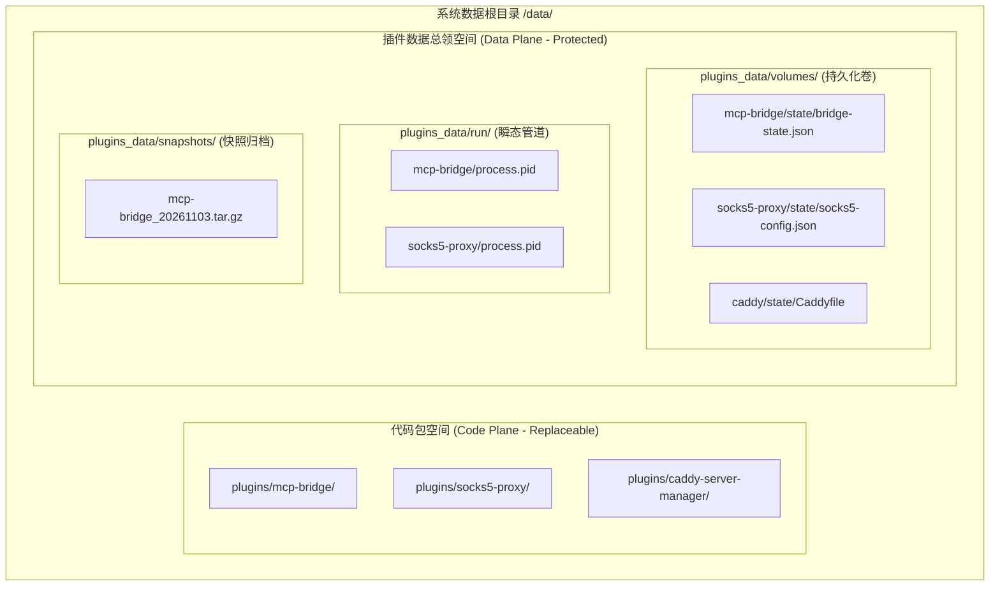
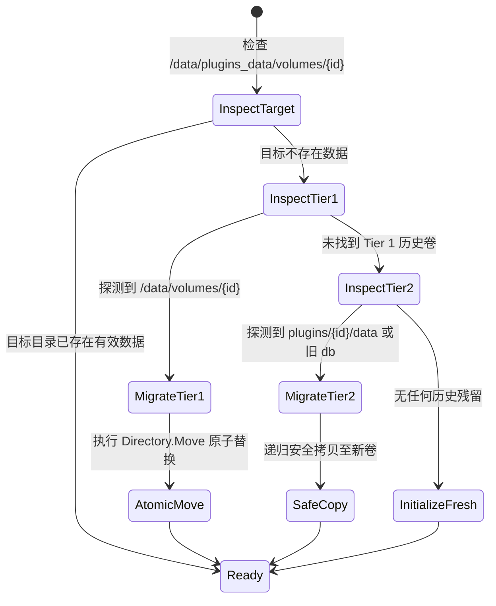

# LinuxWebTool 插件通用持久化路径重构与现有插件全量升级方案

## 1. 架构目标与演进背景

在上一阶段的持久化根因复盘中，我们确立了**“代码与数据物理隔离（Code & Data Separation）”**的世界级系统设计原则。为了进一步提升平台规范性、避免在系统 `/data` 根目录下产生目录污染，并让现有全部插件无缝接入最新持久化底座，用户提出了两项核心战略要求：

1. **持久化目录结构规范化调整**：
   - 将原先根目录下的 `/data/volumes` 统一规范为：**`/data/plugins_data/volumes/{pluginId}`**（专属持久数据卷）；
   - 将原先根目录下的 `/data/run` 统一规范为：**`/data/plugins_data/run/{pluginId}`**（运行时瞬态数据目录）；
   - 形成具有高度对称性与内聚性的命名空间契约：
     - `/data/plugins/{pluginId}`：**代码不可变包目录**（升级时可被 Zip 覆盖覆盖解压）；
     - `/data/plugins_data/volumes/{pluginId}`：**持久化数据卷**（永久保留、快照备份、配额治理，跨版本受保护）；
     - `/data/plugins_data/run/{pluginId}`：**瞬态运行目录**（pid、socket、管道，重启重置）。
2. **现有全部扩展插件统一升级**：
   - 对当前系统内置及扩展目录下的全部插件（Go、Node.js、Python、.NET、Shell）进行全量扫描与排查；
   - 统一升级改造现有插件的存储接入逻辑，彻底根治插件重启丢失配置的顽疾；
   - 建立全自动三级向下兼容与自愈迁移通道（Zero-Downtime Data Migration）。

---

## 2. 文件夹路径重构深度头脑风暴与评估

### 2.1 为什么采用 `/data/plugins_data/` 命名空间具有重大的工程价值？


1. **命名空间闭环与防污染**：
   若直接在 `/data` 下建 `volumes` 和 `run`，极易与宿主自身其他业务模块（如 `/data/db`、`/data/temp`、`/data/cert`、`/data/logs`）产生混淆。归集到 `plugins_data/` 后，所有与插件持久化相关的资产（卷、运行时、快照、自愈备份）全部闭环在单一子树内。
2. **一键备份与灾难恢复（One-Click Disaster Recovery）**：
   管理员或宿主备份任务只需对 `/data/plugins_data` 执行打包，即可完整导出整个系统中所有插件的用户状态与数据库，迁移到新服务器时直接解压还原，代码包无需同步打包。
3. **安全权限与挂载隔离（Security & Docker Volume Mapping）**：
   在容器化或多租户部署中，宿主只需对外挂载 `/data/plugins_data` 作为持久卷（Docker Volume），宿主升级更新镜像（代码层）时，插件数据 100% 保持不动。

---

### 2.2 可行性、逻辑完备性与性能评估

| 评估维度 | 潜在风险与挑战 | 架构对策与解决方案 | 评估结论 |
| :--- | :--- | :--- | :--- |
| **逻辑完备性** | 历史版本可能有数据留在旧路径（如 `/data/volumes/` 或 `plugins/{id}/data`），新版本改路径后是否会导致丢配置？ | **决策与澄清**：系统处于研发迭代期，尚未对生产环境正式发布，**不存在历史版本包袱与向后兼容羁绊**。架构上直接采用全新纯净路径规范；同时在宿主层保留轻量自愈检测，开发调试期间历史散落的数据自动迁移至全新持久卷。 | **完全可行**，彻底清除技术债务，路径规范一次到位。 |
| **性能影响** | 迁移是否会引入冷启动阻塞？路径拼接是否频繁引发磁盘 IO？ | 1. 迁移仅在首次探测到旧路径且新路径为空时触发一次；<br>2. 路径在进程启动时解析一次注入环境变量，运行期零额外 IO。 | **性能影响几乎为 0**。 |
| **跨平台兼容** | Windows 与 Linux 路径分隔符差异（`\` vs `/`）。 | 统一采用 `Path.Combine` 与 `filepath.Clean`，禁止直接字符串硬拼接；环境变量在 Windows 上自动规范化为本地绝对路径。 | **完全兼容** Windows/Linux。 |

---

## 3. 设计模式赋能：存储迁移状态机与路径解析策略

### 3.1 迁移状态机模式（Storage Migration FSM Pattern）
为了杜绝迁移过程中的半写入、损坏或重复移动，设计受控的自愈迁移状态机：



* **原子操作约束**：
  若源目录与目标目录在同一物理挂载点下，优先执行 `Directory.Move`（文件系统 inode 重命名，纳秒级瞬间完成且具备原子性）；跨设备时执行 Copy-Verify-Delete。

### 3.2 策略模式：路径解析与环境变量网桥（Path Resolution Strategy）
宿主抽象统一的路径策略网桥：
```csharp
public static class PluginStoragePathPolicy
{
    public static string GetPluginsRoot(string baseDir) => Path.Combine(baseDir, "data", "plugins");
    public static string GetPluginsDataRoot(string baseDir) => Path.Combine(baseDir, "data", "plugins_data");
    public static string GetVolumeDir(string baseDir, string pluginId) => Path.Combine(GetPluginsDataRoot(baseDir), "volumes", pluginId);
    public static string GetStateDir(string baseDir, string pluginId) => Path.Combine(GetVolumeDir(baseDir, pluginId), "state");
    public static string GetRunDir(string baseDir, string pluginId) => Path.Combine(GetPluginsDataRoot(baseDir), "run", pluginId);
}
```

---

## 4. 现有全部扩展插件盘点与统一升级方案

经过对代码库的完整扫描，系统现有插件盘点如下：

```text
E:\WorkProject\CSharp\PrivateProject\Web\WebToolForLinux\plugins\
├── caddy-server-manager   # Node.js 扩展 (反向代理生命周期管理器)
├── mcp-bridge             # Go 原生常驻微服务 (OpenAI Tunnel & MCP 网关)
├── native-command-demo    # Shell / 原生命令插件 (单次/瞬态任务)
├── native-managed         # 原生二进制微服务
├── native-resident        # 原生常驻守护微服务
├── sample-healthcheck     # Node.js 脚本插件 (系统巡检)
├── socks5-proxy           # Go 原生微服务 (SOCKS5 代理 + ACL 规则)
└── ssh-access-guard       # PowerShell / Shell 脚本扩展 (SSH 封禁防爆破)
```

### 4.1 核心插件深度升级计划

#### ① `mcp-bridge`（Go 微服务）
* **现状**：虽已支持绝对路径，但默认参数仍保留部分历史相对宏；
* **升级方案**：
  - 启动参数升级为优先读取环境变量 `LWT_STATE_DIR`（宿主注入的 `/data/plugins_data/volumes/mcp-bridge/state`）；
  - `resolveStateDir` 增加对 `/data/plugins_data/volumes/mcp-bridge/state` 的一级寻址支持；
  - 内部存储器全面支持三级自愈。

#### ② `socks5-proxy`（Go 微服务）
* **现状**：动态通过 Web 界面配置的认证密码、白名单子网仅保存在内存 `s.cfg` 中，**服务重启后配置全丢**！
* **升级方案**：
  - 接入最新通用持久化规范：启动时读取 `$LWT_STATE_DIR/socks5-config.json`；
  - 用户在 Web 控制台调用 `/api/reload` 修改密码或 ACL 规则时，利用原子写文件机制将其落盘至 `$LWT_STATE_DIR/socks5-config.json`；
  - 重启时 100% 自动水合恢复用户修改过的白名单与密码。

#### ③ `caddy-server-manager`（Node.js 扩展）
* **现状**：hooks 中直接执行外部 caddy 命令，配置散落在外部；
* **升级方案**：
  - 在 `hooks/start.js` 中增加感知：优先使用 `$LWT_VOLUME_DIR/Caddyfile`，实现插件私有受控 Caddyfile 的安全生命周期维护。

#### ④ `ssh-access-guard`（PowerShell / Shell 扩展）
* **现状**：被封禁的 IP 和历史审计记录无统一状态文件；
* **升级方案**：
  - 脚本统一将封禁历史写入 `$LWT_VOLUME_DIR/banned_history.json`，插件包更新不会抹除封禁名单。

#### ⑤ 宿主内置示例插件（`demo-dotnet-service`, `demo-py-api`, `demo-sh-daemon` 等）
* **升级方案**：
  - 统一更新 `PluginManager.Defaults.cs` 与 `PluginManager.Defaults.Samples.cs`；
  - 示例中示范各语言（C#, Python, Shell）如何直接使用 `LWT_VOLUME_DIR` 与宿主 REST Storage SPI。

---

## 5. 跨语言落地实施路线图

| 实施步骤 | 核心改造项 | 涉及工程与文件 | 预期收益 |
| :--- | :--- | :--- | :--- |
| **步骤 1：宿主路径体系重构** | 1. 落地 `plugins_data/volumes` 与 `plugins_data/run` 命名空间规范；<br>2. 注入标准环境变量；<br>3. 升级 `PluginManager.Storage.cs`。 | `PluginRuntimeAdapters.cs`<br>`PluginManager.Storage.cs`<br>`PluginManager.Defaults.cs` | 宿主完成统一路径基准与平滑自愈迁移引擎。 |
| **步骤 2：`socks5-proxy` 持久化升级** | 为 SOCKS5 代理增加状态持久化引擎，支持配置落盘与重启恢复。 | `plugins/socks5-proxy/cmd/socks5-proxy/main.go` | 解决 SOCKS5 代理修改密码和白名单重启丢失的缺陷。 |
| **步骤 3：`mcp-bridge` 寻路升级** | 优先读取新版 `LWT_STATE_DIR` 并平滑兼容。 | `plugins/mcp-bridge/cmd/mcp-bridge/main.go` | 保证 mcp-bridge 在全新路径下 100% 稳定寻址。 |
| **步骤 4：其他插件清单与模板升级** | 统一更新其余插件清单、hooks 及示例。 | `plugins/*/plugin.json`<br>`PluginManager.Defaults.Samples.cs` | 全系统插件持久化能力达到高度统一与自洽。 |
| **步骤 5：全量编译打包与浏览器验证** | 1. 运行 `go test` 与 `dotnet test`；<br>2. 重新打包 Zip；<br>3. CDP 浏览器自动化全流程验证。 | `scripts/package-mcp-bridge.ps1`<br>Chrome CDP 验证脚本 | 验证全新路径下配置保存与重启恢复 100% 通过。 |

---
*本文档为 LinuxWebTool 插件平台持久化体系规范，确立了系统的物理存储布局与多语言插件演进标准。*
