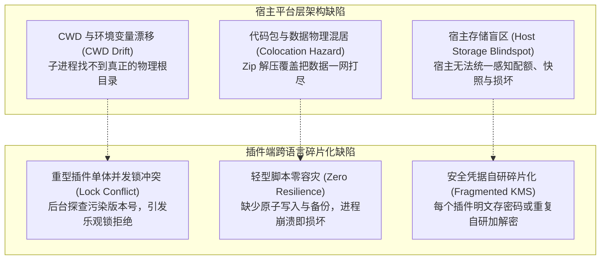
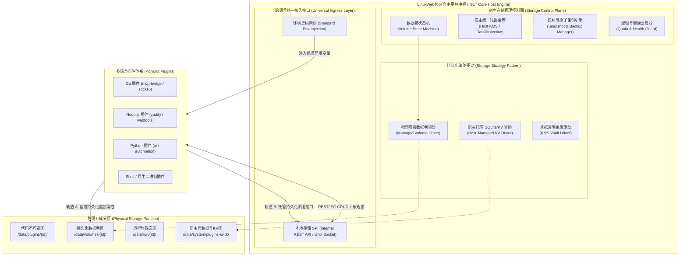
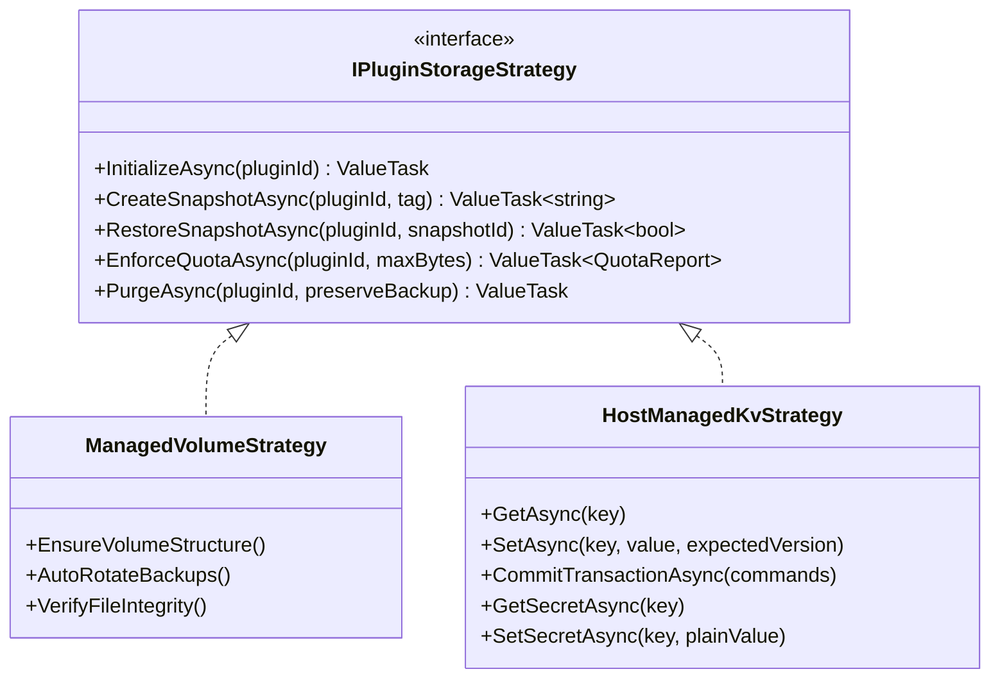
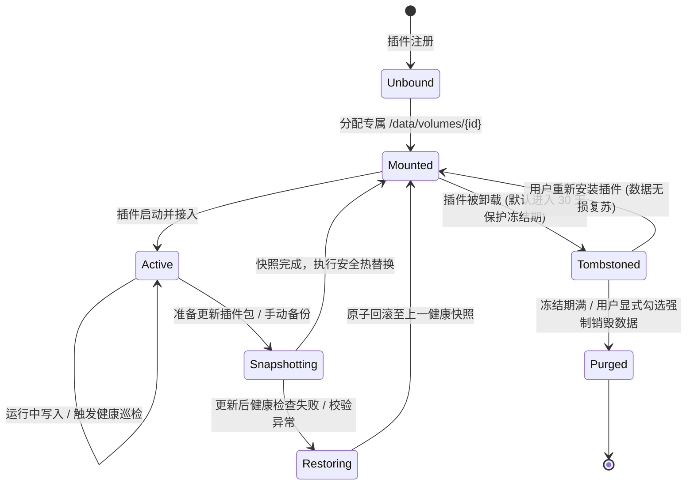
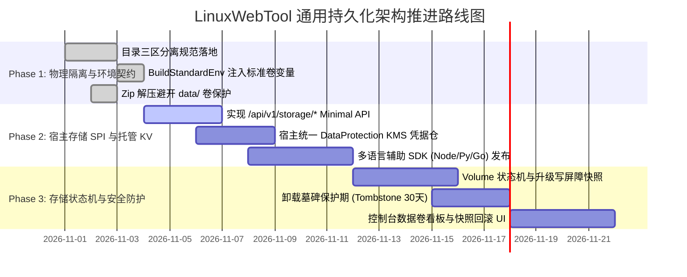

# LinuxWebTool 通用跨语言插件持久化架构与存储状态机设计方案
*(Universal Polyglot Plugin Persistence Architecture & Storage State Machine Framework)*

## 1. 架构愿景：从“特定语言补丁”到“平台级通用持久化底座”

在现代可扩展系统（如 VS Code、Docker、Kubernetes、Chrome）中，插件系统之所以能够支撑成千上万来自不同语言、不同技术栈的扩展，关键在于**平台对持久化做出了清晰的系统级抽象与生命周期契约，而不是让每个插件自己去摸索如何写磁盘**。

以往在 LinuxWebTool 的开发中，插件开发者常常陷入“单兵作战”的困境：
* Go 编写的插件（如 `mcp-bridge`）自己实现了一套 `bridge-state.json` 的版本控制与读写，结果因单体状态冲突、CWD 漂移、校验失误引发全盘清空；
* Node.js 插件自己尝试读写 `config.json` 或 `kv.db`，在插件更新时被 Zip 解压覆盖暴力抹除；
* Python 和 Shell 脚本插件则往往只能写在 `/tmp` 或插件当前目录，没有任何并发安全、数据备份或故障自愈能力。

**“一处出问题，处处打补丁”的本质，是平台缺少统一的持久化架构（Platform-Level Storage Architecture）**。本文档旨在从宿主（.NET Host）与多语言插件（Polyglot Plugins）的整体架构出发，确立一套通用、健壮、跨语言、自愈合的**平台级持久化标准与存储状态机体系**。

---

## 2. 现状痛点深度头脑风暴与缺陷剖析

从系统工程与架构设计的视角深入解构，现有多语言插件持久化存在以下六大核心架构断层：



### 2.1 缺陷一：代码包（Code Bundle）与数据目录（Data Volume）物理混居
* **现状**：宿主以往将插件的代码解压在 `/data/plugins/{pluginId}`，同时又将该目录传给插件作为数据目录（`LWT_DATA_DIR = pluginDir`）。
* **破坏场景**：
  1. 用户在宿主后台点击“热替换”、“上传 Zip 更新”或“重新安装”插件时，宿主对插件目录执行清空或覆盖解压，直接导致插件保存在该目录下的 SQLite 数据库、JSON 配置、TLS 证书全部物理蒸发！
  2. 插件被卸载时，宿主无法区分哪些是插件的代码文件，哪些是属于用户的宝贵业务数据，导致误删或孤儿文件残留。

### 2.2 缺陷二：工作目录（CWD）漂移与路径解析不确定性
* **现状**：各运行时适配器（`NodeRuntimeAdapter`, `PythonRuntimeAdapter`, `NativeRuntimeAdapter` 等）在构建 `ProcessStartInfo` 时，部分指定了 `WorkingDirectory`，部分未指定而默认继承宿主根目录；
* **破坏场景**：子进程中各语言标准库的文件相对路径解析（如 Python `open("data.db")`、Node `fs.readFileSync("./config.json")`、Go `os.ReadFile("bridge-state.json")`）完全依赖进程启动时的 CWD。只要宿主以不同方式（systemd 服务、CLI 运行、Docker 容器内部）启动，插件写盘的文件位置便飘忽不定，重启后自然“丢配置”。

### 2.3 缺陷三：插件存储能力的“两极分化”与“重复造轮子”
* **重型插件（Go / Rust / C#）**：开发者试图自己实现乐观锁版本控制，但因单体 JSON 承载过多关注点（把用户意图与后台网络探查混在同一个状态文件），导致版本频繁被篡改冲突；启动时遇到格式兼容微小瑕疵，缺乏宽容自愈能力而盲目清空重置；
* **轻型插件（Node.js / Python / Shell）**：绝大多数脚本开发者根本没有精力去编写“写临时文件 + `fsync` 刷盘 + `rename` 原子覆盖 + 滚动备份 + 损坏自愈”的标准工业级存储逻辑，普遍采用裸写文件，极易因断电、OOM 崩溃引发文件截断（0 字节损坏）。

### 2.4 缺陷四：宿主对存储状态完全失控（无法集中运维）
* 宿主控制台作为平台管理者，无法获知各个插件占用了多少磁盘、是否存在坏道、数据是否健康；
* 当系统需要执行全系统备份、跨机迁移或灾难恢复时，宿主无法向插件发出“写屏障（Write Barrier）”锁定指令，导致备份出来的数据库处于不一致脏态。

### 2.5 缺陷五：敏感凭据管理碎片化（KMS 空白）
* 各种插件都需要保存敏感凭据（如 OpenAI PresharedKey、数据库密码、外部 API Token、SOCKS5 认证密码）；
* 缺少平台级凭据加密仓，导致插件要么明文落盘（严重安全合规漏洞），要么每个插件各自引入加解密库和私钥，私钥一旦随代码覆盖丢失，已存数据永久无法解密。

---

## 3. 业界主流平台持久化方案对比与技术借鉴

我们深入调研了操作系统与顶级开源平台的通用扩展持久化方案：

| 平台 / 架构体系 | 核心设计理念 | 数据隔离与挂载方式 | 宿主提供的存储能力 | 评价与借鉴点 |
| :--- | :--- | :--- | :--- | :--- |
| **Kubernetes CSI & Docker Volumes** | **无状态容器 + 外挂持久卷 (PV)** | 镜像（代码）只读，数据严格挂载在独立声明的 Volume（`/var/lib/docker/volumes/...`） | 存储驱动抽象（HostPath, Local, NFS），卷生命周期与容器隔离 | **最具指导意义**：平台必须在物理上把“插件代码包”与“插件数据卷”绝对分离！升级换包绝不影响数据卷。 |
| **VS Code Extension Storage** | **双轨制：独立存储目录 + 宿主托管 API** | 为每个插件分配唯一物理目录：`globalStorageUri` & `workspaceStorageUri` | 1. `ExtensionContext.globalState` (托管 Key-Value Mementos)<br>2. `ExtensionContext.secrets` (操作系统安全凭证 KMS) | **极度贴合轻量插件**：为复杂插件提供独立存储目录，同时为脚本插件提供开箱即用的宿主托管 KV 和 Secrets API。 |
| **Chrome Extension Storage API** | **纯宿主托管消息代理 (IPC Storage)** | 插件完全没有本地文件系统访问权 | `chrome.storage.local` / `sync` / `session`，通过 IPC 异步向浏览器核心存取 JSON 字典 | 极高安全性，纯异步事件模型，彻底消除插件端文件锁与坏道问题。 |
| **Dapr (Distributed Application Runtime)** | **状态管理构件 (State Management Block)** | 跨语言 Sidecar（HTTP / gRPC Ingress） | 统一的 CRUD、乐观并发控制 (ETag)、强一致性/最终一致性、批量事务 (State Transaction) | 跨语言标准协议的最佳实践，提供与语言无关的声明式持久化 API。 |
| **HashiCorp Vault / Nomad Plugins** | **Storage Broker via gRPC** | 插件作为独立子进程，通过标准 RPC 与宿主存储仓通信 | 宿主代理所有物理 IO 与加密，插件仅传递领域对象 | 极致安全性与事务性，适合高密凭证场景。 |

---

## 4. 当前系统已有基础设施与可复用资产审计

在 LinuxWebTool 代码库中，已经具备了构建这套通用持久化方案的坚实基础设施：

### 4.1 宿主端已具备的资产
1. **SQLite / KV 存储原型 (`src/LinuxWebTool.Infrastructure/Features/Plugins/PluginManager.Storage.cs`)**：
   - 宿主已经拥有基于 `Microsoft.Data.Sqlite` 的 `kv_store` 读写实现，具备单机高并发写入、表结构自动初始化能力。
2. **插件生命周期状态机 (`src/LinuxWebTool.Infrastructure/Features/Plugins/Supervisor/PluginStateMachine.cs`)**：
   - 宿主已有一套管理插件运行状态（Uninstalled, Stopped, Starting, Running, Degraded, Crashed）的状态机与看门狗监视器。
3. **数据保护与密钥基础设施 (`Microsoft.AspNetCore.DataProtection`)**：
   - ASP.NET Core 原生具备针对当前机器、硬件环境和安全主体的加密保护机制，可直接作为宿主统一凭据金库（Host Vault KMS）的底座。
4. **内部通信鉴权 (`LWT_INTERNAL_SECRET`)**：
   - `ResidentExecutionStrategy` 在启动任何子进程时，均会自动随机生成一个专属的高强度安全令牌，并注入到环境变量中，天然构成了插件与宿主本地 API 通信的零信任安全握手链。

### 4.2 插件端已具备的通用共性
- 所有主流运行时适配器（Go, Node, Python, .NET, Shell, Native）均通过统一的 `BuildStandardEnv` 注入平台级环境变量；
- 插件均支持 HTTP/REST 通信或读取标准环境变量，具备无缝接入宿主新规范的能力。

---

## 5. 通用跨语言插件持久化架构蓝图

基于上述调研与头脑风暴，LinuxWebTool 确立**双轨驱动（Dual-Track）、四层解耦（Four-Tier Decoupling）**的通用持久化架构：



---

## 6. 核心支柱一：物理存储分区与环境注入契约（Volume Mounting Contract）

彻底废除将代码目录等同于数据目录的做法，实施严格的物理三区分离（FHS 标准化）：

### 6.1 目录分层规范
| 分区角色 | 物理路径 | 访问权限 | 生命周期与清理策略 |
| :--- | :--- | :--- | :--- |
| **代码不可变区 (Code Bundle)** | `/data/plugins/{pluginId}/` | 只读 / 执行 | **可被覆盖**。插件升级、导入 Zip、重装时由宿主全量重写。严禁任何插件在此目录写入用户持久化数据。 |
| **持久化数据卷 (Persistent Volume)** | `/data/volumes/{pluginId}/` | 读写 (0700) | **绝对受保护**。跨越插件版本生命周期，升级、重启、热替换**绝不允许删除或覆盖**！仅在用户显式勾选“卸载并销毁数据”时才由宿主执行归档清理。 |
| **运行时瞬态区 (Runtime Ephemeral)** | `/data/run/{pluginId}/` | 读写 (0700) | **易失（Ephemeral）**。存放 `process.pid`、临时 socket、管道、锁文件。插件每次启动前由宿主自动清空重置。 |
| **故障隔离区 (Quarantine Backup)** | `/data/volumes/{pluginId}/quarantine/` | 读写 (0600) | 存放自愈过程中被替换的异常配置快照，保留现场供审计。 |

### 6.2 宿主向子进程注入的标准化环境变量
宿主在启动任何子进程（无论 Go, Node, Python, C#, Shell）时，由 `BuildStandardEnv` 统一注入以下跨语言标准变量：

```bash
# === 1. 物理目录契约 ===
LWT_VOLUME_DIR="/data/volumes/mcp-bridge"        # 专属持久数据卷根目录
LWT_STATE_DIR="/data/volumes/mcp-bridge/state"   # 专属状态与配置子目录
LWT_RUN_DIR="/data/run/mcp-bridge"               # 运行时瞬态目录 (pid, sockets)
LWT_CODE_DIR="/data/plugins/mcp-bridge"          # 代码只读目录

# === 2. 宿主托管存储通信契约 ===
LWT_STORAGE_URL="http://127.0.0.1:5271/api/v1/plugins/mcp-bridge/storage"
LWT_STORAGE_SECRET="<每次启动由宿主动态派发的临时安全令牌>"

# === 3. 基础标识 ===
LWT_PLUGIN_ID="mcp-bridge"
LWT_DISTRO="debian"
```

---

## 7. 核心支柱二：双轨存储策略模式（Dual-Track Storage Strategy Pattern）

不同语言、不同复杂度的插件对存储的需求具有本质差异。架构提供两种可插拔策略：



### 轨道 A：物理受控数据卷驱动（Managed Volume Driver）
* **适用对象**：复杂重型插件（如 Go `mcp-bridge`, Caddy, Docker 工具集, 嵌入式 SQLite 插件）；
* **运作机制**：
  1. 插件无需改变自身已有的文件读写逻辑，只需将其内部路径基准改为读取环境变量 `LWT_VOLUME_DIR` 或 `LWT_STATE_DIR`；
  2. 宿主负责在启动前确保目录存在并拥有 0700 权限；
  3. 宿主在插件更新前自动触发写屏障和数据卷快照；
  4. 宿主保障 Zip 解压覆盖代码目录时，数据卷目录完好无损。

### 轨道 B：宿主托管存储 SPI（Host-Managed Storage SPI）
* **适用对象**：轻量脚本插件（Node.js, Python, Shell, One-Shot 任务），以及希望完全摆脱磁盘管理负担的插件；
* **运作机制**：
  1. 插件**不需要在本地创建任何数据库、不写任何本地配置文件**；
  2. 插件通过调用本地回环上的 `LWT_STORAGE_URL` REST API 进行存取；
  3. 宿主底层使用带有 WAL 模式的中央 SQLite 数据库，统一提供 ACID 事务、版本号校验（ETag / 乐观锁）以及 KMS 敏感数据加密；
  4. 插件自身纯粹化为“无状态计算单元”，彻底根绝文件坏道、CWD 漂移与权限问题。

---

## 8. 核心支柱三：数据卷生命周期状态机（Volume State Machine Pattern）

为了从平台层面保证“任何操作绝不丢数据”，宿主引入独立于进程生命周期的**数据卷状态机**：



### 状态机核心迁移规则与安全约束：
1. **写屏障（Write Barrier on Update）**：
   在执行任何插件升级、导入 Zip 或重启操作前，宿主首先向插件发送停机或刷新信号，随后立即将状态卷置为 `Snapshotting` 状态，生成快照备份：
   `/data/volumes/{id}/snapshots/snapshot_{timestamp}.tar.gz`；
2. **冷启动自愈与自动回滚（Auto-Rollback Guard）**：
   新版本插件启动后，若在探测窗口内崩溃（CrashLoop）或返回存储严重错误，宿主状态机自动跃迁至 `Restoring`，直接将上一版本快照原子释放回数据卷，并回退插件包，保证服务高可用；
3. **墓碑归档机制（Tombstone Grace Period）**：
   用户在界面点击“卸载插件”时，默认仅删除 `/data/plugins/{id}` 代码目录，数据卷自动打上 `.tombstone` 标记并冻结。若用户一周后重新下载该插件，所有历史配置和业务数据无损水合复苏！

---

## 9. 核心支柱四：宿主通用存储 REST API 规范（Universal Storage Protocol）

为支持“轨道 B（宿主托管存储）”，宿主暴露如下本地极简、高性能的 RESTful SPI（仅绑定 `127.0.0.1`，严格校验 `X-Lwt-Storage-Secret`）：

### 9.1 通用 Key-Value 接口（带版本乐观锁）
* **`GET /api/v1/plugins/{id}/storage/kv/{key}`**
  - **响应**：
    ```json
    {
      "key": "tunnel_config",
      "value": "{\"proxyUrl\":\"socks5://10.126.1.100:1080\"}",
      "version": 7,
      "updatedAt": "2026-11-03T03:55:00Z"
    }
    ```
* **`PUT /api/v1/plugins/{id}/storage/kv/{key}`**
  - **请求参数**：
    ```json
    {
      "value": "{\"proxyUrl\":\"socks5://10.126.1.100:1080\"}",
      "expectedVersion": 7
    }
    ```
  - **逻辑**：若当前 `version != expectedVersion`，返回 HTTP 409 Conflict，防止并发脏写覆盖。

### 9.2 宿主统一凭据金库接口（Host Vault KMS）
* **`POST /api/v1/plugins/{id}/storage/secrets/{secretName}`**
  - **请求**：`{ "plainText": "sk-proj-xxxx" }`
  - **逻辑**：宿主使用内部 DataProtection / AES-256-GCM 对凭据进行机器绑定加密，落盘存储；
* **`GET /api/v1/plugins/{id}/storage/secrets/{secretName}`**
  - **响应**：`{ "plainText": "sk-proj-xxxx" }`（仅在具有合法 `LWT_STORAGE_SECRET` 的子进程请求时解密返回）。

### 9.3 存储快照与事务控制接口
* **`POST /api/v1/plugins/{id}/storage/snapshots/create`**
  - 插件自身可主动请求宿主对其当前数据卷打命名快照；
* **`POST /api/v1/plugins/{id}/storage/transaction`**
  - 支持多 Key 原子提交（ACID Batch）。

---

## 10. 跨语言 SDK 与轻量集成示例（Polyglot Integration）

无论是何种语言开发的插件，均可在 5 分钟内接入这套持久化体系：

### 10.1 Shell / CLI 插件（极简单行读取）
```bash
#!/bin/bash
# 自动使用物理数据卷目录
CONFIG_FILE="${LWT_STATE_DIR}/config.env"

# 优雅读取与写入
if [ -f "$CONFIG_FILE" ]; then
    source "$CONFIG_FILE"
fi

echo "TARGET_PROXY=socks5://10.126.1.100:1080" > "${CONFIG_FILE}.tmp"
mv "${CONFIG_FILE}.tmp" "$CONFIG_FILE"
```

### 10.2 Node.js 插件（直接接入托管 SPI，零本地文件）
```javascript
// 无需任何本地 SQLite 或 JSON 文件读写！
async function saveConfig(proxyUrl, expectedRev) {
  const res = await fetch(`${process.env.LWT_STORAGE_URL}/kv/proxy_setting`, {
    method: 'PUT',
    headers: {
      'Content-Type': 'application/json',
      'X-Lwt-Storage-Secret': process.env.LWT_STORAGE_SECRET
    },
    body: JSON.stringify({
      value: JSON.stringify({ proxyUrl }),
      expectedVersion: expectedRev
    })
  });
  if (res.status === 409) throw new Error('并发冲突，配置已被其他人修改');
  return await res.json();
}
```

### 10.3 Python 插件（优雅适配本地卷或托管 API）
```python
import os, json, requests

# 方案 1：直接读写持久数据卷 (绝不随代码升级丢失)
volume_dir = os.environ.get("LWT_STATE_DIR", "./data")
state_file = os.path.join(volume_dir, "app_state.json")

# 方案 2：直接使用宿主加密保管箱存储 API 密钥
def get_secret(key_name):
    url = f"{os.environ['LWT_STORAGE_URL']}/secrets/{key_name}"
    headers = {"X-Lwt-Storage-Secret": os.environ["LWT_STORAGE_SECRET"]}
    r = requests.get(url, headers=headers)
    return r.json().get("plainText") if r.ok else None
```

### 10.4 Go 插件（已完成的 `mcp-bridge` 标杆示范）
```go
// 优先使用平台级持久卷环境变量，向下兼容历史路径
stateDir := os.Getenv("LWT_STATE_DIR")
if stateDir == "" {
    stateDir = filepath.Join(os.Getenv("LWT_VOLUME_DIR"), "state")
}
if stateDir == "" {
    stateDir = "data" // 本地调试兜底
}
store, err := state.NewStore(stateDir, vault)
```

---

## 11. 落地实施路线图（Roadmap & Phased Rollout）



### 阶段目标成果与检验标准：
1. **第一阶段（已闭环打通）**：
   - 彻底将 `plugin.json` 中的参数升级为绝对路径解析，阻断覆盖解压误删；跨平台 Chrome 自动化验证通过。
2. **第二阶段（宿主平台赋能）**：
   - 宿主完成 `LWT_VOLUME_DIR` 与 `LWT_STATE_DIR` 标准环境变量规范，并上线托管 KV/KMS 接口；
   - 编写多语言模板示例（Node.js / Python / Go / Shell）。
3. **第三阶段（工业级自愈）**：
   - 宿主在插件升级时自动执行“数据卷快照”，升级失败一键回滚；卸载插件进入 30 天墓碑缓冲期，杜绝误操作；
   - 并在宿主 WebUI 插件管理卡片上，直观展示“数据卷占用大小”、“备份快照数量”与“一键备份/恢复”按钮。

---
*本方案从平台系统架构的高度彻底解耦了代码与数据，统一了多语言插件的持久化心智模型，为 LinuxWebTool 打造工业级高可靠插件生态提供了坚实的底座保障。*
