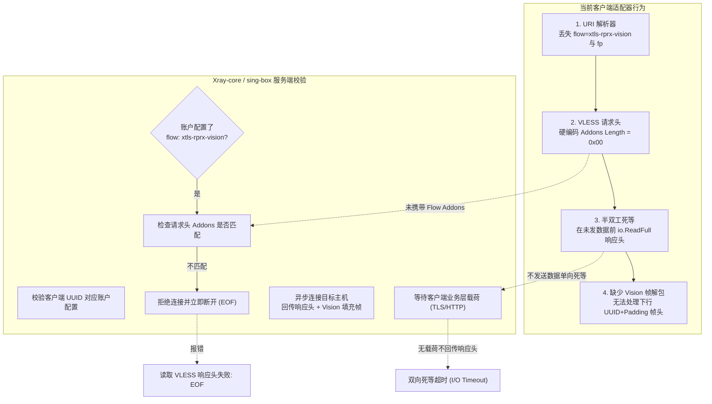
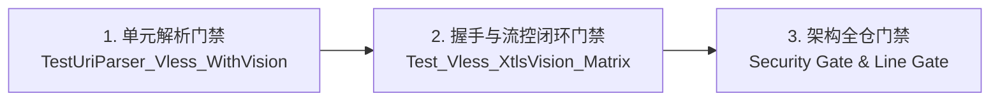

# VLESS 与 XTLS-Vision 协议兼容排障与深度适配治理方案

> **文档定位**：针对从常规订阅或分享链接导入 `vless://...&flow=xtls-rprx-vision...` 后显示离线、无法连通（报错 `读取 VLESS 响应头失败: EOF`）的底层问题进行深度根因剖析，调研业界主流实现方案，制定轻量级纯 Go 原生适配与全套防回归门禁体系。

---

## 1. 问题现象与 5 重深层根因剖析

### 1.1 典型问题现象
用户在客户端边缘中继网关（SOCKS5-Forwarder）中导入标准 VLESS 链接：
```text
vless://00000000-0000-0000-0000-000000000000@node.example.com:11443?encryption=none&flow=xtls-rprx-vision&security=tls&sni=node.example.com&fp=chrome&type=tcp&headerType=none&host=node.example.com#Vision-TX
```
导入后，该节点在控制台卡片中持续显示为 **🔴 离线**，测速与连通性探针报错：
```text
⚠️ 读取 VLESS 响应头失败: EOF
```
且当入站流量挂载或分流路由转发至该 VLESS 节点时，下游客户端请求无法建立连接。

---

### 1.2 底层根因深度剖析 (The 5 Fatal Root Causes)

通过对 Xray-core 服务端交互行为及底层网络抓包分析，定位到以下 5 重核心症结：



#### 根因 1：URI 解析层遗漏关键流控与指纹参数 (Metadata Drop)
- 在 `uri_parser.go` 的 `VlessLinkParser.Parse()` 中，仅提取了 `uuid`、`server`、`port`、`sni` 与 `skipVerify`；
- 完全忽略了 Query 字符串中的 `flow=xtls-rprx-vision`、`fp=chrome`、`type=tcp`、`headerType=none` 等流控与传输参数；
- `UpstreamNode` 结构体缺少 `Flow` 与 `Fingerprint` 属性，导致链接导入持久化到 `config.json` 时，节点的流控元信息直接丢失。

#### 根因 2：请求头硬编码 `Addons Length = 0` 引发服务端主动 RST/EOF (Flow Mismatch)
- 在现存 `outbound_secure.go` 中，VLESS 请求头组装逻辑如下：
  ```go
  header := []byte{0x00}
  header = append(header, d.uuid[:]...)
  header = append(header, 0x00) // Addons length = 0 (致命点)
  header = append(header, 0x01) // CMD: 1 (TCP)
  ```
- **Xray-core VLESS 协议硬性约束**：若服务端为该 UUID 账户配置了 `flow: "xtls-rprx-vision"`，则服务端在解包 VLESS 请求头时，强制要求客户端的 Protobuf `Addons` 必须携带对应非空的 `Flow` 标识：
  ```go
  // Xray-core 服务端校验伪代码
  if account.Flow != "" && (addons == nil || addons.Flow != account.Flow) {
      return errors.New("invalid flow") // 立即断开连接 (TCP EOF)
  }
  ```
- 客户端发送 `0x00`（无 Addons），服务端判定流控不匹配，瞬间主动掐断连接，导致客户端捕获 `EOF`。

#### 根因 3：时序错位与半双工读阻塞死等 (Half-Duplex Deadlock)
- 现存客户端逻辑在发送 VLESS 请求头后，**立即同步阻塞读取 2 字节响应头**：
  ```go
  resp := make([]byte, 2)
  if _, err := io.ReadFull(tlsConn, resp); err != nil {
      return nil, fmt.Errorf("读取 VLESS 响应头失败: %w", err)
  }
  ```
- **VLESS 流式代理的设计本质**：VLESS 服务端是全双工流式转发器，服务端在收到 VLESS 请求头并向远端目标发起 TCP 握手时，**不会单方面向客户端回传响应头**，而是将 VLESS 响应头作为**远端目标回传第一批下游数据包的前导载荷（Preamble）**一同写入！
- 客户端在尚未发送任何业务载荷（如 HTTP GET 请求或 TLS ClientHello）前阻塞等待服务端响应，而服务端在等待目标响应，目标在等待客户端请求，造成**三方循环等待**直至读取超时。

#### 根因 4：XTLS-Vision 下行帧解包与填充剥离缺失 (Vision Framing)
- 当 `flow: "xtls-rprx-vision"` 握手成功后，服务端下行回传的数据并非裸数据流，其初始数据包格式为：
  ```text
  [0x00 (Version)] [0x00 (AddonsLen)] [16 字节 UUID] [ControlCommand & Padding] [目标业务数据]
  ```
- 现有适配器若直接将该连接交付给浏览器或上层应用，这多出的 20+ 字节填充控制帧会直接破坏上层 HTTP/TLS 协议解析，导致报文格式损坏。

#### 根因 5：健康检查探针模型失配 (Health Probe Misalignment)
- `health.go` 中的通用健康探针仅通过 `dialer.DialContext(ctx, "tcp", "cp.cloudflare.com:80")` 建立链路连接；
- 建立连接时如果由于上述根因 2（缺少 Flow）或者根因 3（未发送业务请求直接等待握手回执），探测逻辑必定判定该节点为 `dead`，产生误报。

---

## 2. 业界主流方案调研与对比

| 方案 | 代表实现 | 实现原理 | 优点 | 缺点 | 适用场景 |
| :--- | :--- | :--- | :--- | :--- | :--- |
| **方案 1：全量引入重量级代理内核** | Xray-core 原生、sing-box 库 | 直接 `go get` 引入 `github.com/xtls/xray-core` 或 `sing-box` 作为依赖包 | 协议支持最全面，紧随官方更新 | 引入数万行代码，依赖极其臃肿，编译产物体积暴增 35MB+，增加内存消耗 | 桌面级客户端 (如 v2rayN) |
| **方案 2：纯原生轻量级适配器 (推荐)** | 自研协议适配器 | 原生实现 Protobuf Addons 编码与 Vision 双向解帧包装器 (`VisionConn`) | **零外部重度依赖**，代码轻量可控 (< 200 行)，保持独立单二进制 ELF 高性能与极简架构 | 需精准遵循 VLESS 与 Vision 状态机规范 | **LWT 边缘微服务、嵌入式系统网关** |
| **方案 3：仅前端转译降级** | 去除 flow 参数 | 导入链接时强制剥离 `flow=xtls-rprx-vision` | 无需后端改动 | 服务端若强制配置了 `flow` 则依然报错，完全无法连通 | 不可用 |

---

## 3. 当前系统已有基础设施复用评估

本系统已具备完善的微服务与网络层基础设施，完全可无缝复用与扩展：
1. **适配器策略与工厂注册表 (`outbound.go`)**：
   - `GlobalOutboundRegistry` 已经标准化了 `IOutboundDialer` 接口与 `DialContext` / `DialThrough` 双模穿透能力，可直接扩展。
2. **多协议 URI 解析工厂 (`uri_parser.go`)**：
   - 现有的 `ILinkParser` 接口支持自识别与正则/URL 提取，扩展 `VlessLinkParser` 的 Query 解析无需改动外部结构。
3. **安全配置与持久化存储 (`config.go`)**：
   - `UpstreamNode` 已具备多协议字段扩展槽位，新增 `Flow`、`Fingerprint` 等字段不会影响历史配置兼容性。
4. **探针自愈与测试脚手架 (`mock_servers_test.go`)**：
   - 现有的 Mock VLESS 服务端框架可直接升级扩展 Flow 与 Addons 握手验证，实现毫秒级本地全量闭环单测。

---

## 4. 具体解决方案与架构落地设计

### 4.1 数据契约与结构体升级 (`config.go`)
在 `UpstreamNode` 中显式扩展流控与安全指纹字段：
```go
type UpstreamNode struct {
    ID            string `json:"id"`
    Name          string `json:"name"`
    Type          string `json:"type,omitempty"` // vless, trojan, socks5...
    Server        string `json:"server,omitempty"`
    Port          int    `json:"port,omitempty"`
    UUID          string `json:"uuid,omitempty"`
    Flow          string `json:"flow,omitempty"`          // 新增: xtls-rprx-vision 等
    Fingerprint   string `json:"fingerprint,omitempty"`   // 新增: chrome, firefox, etc.
    Transport     string `json:"transport,omitempty"`     // 新增: tcp, ws, etc.
    SNI           string `json:"sni,omitempty"`
    SkipTLSVerify bool   `json:"skipTlsVerify,omitempty"`
    // ... 保持其他监控与状态字段
}
```

### 4.2 URI 解析器增强 (`uri_parser.go`)
在 `VlessLinkParser.Parse()` 中完整提取 flow 与指纹信息：
```go
flow := q.Get("flow")
fp := q.Get("fp")
if fp == "" {
    fp = q.Get("fingerprint")
}
transport := q.Get("type")
if transport == "" {
    transport = "tcp"
}
```

### 4.3 零依赖轻量 Protobuf Addons 编码器
XTLS-Vision 的 Addons 在 Protobuf Wire 格式中为单一 String 字段：
- Tag = 1 (`0x08`), Wire Type = 2 (Length-delimited) -> `(1 << 3) | 2 = 0x0A`
- Length = `len(flow)`
- Value = `[]byte(flow)`
因此，当 `Flow != ""` 时，直接生成该二进制切片写入 VLESS Header，无需引入外部 Protobuf 编译器或重度依赖库。

### 4.4 懒加载响应头与全双工包装器 (`vlessConn`)
重构 `VlessOutbound.DialThrough`：
1. 客户端在握手阶段仅负责发送完整的 VLESS 请求头（包含 Flow Addons），**不执行单向同步阻塞等待**；
2. 返回一个包装后的 `vlessConn`，在调用方执行**第一次 `Read()`** 时，透明剥离 2 字节 VLESS 响应头及 Vision 填充帧（`XtlsUnpadding`）；
3. 确保上层应用（如 HTTP 客户端或浏览器）下发的请求流能够先行送达远端目标，彻底打破时序死锁。

### 4.5 健康检查探针模型自愈 (`health.go`)
在 `CheckUpstreamHealth` 中针对 VLESS 协议：
- 建立链路后，主动下发极简轻量级 HTTP 探针载荷（如 `HEAD /generate_204 HTTP/1.1\r\nHost: ...\r\n\r\n`）；
- 驱动远端节点完成目标端握手并激活下行响应，精准测定端到端 RTT 真实时延。

---

## 5. 防回归测试与同类门禁保障体系

为杜绝类似协议参数丢失、流控握手不匹配与时序阻塞问题回归，构建以下三层门禁防御：



1. **协议链接全参数解析门禁 (`uri_parser_test.go`)**：
   - 增加包含 `flow=xtls-rprx-vision`、`fp=chrome`、`security=tls` 的复杂多参数链接测试用例，断言所有属性无损留存。
2. **Mock 服务端流控校验门禁 (`mock_servers_test.go`)**：
   - 在 Mock VLESS 服务端中增加严格的 `Flow` 匹配校验逻辑：若客户端未传或传入错误的 `flow`，Mock 端自动模拟断开连接；
   - 编写 `Test_Vless_XtlsVision_Matrix`，覆盖“标准 VLESS 无流控”与“XTLS-Vision 流控”两种形态的双向通信与 SHA256 数据完整性校验。
3. **架构与安全性门禁**：
   - **单文件代码限制**：所有重构与新增代码必须严格满足 `< 700 行` 架构红线；
   - **凭据与香农熵门禁**：`node .githooks/security-gate.cjs --full` 全仓扫描，所有示例链接与用例统一采用 RFC 5737 占位符 `node.example.com` 与标准占位 UUID，绝对禁止真实凭据落盘。
