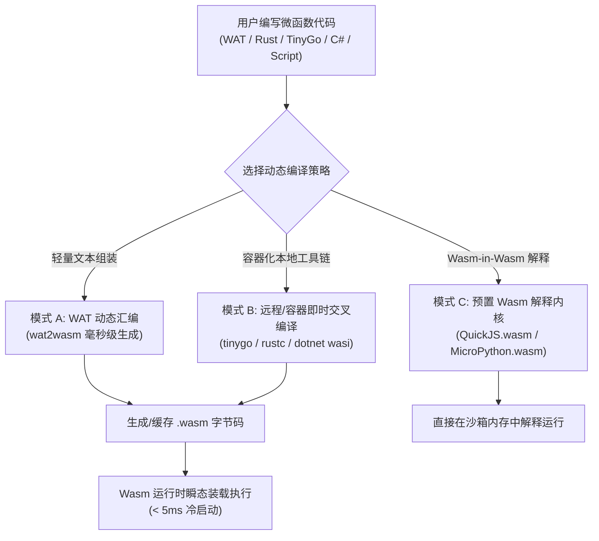
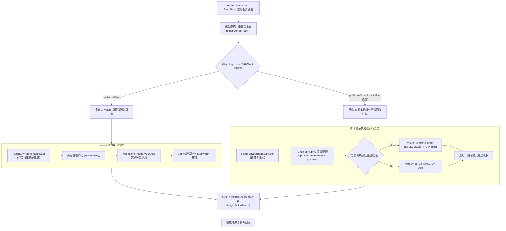

# Wasm 与多语言脚本微函数架构对比、可行性调研与系统演进方案

> 本文档针对 LinuxWebTool (LWT) 插件生态中 **WebAssembly (Wasm) 极速微函数** 与 **多语言脚本微函数 (bat/node/py/ps/sh)** 的技术边界、运行时要求、动态编译机制、C# 原生支持、性能差异、安全隔离以及架构演进进行深度调研、头脑风暴与落地设计。

---

## 1. 核心问题深度剖析

### 1.1 Wasm 有哪些限制？支持网络与文件操作吗？需要什么运行时？

#### 1. 核心限制与能力边界
- **线性内存隔离（Linear Memory Sandbox）**：
  Wasm 运行在严格隔离的 32 位（或 64 位 memory64）线性地址空间中。Wasm 模块内部的指令**绝对无法直接解引用或读写宿主操作系统的物理内存地址**，完全杜绝了缓冲区溢出利用、任意内存读写等安全漏洞。
- **无默认系统特权（Capability-based Security / Default Deny）**：
  原生的 Wasm 字节码规范（MVP）是纯计算模型，内部没有任何系统调用指令（如 Linux `syscall`、Windows `int 2e`）。任何外界环境能力（系统时间、随机数、环境变量、文件、网络）默认全部为零，**必须由宿主显式导出函数（Host Functions）并注入给 Wasm 实例**。
- **并发与线程限制**：
  目前大多数轻量 Wasm 运行时默认以“单线程无共享状态（Shared-Nothing）”方式运行。虽然有 `wasm-threads` 标准（基于 `SharedArrayBuffer` 与原子操作 Atomics），但多线程并发管理和锁调度比原生程序复杂，通用微函数普遍采用多实例并发模型而非进程内多线程。

#### 2. 对文件系统与网络操作的支持现状
- **文件操作**：
  - **支持，基于 WASI（WebAssembly System Interface）**：通过 WASI 0.1 (`preview1`) 标准，宿主可以在实例化 Wasm 模块时，以**能力安全预打开目录（Pre-opened Directories）**的方式将宿主特定路径（如 `/app/data/plugins/my-wasm/sandbox`）虚拟映射给 Wasm 模块。
  - Wasm 内部调用 `fd_read`、`fd_write` 等 POSIX 类似接口，但**绝对无法跳出被授权的目录访问宿主根目录（如 `/etc`、`C:\Windows`）**。
- **网络操作**：
  - **WASI 0.1 (Preview 1)**：原生规范**不支持直接建立 TCP/UDP Socket 或监听端口**。传统方案通过宿主注入自定义 Host Call（例如宿主提供 `http_fetch(url)` 方法供 Wasm 调用）。
  - **WASI 0.2 / Preview 2 (Component Model)**：于 2024 年正式发布的组件模型引入了标准化接口（如 `wasi:http/outgoing-handler`），Wasm 模块无需特权 Socket 即可直接以类型安全的方式发起 HTTP/HTTPS 出站请求。

#### 3. 需要的运行时环境
Wasm 二进制不能直接被 CPU 裸跑执行，必须通过专门的 Wasm 虚拟沙箱引擎：
- **独立生产级 Wasm 引擎**：
  - **Wasmtime**（Bytecode Alliance，Rust 编写，支持 Cranelift JIT 编译器，标准参考实现）；
  - **WasmEdge**（CNCF 毕业项目，C++ 编写，面向云原生、边缘计算及 LLM 推理加速）；
  - **Wasmer**（跨平台，支持 Singlepass/Cranelift/LLVM 三种后端编译器）；
  - **WAMR (WebAssembly Micro Runtime)**（极致轻量，针对内存仅几十 KB 的嵌入式芯片）。
- **通用宿主内置引擎（零新依赖平替）**：
  - **Node.js / Chromium (V8 引擎)**：内置成熟的 `WebAssembly` JIT 与 `@wasi` 支持；
  - **.NET 运行时 (Mono Wasm / Wasmtime-Dotnet)**。

---

### 1.2 Wasm 能支持动态编译运行吗（类似 Go 语言方案）？

**答案：完全支持，且存在多种工程化落地途径。**

Wasm 本身是预编译的二进制字节码（`.wasm`），但在微服务和插件平台中，可以通过以下三种模式实现类似 Go 源码即时拉起与动态编译的效果：



1. **模式 A：WAT 动态汇编（毫秒级，开箱即用）**：
   - 用户上传或动态生成人类可读的 WebAssembly 文本代码（`.wat`）；
   - 系统调用预置在容器内的 `wat2wasm` 工具，**耗时只需 3~8ms** 即可转译成目标 `.wasm` 字节码并立即执行。
2. **模式 B：容器化即时交叉编译（类 Go 预热方案）**：
   - 类似我们现有脚本 `deploy-remote.ps1` 交叉编译 Go 二进制的机制；
   - 当插件更新源码（如 `handler.go` 或 `src/lib.rs`）时，检测文件 `LastWriteTime`，由后台调用 `tinygo build -target=wasi` 或 `cargo build --target wasm32-wasip1` 编译为 `.wasm` 并建立 SHA256 缓存。后续请求直接命中缓存。
3. **模式 C：Wasm-in-Wasm 解释架构（业界主流：Shopify / Spin 模式）**：
   - 提前将微型语言解释器（如 QuickJS 或 MicroPython）编译为标准的 `engine.wasm`；
   - 用户只需编写动态脚本（JavaScript / Python），系统将用户脚本作为数据载荷灌入 `engine.wasm`，在严格的 Wasm 沙箱内部动态解释运行用户脚本。既保留了脚本的动态灵活性，又享有 Wasm 的强内存沙箱隔离。

---

### 1.3 Wasm 能支持 C# 开发吗？

**答案：原生完全支持，且在 .NET 8 / 9 / 10 生态下日趋成熟。**

在 .NET 生态中开发 Wasm 微函数主要有两条成熟路径：

#### 路径 1：官方 WASI 原生微函数（推荐后端微服务）
微软在 .NET 8 及更高版本（包括 .NET 10）中深度集成了 `wasi-wasm` 目标架构：
- **开发与构建命令**：
  ```bash
  # 安装 WASI SDK 工作负载
  dotnet workload install wasi-experimental
  
  # 创建 WASI 控制台工程
  dotnet new wasiconsole -o MyWasmFunction
  
  # 编译为独立的 WASI WebAssembly 二进制
  dotnet build -c Release -r wasi-wasm
  ```
- **输出产物**：编译出独立的 `MyWasmFunction.wasm`，**可以直接使用 `wasmtime run MyWasmFunction.wasm` 执行**，无需浏览器或 HTML/DOM 环境，非常适合作为无状态微函数。

#### 路径 2：NativeAOT-LLVM (无解释器、单二进制纯静态 Wasm)
利用实验性的 NativeAOT-LLVM 工具链（如社区成熟的 `bflat`），直接将 C# 代码 Native AOT 编译成 Wasm 字节码：
- 优势：剥离了重量级的运行时与 JIT 引擎，启动时间压缩到 1ms 以内，体积压缩至几百 KB。

---

### 1.4 Wasm 的实际性能表现如何？

根据学术界与云原生基准测试（ACM SIGPLAN、USENIX ATC 以及 Fastly/Fermyon 实测数据）：

| 性能维度 | 原生二进制 (C/Rust/AOT) | Wasm (Wasmtime/Cranelift) | Node.js (V8 JIT) | Python (CPython) | 容器 (Docker/Oci) |
| :--- | :---: | :---: | :---: | :---: | :---: |
| **冷启动延迟 (Cold Start)** | **< 1 ms** | **1 ~ 5 ms** | 50 ~ 120 ms | 80 ~ 200 ms | 300 ~ 2000 ms |
| **纯计算性能 (CPU Bound)** | **100% (基准)** | **75% ~ 95%** | 30% ~ 60% | 3% ~ 8% | 100% (原生隔离) |
| **常态内存开销 (Idle RAM)** | **1 ~ 3 MB** | **< 2 MB** | 30 ~ 50 MB | 20 ~ 40 MB | 50 ~ 100 MB |
| **内存沙箱跨越开销** | 0 (无沙箱) | 极小 (边界安全检查) | 中 (V8 上下文) | 高 (GIL/解释器) | 低 (内核命名空间) |
| **高频 I/O / 网络吞吐** | **100% (极高)** | **80% ~ 88%** (受内存拷贝限制) | 85% ~ 90% | 40% ~ 60% | 95% ~ 98% |

- **冷启动**：比 Docker 容器快 **100~300 倍**，比 Node.js/Python 进程快 **20~40 倍**。
- **计算吞吐**：Wasm 字节码经过 JIT 编译器（Cranelift）直接转译为本地硬件机器码，执行速度极度逼近原生 C/Rust，远超 Python/PowerShell 等解释型语言。
- **I/O 损耗**：由于沙箱隔离要求，Wasm 线性内存与宿主内核缓冲区之间存在边界拷贝，在大吞吐网络代理（如 10Gbps 网卡线速转发）场景下吞吐略低于特权原生进程，但对于微函数计算与 API 网关场景影响微乎其微。

---

### 1.5 Wasm 相比 bat / nodejs / py / ps 脚本微函数的本质区别？为什么选 Wasm？

| 对比维度 | Wasm 极速微函数 (`PluginProfile.Wasm`) | 脚本微函数 (`bat` / `ps` / `py` / `node`) |
| :--- | :--- | :--- |
| **安全隔离级别** | **强沙箱隔离（Kernel-like Sandboxing）**<br>无特权指令，无法越权读写系统物理内存或未授权文件。 | **零安全沙箱（特权泛滥）**<br>默认继承主系统的全部权限，可随意执行 `rm -rf` 或读写系统敏感配置。 |
| **凭据泄露风险** | **零凭据暴露**<br>默认无法读取宿主环境变量，必须由宿主显式安全注入。 | **高风险**<br>脚本可直接打印 `process.env` 或 `$env:WEB_ADMIN_PASSWORD` 导致敏感凭据泄露。 |
| **冷启动延迟** | **毫秒/纳秒级（1 ~ 5ms）**<br>真正的按请求瞬时唤醒与销毁。 | **较慢（50ms ~ 1500ms）**<br>尤其 PowerShell 启动耗时常超过 1 秒，无法做高频事件拦截。 |
| **内存与并发密度** | **极高密度（每任务 < 2MB）**<br>单机轻松支撑万级微函数并发隔离实例。 | **极低密度（每任务 20~80MB）**<br>高并发下快速引发系统 OOM（内存溢出）崩溃。 |
| **跨平台一致性** | **编译一次，到处运行（Write Once, Run Anywhere）**<br>一份 `.wasm` 在 x86、ARM、Windows、Linux 下二进制完全一致。 | **碎片化严重**<br>`bat`/`ps` 在 Linux 兼容差；`sh` 在 Windows 不可用；`py` 存在 `glibc`/动态链接库依赖地狱。 |

#### 为什么需要 Wasm？
1. **多租户与不可信代码防护**：用户上传第三方插件或自动化任务时，传统脚本很容易恶意窥探主机或反弹 Shell，而 Wasm 在虚拟机指令级别彻底封死了恶意越权；
2. **瞬时事件响应（SLA 要求）**：在 Webhook 回调、边缘网关规则过滤、日志实时清洗等场景，脚本微函数起停开销太大，Wasm 能做到毫秒级即时响应；
3. **消除容器依赖膨胀**：传统 Docker 容器即便最简 Alpine 镜像也要几十 MB，而 Wasm 微函数通常只有几十 KB 到几 MB，分发与备份极度轻快。

---

### 1.6 能支持 bat / nodejs / py / ps 等脚本微函数吗？会有哪些弊端？

**答案：完全能够支持，且我们系统底座已经具备核心基础；但必须正视其固有弊端并设计针对性防御机制。**

#### 弊端与技术陷阱（Pain Points）：
1. **进程创建开销与“冷启动卡顿”**：
   - Windows PowerShell Core (`pwsh`) 启动需要加载 CLR 核心引擎并解析 Profile，冷启动高达 **800ms ~ 1500ms**；
   - 每次 HTTP 请求或定时事件如果都拉起一个新进程，CPU 将全部耗死在进程上下文切换与解释器初始化上。
2. **缺乏内核级强隔离（安全隐患）**：
   - 脚本只要执行 `curl http://127.0.0.1:5270/api/...` 或访问宿主 `/proc`、`/sys`，即可探测甚至控制宿主机；
   - 恶意或编写错误的 Python 代码可能陷入 `while True: pass`，如果不结合 OS cgroup 控制，将耗尽 CPU 导致整个 WebTool 宿主假死。
3. **依赖环境地狱（Dependency Hell）**：
   - Python 脚本依赖 `requests`、`pandas`；Node.js 依赖 `axios`、`express`。如果宿主镜像未预装或各插件版本冲突，脚本微函数将频繁因 `ModuleNotFoundError` 崩溃。
4. **跨操作系统环境割裂**：
   - 在开发和生产双轨环境中，开发机器若在 Windows 上编写了 `.bat` 或 PowerShell 专用脚本，推送到 Alpine Linux 容器中将直接遭遇 `command not found`。

---

## 2. 业界主流微函数与沙箱架构对比

| 平台 / 项目 | 核心隔离技术 | 冷启动时间 | 运行语言 | 适用场景与优缺点 |
| :--- | :--- | :---: | :--- | :--- |
| **Cloudflare Workers** | V8 Isolate 沙箱 | 5 ms | JS / TS / Wasm | 性能与密度极高，基于 V8 隔离；缺点是不支持原生 C/Python/Shell。 |
| **Fastly Compute@Edge** | Wasmtime (Lucet) | < 1 ms | Rust / C / Go / Wasm | 极致冷启动与纯能力安全模型；缺点是开发者需编译为 Wasm，学习曲线较陡。 |
| **AWS Lambda (传统)** | Firecracker MicroVM | 150 ~ 800 ms | 任意语言 (OS/容器) | 强虚拟化隔离；缺点是内存与冷启动开销较大，轻量场景过重。 |
| **OpenFaaS / Classic Watchdog** | 容器 + STDIO Watchdog | 50 ~ 200 ms | 任意可执行文件/脚本 | 架构极其简洁通用；将 stdin/stdout 包装为 HTTP；缺点是进程开销较大。 |
| **Fermyon Spin** | WASI 组件模型 | 0.5 ms | Wasm (多语言支持) | 专门为后端微服务优化的下一代 Wasm 框架；目前处于快速迭代期。 |

---

## 3. LinuxWebTool 双模微函数架构设计与设计模式优化

为了兼顾 **Wasm 的极致性能与内存安全** 以及 **传统脚本（Node/Py/Sh/Ps）的高开发效率与丰富生态**，在 LWT 中应确立 **“双模微函数协同架构（Dual-Mode Micro-Function Architecture）”**：



### 3.1 核心设计模式应用

1. **适配器策略模式（Adapter & Strategy Pattern）**：
   - 统一抽象 [`IExecutionProfileStrategy`](file:///e:/WorkProject/CSharp/PrivateProject/Web/WebToolForLinux/src/LinuxWebTool.Infrastructure/Features/Plugins/Strategies/OneShotExecutionStrategy.cs)，由 `WasmMicroFunctionStrategy` 处理二进制沙箱微函数，由 `ServerlessExecutionStrategy` 处理按需扩缩容的脚本微函数。
   - 对外提供标准且一致的接口：`ExecuteActionAsync(manifest, pluginDir, request, adapters, ct)`。
2. **状态机模式（State Machine Pattern）**：
   - 扩展微函数的细粒度生命周期：
     - `Dormant / Cold`（冷休眠，0 内存）
     - `Spawning / Instantiating`（快速实例化中）
     - `Executing`（正在计算）
     - `Cooldown / Eviction`（进入冷却窗口或资源释放）。
3. **责任链与拦截管道模式（Pipeline Middleware Pattern）**：
   - 无论 Wasm 还是脚本，在执行前必须依次通过：
     1. **凭据安全过滤器**（[`PluginEnvironmentSanitizer`](file:///e:/WorkProject/CSharp/PrivateProject/Web/WebToolForLinux/src/LinuxWebTool.Infrastructure/Features/Plugins/Adapters/PluginEnvironmentSanitizer.cs)）；
     2. **内核配额控制器**（[`PluginCgroupManager`](file:///e:/WorkProject/CSharp/PrivateProject/Web/WebToolForLinux/src/LinuxWebTool.Infrastructure/Features/Plugins/Supervisor/PluginCgroupManager.cs)）；
     3. **弹性熔断与就绪探针**（[`PluginResiliencePipeline`](file:///e:/WorkProject/CSharp/PrivateProject/Web/WebToolForLinux/src/LinuxWebTool.Infrastructure/Features/Plugins/Supervisor/PluginResiliencePipeline.cs)）；
     4. **结果与日志标准化拦截器**。

---

## 4. 当前系统基础设施复用分析

当前 LinuxWebTool 代码库已经拥有非常优秀的基础架构储备，绝大多数底层机制可以直接复用，无需重复造轮子：

| 系统现有基础设施 / 组件 | 源码位置 | 在微函数与 Wasm 中的复用价值 |
| :--- | :--- | :--- |
| **凭据脱敏防火墙** | [`PluginEnvironmentSanitizer.cs`](file:///e:/WorkProject/CSharp/PrivateProject/Web/WebToolForLinux/src/LinuxWebTool.Infrastructure/Features/Plugins/Adapters/PluginEnvironmentSanitizer.cs) | **100% 复用**：彻底拦截 `WEB_ADMIN_PASSWORD`、私钥与 JWT 传递给不可信微函数。 |
| **cgroup v2 资源配额管理** | [`PluginCgroupManager.cs`](file:///e:/WorkProject/CSharp/PrivateProject/Web/WebToolForLinux/src/LinuxWebTool.Infrastructure/Features/Plugins/Supervisor/PluginCgroupManager.cs) | **100% 复用**：限制脚本微函数 CPU 使用率、最大内存上限与最大进程数（防 Fork 炸弹）。 |
| **统一进程调度与输出捕获** | [`NativeProcessRunner.cs`](file:///e:/WorkProject/CSharp/PrivateProject/Web/WebToolForLinux/src/LinuxWebTool.Infrastructure/Features/Plugins/Adapters/NativeProcessRunner.cs) | **100% 复用**：提供 cross-platform 的标准进程拉起、STDIO 管道流控与退出码捕获。 |
| **多语言运行时适配器** | [`IRuntimeAdapter.cs`](file:///e:/WorkProject/CSharp/PrivateProject/Web/WebToolForLinux/src/LinuxWebTool.Contracts/Features/Plugins/Contracts/IPluginManager.cs) | **100% 复用**：已有 Node, Python, Bash, PowerShell, Go, Caddy, Wasm 7 大语言环境自动探针。 |
| **可靠事件驱动总线** | [`PluginEventBus.cs`](file:///e:/WorkProject/CSharp/PrivateProject/Web/WebToolForLinux/src/LinuxWebTool.Infrastructure/Features/Plugins/Supervisor/PluginEventBus.cs) | **100% 复用**：支持事件触发式微函数（Event-Driven FaaS）与异步解耦消费。 |
| **不可变版本快照与路由** | [`PluginRevisionManager.cs`](file:///e:/WorkProject/CSharp/PrivateProject/Web/WebToolForLinux/src/LinuxWebTool.Infrastructure/Features/Plugins/Supervisor/PluginRevisionManager.cs) | **100% 复用**：微函数支持按版本（`rev-1.0.0`）及金丝雀（`canary`）别名执行。 |
| **DAG 编排与逆向 Saga 补偿** | [`WorkflowDagValidator.cs`](file:///e:/WorkProject/CSharp/PrivateProject/Web/WebToolForLinux/src/LinuxWebTool.Infrastructure/Features/Workflows/WorkflowDagValidator.cs) | **100% 复用**：微函数可以作为工作流 Pipeline 的节点无缝串联与故障补偿。 |

---

## 5. 落地执行方案与演进路线图

### 阶段一：Wasm 微函数增强（编译构建与能力扩展）
1. **轻量在线转译支持**：在 [`WasmMicroFunctionStrategy.cs`](file:///e:/WorkProject/CSharp/PrivateProject/Web/WebToolForLinux/src/LinuxWebTool.Infrastructure/Features/Plugins/Strategies/WasmMicroFunctionStrategy.cs) 中集成 `.wat` 文本实时编译逻辑（若存在 `function.wat` 且 `main.wasm` 过期，自动调用 `wat2wasm` 即时生成）；
2. **C# WASI 模板预置**：在插件工程中心增加 `demo-dotnet-wasm` 示例，提供基于 `dotnet build -r wasi-wasm` 的 C# 微函数范例；
3. **入参透传机制标准化**：支持将 action 参数作为命令行参数或 WASI 环境变量传递给 Wasm 实例，统一采用 JSON 协议输出。

### 阶段二：脚本微函数（Script FaaS）沙箱化与优化
1. **STDIO JSON-RPC 包装协议**：借鉴 OpenFaaS Watchdog 思想，为 Python/Node/PowerShell 脚本提供零侵入的标准输入输出包裹层，支持直接处理 HTTP 请求体；
2. **强制 cgroup v2 绑定**：在 [`ServerlessExecutionStrategy.cs`](file:///e:/WorkProject/CSharp/PrivateProject/Web/WebToolForLinux/src/LinuxWebTool.Infrastructure/Features/Plugins/Strategies/ServerlessExecutionStrategy.cs) 中强制将新派生的脚本进程写入专属 cgroup scope，超额立即由内核 OOM-Killer 终止，保障主系统绝对安全；
3. **预热进程池选项（可选）**：针对重度使用的 Python/Node 插件，提供配置项 `"warmPool": true`，启动 1 个常驻看门狗进程维持热解释器，将调用延迟从 150ms 压降至 5ms 以内。

---

## 6. 总结与选型决策指南

在未来系统使用和插件开发中，建议遵循以下决策树：

```text
                           [需要开发微函数 / 扩展功能]
                                       |
                   +-------------------+-------------------+
                   |                                       |
          [不可信外部代码 /                       [内部运维脚本 /
           多租户安全强隔离 /                      调用系统 CLI 工具 /
           超高频毫秒响应 /                        生态库依赖重 /
           跨平台极小分发]                        快速胶水粘合]
                   |                                       |
                   v                                       v
         【选用 Wasm 极速微函数】                 【选用 脚本微函数 / OneShot】
           - 语言：Rust / TinyGo / C#               - 语言：Python / Node / Bash / Ps
           - 运行：Wasmtime / V8 沙箱               - 防御：cgroup v2 + 凭据脱敏管道
           - 优点：< 5ms 冷启动、强安全             - 优点：生态现成、无需交叉编译
```
通过上述双轨协同方案，LinuxWebTool 既能满足企业级多租户与高性能边缘计算对 Wasm 极致安全和轻量化的要求，又能完美包容传统运维工程师使用 Python、Bash、PowerShell 编写敏捷自动化脚本的实际场景。
