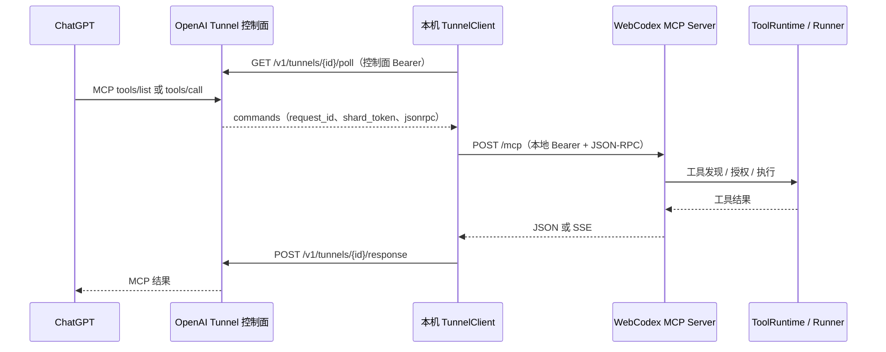

# WebCodex 通过 OpenAI Secure MCP Tunnel 向 ChatGPT 提供服务：调研索引

调研日期：2026-11-01。参考源码：`E:\WorkProject\Rust\【参考项目】\webcodex-main`。
交付位置：当前 LinuxWebTool 项目的 `docs`，参考项目保持只读。

## 结论

WebCodex 把两件事分开实现：**Secure MCP Tunnel 负责搬运请求，MCP Server 负责提供功能**。

- Tunnel ID 指定 OpenAI 控制面的隧道资源。
- 用户所说的“ChatGPT API Key”，在该代码中对应 `CONTROL_PLANE_API_KEY`，是访问 OpenAI Tunnel 控制面的 OpenAI Platform API Key，不用于调用聊天模型。
- 本机客户端主动 HTTPS 长轮询 OpenAI，收到命令后向固定本地 MCP 地址发起 HTTP 请求，再把结果 POST 回 OpenAI。无需给本机开放公网入站端口。
- 本地 MCP 使用另一份凭据。控制面 API Key 不转发到本地 MCP；ChatGPT 网页也不需要填写该 API Key。
- 功能通过 MCP `tools/list` 描述，通过 `tools/call` 执行；Tunnel 本身不会把 HTTP API 或程序函数自动变成工具。

该图表示逻辑消息流；长轮询可以先于 ChatGPT 请求开始，控制面内部实现不在参考仓库中。

## 阅读顺序

1. [连接、凭据与传输核心代码](webcodex-tunnel-connection.md)：配置来源、请求格式、认证隔离、最小复用方式。
2. [工具发现、调用及 LinuxWebTool 接入映射](webcodex-tunnel-tools.md)：MCP 路由、工具注册、执行链路与当前项目可复用部分。

两篇均包含核心代码摘录、文件索引和未验证边界。源码摘录只保留相关段落；使用省略号的片段不作为独立可编译程序。

## 验证范围

- 已静态追踪配置 → 客户端构造 → poll → 本地 MCP → response，以及 tools/list → tools/call → canonical dispatch / Runner 的调用链。
- 已检查当前 LinuxWebTool 的 `/mcp` 路由和 Bearer API Key 提取逻辑。
- 未创建 Tunnel、未读取或使用真实凭据、未启动服务、未进行 ChatGPT 实连；本文不宣称完成端到端接入。
- 参考目录没有 `.git`，无法给出提交号。根 `Cargo.toml` 的 workspace 版本是 `0.5.0`；独立 tunnel crate 版本是 `0.1.0`。它与本聊天此前观测到的运行服务不是同一份版本证据。
- ChatGPT 页面操作和平台权限说明来自参考仓库的安装文档，未在本次调研中独立核验在线界面、账号资格或服务端协议实现。

## 主要源码索引

| 层 | 文件（相对于参考项目） | 作用 |
|---|---|---|
| 配置与安装 | `docs/desktop-install.zh-CN.md` | Tunnel ID / Key 来源及 ChatGPT Tunnel 接入步骤 |
| 独立 SDK | `crates/webcodex-openai-tunnel/src/lib.rs` | 固定身份、固定目标、两个 HTTP Client |
| 控制面 | `crates/webcodex-openai-tunnel/src/control_plane.rs`、`response.rs` | poll / response 协议 |
| 本地转发 | `crates/webcodex-openai-tunnel/src/mcp_http.rs` | JSON-RPC、SSE、会话终止 |
| WebCodex 适配 | `src/project_entry_openai_tunnel.rs`、`src/server_tunnels.rs` | 本地探测、启动与生命周期 |
| MCP 入口 | `src/lib.rs`、`src/mcp.rs`、`src/mcp/tools.rs` | 路由、方法分发、工具描述 |
| 业务执行 | `src/mcp/tools/call.rs`、`src/tool_runtime/` | 参数、权限、执行与 Runner 转发 |

参考实现的 API 类型和配置入口是复用依据；不建议只复制几个 HTTP 请求就省略其重复执行保护、生命周期和错误处理。
