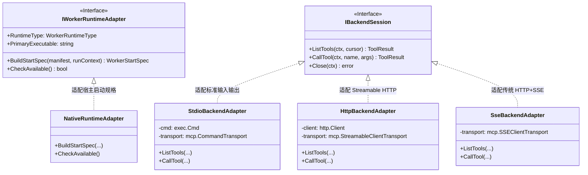
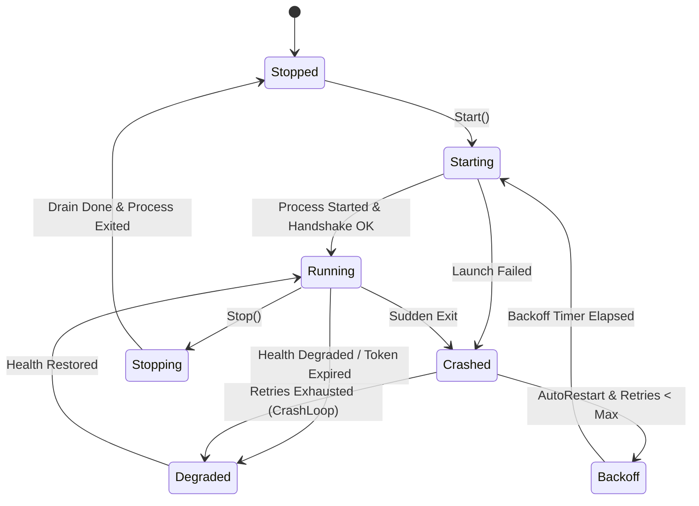

# 纯粹 Worker 扩展服务架构调研与总体设计方案

> 日期：2026-11-01  
> 核心原则：坚持 Worker 是独立、可插拔扩展服务，宿主保持平台通用内核，**严禁任何特定 Worker 业务代码、专有 DTO 或专有 UI 侵入宿主核心工程**。

---

## 1. 架构定位：宿主平台内核 vs 独立 Worker 扩展

### 1.1 核心矛盾与历史教训反思
在此前的迭代中，为了向管理员提供图形化配置 OpenAI Secure MCP Tunnel 与第三方 MCP 工具的功能，方案不自觉地走了一条“侵入宿主前端”的捷径：
- 在宿主 `src/LinuxWebTool.WebHost/wwwroot/app/views/WorkersView.js` 中硬编码了 `v-if="w.id === 'mcp-bridge'"` 并追加了“管理 MCP”专用按钮；
- 在宿主前端组件库中硬塞入 `McpBridgePanel.js`、`McpServerEditor.js`、`McpToolSelection.js` 等专用业务组件；
- 在宿主 API 常量 `config.js` 中声明专属的 `/api/McpBridge/*` 路由。

**这种做法违背了插件/Worker 平台的核心设计哲学（开闭原则 OCP）：**
1. **宿主臃肿与耦合**：如果系统纳管 50 个微服务（如 Git 同步、数据库备份、MCP 桥接、媒体转码、WebDav 扩展），宿主前端源码将被大量专有组件和 `v-if` 条件污染，最终导致宿主无法维护；
2. **生命周期割裂**：当管理员在宿主中删除或卸载某个 Worker 时，宿主核心前端代码依然残留着该 Worker 的僵尸组件和路由常量；
3. **分发与自治受限**：Worker 无法作为一个独立的 ZIP 安装包分发到任意其他 LinuxWebTool 实例上，因为离开特定宿主的前端源码，Worker 就失去了图形化管理界面。

### 1.2 纯粹 Worker 架构的核心公理
1. **宿主只负责平台级基础设施**：
   - 进程生命周期托管（创建、守护、健康探针、自愈重试、优雅停机、孤儿清理）；
   - 资源与安全沙盒隔离（分配回环端口、注入最小环境变量、专属 SQLite/KV 数据目录、cgroups/JobObject 资源限额）；
   - 统一入口与安全代理（JWT 权限门禁、统一回环路径代理 Ingress `/w/{workerId}/*`、通用管理探针 `/control/*`）。
2. **Worker 负责自己的全部业务与界面自治**：
   - Worker 是一个包含自述清单 `worker.json`、可执行入口与私有静态资源的自闭环软件制品；
   - Worker 的业务协议、第三方工具对接、密钥加密、甚至图形化管理界面，均封装在 Worker 内部；
   - 宿主不需要预先知道 Worker 会干什么、提供什么工具或渲染什么表单。

---

## 2. 界面解耦选型头脑风暴：Worker 如何自治提供管理界面？

针对“Worker 需要管理界面，但宿主前端不写任何 Worker 专有代码”的诉求，头脑风暴对比四种业内可行机制：

| 机制 | 运行原理 | 宿主侵入度 | 灵活性 / 复杂度 | 适用场景 |
|---|---|---|---|---|
| **A. 自闭环 Ingress 动态反向代理（推荐首选）** | Worker 自身作为 Service 运行，监听本地分配的随机端口。Worker 二进制（Go `embed` / Python 静态目录）内置轻量 Web 界面。宿主利用已有的 `/w/{workerId}/*` 动态反向代理流量。宿主前端仅需一个通用的“打开控制台 / 打开服务”（`w.accessUrl`）或嵌入式通用 Webview Drawer，宿主源码 0 侵入。 | **0（完全无侵入）** | 极高；Worker 界面可使用任意前端框架（Vue/React/原生JS），完全自治。 | 具有复杂独立控制台的 Worker（如 MCP Bridge、管理后台、Grafana 等）。 |
| **B. 声明式 Schema 驱动通用表单（元数据模式）** | Worker 在 `worker.json` 或 `/control/schema` 暴露 JSON Schema 配置模型。宿主前端提供一个全局通用的 `GenericWorkerConfigDrawer`，通过 Schema 动态生成表单。 | **低（仅一套通用 Schema 渲染器）** | 中；适合结构化键值配置，但难以呈现动态多列列表、工具勾选树、实时长连接测试等高交互界面。 | 普通轻量级配置型 Worker（如简单轮询守护进程、Webhook 回调）。 |
| **C. 微前端动态模块加载（Micro-Frontend ESM）** | Worker 包解压到前端静态目录，声明 `entry: "web/index.js"`。宿主通过原生浏览器 `import(/* @vite-ignore */ url)` 动态导入 ES 模块并在通用插槽中挂载。 | **低（需要通用挂载沙盒）** | 高；但存在全局 CSS 样式污染、Vue 运行时版本冲突、动态打包复杂性等问题。 | 深度集成至宿主主导航栏的一级应用。 |
| **D. 协议降级为纯命令行 / Stdin-Stdout** | Worker 不提供任何 HTTP 界面，所有操作通过一次性命令输入 JSON 并返回 JSON。宿主通过通用终端或命令执行器调度。 | **0（无专用界面）** | 低；对长时常驻、实时状态监控和多步骤审批极不友好。 | 纯离线批处理脚本、数据导入导出脚本。 |

### 结论与决策
**确定采用方案 A（自闭环 Ingress 动态反向代理）为主，结合宿主通用 Resident Control 探针：**
- `workers/mcp-bridge` 作为独立 Go 进程，通过 Go 原生 `//go:embed` 将轻量管理界面（HTML/JS/CSS，单文件或打包后体积 < 100 KiB）内嵌在可执行二进制中；
- 宿主利用已有成熟的 `PipelineExtensions.cs` 中的 `app.Map("/w/{workerId}/{**catch-all}")` 将外网安全请求代理至该 Worker；
- 宿主 `WorkersView.js` 保持 100% 通用，只渲染已有通用卡片上的 `w.accessUrl`（直达页面），**宿主源码中不包含任何一行 `mcp-bridge` 专有代码或组件**！

---

## 3. 全局可行性、逻辑与性能深度头脑风暴

### 3.1 逻辑严密性缺陷与防御
1. **绝对请求截止时间 vs 常驻进程生命周期混淆**：
   - *缺陷*：OpenAI Tunnel 单次请求的 HTTP Deadline 绝对上限为 120 秒（官方安全预算）。如果用户配置的第三方工具超时设置过大，或者排队耗尽了预算，就会造成 OpenAI 端先超时断开，而后端子进程仍在死跑。
   - *防御*：网关引入“动态安全预算递减模型”，`MaxRequestBudget = min(115s, RemainingTunnelBudget)`。在向后端分发前，若剩余预算已低于 2 秒，直接在网关线性化点拒绝分发，并返回未消耗资源的超时错误，杜绝盲目重放。
2. **孤儿进程泄漏（Orphan Process Leaks）**：
   - *缺陷*：如果 Go Bridge 进程被强制杀死（如 `kill -9` 或断电），其派生的第三方 `stdio` 子进程（如 Node、Python 解释器）可能脱离父进程挂到 PID 1 成为孤儿，继续霸占端口和内存。
   - *防御*：
     - Windows 平台：使用 Windows **Job Objects** 并配置 `JOB_OBJECT_LIMIT_KILL_ON_JOB_CLOSE`，父进程一旦死亡，系统内核自动级联回收所有子孙进程树；
     - Linux 平台：在子进程创建前通过 `syscall.SysProcAttr` 设置 `Pdeathsig: syscall.SIGKILL`，确保当父进程退出时，内核向子进程投递致命信号。
3. **版本草稿提交与并发竞态（Draft Race & Lost Updates）**：
   - *缺陷*：两个管理员同时打开页面保存草稿，后提交的人可能静默覆盖前者的修改。
   - *防御*：持久状态层实行严格的**乐观并发控制（Optimistic Concurrency Control, OCC）**。所有修改操作强制携带 `expectedRevision`，若预期版本与当前 `DraftRevision` 不符，返回 HTTP 409 Conflict，要求操作者先刷新。

### 3.2 性能瓶颈与资源控制设计
1. **内存上界保护（Bounded Memory Safeguards）**：
   - 宿主反向代理与 Worker 之间、以及 Worker 与第三方 MCP 之间，均设置 **4 MiB 严格响应包截断与流控上限**（使用 `io.LimitReader` 与有界环形缓冲），彻底防止恶意或超大输出把宿主内存打爆。
2. **连接池与协程防饥饿（Concurrency & Leases）**：
   - 第三方 MCP 连接实行“配额租约模式”：全局并发上限 4，每服务并发上限 2，等待队列深度上限 16，排队超时 2 秒。活跃调用不参与空闲回收，闲置会话 120 秒 TTL 自动回收。
3. **低资源占用达标线（NAS 环境验证指标）**：
   - Worker 单进程常驻内存 ≤ 30 MiB；
   - 空闲 CPU 均值 < 单核 0.5%；
   - 进程冷启动时间 ≤ 200 ms。

---

## 4. 设计模式落地与重构规划

### 4.1 适配器模式（Adapter Pattern）
1. **运行时适配（Host Runtime Adapters）**：
   - 宿主通过 `IWorkerRuntimeAdapter` 屏蔽 Python、Node、Bash、Native 预编译二进制的差异。宿主主循环只消费统一的 `WorkerStartSpec(FileName, ArgumentList, Env, Cwd)`。
2. **传输层适配（Transport Adapters）**：
   - Worker 内部通过 `IBackendSession` 统一封装 `stdio`、`streamable-http` 与 `sse` 三种 MCP 通信协议，向上层网关提供无差别的 `ListTools` 与 `CallTool` 接口。
3. **Ingress 路由适配（Reverse Proxy Ingress Adapter）**：
   - 宿主 `PipelineExtensions` 中的 `app.Map("/w/{workerId}/{**catch-all}")` 作为通用的 Ingress 适配器，将外部带鉴权的统一格式请求，无损适配至目标 Worker 的内部动态回环端口。

### 4.2 策略模式（Strategy Pattern）
1. **健康与就绪探针策略（ReadinessStrategy）**：
   - `LoopbackHttpPingStrategy`：用于普通 Web Worker；
   - `ResidentControlHandshakeStrategy`：用于声明了 `ResidentControl` 的治理型 Worker；
   - `ProcessExitCodeStrategy`：用于短时批处理任务。
2. **优雅停机与排空策略（GracefulDrainStrategy）**：
   - 策略执行顺序：`置停机意图位` -> `关闭新请求入口` -> `在途调用排空 (等待 10s)` -> `SIGTERM/正常退出` -> `超时强杀进程树`。
3. **凭据掩码与存储策略（SecretSanitizationStrategy）**：
   - 对敏感密钥实行“只写、不回显、AES-GCM 加密封装”策略。在 DTO 与状态查询中只返回 `hasSecret: true/false`，任何时候不将真实密文返回前端。

### 4.3 状态机模式（State Machine Pattern）
引入双层状态机分离关注点：

1. **进程生命周期状态机（Process Lifecycle FSM）**：
   - 强类型状态：`Stopped` -> `Starting` -> `Running` -> `Degraded` -> `Stopping` -> `Crashed` -> `Backoff`；
   - 状态迁移携带 `RunID` / `Generation` 栅栏。旧进程的延迟退出事件绝不能改变新实例的状态。
2. **配置发布状态机（Config Publication FSM）**：
   - 状态：`Draft (rN)` -> `Discovered` -> `Selected` -> `Committed/Active (rM)`；
   - 严格区分“已保存草稿”与“已生效版本”，必须由管理员显式确认 `Apply` 后才生成新版本的不可变只读目录快照（`catalog.Snapshot`）。
