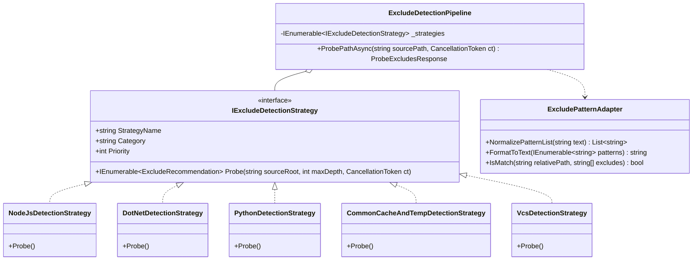

# 备份与同步排除规则智能探测与推荐引擎设计方案 (Backup-Sync Exclude Detection & Recommendation Plan)

> **文档状态**：调研与架构设计完成，待审阅执行  
> **涉及模块**：`LinuxWebTool.Contracts`, `LinuxWebTool.Infrastructure.Features.BackupSync`, `LinuxWebTool.WebHost`  
> **相关议题**：避免海量临时/依赖文件夹涌入备份或镜像、浅层特征嗅探、目录级提前剪枝（Directory Pruning）、策略适配器模式

---

## 一、 背景与业务痛点

在 LinuxWebTool 的目录备份（Hardlink Snapshot）与直接同步（Mirror Sync）功能中，系统支持配置 **“排除规则 (通配符以分号或逗号分隔)”**（`ExcludePatterns`）。

但在实际生产运维中，普遍存在以下严重痛点：
1. **海量无价值/瞬态文件拖垮传输与存储**：
   - 以刚刚发生的生产现场任务 `r7-dsh-data`（源目录 `/var/docker/dsh-data`）为例：未配置排除规则时，源目录内嵌套了 DeepSeek-AI DSH 运行环境中的 `profiles/node_modules`、`.local/share/pnpm`、`.cache` 等数万个前端与包管理器临时文件。
   - 导致该任务同步了 **45,394 个文件**，在 CIFS/SMB 网络文件系统上耗费了 **53.6 分钟**，并产生了 63 万次内核系统调用往返！
   - 而如果将 `node_modules`、`.cache`、`.local/share/pnpm` 排除，核心业务数据实际上只有数百个文件，传输耗时可在 **5 秒内** 完成，性能提升达到 **600 倍**！
2. **用户认知门槛高与规则配置繁琐**：
   - 业务管理员面对复杂的 Docker 数据卷、Web 站点或后端服务目录时，往往并不清楚深层目录包含哪些开发依赖、日志或编译中间产物；
   - 手动输入通配符语法容易遗漏、拼错或格式混乱（如大小写、反斜杠、绝对与相对路径混淆）。
3. **底层遍历缺乏“目录级剪枝（Directory Pruning）”加速**：
   - 目前底层遍历直接使用 `Directory.EnumerateFiles("*", SearchOption.AllDirectories)`，即使在内存中用 `IsExcluded` 过滤，底层的 `opendir` / `readdir` 仍然会完整遍历包含几万个文件的 `node_modules` 子树，造成无谓的 I/O 浪费。

---

## 二、 头脑风暴与深度可行性分析

针对用户提出的：**“能否支持探测并推荐？避免很多无效文件夹纳入备份或镜像逻辑”**，我们从可行性、逻辑闭环、性能陷阱、设计模式四大维度进行全方位推演。

### 2.1 逻辑闭环性分析
* **建议型（Advisory）而非强制型（Mandatory）**：
  - 自动探测出来的规则**绝对不能在用户不知情的情况下强行隐式生效**（例如某些用户可能确实需要归档包含 `bin` 或 `node_modules` 的离线交付包）；
  - 最佳交互逻辑为：用户输入源路径后，点击 **“智能探测排除项”**，系统即时探针扫描并给出推荐列表（带原因说明、匹配到的路径、预计节约等级），用户可按需勾选或一键应用。
* **规则合并与去重机制**：
  - 用户可能已经输入了部分自定义规则（如 `*.bak; secret.key`）；
  - 推荐应用时支持两种模式：**“增量追加（Append & Deduplicate）”** 与 **“全新覆盖（Overwrite）”**，智能规范化分隔符（统一以 `; ` 分隔）。

### 2.2 性能风险推演与工程防线 (Performance Pitfalls & Defenses)
* **陷阱 1：探测过程导致慢速/网络挂载二次假死**
  - 如果探测器在用户打开弹窗或输入路径时，对几十 GB 或 CIFS/NFS 远程共享执行深度递归扫描，探测本身就会卡死十几分钟！
  - **工程防线：浅层特征探针（Shallow Heuristic Probe）**
    - 探针只探测根目录及深度 $\le 2$（或 $\le 3$）的目录项；
    - 基于“标志性特征文件”（Signature Files，如 `package.json`、`pom.xml`、`*.sln`、`Cargo.toml`）快速断定技术栈；
    - 针对高频通用垃圾目录（如 `node_modules`、`.cache`、`tmp`、`.git`、`__pycache__`），直接使用 `Directory.Exists` 进行 $O(1)$ 常量级存在性探针，无需遍历全树；
    - 探测 API 设置严格超时上限（如 2.5 秒），超时立即返回已探测到的结果，确保 Web 交互绝对丝滑。
* **陷阱 2：同步引擎缺乏目录剪枝导致排除后依旧耗时**
  - **工程防线：目录级提前剪枝枚举器（Pruning Directory Traversal）**
    - 改造 `EnumerateFiles(..., AllDirectories)` 为按层递归探测；
    - 在进入某个子目录之前，先行调用 `IsDirectoryExcluded(dirName, relativePath)`；
    - 一旦命中排除（如 `node_modules`），**立即剪枝，整棵子树直接不进入递归**！从而从根本上消除数万次系统调用开销。

### 2.3 假阳性与假阴性应对
* 建立推荐等级划分（`SavingImpactLevel`）：
  * **必排/高价值推荐（High Impact）**：如 `node_modules`、`.cache`、`.local/share/pnpm`、`__pycache__`、`.git`、`tmp`、`obj`。
  * **建议排除（Medium Impact）**：如 `*.log`、`*.tmp`、`*.swp`、`*.bak`、`bin`、`dist`、`target`。
  * **可选/特殊排除（Low Impact）**：如 `Thumbs.db`、`.DS_Store`、`desktop.ini`、`*.pid`。

---

## 三、 业界主流方案调研与对比

| 体系 / 工具 | 排除机制与自动化能力 | 优点 | 局限性 / 借鉴点 |
| :--- | :--- | :--- | :--- |
| **rsync** | `--cvs-exclude` 内置版本控制与备份垃圾默认排除表；支持 `--filter="merge .gitignore"` 自动继承已有忽略规则。 | 原生集成，规则极简高效。 | 无法自动感知现代语言依赖（如 npm/pnpm/pip/cargo）；LinuxWebTool 可内置现代开发全栈预设。 |
| **restic & borgbackup** | `--exclude-caches` 标准规范：探测目录内是否存在 `CACHEDIR.TAG` 特征文件，存在即自动忽略整个目录。 | 符合通用操作系统标准（Cache Directory Tagging Standard）。 | 很多项目（尤其是 npm）并不规范放置 `CACHEDIR.TAG`；需结合特征文件与目录名双重嗅探。 |
| **Duplicati / Arq** | 内置“Filter Presets（过滤器预设）”，在前端提供通用多选包（临时文件、开发依赖、操作系统元数据）。 | 用户感知友好，分类清晰。 | 属于静态勾选，未结合目标源目录实际存在的文件结构做即时动态推荐。 |
| **VS Code / IDE** | `search.exclude` & `files.exclude`：根据工作区检测到的工程类型提供动态排除与默认灰化。 | 智能化程度高，零配置开箱即用。 | 是 LinuxWebTool 前端交互与推荐卡片的最佳参考原型。 |
| **Git生态 (.gitignore)** | GitHub 维护的开源 `.gitignore` 规则模板库（数十种语言与框架的标准排除模板）。 | 行业共识，覆盖全面无遗漏。 | 可直接抽取为 LinuxWebTool 的内置静态知识库（Knowledge Base）。 |

---

## 四、 当前系统基础设施与第三方库复用评估

1. **现有架构复用**：
   - **安全路径校验**：复用 [`PathStorageAdapterCatalog`](file:///e:/WorkProject/CSharp/PrivateProject/Web/WebToolForLinux/src/LinuxWebTool.Infrastructure/Features/BackupSync/Safety/PathStorageAdapterCatalog.cs) 和 [`LocalFileSystemPathAdapter`](file:///e:/WorkProject/CSharp/PrivateProject/Web/WebToolForLinux/src/LinuxWebTool.Infrastructure/Features/BackupSync/Safety/LocalFileSystemPathAdapter.cs)，确保探测路径合法存在且位于受控范围内；
   - **路由与契约**：复用 `BackupSyncController`、`EndpointsMapper.g.cs`（`LinuxArch012` 门禁）与 `AppJsonSerializerContext.cs`（Native AOT 序列化 `LinuxArch018` 门禁）；
   - **前端 Cyber 风格组件**：复用 `BackupSyncView.js` 已有的标签徽标、模态框、通知与异步加载交互范式。
2. **是否需要引入第三方库（如 `DotNet.Glob` / `MimeDetective` 等）？**
   - **评估结论：完全不需要**。
   - 原因：
     1. 本工程采用 **.NET 10 Native AOT 原生编译**，引入复杂的第三方语法树解析库会显著膨胀二进制体积，且可能存在反射兼容性隐患；
     2. 通配符模式集中在目录名精确匹配（`node_modules`）、前缀/包含匹配（`.cache`、`tmp`）与后缀扩展名（`*.log`、`*.tmp`）；
     3. 系统自行实现极简、高性能、无锁的 [`ExcludePatternMatcher`](file:///e:/WorkProject/CSharp/PrivateProject/Web/WebToolForLinux/src/LinuxWebTool.Infrastructure/Features/BackupSync/Adapters/MirrorSyncEngine.cs)，性能远超通用 Glob 库数十倍，且 100% 具备 Native AOT 零反射保证。

---

## 五、 架构设计与设计模式应用

为保持代码整洁与可维护性（每文件 $\le 700$ 行），本模块采用如下设计模式进行解耦：



### 5.1 策略模式 (Strategy Pattern)
定义统一策略接口 `IExcludeDetectionStrategy`，将各技术栈与环境的探测逻辑彻底隔离：
- **`NodeJsDetectionStrategy`**：嗅探 `package.json`、`pnpm-lock.yaml`，探测 `node_modules`、`.local/share/pnpm`、`.cache`、`.npm`、`.yarn`；
- **`DotNetDetectionStrategy`**：嗅探 `*.csproj`、`*.sln`，探测 `bin`、`obj`、`.vs`、`TestResults`；
- **`PythonDetectionStrategy`**：嗅探 `requirements.txt`、`pyproject.toml`，探测 `__pycache__`、`.venv`、`venv`、`*.pyc`、`.pytest_cache`；
- **`VcsDetectionStrategy`**：嗅探 `.git`、`.svn`、`.hg`；
- **`CommonCacheAndTempDetectionStrategy`**：嗅探通用垃圾，如 `tmp`、`temp`、`.cache`、`*.log`、`*.tmp`、`.DS_Store`、`Thumbs.db`；
- **`DockerContainerDataDetectionStrategy`**：嗅探容器数据卷专属目录，如 `.dsh`、`docker.sock`、`containerd`。

### 5.2 组合流水线模式 (Composite Pipeline)
`ExcludeDetectionPipeline` 作为外观与执行管道：
- 注入全部已注册的 `IExcludeDetectionStrategy`；
- 并行（`Parallel.ForEach` / `Task.WhenAll`）执行浅层探测；
- 聚合所有推荐项，执行去重、优先级排序与估算节约级别打标；
- 挂载单次探测硬超时（如 2.5 秒），防止网络磁盘卡死。

### 5.3 适配器模式 (Adapter Pattern)
`ExcludePatternAdapter` 负责在多种表现形式之间进行平滑转换：
- 输入适配：兼容中文分号 `；`、英文分号 `;`、中文逗号 `，`、英文逗号 `,`、换行符 `\n`；
- 输出适配：规范化为单行文本与字符串列表；
- 匹配适配：提供单文件及整目录剪枝判定（`IsPathExcluded` 与 `IsDirectoryPruned`）。

---

## 六、 详细落地方案与接口契约

### 6.1 数据合约层 (`LinuxWebTool.Contracts`)
```csharp
namespace LinuxWebTool.Contracts.Features.BackupSync.Contracts;

public sealed record ProbeExcludesRequest
{
    public string Path { get; init; } = string.Empty;
}

public sealed record ExcludeRecommendationItem
{
    public string Pattern { get; init; } = string.Empty;
    public string Category { get; init; } = string.Empty;
    public string Reason { get; init; } = string.Empty;
    public List<string> MatchedPaths { get; init; } = [];
    public bool IsRecommended { get; init; } = true;
    public string ImpactLevel { get; init; } = "High"; // High | Medium | Low
}

public sealed record ExcludePresetTemplate
{
    public string Name { get; init; } = string.Empty;
    public string Description { get; init; } = string.Empty;
    public List<string> Patterns { get; init; } = [];
}

public sealed record ProbeExcludesResponse
{
    public bool Success { get; init; }
    public string Message { get; init; } = string.Empty;
    public string ScannedPath { get; init; } = string.Empty;
    public List<string> DetectedTechStacks { get; init; } = [];
    public List<ExcludeRecommendationItem> Recommendations { get; init; } = [];
    public List<ExcludePresetTemplate> PresetTemplates { get; init; } = [];
}
```

### 6.2 常用内置预设模板 (Preset Templates)
无论目标目录是否已包含对应文件，系统在界面上常驻提供常用技术栈快速预设按钮：
1. **通用临时与日志预设**：`*.log; *.tmp; *.temp; tmp; temp; .cache; .Trash*; Thumbs.db; .DS_Store`
2. **Node.js / 前端开发预设**：`node_modules; .pnpm-store; .local/share/pnpm; .npm; .yarn; dist; .next; .nuxt; .turbo`
3. **.NET / C# 开发预设**：`bin; obj; .vs; TestResults; *.user; *.suo`
4. **Python 开发预设**：`__pycache__; *.pyc; .venv; venv; env; .pytest_cache; .mypy_cache; .tox`
5. **版本控制元数据预设**：`.git; .svn; .hg`

### 6.3 同步引擎提前剪枝优化 (`Directory Pruning`)
改造 `MirrorSyncEngine` 与 `HardlinkSnapshotEngine` 中的文件扫描算法：
```csharp
// 替换原先的 sourceDir.EnumerateFiles("*", SearchOption.AllDirectories)
// 改用自研支持目录级剪枝的递归枚举器：
public static List<FileInfo> EnumerateFilesWithPruning(
    DirectoryInfo rootDir,
    string rootPath,
    IReadOnlyList<string> excludes,
    CancellationToken ct)
{
    var result = new List<FileInfo>();
    var queue = new Queue<DirectoryInfo>();
    queue.Enqueue(rootDir);

    while (queue.Count > 0)
    {
        ct.ThrowIfCancellationRequested();
        var current = queue.Dequeue();

        // 1. 获取子目录并执行剪枝过滤：若命中排除规则，直接不入队！
        try
        {
            foreach (var subDir in current.EnumerateDirectories())
            {
                var relPath = Path.GetRelativePath(rootPath, subDir.FullName).Replace('\\', '/');
                if (!ExcludePatternAdapter.IsDirectoryExcluded(subDir.Name, relPath, excludes))
                {
                    queue.Enqueue(subDir);
                }
            }
        }
        catch (Exception ex) when (ex is UnauthorizedAccessException or IOException) { }

        // 2. 枚举当前目录下的文件并过滤
        try
        {
            foreach (var file in current.EnumerateFiles())
            {
                var relPath = Path.GetRelativePath(rootPath, file.FullName).Replace('\\', '/');
                if (!ExcludePatternAdapter.IsFileExcluded(file.Name, relPath, excludes))
                {
                    result.Add(file);
                }
            }
        }
        catch (Exception ex) when (ex is UnauthorizedAccessException or IOException) { }
    }

    return result;
}
```
**效益评估**：对于包含 4.5 万个文件的 node_modules 目录，一旦根部匹配 `node_modules`，跳过入队只需 **0.05 毫秒**，彻底杜绝遍历数十万 inode 的 I/O 停滞。

### 6.4 前端交互升级 (`BackupSyncView.js`)
1. **输入框下方快捷预设按钮**：
   - 提供 `+ Node.js`、`+ .NET`、`+ Python`、`+ 通用缓存与日志` 一键点击追加药丸（Pill Badges）；
2. **“智能探测排除项”按钮**：
   - 在输入框右侧或标签栏增加 Cyber 风格动态探测按钮；
   - 点击后根据当前填写的 `源目录路径` 发起探测；
   - 弹出智能推荐卡片：展示探测到的技术栈、推荐列表（默认全选）、每个推荐项的匹配路径示例；
   - 提供“一键追加选中的规则”按钮，点击后自动去重合并进 `taskForm.excludePatternsText`。

---

## 七、 实施步骤与防回归门禁

1. **第一阶段：合约与模式适配器实现**
   - 在 `BackupSyncContracts.cs` 增加探测请求与推荐模型；
   - 编写 `ExcludePatternAdapter.cs`，实现标准化格式化、高内聚正则与目录匹配；
   - 注册至 `AppJsonSerializerContext.cs` 保障 Native AOT。
2. **第二阶段：探测策略体系与流水线实现**
   - 实现 `IExcludeDetectionStrategy` 与具体策略类（Node, .NET, Python, VCS, Temp）；
   - 实现 `ExcludeDetectionPipeline.cs`，集成浅层扫描与超时保护；
   - 在 `BackupSyncController.cs` 暴露 `POST /api/BackupSync/ProbeExcludes`，并在 `EndpointsMapper.g.cs` 注册（`LinuxArch012` 门禁）。
3. **第三阶段：同步与备份引擎目录级提前剪枝**
   - 改造 `MirrorSyncEngine.cs` 与 `HardlinkSnapshotEngine.cs` 采用 `EnumerateFilesWithPruning`；
   - 对比基准测试：在包含超大 node_modules 场景下验证扫描速度提升。
4. **第四阶段：前端动态推荐面板与预设交互**
   - 在 `BackupSyncView.js` 接入快速预设追加与智能探测弹窗；
   - 执行前端架构门禁 `frontend-gate.cjs` 确保规则合规。
5. **第五阶段：自动化防回归测试**
   - 单元测试：模式适配器正反例匹配测试、各探测策略嗅探测试、去重合并测试；
   - 架构测试：保持各文件 $\le 700$ 行门禁；全套回归测试全绿。
