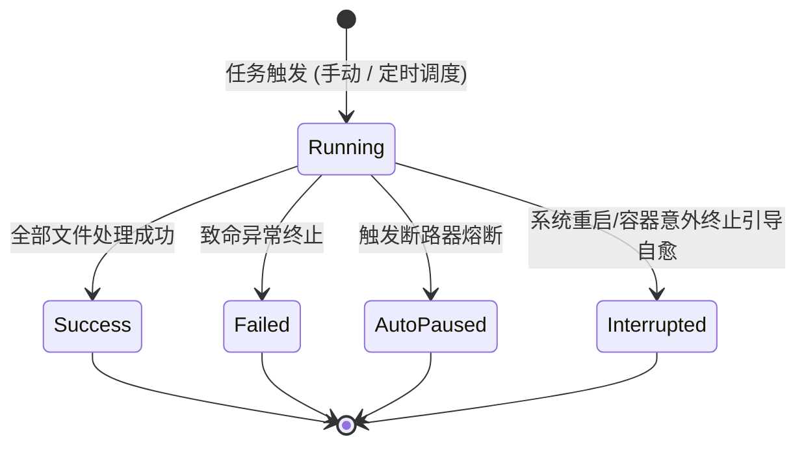

# 备份同步任务无法完成深度根因分析与执行记录自动清理设计方案

## 1. 为什么任务还是无法完成？（深度根因与交付链路剖析）

### 1.1 现状与根本原因一：发布交付链路与服务器运行镜像脱节
- **现象**：在远端服务器 `http://10.126.1.70:5270/app/#/backup-sync` 再次触发增量备份或直接同步时，界面依然提示：
  `✕ 任务执行失败：Could not find file '/var/docker/dsh-data/profiles/node_modules/detect-libc'.`
- **根本原因**：
  1. 当前 `10.126.1.70` 运行的 Docker 镜像版本为 **`v0.2.22`**（构建于 Git 提交 `4ff4f6b`）。
  2. 在 `v0.2.22` 的代码中，`HardlinkSnapshotEngine.cs` 遍历目录文件时直接调用了 `totalBytes += file.Length;` 以及 `file.CopyTo(targetFilePath, overwrite: true);`。同时，遍历循环体内部没有任何单文件级异常捕获隔离逻辑。
  3. 上一轮研发中我们在本地实现了 `SymlinkAndFileTransferHelper`、对三大备份同步引擎进行了软链保真与单文件故障隔离改造，并新增了架构门禁 `LinuxArch032`。
  4. **但由于当时用户要求先查询构建状态，本地修复代码处于工作区尚未执行 `git commit`、打上新版本标签（如 `v0.2.23`）以及推送到 GitHub**。
  5. GitHub Actions 尚未为这些修改编译构建新的 Docker 镜像，远端服务器 `10.126.1.70` 依然跑在旧的 `v0.2.22` 容器中，因此在服务器上重试必然重现完全相同的报错。

### 1.2 现状与根本原因二：容器与宿主机跨命名空间软链陷阱（Dangling Symlink Dereference）
- **路径场景**：`/var/docker/dsh-data/profiles/node_modules/detect-libc`。
  - 在 Docker 容器内部通过 npm/pnpm/yarn 安装依赖时，包管理器常会生成指向容器内部公共路径（如 `/usr/local/lib/node_modules/@deepseek-ai/dsh/node_modules/detect-libc`）的软链接。
  - 当宿主机（或映射了宿主机卷的备份工具）对 `/var/docker/dsh-data` 进行备份扫描时，该符号链接的目标在宿主机环境（或备份容器自身的文件系统命名空间）中并不存在，成为了典型的**悬空软链接（Broken / Dangling Symlink）**。
- **.NET 跨平台运行时的底层行为**：
  - 在 Linux/POSIX 体系下，`.NET` 的 `FileInfo.Length` 和 `FileInfo.CopyTo` 底层系统调用为 `stat()`。
  - `stat()` 遇到符号链接时会自动跟随（Dereference）目标路径。当目标路径不存在时，内核返回 `ENOENT`。
  - .NET 文件系统抽象层将 `ENOENT` 翻译抛出：
    `System.IO.FileNotFoundException: Could not find file '...'`。
  - 旧版引擎由于缺少单文件故障隔离，该未捕获异常导致整个备份任务被立即打断并触发连续失败计数。

### 1.3 本地修复代码的免疫能力与验证
- 在未提交的代码中，我们引入了 `SymlinkAndFileTransferHelper.cs`：
  1. 通过 `IsSymbolicLink(file)`（基于 `file.LinkTarget` 与 `FileAttributes.ReparsePoint`）识别软链；
  2. 使用 `GetLinkTarget(file)`（不跟随目标，纯字符串读取）获取软链指向的目标路径；
  3. 目标端使用 `File.CreateSymbolicLink(targetFilePath, linkTarget)` 原生重建同名同目标软链接，实现 100% 软链保真；
  4. 对可能消失的文件或损坏链接通过 `TryGetSafeLength(file, out var length)` 安全获取长度；
  5. 在循环体内增加 `catch (Exception ex) when (ex is IOException or UnauthorizedAccessException)` 故障隔离，单文件异常仅记录警告并计入 `skippedFiles++`，绝不击垮整个备份作业。
- 只要将该修复与后续功能统一打包为 `v0.2.23` 提交发布并更新到服务器，此问题即彻底根治。

---

## 2. 同步与备份任务执行记录与自动清理需求头脑风暴

### 2.1 需求价值与痛点剖析
1. **可观测性缺失**：目前 `BackupSyncTask` 仅记录了 `LastRunStatus`、`LastRunMessage`、`LastRunTime`，只能看到“最近一次”的简单状态。一旦定时任务在凌晨执行过，白天排查时往往不知道昨天、前天究竟备份了多少文件、传输了多少字节、耗时多久、跳过了哪些文件。
2. **事故溯源与断路器排查**：当任务触发 `AutoPaused` 熔断或多次失败时，缺乏历史执行时间线（Execution Timeline）无法判断是偶尔瞬态波动还是持续恶化。
3. **数据库无界膨胀风险**：如果每次执行都记录一条历史，在每 5 分钟或高频同步的场景下，单月会产生数万条记录。若无自动清理机制，将导致 SQLite 数据库体积膨胀、查询变慢。

### 2.2 业界主流方案调研与对比 (Industry Benchmarks)

| 系统 / 方案 | 记录组织方式 | 状态机模型 | 清理保留策略 (Retention Strategy) | 借鉴点 |
| :--- | :--- | :--- | :--- | :--- |
| **Velero (K8s Backup)** | CRD `Backup` / `Restore` 对象 | `New` -> `InProgress` -> `Completed` / `PartiallyFailed` / `Failed` | TTL 机制（`spec.ttl`，默认 720h），控制器定期 Garbage Collect | 区分部分失败（跳过文件）与完全失败；TTL 自动回收 |
| **Jenkins / CI Engines** | 构建历史列表 (Run Records) | `QUEUED` -> `BUILDING` -> `SUCCESS` / `FAILURE` / `ABORTED` | Log Rotator / Build Discarder：`numToKeep`（保留最近 N 次）+ `daysToKeep`（保留最近 D 天） | 数量上限与时间上限复合策略，简单有效 |
| **Hangfire / Quartz.NET** | 状态迁移表 (JobHistory) | `Enqueued` -> `Processing` -> `Succeeded` / `Failed` | 滑动窗口与过期时间戳（`ExpireAt`），后台轮询批量清理 | 僵尸作业识别；基于时间窗口清理 |
| **BorgBackup / Restic** | 事务日志与快照元数据 | 阶段式事务（Scan -> Transfer -> Commit） | GFS 保留策略（Keep Daily/Weekly/Monthly）与自动 Prune | 快照与执行元数据的生命周期分层管理 |

### 2.3 当前系统已有基础设施与可复用资产
1. **SQLite + DapperAot 编译期源生成**：
   - 现有的 `ExecutionStore.cs`（命令执行历史）和 `OperationLogStore.cs` 已经实现了高性能的 `PagedResult<T>` 分页查询、DapperAot 无反射映射、参数化条件过滤与按时间清理 `ClearOlderThanAsync`。
   - `DbSetup.cs` 提供了统一的 DDL 建表与幂等 `EnsureColumnExists` 字段迁移。
2. **生命周期与状态机 (`BackupSyncStateMachine.cs`)**：
   - 系统已有现成的 `BackupSyncStateMachine`，不仅管理连续失败计数和熔断跳闸（`TripAutoPauseAsync`），天然适合作为执行记录生命周期的驱动核心（`Running` -> `Success` / `Failed` / `AutoPaused`）。
3. **服务引导容灾 (`BackupSyncBootstrapService.cs`)**：
   - 现有的引导服务在系统启动时初始化任务，可以在此注入“僵尸运行记录自愈”逻辑：将因断电或重启遗留为 `Running` 状态的记录自动标为 `Interrupted`（已中断）。

---

## 3. 设计模式优化与架构设计

### 3.1 策略模式 (Strategy Pattern) - 执行记录保留与修剪策略
- **接口抽象**：
  ```csharp
  public interface IBackupRecordRetentionStrategy
  {
      Task PruneRecordsAsync(Guid taskId, BackupSyncRecordStore store, CancellationToken ct = default);
  }
  ```
- **工业级复合保留策略 (`SmartHybridRecordRetentionStrategy`)**：
  - **数量保底 (Count Limit)**：保留每个任务最新 N 条记录（如默认 100 条）。无论调度多稀疏，都能查到最近的历史。
  - **时间淘汰 (Age Limit)**：超出 N 条的记录中，创建时间超过 D 天（如 30 天）的记录自动修剪。
  - **故障现场保护 (Fault Preservation)**：最近的失败记录（`Failed` / `AutoPaused`）在保留周期内享有优先豁免权，防止被密集成功的调度高频刷掉，保障故障排查溯源。

### 3.2 状态机模式 (State Machine) - 执行记录与任务协同生命周期

- 在 `BackupSyncCoordinator.RunTaskAsync` 开始时：调用 `stateMachine.StartRecordAsync(...)` 创建 `Running` 记录，获取 `recordId`。
- 执行过程中记录指标：扫描文件数、新增文件数、修改文件数、删除文件数、跳过文件数、传输字节数。
- 任务结束时（无论是成功还是捕获异常）：
  - 调用 `stateMachine.CompleteRecordAsync(...)` 更新完成时间、耗时、状态、指标与错误摘要；
  - 触发策略清理器 `IBackupRecordRetentionStrategy.PruneRecordsAsync`，执行 O(1) 索引化修剪，零后台常驻线程开销。

### 3.3 适配器模式 (Adapter Pattern) - 数据持久化契约
- 新建 `BackupSyncRecordStore.cs` 继承仓储规范：
  - 封装 SQLite Dapper 语法细节，对外暴露强类型领域方法；
  - 查询接口支持按任务 ID、执行状态（`Success` / `Failed` / `Running`）、时间倒序分页；
  - 批量删除修剪接口采用 SQLite 单条批量删除语法，避免大表全表扫描。

---

## 4. 详细技术实现方案

### 4.1 数据库模式设计 (`DbSetup.cs`)
```sql
CREATE TABLE IF NOT EXISTS backup_sync_record (
  Id TEXT PRIMARY KEY COLLATE NOCASE,
  TaskId TEXT NOT NULL COLLATE NOCASE,
  TaskName TEXT NOT NULL,
  Mode INTEGER NOT NULL,               -- 1 = Sync, 2 = Backup
  TriggerType INTEGER NOT NULL,        -- 1 = Manual, 2 = Scheduled
  Status TEXT NOT NULL,                -- Running, Success, Failed, AutoPaused, Interrupted
  StartTime TEXT NOT NULL,
  EndTime TEXT,
  DurationMs INTEGER NOT NULL DEFAULT 0,
  ProcessedFiles INTEGER NOT NULL DEFAULT 0,
  ProcessedBytes INTEGER NOT NULL DEFAULT 0,
  AddedFiles INTEGER NOT NULL DEFAULT 0,
  UpdatedFiles INTEGER NOT NULL DEFAULT 0,
  DeletedFiles INTEGER NOT NULL DEFAULT 0,
  SkippedFiles INTEGER NOT NULL DEFAULT 0,
  Summary TEXT,
  ErrorMessage TEXT,
  ClientIp TEXT
);
CREATE INDEX IF NOT EXISTS idx_backup_sync_record_task_time ON backup_sync_record(TaskId, StartTime DESC);
CREATE INDEX IF NOT EXISTS idx_backup_sync_record_time ON backup_sync_record(StartTime DESC);
```

### 4.2 契约模型与 Native AOT 注册 (`BackupSyncContracts.cs` & `AppJsonSerializerContext.cs`)
- `BackupSyncRecordItem`: 包含所有统计字段的不可变 record。
- `BackupSyncRecordQuery`: 分页与过滤模型。
- `ClearBackupSyncRecordsRequest`: 支持按任务或全局清理历史记录。
- 在 `AppJsonSerializerContext.cs` 中注册 `BackupSyncRecordItem`、`List<BackupSyncRecordItem>`、`PagedResult<BackupSyncRecordItem>` 等类型，确保 Native AOT 零反射编译。

### 4.3 引擎执行指标回传丰富化
- `HardlinkSnapshotEngine.SnapshotCreationResult` 增加 `SkippedFiles` 计数。
- `MirrorSyncEngine.SyncResult` 增加 `SkippedFiles` 计数。
- 当出现悬空软链不可读或并发变动文件被跳过时，`SkippedFiles` 准确递增并在摘要中提示。

### 4.4 前端界面交互设计 (`BackupSyncView.js`)
- 在任务管理 Tab 旁新增 **“执行记录 (Records)”** Tab。
- 提供任务过滤下拉框、状态过滤（全部 / 成功 / 失败 / 熔断）、刷新与分页翻页。
- 任务卡片增加直接跳转查看该任务执行记录的快捷按钮。
- 每条记录呈现：触发方式（手动/定时）、开始时间、耗时、处理状态徽章、文件统计细节（新增/更新/删除/跳过）、容量字节数及错误详情提示。
- 顶部提供“清理历史”快捷操作。

### 4.5 架构门禁与质量保障
- 新增架构门禁 `LinuxArch033_备份同步执行记录必须具备状态机生命周期与自动清理保留策略`：
  - 强制检验 `backup_sync_record` 数据库表与索引声明；
  - 强制检验保留策略接口与智能修剪实现；
  - 强制检验控制器路由与 `EndpointsMapper.g.cs` 100% 吻合；
  - 强制检验 DTO 的 Native AOT 上下文注册。
- 编写单元测试验证：
  - 执行记录的创建、状态更新与分页查询；
  - 智能保留策略对过期历史的自动修剪与失败记录保护；
  - 引导服务对僵尸 `Running` 记录的自愈迁移。
