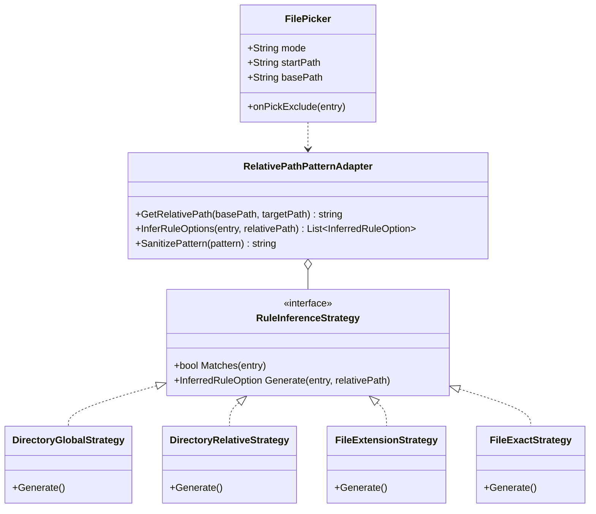

# 备份同步文件夹路径点选排除与交互体验升级设计方案 (Folder Picker & Visual Exclusion Plan)

> **文档状态**：调研与架构设计完成，待审阅执行  
> **涉及服务**：`LinuxWebTool.WebHost/wwwroot/app/components/FilePicker.js`, `BackupSyncView.js`, `LinuxWebTool.Contracts`  
> **核心诉求**：支持对源目录/目标目录直接打开文件管理器视图，通过点击或勾选具体文件夹/文件一键加入排除规则，彻底告别盲猜相对路径。

---

## 一、 需求溯源与交互痛点

在 LinuxWebTool 的备份（Hardlink Backup）与直接同步（Mirror Sync）任务配置中：
* **当前痛点**：
  1. 用户配置了源路径（例如 `/var/docker/dsh-data`）后，如果想排除某个深层目录（如 `profiles/node_modules`）或某些大文件（如 `sessions/dump.bin`），必须手动凭借记忆敲打通配符文本；
  2. 极易发生拼写错误、大小写错误或前导斜杠遗漏，导致排除规则失效；
  3. 无法直观确认该路径在磁盘上是否存在、是否为目录还是文件。
* **用户新诉求**：
  能否支持在前端界面上，直接**针对源文件夹（或目标文件夹）打开目录树浏览**，像在文件管理器里一样，浏览子目录和文件，直接点击“＋排除此项”或多选勾选，自动生成相对路径规则加入排除列表？

---

## 二、 头脑风暴与深度可行性分析

### 2.1 交互体验全方位可行性
1. **所见即所选（Browse-to-Exclude）**：
   - 用户在输入完 `源路径`（如 `/var/docker/dsh-data`）或 `目标路径` 后，排除规则输入区右侧提供两个操作按钮：
     - `📂 从源目录点选排除项`
     - `📂 从目标目录点选排除项`
   - 点击后，弹出专门的 **“排除项拾取器（Exclude File & Folder Picker）”**；
   - 浏览器的根部自动锚定（Anchor）在当前输入的源路径或目标路径，用户只能在此目录内部向下漫游导航，防止误选越界路径。
2. **智能模式推断（Smart Pattern Inference - 核心交互亮点）**：
   当用户在文件浏览器中点选具体项时，系统智能给出 2~3 个最合理的规则形式供用户秒级点选确认：
   * **若点选的是文件夹**（例如点选了 `/var/docker/dsh-data/profiles/node_modules`）：
     - 选项 A（按目录名全局排除 - 推荐）：`node_modules`（该源路径下任何层级的同名目录均被忽略）
     - 选项 B（仅按相对子路径精确排除）：`profiles/node_modules`（仅忽略 profiles 目录下的这一个，其他位置不受影响）
   * **若点选的是文件**（例如点选了 `/var/docker/dsh-data/logs/app.log`）：
     - 选项 A（按文件扩展名排除 - 推荐）：`*.log`（所有同后缀文件均被忽略）
     - 选项 B（仅按特定文件名排除）：`app.log`（全局匹配此文件名的所有实例）
     - 选项 C（仅精确排除此相对路径文件）：`logs/app.log`
   * **若多选批量点选**：
     - 支持在文件列表左侧勾选多个复选框（如同时勾选 `Demo`、`profiles`、`settings.yaml.imported`），点击底部“一键加入排除”，批量生成相对路径规则。

### 2.2 性能风险推演与工程防线 (Performance Pitfalls & Defenses)
* **性能风险**：如果打开选择器时尝试去递归计算子文件夹的体积或文件总数，遇到超大目录会卡顿；
* **工程防线**：
  1. **单层按需懒加载（Lazy Load Single Depth）**：
     - 完全复用现有 `/api/Files?path=...` 端点；
     - 每次点击仅获取当前目录下的一级直属子项（$O(1)$ 级别 I/O），耗时 $< 20\text{ms}$，绝不向下递归探测；
  2. **毫秒级前端相对路径推导（Client-side Relative Path Resolution）**：
     - 相对路径计算与模式生成纯粹在前端完成，不占用服务器任何额外 I/O 资源；
  3. **路径越界防御（Path Traversal Guard）**：
     - 检查选中的路径必须以基准路径（`basePath`）作为前缀，严禁利用 `../` 越界生成指向系统敏感路径的无效规则。

---

## 三、 业界主流方案调研与对比

| 体系 / 工具 | 排除点选机制与交互体验 | 借鉴点与优势 |
| :--- | :--- | :--- |
| **FreeFileSync** | 在同步目录对比结果树状列表中，任意文件夹/文件右键菜单包含：<br/>• `添加到排除列表 (名称)`<br/>• `添加到排除列表 (完整相对路径)` | 业界标杆体验：将具体选中的项目智能转化为“按名称”或“按相对路径”两种规则模板供选择。 |
| **Beyond Compare** | 文件对比视图中右键单击项，选择“排除此文件夹”或“排除此类扩展名”。 | 极佳的智能推断：针对文件一键提取 `*.ext` 通配符。 |
| **Duplicati** | 树状目录浏览器中提供三态选择框（选中备份 / 灰态继承 / 红色叉号排除）。 | 视觉上非常直观，但实现复杂度较高，对于上万级文件的大目录树展开容易卡顿。 |
| **VS Code** | 资源管理器右键：“Add to .gitignore” 或在设置中为 `files.exclude` 提供快速添加项。 | 轻量、高频、快捷点选追加。 |

**LinuxWebTool 决策**：采用 **FreeFileSync + VS Code** 的轻量高效混合形态——在按需懒加载的文件选择器中，每一行提供快捷“＋排除”按钮，点击即弹出智能推断胶囊，一键添加入可视化规则列表。

---

## 四、 现有基础设施与第三方库复用评估

1. **现有组件与基础设施 100% 复用**：
   - **前端选择器组件**：直接复用与扩展 [`FilePicker.js`](file:///e:/WorkProject/CSharp/PrivateProject/Web/WebToolForLinux/src/LinuxWebTool.WebHost/wwwroot/app/components/FilePicker.js)；
     - `FilePicker.js` 已具备完善的路径导航、面包屑导航（`buildFileBreadcrumbs`）、大小/时间格式化、虚拟根目录兼容及 Cyber 视觉风格；
     - 仅需增加 `mode='exclude'` 及传入 `basePath` 属性即可无缝升级。
   - **后端文件 API**：直接复用 `/api/Files` 端点，无需新增任何后端 C# Controller 路由与实体，对后端保持**零侵入、零膨胀**。
   - **前端可视化规则引擎**：复用我们在上一方案中设计的 `VisualRuleChip` 与 `ExcludeRuleVisualAdapter`，点选生成的规则直接以彩色胶囊形式注入表单。
2. **第三方库评估**：
   - 零依赖第三方库，保持纯原生 Vue 3 响应式设计。

---

## 五、 架构设计与设计模式应用



### 5.1 适配器模式 (Adapter Pattern - `RelativePathPatternAdapter`)
负责将宿主机绝对物理路径（如 `/var/docker/dsh-data/profiles/node_modules`）与基准源路径（`/var/docker/dsh-data`）进行跨平台无损相对化转换：
* 统一处理 Windows 反斜杠 `\` 与 Linux 正斜杠 `/`；
* 规范化消除尾部斜杠；
* 剥离驱动器号与多余前导符，输出符合标准 Glob 语法的相对路径（如 `profiles/node_modules`）。

### 5.2 策略模式 (Strategy Pattern - `RuleInferenceStrategy`)
当用户在文件浏览器中选中某个项时，由策略流水线输出候选规则选项：
1. **`DirectoryGlobalStrategy`**：提取文件夹名（`entry.name`），生成适用全树的全局排除项；
2. **`DirectoryRelativeStrategy`**：提取相对路径（`relPath`），生成仅作用于该子路径的精确排除项；
3. **`FileExtensionStrategy`**：若为文件且包含扩展名，提取 `*.{ext}`；
4. **`FileExactStrategy`**：提取文件名或相对文件路径。

### 5.3 状态机模式 (State Machine Pattern)
管理点选操作在浏览状态、推断选择浮层与表单回写之间的有限状态流转：
```text
[BrowsingDirectory]
      │
      ├── 点击某行的【＋排除】
      │        ▼
[InferencePopoverReady] (展示推荐胶囊: 按目录名 / 按相对路径 / 按后缀)
      │
      ├── 用户点选其中一个推荐胶囊
      │        ▼
[RuleEmitted & Deduplicated] ──► 自动转换并插入 taskForm 排除规则胶囊
      │
      └── 继续漫游浏览或关闭选择器
```

---

## 六、 详细落地方案与代码设计

### 6.1 前端相对路径计算工具函数 (`src/.../app/utils/filePaths.js`)
```javascript
/**
 * 计算目标绝对路径相对于基准路径的规范化相对路径
 */
export function getRelativePath(basePath, targetPath) {
  if (!basePath || !targetPath) return '';
  const normBase = basePath.replace(/\\/g, '/').replace(/\/+$/, '');
  const normTarget = targetPath.replace(/\\/g, '/').replace(/\/+$/, '');
  
  if (normTarget === normBase) return '.';
  if (normTarget.startsWith(normBase + '/')) {
    return normTarget.slice(normBase.length + 1);
  }
  return normTarget; // 若不在基准目录下则回退
}

/**
 * 根据选中的文件或目录条目推断推荐的排除规则模式选项
 */
export function inferExcludeRuleOptions(basePath, entry) {
  const relPath = getRelativePath(basePath, entry.path);
  const options = [];

  if (entry.isDirectory) {
    // 选项 1: 按目录名全局排除 (最常用)
    options.push({
      label: `全局排除同名目录 (${entry.name})`,
      pattern: entry.name,
      type: 'dir-global',
      desc: '源路径下所有层级的同名目录均不参与同步/备份'
    });
    // 选项 2: 仅按当前精确相对路径排除
    if (relPath && relPath !== entry.name) {
      options.push({
        label: `仅排除此子路径 (${relPath})`,
        pattern: relPath,
        type: 'dir-relative',
        desc: '仅忽略该特定位置的目录，其他子目录同名项不受影响'
      });
    }
  } else {
    // 文件选项
    const extMatch = entry.name.match(/\.([a-zA-Z0-9_\-]+)$/);
    if (extMatch) {
      const ext = extMatch[1];
      options.push({
        label: `排除所有同后缀文件 (*.${ext})`,
        pattern: `*.${ext}`,
        type: 'file-ext',
        desc: `源路径下所有 .${ext} 文件均将被忽略`
      });
    }
    options.push({
      label: `排除同名文件 (${entry.name})`,
      pattern: entry.name,
      type: 'file-name',
      desc: '源路径下所有同名文件均将被忽略'
    });
    if (relPath && relPath !== entry.name) {
      options.push({
        label: `仅排除此相对路径文件 (${relPath})`,
        pattern: relPath,
        type: 'file-relative',
        desc: '仅忽略该位置的具体文件'
      });
    }
  }

  return options;
}
```

### 6.2 扩展 `FilePicker.js` 支持 `mode='exclude'`
在 `FilePicker.js` 的表格操作列与底部栏中增加点选支持：
```html
<!-- 当处于 exclude 模式时，表格操作列展示快捷排除操作 -->
<td v-if="mode === 'exclude'" class="text-right text-xs whitespace-nowrap">
  <div class="relative inline-block text-left">
    <button
      type="button"
      class="btn btn-xs border-rose-500/50 text-rose-300 hover:bg-rose-500/20"
      @click.stop="triggerExcludeInference(entry)"
    >
      ＋排除此项
    </button>
  </div>
</td>
```
当点击“＋排除此项”时，就地弹出气泡选择卡片（Popover），展示上述推断出的选项胶囊，用户单选后直接触发 `emit('select-exclude', pattern)`，弹窗内弹出 Toast：`已将「{pattern}」添加至排除规则`，用户可继续留在文件管理器中连续点选多个项目！

### 6.3 在 `BackupSyncView.js` 任务表单中集成
在任务模态框的“排除规则”区域升级如下交互：
```html
<div class="flex items-center justify-between mb-1">
  <label class="block text-xs text-slate-400">排除规则 (可视化胶囊与通配符)</label>
  <div class="flex items-center gap-1.5">
    <button
      type="button"
      class="btn btn-xs text-cyan-300 border-cyan-500/30 hover:bg-cyan-500/10"
      :disabled="!taskForm.sourcePath"
      @click="openPickerForExclude('sourcePath')"
      title="打开源目录文件管理器，直接点击文件或文件夹加入排除"
    >
      📂 从源目录点选排除
    </button>
    <button
      v-if="taskForm.targetPath"
      type="button"
      class="btn btn-xs text-slate-300 border-slate-600 hover:bg-slate-700/50"
      @click="openPickerForExclude('targetPath')"
      title="打开目标端目录结构浏览并选择排除"
    >
      📂 从目标端点选
    </button>
  </div>
</div>
```

---

## 七、 实施演进路线与测试规范

1. **第一阶段：路径推断与适配器单元实现**
   * 编写 `filePaths.js` 中的 `getRelativePath` 与 `inferExcludeRuleOptions`；
   * 编写前端单元测试，验证 Windows/Linux 路径、跨盘符越界、无扩展名文件等各种边界情况。
2. **第二阶段：`FilePicker.js` 排除模式改造**
   * 接入 `mode='exclude'`、`basePath` 属性及推断悬浮选择卡片；
   * 支持连续点选不关闭选择器，体验流畅。
3. **第三阶段：`BackupSyncView.js` 双向打通**
   * 从表单传递 `sourcePath` / `targetPath` 作为 `basePath` 打开选择器；
   * 选中的规则直接追加到已有的可视化标签胶囊列表中，并触发去重与保存。
4. **第四阶段：质量防回归门禁**
   * 执行 `node src/LinuxWebTool.WebHost/wwwroot/frontend-gate.cjs` 确保前端规则全绿；
   * 执行 `dotnet test` 确保无任何意外破坏。
