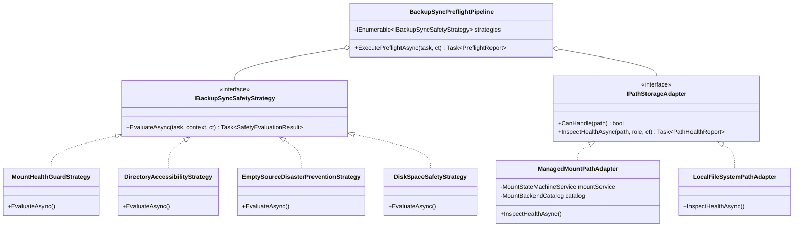
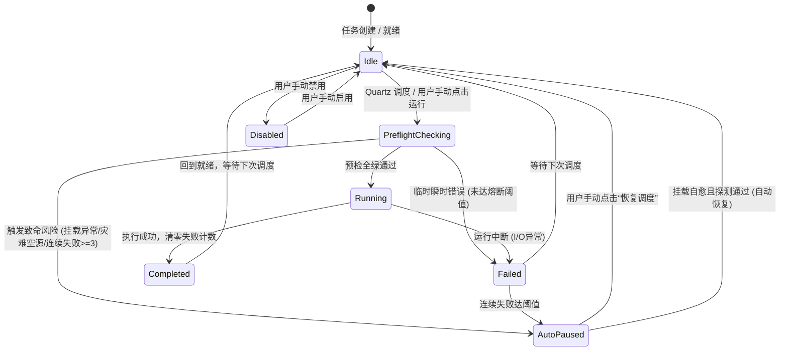

# 备份与同步任务“源/目标目录与关联挂载异常自动暂停”可行性调研与架构方案

> **状态**：方案规划与实施标准 (Architecture Plan & RFC)  
> **创建日期**：2026-10-27  
> **目标模块**：存储与媒体 (Storage) -> 备份与同步 (`BackupSync`) / 挂载管理 (`Mount`)

---

## 一、需求背景与威胁模型 (Threat Model)

在私有 Linux 服务器和家庭 NAS 环境中，数据备份与同步任务的源端（Source）或目标端（Target）通常会依赖网络挂载点（如 SMB/CIFS、NFS、WebDAV、Rclone 云存储挂载等）。当网络抖动、NAS 关机/重启、认证凭据过期或网络文件系统服务异常时，极易发生挂载失效。

若备份与同步引擎在无防护状态下盲目运行，会触发以下**灾难性后果**：

### 1.1 核心灾难场景
1. **静默脱机引发镜像清空（Wipeout Disaster）**：
   - 在直接镜像同步模式（`OneWayMirror`）下，若源端 SMB 挂载掉线，Linux 的挂载点目录会静默回退到宿主机底层的本地空目录。
   - 同步引擎检测到源目录存在但包含 `0` 个文件，误判定为“源端所有文件已被用户删除”，随即向目标端发起大量 `Delete` 或全量移入回收站操作，导致**目标端数据被彻底清空**！
2. **空快照污染与 GFS 轮转失效（GFS Poisoning）**：
   - 在增量版本备份模式（`Backup`）下，源端掉线将导致系统生成只有 0 字节的空快照。
   - 随后的 GFS 自动修剪策略将逐步淘汰以前真实的健康历史版本，最终留下全是空目录的无用快照。
3. **写入击穿宿主机系统盘（Root Disk Exhaustion）**：
   - 若目标端挂载点掉线，原本应该写入外置大容量 NAS 的几十 GB 备份数据，会被直接写入宿主机本地根分区（`/`）。
   - 这会导致根分区磁盘空间瞬间耗尽（100% 满），引发 Docker 引擎崩溃、系统日志中断及核心系统服务死锁。
4. **内核 I/O 卡死与 Web 服务雪崩（D-State Kernel Hang）**：
   - 处于异常状态（如网络断开但未超时卸载）的 CIFS/NFS 挂载点，在执行 `Directory.Exists` 或 `EnumerateFiles` 时会长时间陷入 Linux 内核不可中断睡眠状态（D 状态），耗尽 .NET 线程池，导致整个 Web 服务无响应。

因此，**“在源目录或目标目录存在问题或关联挂载异常时，自动拦截并熔断暂停同步任务”** 是一项至关重要的数据安全防线。

---

## 二、业界主流方案调研与借鉴

针对外部存储掉线和空目录风险，存储和同步领域的成熟产品均有一套防御规范：

| 产品 / 工具 | 核心机制 | 借鉴价值与启示 |
|---|---|---|
| **Syncthing** | **`.stfolder` 文件夹标记探针**：每个同步根目录必须存在 `.stfolder` 标记，一旦外部介质脱机导致该标记消失，立即将任务标记为 `Stopped (folder marker missing)` 并全面冻结同步，绝不向集群扩散删除操作。 | **零误判的挂载探针机制**：可以在源端和目标端支持可选或自动探测的 Canary 标记，防范静默空目录。 |
| **Rclone** | **`--max-delete <N>` 熔断阈值**：单次同步若计划删除的文件数量超过安全阈值，直接报错中止退出；配合 `--check-first` 预先估算差异。 | **灾难删除熔断策略**：当单向镜像预计删除数量超过比例或绝对值阈值时，自动触发安全阻断。 |
| **FreeFileSync** | **卷序列号与 `.sync.ffs_db` 校验**：在同步前校验根目录的卷唯一标识与元数据库，检测目标盘是否为同一物理介质。 | **设备标识与存储介质绑定**。 |
| **BorgBackup / Restic** | **Repository Lock & Mountpoint Check**：利用 `mountpoint -q` 检查挂载点有效性，结合排他锁机制防止多写损坏。 | **挂载点边界预检（Pre-flight Probe）**。 |
| **Systemd** | **`RequiresMountsFor=` 单元依赖**：Service 在目标挂载点未就绪前保持挂起，绝不盲目启动。 | **任务与挂载状态机的强关联绑定**。 |
| **Polly (.NET)** | **断路器模式（Circuit Breaker）**：Closed（闭合运行）-> Open（跳闸熔断）-> Half-Open（半开试探恢复）。 | **自动暂停与恢复的生命周期管理标准**。 |

---

## 三、可行性、逻辑欠缺与性能多维研判 (Brainstorming)

### 3.1 可行性研判
- **可行性评分**：**100% 可行且急迫需要**。
- **项目已有优势**：本项目已具备成熟的 `MountStateMachineService`、`SmbMountRuntimeProbe` 以及 `LinuxMountInfoParser`。挂载健康状态（`Healthy`, `ServerUnreachable`, `Stale`, `NotMounted`, `RecoveryFailed`）在内存中已有实时快照，具备无缝联动的天然优势。

### 3.2 逻辑欠缺与边缘陷阱（避坑分析）
1. **真假空目录误判（False Positive）**：
   - *问题*：用户新建一个备份任务，源目录确实刚创建、本身就是空的，系统是否会误判为“挂载掉线”并拒绝执行？
   - *解决方案*：
     - 若该任务为**首次执行**（`LastRunTime == null` 且历史快照为 0），允许空目录执行；
     - 若该任务**历史已有备份文件记录**（`TotalFiles > 0`），而本次探测发现文件数骤降为 0，则属于高危异常，触发熔断阻断；
     - 结合挂载点状态判定：若路径属于受管挂载点且挂载状态为非 Healthy，无论目录是否为空均立即拦截。
2. **子目录关联识别（Subpath Resolution）**：
   - *问题*：用户填写的路径通常不是挂载根路径，而是其深层子目录（如 `/mnt/nas/backup/project1`），直接比对路径字符串会漏判。
   - *解决方案*：基于最长公共前缀（Longest Prefix Match）算法，自动解析出该路径所属的挂载根目录，挂钩对应的挂载健康状态。
3. **偶发网络抖动与状态振荡（Flapping）**：
   - *问题*：WiFi 或网络有 1 秒的瞬时重传抖动，若直接将任务永久禁用，会导致用户体验割裂。
   - *解决方案*：引入**断路器（Circuit Breaker）**机制。
     - 单次失败记录错误并跳过本次周期；
     - 若命中“致命条件”（受管 SMB 确认脱机、删除数量超过灾难阈值、或连续失败达到 3 次），则跳闸进入 `AutoPaused`（自动暂停）状态；
     - 提供“一键恢复”及“挂载自愈自动唤醒”能力。
4. **探针内核卡死防护（Timeout & Concurrency）**：
   - *问题*：直接调用 `Directory.Exists` 在掉线的 CIFS 挂载点上可能会阻塞 120 秒以上。
   - *解决方案*：先查询 `MountStateMachineService` 内存缓存（0ms 开销）；对于磁盘 I/O 探针，采用严格超时控制（3000ms），超时直接判定为不可达。

---

## 四、设计模式架构优化

为了实现高内聚、低耦合、Native AOT 友好以及高扩展性，系统采用以下三大设计模式进行深度重构：

### 4.1 适配器模式 (Adapter Pattern)
- **目标**：统一屏蔽受管挂载（SMB/WebDAV/Rclone）与本地物理磁盘、未知 FUSE 挂载的底层差异。
- **抽象**：`IPathStorageAdapter`
  - `CanHandle(string path)`: 判断该适配器是否负责该路径。
  - `InspectHealthAsync(string path, PathRole role, CancellationToken ct)`: 输出统一的健康探测报告（`PathHealthReport`）。
- **实现**：
  1. `ManagedMountPathAdapter`：适配系统内部受管挂载点，直接复用 `MountStateMachineService` 的内存健康快照，无网络/I/O 开销。
  2. `LocalFileSystemPathAdapter`：适配宿主机本地目录，校验目录可达性、可写性（Canary 探针）与可用空间。

### 4.2 策略模式 (Strategy Pattern)
- **目标**：将所有安全预检与灾难拦截规则解耦为独立的策略对象，易于单测与灵活插拔。
- **抽象**：`IBackupSyncSafetyStrategy`
  - `EvaluateAsync(BackupSyncTask task, PreflightContext context, CancellationToken ct)`
- **内置策略**：
  1. `MountHealthGuardStrategy`：拦截源/目标路径所挂载的 SMB/WebDAV 掉线、处于 RecoveryFailed 或 Stale 状态。
  2. `DirectoryAccessibilityStrategy`：拦截目录不存在、权限不足、目标目录不可写（Canary 写入测试）。
  3. `EmptySourceDisasterPreventionStrategy`：针对单向镜像同步和增量备份，拦截源端异常清空引发的灾难性删除与空快照污染。
  4. `DiskSpaceSafetyStrategy`：检查目标磁盘可用空间，防止写穿系统根盘。

### 4.3 状态机模式与断路器 (State Machine & Circuit Breaker)
- **目标**：精细化任务运行周期管理，明确区分“单次运行失败”与“熔断自动暂停”。
- **状态流转**：

- **数据模型增强**：
  - `AutoPaused` 状态码（在 `LastRunStatus` 中持久化记录为 `AutoPaused`）。
  - 任务新增 `CircuitBreakerReason`、`ConsecutiveFailures` 等元数据。
  - 当状态为 `AutoPaused` 时，Quartz 触发作业自动略过执行，保护系统。
  - 前端以高亮琥珀色警示徽章展示，并提供“恢复调度”按钮。

---

## 五、实施路径规划

1. **协议层扩展 (`Contracts`)**：
   - 增加任务状态 `AutoPaused` 枚举及字段。
   - 增加安全预检报告与恢复调度契约。
2. **安全防护引擎与模式实现 (`Infrastructure/Features/BackupSync/Safety`)**：
   - 实现 `IPathStorageAdapter` 与挂载适配器。
   - 实现各 `IBackupSyncSafetyStrategy` 及编排管线 `BackupSyncPreflightPipeline`。
   - 实现断路器与任务状态迁移管理器。
3. **协调器集成 (`BackupSyncCoordinator`)**：
   - 在 `RunTaskAsync` 开头执行安全流水线；
   - 遇到致命安全违规时，立即触发熔断保护，更新数据库为 `AutoPaused`，记录详细诊断原因。
4. **调度与恢复能力 (`BackupSyncScheduler` & `Routes`)**：
   - 在 `BackupSyncJob` 中识别 `AutoPaused` 并防范空跑；
   - 提供 `POST /api/BackupSync/Tasks/{id}/Resume` 接口用于恢复调度。
5. **前端界面更新 (`BackupSyncView.js`)**：
   - 针对 `AutoPaused` 任务展示醒目的“已自动暂停保护（熔断）”状态与原因提示。
   - 提供快捷“恢复”操作。
6. **自动化测试覆盖 (`UnitTests`)**：
   - 覆盖挂载掉线拦截、空目录防清空熔断、断路器跳闸与恢复逻辑。
