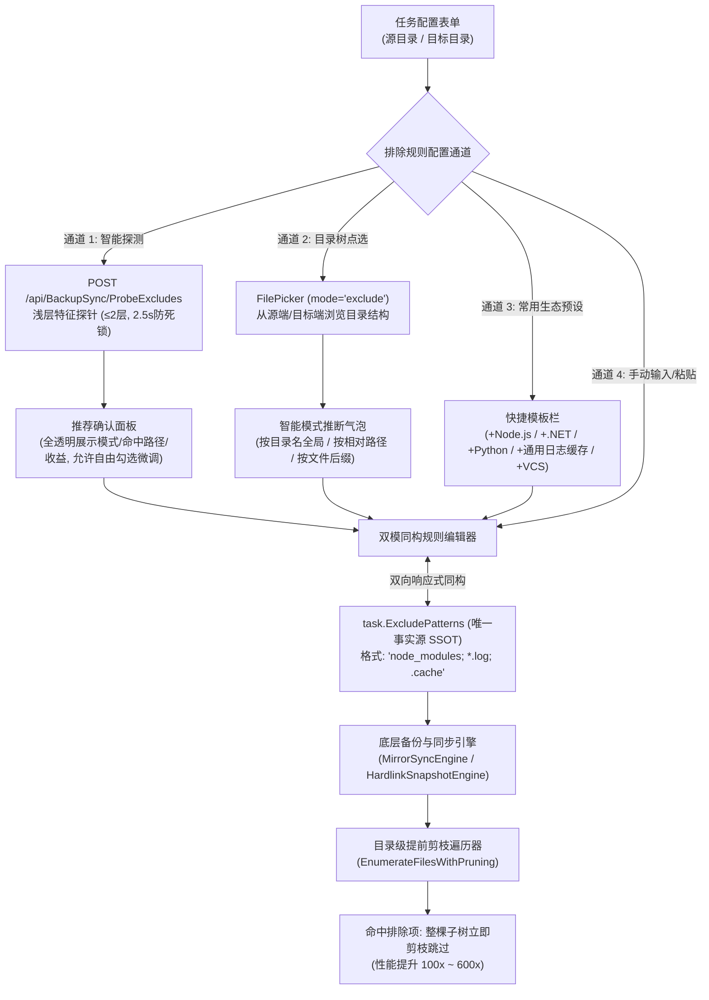

# 备份同步智能排除规则与可视化交互全景开发方案 (Backup-Sync Smart Exclusions Master Implementation Plan)

> **文档状态**：已整合三阶段调研成果，进入全量执行阶段  
> **核心目标**：构建“智能浅层探测 + 零黑盒全透明 + 双模可视化胶囊 + 目录树点选排除 + 目录级提前剪枝加速”端到端解决方案。  
> **整合来源**：
> 1. `docs/backup-sync-exclude-detection-and-recommendation-plan.md`（技术栈浅层探测与目录剪枝）
> 2. `docs/backup-sync-visual-exclude-rules-and-zero-hidden-logic-plan.md`（零隐藏黑盒逻辑与双模同构编辑器）
> 3. `docs/backup-sync-folder-picker-and-visual-exclusion-plan.md`（源端/目标端目录树点选排除与模式智能推导）

---

## 一、 系统架构与最高设计准则

### 1.1 核心准则
1. **绝对零隐藏逻辑（Zero-Hidden-Logic / WYSIWYG）**：
   - 绝不设置任何后台私有或隐式排除项；
   - 只有用户在界面上明确保存进 `task.ExcludePatterns` 的规则才会执行；
   - 排除规则输入框留空时，执行 100% 忠实全量同步。
2. **只读性与无害性（Advisory Only）**：
   - 探测接口与点选选择器纯只读，绝不修改存储，只生成给用户的修改建议；
   - 探测设置 2.5 秒硬超时与深度 $\le 2$ 限制，彻底防范远程 CIFS/SMB 卡死。
3. **极速剪枝（Directory Pruning）**：
   - 遇到匹配排除的目录项（如 `node_modules`、`.cache`），整棵子树直接跳过递归入队，彻底消灭几十万次 I/O 系统调用。

---

## 二、 阶段开发实施路线图

### 第一阶段：数据合约与 Native AOT 序列化 (`Contracts`)
1. **合约定义**：在 `LinuxWebTool.Contracts/Features/BackupSync/Contracts/BackupSyncContracts.cs` 中增加：
   - `ProbeExcludesRequest`
   - `ExcludeRecommendationItem`
   - `ExcludePresetTemplate`
   - `ProbeExcludesResponse`
2. **AOT 上下文**：在 `AppJsonSerializerContext.cs` 注册以上所有模型，确保 Native AOT 零反射。

### 第二阶段：规则模式匹配器与提前剪枝引擎 (`Infrastructure`)
1. **高性能匹配器**：`ExcludePatternMatcher.cs`：
   - 支持目录名精确匹配（`node_modules`, `.cache`, `bin`）；
   - 支持文件扩展名匹配（`*.log`, `*.tmp`, `*.bak`）；
   - 支持路径分词段包含匹配（`pnpm-store`）；
2. **提前剪枝枚举器**：在 `MirrorSyncEngine.cs` 和 `HardlinkSnapshotEngine.cs` 改造文件扫描算法：
   - 遇到被排除目录，立即停止子树递归遍历。

### 第三阶段：技术栈浅层探测流水线 (`Infrastructure` & `WebHost`)
1. **探测策略族**（`IExcludeDetectionStrategy`）：
   - `NodeJsDetectionStrategy`（嗅探 `package.json`，探测 `node_modules`、`.cache`、`pnpm`）
   - `DotNetDetectionStrategy`（嗅探 `*.sln`、`*.csproj`，探测 `bin`、`obj`、`.vs`）
   - `PythonDetectionStrategy`（嗅探 `requirements.txt`，探测 `__pycache__`、`.venv`）
   - `VcsDetectionStrategy`（嗅探 `.git`、`.svn`）
   - `CommonTempAndLogsDetectionStrategy`（嗅探 `*.log`、`tmp`、`Thumbs.db`）
2. **流水线调度器**：`ExcludeDetectionPipeline.cs`，整合并发探测与 2.5s 超时保护；
3. **Web 端点**：在 `BackupSyncController.cs` 暴露 `POST /api/BackupSync/ProbeExcludes`，并在 `EndpointsMapper.g.cs` 映射（符合 `LinuxArch012`）。

### 第四阶段：前端文件选择器点选排除与模式推断 (`WebHost/wwwroot`)
1. **相对路径与推断工具**：在 `filePaths.js` 实现 `getRelativePath` 与 `inferExcludeRuleOptions`；
2. **`FilePicker.js` 扩展**：
   - 增加 `mode='exclude'` 与 `basePath` 支持；
   - 每一行增加“＋排除此项”按钮与推断气泡（按目录名全局/按相对路径/按后缀）；
   - 允许连续点选追加，不打断浏览过程。

### 第五阶段：前端双模可视化规则编辑器与推荐面板 (`BackupSyncView.js`)
1. **双模响应式同构绑定**：
   - 可视化模式：彩色胶囊芯片（Chips，带图标 📁/📄/🌐 与一键删除 ✕）；
   - 原始文本模式：分号/逗号多行代码文本框；
   - 二者通过 `ExcludeRuleVisualAdapter` 实时双向同步；
2. **常用预设模板栏**：`+ Node.js`、`+ .NET`、`+ Python`、`+ 通用临时/日志`、`+ 版本控制`；
3. **点选排除接入**：`📂 从源目录点选排除`、`📂 从目标端点选`；
4. **智能探测弹窗**：展示探测结果、全透明命中路径与收益评级，支持自由勾选与一键追加。

### 第六阶段：自动化质量门禁与回归验证
1. 单元测试全覆盖：探测策略单测、模式匹配单测、相对路径推导单测；
2. 架构门禁验证：行数限制 $\le 700$ 行（`LinuxArch026`）、端点映射（`LinuxArch012`）、AOT 序列化（`LinuxArch018`）；
3. 前端架构门禁：`frontend-gate.cjs` 扫描通过。
