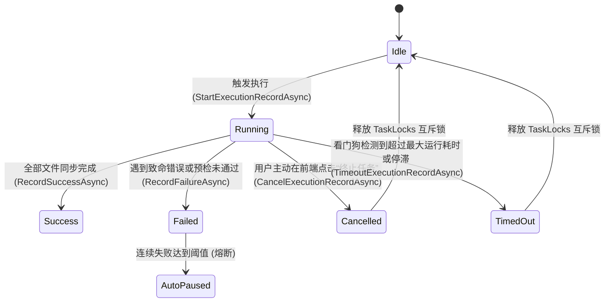

# 备份同步执行中假死与 CIFS 深度韧性优化方案 (Backup-Sync Stuck-Running & CIFS Resilience Plan)

> **文档状态**：已落盘并进入执行阶段  
> **涉及服务**：`LinuxWebTool.Infrastructure`, `LinuxWebTool.WebHost`, `BackupSyncCoordinator`, `MirrorSyncEngine`, `BackupProgressTracker`  
> **环境现场**：Debian Linux 6.1 (R7), CIFS 挂载点 `//10.126.1.77/TempFileBig`, 任务 `r7-dsh-data` (源路径 `/var/docker/dsh-data`，约 32,000 个文件，包含容器内 node_modules 软链接)

---

## 一、 现场诊断与问题还原

### 1.1 用户反馈的两个核心问题
1. **问题一**：历史定时任务执行报错失败：  
   `Could not find file '/var/docker/dsh-data/profiles/node_modules/detect-libc'`。
2. **问题二**：再次触发（或定时执行）后，Web 界面记录长时间显示为 **“执行中 · 耗时 0ms · 0 个文件 · 0 B”**，再次点击“立即同步”提示“任务正在执行中，已跳过本次重复触发”，无法取消也无法重跑，犹如系统“假死”。

### 1.2 生产现场实时探针与内核调用栈取证
通过现场控制台针对正在运行的进程 `PID: 35596` (`LinuxWebTool.WebHost`) 探针取证：
1. **挂载分析**：
   - 目标路径 `/lwt/r7/TempFileBig` 为跨局域网挂载的 Windows/Samba CIFS 共享：  
     `//10.126.1.77/TempFileBig on /lwt/r7/TempFileBig type cifs (rw,relatime,vers=3.0,soft,echo_interval=10,actimeo=1,closetimeo=1)`。
2. **源目录特征分析**：
   - 源目录 `/var/docker/dsh-data` 包含大量容器生成的数据（包括 DeepSeek-AI DSH 运行环境中的 `.dsh`, `.local/share/pnpm`, `profiles/node_modules` 等），文件总计 **31,958 个**！
   - 包含悬空损坏的软链接，例如：  
     `/var/docker/dsh-data/profiles/node_modules/detect-libc -> /usr/local/lib/node_modules/@deepseek-ai/dsh/node_modules/detect-libc`。  
     目标路径指向原容器内部专用目录，在宿主机/备份服务容器中该路径并不存在。
3. **工作线程状态分析**：
   - 检查任务执行线程 `TID: 38187` 的内核状态：
     ```text
     State: D (disk sleep)
     wait_for_response
     [<0>] wait_for_response+0x99/0xe0 [cifs]
     [<0>] compound_send_recv+0x4ad/0xb30 [cifs]
     [<0>] cifs_send_recv+0x1f/0x30 [cifs]
     [<0>] SMB2_flush+0x26a/0x3a0 [cifs]
     [<0>] cifs_setattr+0xb71/0xf70 [cifs]
     [<0>] notify_change+0x29b/0x5b0
     [<0>] vfs_utimes+0x13c/0x270
     [<0>] do_utimes+0xe6/0x150
     [<0>] __x64_sys_utimensat+0x9d/0xe0
     ```
   - 检查该线程的文件句柄与上下文切换（Context Switches）：
     - 05:02:30: `voluntary_ctxt_switches: 463744`，当前操作 `es-toolkit/dist/map/keyBy.d.mts`
     - 05:05:35: `voluntary_ctxt_switches: 496380`
     - 05:06:05: `voluntary_ctxt_switches: 501448`，当前操作 `d3-selection/src/selection/on.js`
     - 05:06:37: `voluntary_ctxt_switches: 507325`，当前操作 `cytoscape/src/collection/zsort.mjs`

**探针证实**：该任务**并未发生进程级死锁，而是在极为缓慢地进行逐个文件的网络传输与时间戳同步**。

---

## 二、 根本原因剖析 (Root Causes)

### 2.1 为什么历史执行会报错 `detect-libc` 丢失？
- **深层机理**：`/var/docker/dsh-data/profiles/node_modules/detect-libc` 是一个指向容器内部私有路径 `/usr/local/lib/...` 的**悬空软链接（Dangling Symlink）**。
- 在旧版本（`v0.2.22`）中，同步引擎使用常规文件 I/O 遍历与复制。在对软链接进行属性读取（`FileInfo.Length`）或内容解引用复制时，因其指向的目标在当前环境中不存在，.NET 运行时直接抛出 `System.IO.FileNotFoundException`。
- **现状**：此缺陷在 `v0.2.23` 中已引入 `SymlinkAndFileTransferHelper` 进行修复，对悬空软链接改用 `File.CreateSymbolicLink` 镜像指向，不再触发解引用崩溃。界面上的 `03:25:48` 报错为更新部署前的历史失败记录。

### 2.2 为什么后续任务长时间显示为“执行中 · 耗时 0ms · 0 个文件 · 0 B”？
导致用户产生“假死”感知的核心原因包含以下 4 项系统性设计缺陷：

1. **缺陷一：在途状态与持久化记录脱节（缺乏中途落库机制）**
   - 任务启动时，`StartExecutionRecordAsync` 向 SQLite 插入一条初始记录：`Status = Running, durationMs = 0, processedFiles = 0, processedBytes = 0`。
   - 在旧代码中，**全流程仅在任务彻底成功或抛出未捕获异常时，才会调用 `CompleteExecutionRecordAsync` 更新数据库**。
   - 虽然此前设计了内存级进度跟踪器，但数据库中的执行记录在整个 40~60 分钟的同步过程中从未刷新。用户刷新前端或查看执行记录列表时，始终读到 `0ms · 0 个文件 · 0 B`。

2. **缺陷二：CIFS/SMB 协议上的小文件网络 RPC 延迟放大与内核 D-State 耗时**
   - 目标端 `/lwt/r7/TempFileBig` 属于网络 CIFS 挂载，源目录有多达 **31,958 个小文件**。
   - 对每个文件，同步引擎依次调用：
     `File.Exists`（网络 SMB 查询） $\rightarrow$ `SafeDeleteFileOrLink` $\rightarrow$ `File.CopyTo` $\rightarrow$ `File.SetLastWriteTimeUtc`（触发 `utimensat` $\rightarrow$ `cifs_setattr` $\rightarrow$ `SMB2_flush`）。
   - 即使每个网络往返耗时仅 15ms，32,000 个文件也需耗时至少 `32,000 × 15ms ≈ 480 秒`（8 分钟），若遇到网络排队或 Windows/Samba 服务端刷新磁盘缓冲，耗时将延长至 30~60 分钟。
   - 在 `SMB2_flush` 执行期间，Linux 内核线程处于 `D` 状态（不可中断休眠），等待网络 SMB 服务端应答。

3. **缺陷三：内存级 `SemaphoreSlim` 缺乏任务超时与手动取消（Cancel/Abort）管道**
   - `BackupSyncCoordinator` 采用单任务排他锁：`TaskLocks.GetOrAdd(taskId, _ => new SemaphoreSlim(1, 1))`。
   - 任务在没有设置超时（Timeout Watchdog）的情况下启动；
   - 系统未提供针对单次在途任务的取消机制（没有暴露 `CancellationTokenSource` 供前端中断）；
   - 当任务在 CIFS 上缓慢运转时，用户点击“立即同步”直接命中锁互斥，返回“任务正在执行中，已跳过本次重复触发”。用户既无法终止任务，又无法强行重新执行。

4. **缺陷四：僵尸任务恢复仅在服务冷启动时执行**
   - `BackupSyncRecordStore.MarkInterruptedRunningRecordsAsync` 仅在应用启动（`BackupSyncBootstrapService.StartAsync`）执行一次。如果任务在运行时因网络永久断开挂起，运行时缺乏常驻看门狗（Runtime Watchdog）进行超时熔断与僵尸回收。

---

## 三、 业界主流方案调研与对比 (Industry Benchmark)

| 对比维度 | `rsync` 方案 | `rclone` 方案 | `Hangfire` / `Temporal` 方案 | LinuxWebTool 当前方案 | 本次改进方案 |
| :--- | :--- | :--- | :--- | :--- | :--- |
| **I/O 超时防挂死** | `--timeout=120`（单次 I/O 空闲超过 120 秒自动断开退出，错误码 30） | `--timeout=5m`（I/O 空闲超时），`--contimeout=60s`（连接握手超时） | Heartbeat 心跳丢失判定，超过超时自动进入 Failed / TimedOut | 依赖 .NET 底层文件流，无任务级超时与 I/O 停滞探测 | **引入在途任务双重看门狗**：总时长硬超时（如 2小时）+ 单步停滞看门狗（10分钟无进展自动取消） |
| **在途状态可见性** | 管道输出实时字节与速度，终端实时刷新 | `--rc` 远程控制端口暴露 `/core/stats`，支持轮询与取消 | 周期性往数据库汇报心跳与进度（Heartbeat & Checkpoint Flush） | 内存中有 Tracker，但数据库中始终为 0，刷新页面即变回 0 | **在途记录周期持久化（Checkpoint Flush）**：Tracker 批量/节流向 SQLite 刷写当前已处理文件数与字节数 |
| **用户主动干预** | 发送 `SIGINT` / `SIGTERM` 信号优雅关闭 | 调用 `/core/quit` 或 `/job/stop` 接口取消在途 Transfer | 任务控制台提供一键 `Stop / Cancel / Requeue` | 无取消接口，点击立即同步仅提示“正在执行中” | **全链路取消令牌（CancellationToken）+ 前端一键“终止/取消”** |
| **网络文件系统适应性** | 支持忽略某些不支持的时间戳/属性警告 | 针对 SMB/WebDAV 进行大文件分块与小文件并发缓冲 | 重试策略与死信队列 | 强同步单线程复制，同步设置时间戳 | **CIFS 属性写入容错**：时间戳写入异常降级为 Warning，不阻塞主流程，增加逐文件 CT 检测 |

---

## 四、 架构设计与设计模式应用

### 4.1 状态机模式升级 (State Machine Extension)
在 `BackupSyncStateMachine` 中扩展状态与事件转换流：


### 4.2 适配器与主动取消模式 (CancellationToken Registry)
在 `BackupSyncCoordinator` 中维护活跃任务取消字典：
- `ConcurrentDictionary<Guid, (CancellationTokenSource Cts, Guid RecordId, DateTime StartTime)> _activeExecutions`
- 暴露 `Task<bool> CancelTaskAsync(Guid taskId, string reason)`：
  1. 检索对应的 `CancellationTokenSource` 并调用 `Cancel()`；
  2. 驱动状态机流转到 `Cancelled`；
  3. 释放 `SemaphoreSlim`；
  4. 更新数据库中对应的记录为 `StatusCancelled`，并补充运行耗时与摘要。

### 4.3 周期性落盘与看门狗机制 (Periodic Checkpoint & Watchdog)
- 在 `BackupProgressTracker` 或协调器中加入节流落盘逻辑（如每 5 秒或每 100 个文件，将最新 `processedFiles`, `processedBytes`, `durationMs` 异步刷写到 SQLite 执行记录中），使“正在执行”中的记录能真实呈现当前已处理文件和字节数，彻底消除“0ms · 0 个文件”的假象。
- 注入后台看门狗定时器（Watchdog），检测超过运行阈值或无响应的任务，自动触发取消并释放锁。

---

## 五、 具体改造实施方案

1. **核心库与合约层 (`LinuxWebTool.Contracts` / `Infrastructure`)**:
   - `BackupSyncStateMachine.cs`：增加 `StatusCancelled` 与 `StatusTimedOut` 状态定义及落盘方法。
   - `BackupSyncCoordinator.cs`：
     - 加入 `_activeExecutions` 取消源管理。
     - 支持 `CancelTaskAsync(Guid taskId)`。
     - 在文件同步循环中结合传入的 `CancellationToken` 支持毫秒级响应取消。
     - 增加任务总耗时超时包装。
   - `BackupProgressTracker.cs`：
     - 增加在途数据落盘回调委托（Checkpoint Persistence Action），周期性同步至 SQLite。
   - `MirrorSyncEngine.cs` & `SymlinkAndFileTransferHelper.cs`：
     - 时间戳设置操作（`File.SetLastWriteTimeUtc`）针对 CIFS 网络抖动增加降级保护，避免因底层属性锁阻塞整体流程。

2. **Web API 控制器与端点映射 (`LinuxWebTool.WebHost`)**:
   - `BackupSyncController.cs`：新增 `POST /api/BackupSync/Tasks/{id:guid}/Cancel` 端点。
   - `EndpointsMapper.g.cs`：注册 `/api/BackupSync/Tasks/{id:guid}/Cancel`（符合 `LinuxArch012` 门禁）。
   - `AppJsonSerializerContext.cs`：确保所有返回模型纳入 Native AOT 序列化上下文（符合 `LinuxArch018`）。

3. **前端交互与视图 (`BackupSyncView.js`)**:
   - 当任务处于 `Running` 状态时，操作列提供醒目的红色 **“终止任务”**（Cancel）按钮。
   - 执行记录列表中，“执行中”状态展示当前动态刷新的已处理文件数与容量，而不是空白或 0。
   - 点击“终止任务”弹出确认弹窗，调用取消接口并立即刷新状态。

4. **自动化防回归门禁与测试**:
   - 新增单元测试：测试手动取消、看门狗超时、中途持久化刷新逻辑。
   - 执行架构门禁：确保行数限制、路由 1:1 映射、Native AOT 上下文全绿。

---

## 六、 现场应急处置方案 (针对当前 10.126.1.70:5270)
在代码优化发布前，针对目前正在后台缓慢传输的 `r7-dsh-data` 任务：
1. 现场任务已经传输至 `node_modules` 的中后段（正处于 `d3`, `cytoscape` 等包，上下文切换超 50 万次）。
2. 可选择让其平稳跑完，或在发布新版本重启容器时由新启动逻辑自动收敛并将记录标记为中断。
3. 新版本发布后，将具备实时取消、实时入库与超时看门狗保护，彻底根治此类问题。
