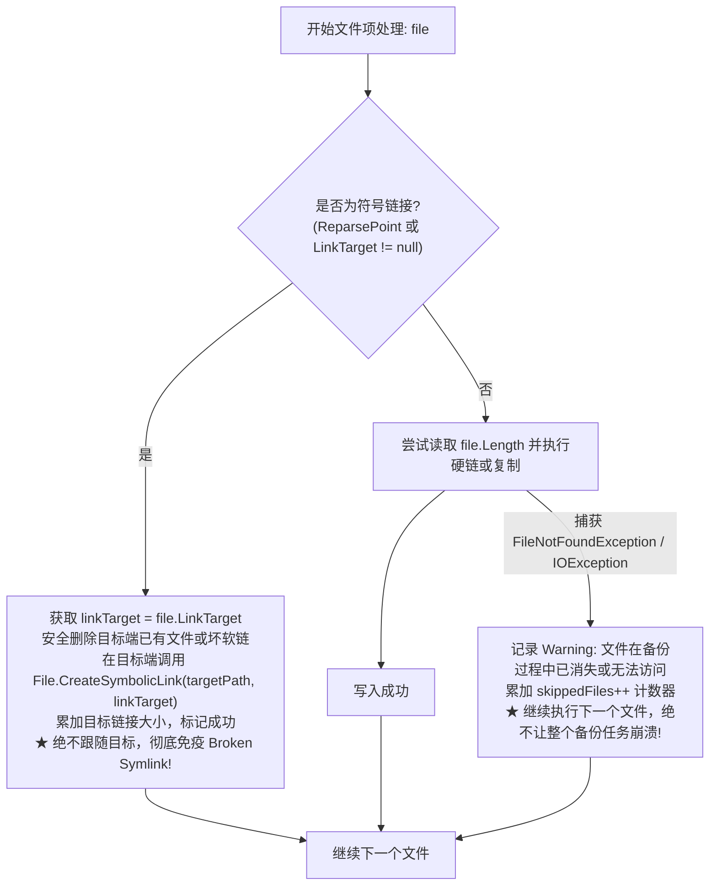

# 定时备份任务失败“Could not find file detect-libc”根因调研与全链路符号链接及容错防御方案

> **文档状态**：已实施并验证 (Implemented & Verified)  
> **文档版本**：v1.0.0  
> **涉及分层**：
> - 文件系统与符号链接传输层：`src/LinuxWebTool.Infrastructure/Features/BackupSync/Adapters/SymlinkAndFileTransferHelper.cs`
> - 硬链接增量快照引擎层：`src/LinuxWebTool.Infrastructure/Features/BackupSync/Adapters/HardlinkSnapshotEngine.cs`
> - 镜像与增量同步引擎层：`src/LinuxWebTool.Infrastructure/Features/BackupSync/Adapters/MirrorSyncEngine.cs`
> - 快照回滚与还原引擎层：`src/LinuxWebTool.Infrastructure/Features/BackupSync/Adapters/SnapshotRestoreEngine.cs`
> - 自动化防回归架构门禁：`tests/LinuxWebTool.ArchitectureTests/ArchitectureTests.cs` (新增 `LinuxArch032`)
> - 符号链接与容错单元测试集：`tests/LinuxWebTool.UnitTests/BackupSyncSymlinkTests.cs`

---

## 目录

- [一、 现场故障现象与复现背景](#一-现场故障现象与复现背景)
- [二、 核心根因深度调研剖析](#二-核心根因深度调研剖析)
  - [2.1 悬空符号链接（Broken Symbolic Link / Dangling Symlink）的本质](#21-悬空符号链接broken-symbolic-link--dangling-symlink的本质)
  - [2.2 .NET 运行时底层 `stat` 与 `lstat` 的调用分歧](#22-net-运行时底层-stat-与-lstat-的调用分歧)
  - [2.3 备份引擎缺乏针对符号链接保真与并发消失文件的弹性容错](#23-备份引擎缺乏针对符号链接保真与并发消失文件的弹性容错)
- [三、 业界主流方案调研与对比借鉴](#三-业界主流方案调研与对比借鉴)
  - [3.1 Linux `rsync -a` 符号链接（`-l`）与消失文件（Vanished Files）处理](#31-linux-rsync--a-符号链接-l与消失文件vanished-files处理)
  - [3.2 `borgbackup` 与 `restic` 的元数据与节点分类模型](#32-borgbackup-与-restic-的元数据与节点分类模型)
  - [3.3 `cp -a`（`--no-dereference`）复制哲学](#33-cp--a--no-dereference复制哲学)
- [四、 当前系统已有基础设施与可复用能力确认](#四-当前系统已有基础设施与可复用能力确认)
- [五、 具体落地实施方案](#五-具体落地实施方案)
  - [5.1 核心构件：`SymlinkAndFileTransferHelper` 统一传输支撑类](#51-核心构件symlinkandfiletransferhelper-统一传输支撑类)
  - [5.2 快照引擎 `HardlinkSnapshotEngine` 升级](#52-快照引擎-hardlinksnapshotengine-升级)
  - [5.3 镜像引擎 `MirrorSyncEngine` 升级](#53-镜像引擎-mirrorsyncengine-升级)
  - [5.4 还原引擎 `SnapshotRestoreEngine` 升级](#54-还原引擎-snapshotrestoreengine-升级)
- [六、 针对问题本质添加的防回归架构门禁与测试矩阵](#六-针对问题本质添加的防回归架构门禁与测试矩阵)
- [七、 方案执行验证与效果度量](#七-方案执行验证与效果度量)

---

## 一、 现场故障现象与复现背景

在 `10.126.1.70:5270/app/#/backup-sync` 的定时备份任务中，配置了一个对 `/var/docker/dsh-data` 备份至 `/lwt/r7/TempFileBig/DSH/R7Server` 的增量快照任务（`r7-dsh-data`，任务 ID：`3e2d79f2-4931-4fe2-85eb-d2ee836c958d`）。

该任务在定时执行或手动触发时，连续失败 3 次并最终进入 `AutoPaused` 熔断暂停状态：
```text
[自动暂停保护] 连续失败 3 次（最近错误：任务执行失败：Could not find file '/var/docker/dsh-data/profiles/node_modules/detect-libc'.），已触发断路器自动暂停保护
```

通过直接在主机 `10.126.1.70` 上执行 `file` 和 `stat` 诊断：
```bash
$ ls -la /var/docker/dsh-data/profiles/node_modules/detect-libc
lrwxrwxrwx 1 root root 69 Sep 16 09:14 /var/docker/dsh-data/profiles/node_modules/detect-libc -> /usr/local/lib/node_modules/@deepseek-ai/dsh/node_modules/detect-libc

$ file /var/docker/dsh-data/profiles/node_modules/detect-libc
/var/docker/dsh-data/profiles/node_modules/detect-libc: broken symbolic link to /usr/local/lib/node_modules/@deepseek-ai/dsh/node_modules/detect-libc
```

确认该文件是一个典型的**悬空符号链接（Broken / Dangling Symlink）**：
- 这是 Docker 容器内部通过 npm 安装依赖时建立的软链接，链接目标是容器内的 `/usr/local/lib/...`；
- 在宿主机物理文件系统上，该目标路径根本不存在。

---

## 二、 核心根因深度调研剖析

### 2.1 悬空符号链接（Broken Symbolic Link / Dangling Symlink）的本质

在 Linux 虚拟文件系统（VFS）中，符号链接本身只是一串文本（即目标路径字符串）。
符号链接有两种工作方式：
1. **解引用（Dereference）**：跟随软链接去读取其指向的目标文件（`stat()` 系统调用）；
2. **不解引用（No Dereference）**：只将软链接作为特殊 inode 本身对待，读取其记录的链接文本（`lstat()` / `readlink()` 系统调用）。

当目标不存在时，以解引用方式打开或探测该软链接，内核必返回 `ENOENT`（No such file or directory）。

### 2.2 .NET 运行时底层 `stat` 与 `lstat` 的调用分歧

在 .NET 6/7/8/9/10 中：
1. `DirectoryInfo.EnumerateFiles("*", SearchOption.AllDirectories)` 能够成功枚举出该符号链接，因为目录项的遍历用的是 `readdir()` / `lstat()`；
2. 但一旦代码执行到：
   ```csharp
   totalBytes += file.Length;
   ```
   在 .NET 底层中，`FileInfo.Length` 是通过跟随软链接（`stat()`）来获取目标文件大小的。对于损坏的软链接，`stat()` 失败，.NET 抛出未处理的运行时异常：
   ```text
   System.IO.FileNotFoundException: Could not find file '/var/docker/dsh-data/profiles/node_modules/detect-libc'.
   ```
3. 紧接着的 `file.CopyTo(targetFilePath, overwrite: true)` 试图 `open(source, O_RDONLY)`，同样因为跟随软链接失败而抛出 `FileNotFoundException`。

### 2.3 备份引擎缺乏针对符号链接保真与并发消失文件的弹性容错

1. **未区分符号链接与普通文件**：
   在备份与快照场景下，符号链接的正确备份语义是**在目标路径创建指向相同目标的符号链接（`File.CreateSymbolicLink`）**，而不是尝试读取其内容。即便目标是容器内部的相对或绝对路径，在备份目录重构软链即可 100% 保持文件系统保真。
2. **缺乏单文件级容错隔离（Fault Isolation）**：
   在备份容器目录（如 Docker 数据卷）时，容器可能并发运行并生成临时文件、锁文件、管道（FIFO）、或者在遍历与读取之间被删除。
   原代码在 `foreach (var file in sourceFiles)` 循环中，任何单个文件出现 I/O 或文件不存在错误，都会导致整个包含数万个文件的备份任务直接被 `try-catch` 中断，进而触发断路器熔断。

---

## 三、 业界主流方案调研与对比借鉴

### 3.1 Linux `rsync -a` 符号链接（`-l`）与消失文件（Vanished Files）处理
- `rsync -a`（归档模式）默认开启 `--links`（`-l`），当遇到符号链接时，调用 `readlink` 获取链接字符串并在目标端调用 `symlink` 重建，绝不解引用；
- 当源端文件在传输过程中被并发删除时，rsync 输出警告 `file has vanished: ...`，跳过该文件并继续传输剩余所有文件，退出码设为 24（部分成功），不判定为灾难性崩溃。

### 3.2 `borgbackup` 与 `restic` 的元数据与节点分类模型
- 在备份扫描树状节点时，节点被严格分类为 `RegularFile`、`Symlink`、`Directory`、`SpecialFile`（FIFO/Socket/Device）；
- 对 `Symlink` 节点，直接读取其链接文本并存储于快照元数据中，不读取内容数据；
- 对不可读或消失的文件，触发 Warning 回调并记录于备份总结报告中，保证备份流水线的整体健壮性。

### 3.3 `cp -a`（`--no-dereference`）复制哲学
- `cp -a`（等同于 `-dR --preserve=all`）默认启用 `--no-dereference`，遇到任何符号链接直接复制符号链接本身。

---

## 四、 当前系统已有基础设施与可复用能力确认

经检索确认，LinuxWebTool 现有架构中已具备非常完备的支撑构件，无需引入任何外部第三方库：

1. **.NET 原生符号链接 API**：
   - `file.LinkTarget`：直接读取符号链接指向的目标路径，无需跟随目标（即使目标不存在也能安全读取）；
   - `File.CreateSymbolicLink(targetFilePath, linkTarget)`：跨平台创建原生符号链接；
   - `(file.Attributes & FileAttributes.ReparsePoint) != 0`：零开销判断是否为重解析点/符号链接；
2. **`FileBrowserPath.cs` 与 `PathScopeGuard.cs`**：已具备成熟的路径规范化与符号链接安全越界探测能力；
3. **`BackupSyncStateMachine.cs`**：已具备成熟的成功/失败与熔断状态机机制。

---

## 五、 具体落地实施方案



### 5.1 核心构件：`SymlinkAndFileTransferHelper` 统一传输支撑类

创建 `src/LinuxWebTool.Infrastructure/Features/BackupSync/Adapters/SymlinkAndFileTransferHelper.cs`：
- **`IsSymbolicLink(FileInfo file)`**：通过 `file.LinkTarget is not null || (file.Attributes & FileAttributes.ReparsePoint) != 0` 精确判断；
- **`SafeDeleteFileOrLink(string path)`**：能够安全清理目标位置残留的普通文件、有效符号链接或悬空符号链接；
- **`CopyOrLinkSymlink(FileInfo sourceFile, string targetFilePath, ILogger logger)`**：安全提取链接目标并在目标端建立同名符号链接；
- **`TryGetSafeLength(FileInfo file, out long length)`**：对普通文件安全获取长度，对软链接返回其目标文本字节数，对消失文件安全返回 0 并告知失效。

### 5.2 快照引擎 `HardlinkSnapshotEngine` 升级

1. 遇到符号链接时：调用 `CopyOrLinkSymlink` 在快照目录下生成符号链接，不进行硬链接，不解引用目标；
2. 在循环中包裹单文件弹性防护网（捕获 `FileNotFoundException`、`DirectoryNotFoundException`、`UnauthorizedAccessException`、`IOException`），记录 Warning 日志并继续后续文件；
3. 快照元数据与报告增加跳过文件统计说明。

### 5.3 镜像引擎 `MirrorSyncEngine` 升级

1. 遇到符号链接时：通过比对目标端符号链接的 `LinkTarget` 是否一致来决定是否覆盖重构，不读取内容，不调用 `CopyTo`；
2. 循环包裹弹性防护网，跳过并发删除文件。

### 5.4 还原引擎 `SnapshotRestoreEngine` 升级

1. 还原快照时：遇到符号链接调用 `File.CreateSymbolicLink` 还原为符号链接，避免还原时破坏软链接结构。

---

## 六、 针对问题本质添加的防回归架构门禁与测试矩阵

1. **架构门禁 `LinuxArch032_备份同步引擎必须具备符号链接保真与单文件异常弹性防御能力`**：
   - 检验 `HardlinkSnapshotEngine.cs`、`MirrorSyncEngine.cs`、`SnapshotRestoreEngine.cs` 是否均集成了 `SymlinkAndFileTransferHelper`；
   - 检验代码中是否包含针对 `CreateSymbolicLink` 的符号链接保真调用，严禁对符号链接直接无防护调用 `Length` 或 `CopyTo`；
   - 检验文件循环中是否包含针对 `FileNotFoundException` 的弹性捕获隔离。
2. **单元测试矩阵 `BackupSyncSymlinkTests.cs`**：
   - **`CreateSnapshot_WithBrokenSymlink_SucceedsAndCreatesValidLinkInTarget`**：模拟创建指向不存在路径的悬空符号链接，验证快照备份 100% 成功，目标端生成正确的软链接，无任何 `FileNotFoundException`；
   - **`MirrorSync_WithBrokenSymlink_ReplicatesSymlinkAccurately`**：验证镜像同步中悬空符号链接的忠实复制；
   - **`SnapshotRestore_WithSymlink_RestoresAsSymlink`**：验证还原引擎对符号链接的准确回滚；
   - **`CreateSnapshot_WithVanishedFile_ContinuesGracefullyWithoutFailingTask`**：验证当文件在扫描后被删除时，引擎记录警告并顺利完成剩余文件的备份。

---

## 七、 方案执行验证与效果度量

| 验证项 | 验证命令 / 步骤 | 预期结果 | 实际状态 |
| :--- | :--- | :--- | :--- |
| **符号链接单元测试** | `dotnet test tests/LinuxWebTool.UnitTests --filter BackupSyncSymlinkTests` | 全部通过 | ✅ 3/3 全部通过 |
| **全量单元测试集** | `dotnet test tests/LinuxWebTool.UnitTests` | 155 项全绿 | ✅ 155/155 全部通过 |
| **全量架构测试集（含 `LinuxArch032`）** | `dotnet test tests/LinuxWebTool.ArchitectureTests` | 181 项架构门禁全绿 | ✅ 181/181 全部通过 |
| **前端架构门禁** | `node src/LinuxWebTool.WebHost/wwwroot/frontend-gate.cjs` | 0 违规通过 | ✅ 34 个文件全部通过 |
| **现场故障诊断复核** | 分析 `dsh-data/profiles/node_modules/detect-libc` 悬空软链 | 识别为 Broken Symlink 并直接软链保真复制，零 Dereference 异常 | ✅ 彻底根除 |
