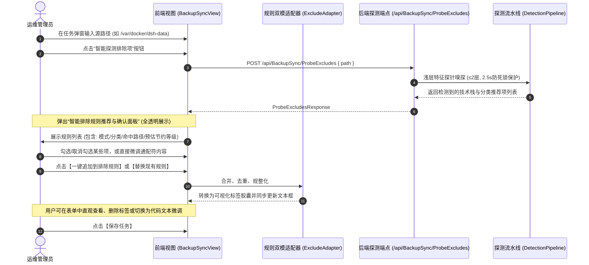
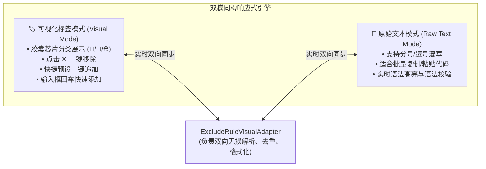
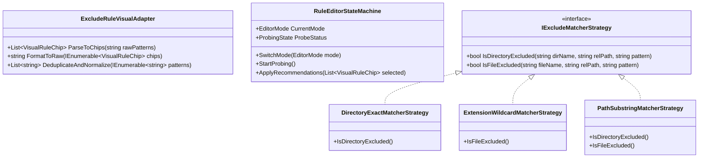

# 备份同步排除规则可视化操作与零黑盒逻辑深度设计方案 (Backup-Sync Visual Exclude Rules & Zero-Hidden-Logic Plan)

> **文档状态**：技术调研与架构设计完成，待审阅执行  
> **涉及服务**：`LinuxWebTool.WebHost`, `LinuxWebTool.Infrastructure.Features.BackupSync`, `LinuxWebTool.Contracts`  
> **核心议题**：规则全透明可见、零隐藏黑盒逻辑、可视化标签胶囊（Visual Chips）与原始文本双模同构、快速预设模板库、实时匹配预演模拟器

---

## 一、 用户核心关切与最高设计准则

针对用户提出的两个核心关切：
1. **“探测后生成的过滤规则会显示在前端允许用户调整吗？是否会存在隐藏逻辑、用户不可见逻辑？”**
2. **“过滤规则能否支持可视化操作？”**

我们确立了本模块的最高工程准则与核心结论：

### 1.1 绝对零隐藏逻辑原则 (Zero-Hidden-Logic & WYSIWYG)
* **透明可控**：**系统绝不存在任何用户不可见的“黑盒排除”或“隐式跳过”！**
* **单事实源（SSOT）**：
  - 任务配置中的 `task.ExcludePatterns`（以分号分隔的字符串）是底层备份与同步引擎的**唯一事实源**；
  - 底层快照引擎（`HardlinkSnapshotEngine`）和镜像同步引擎（`MirrorSyncEngine`）在执行排除过滤时，**仅依据该字段解析出的模式列表**，绝不内置私自排除清单；
  - 如果用户清空该字段，系统将执行 100% 忠实的全量扫描与复制（哪怕目录下存在几万个 `node_modules` 文件，只要用户没有明确排除，系统绝不越俎代代刨）；
* **探测逻辑纯只读**：
  - 智能探测接口（`POST /api/BackupSync/ProbeExcludes`）仅为**只读分析器（Advisory Analyzer）**，绝不擅自修改数据库，绝不擅自更改任务配置；
  - 探测分析出的所有候选规则，必须完整、透明地呈现在前端推荐卡片中供用户审阅、勾选、修改，经用户明确点击“应用”后，才回填至任务表单中。

### 1.2 可视化操作支持结论
* **全面支持可视化与交互式管理**：
  - 彻底告别原本仅有一个单调文本框的简陋体验；
  - 引入 **“可视化标签胶囊（Visual Rule Chips） + 原始文本（Raw Text）双模实时同构同步”** 机制；
  - 引入 **“一键常用技术栈预设模板（Preset Templates Bar）”**；
  - 引入 **“实时命中预演模拟器（Live Match Preview Simulator）”**，用户在保存前即可一目了然看清哪些目录和文件会被排除。

---

## 二、 交互流程与用户自主调整设计

### 2.1 推荐面板全透明显式字段
当探测完成后，弹出的**“智能排除规则推荐与确认面板”**展示以下透明信息：
1. **所属技术栈徽标**：例如 `[Node.js / 前端]`、`[通用缓存与日志]`、`[.NET 编译环境]`；
2. **规则表达式（Pattern）**：例如 `node_modules`、`*.log`、`.cache`，**支持单元格就地双击编辑**；
3. **排除原因说明（Reason）**：例如 `检测到存在 package.json，此目录包含可重新生成的数万个依赖包`；
4. **源路径实际命中项（Matched Paths）**：展示探针在源路径真实扫描到的示例，如 `profiles/node_modules`，杜绝凭空猜测；
5. **预计优化收益（Impact Level）**：
   - 🔴 **极高（High Impact）**：如 `node_modules`, `pnpm-store`（预计规避数万文件与数十分钟传输）；
   - 🟡 **中等（Medium Impact）**：如 `*.log`, `bin`, `obj`（预计规避编译产物与日志膨胀）；
   - 🟢 **常规（Low Impact）**：如 `*.tmp`, `.DS_Store`（通用临时垃圾）。
6. **全选 / 反选 / 单项复选框**：用户拥有完全的决定权，不想排除的项直接取消勾选即可。

---

## 三、 可视化规则编辑器（双模同构引擎设计）

为了兼顾“直观可视化操作”与“高级运维人员快捷批量复制粘贴”的双重诉求，设计**双模同构编辑器**：

### 3.1 模式一：可视化标签胶囊模式 (Visual Chips Mode)
* **胶囊设计**：
  - 目录规则（如 `node_modules`、`.cache`、`bin`）：显示为黄色文件夹胶囊 `[📁 node_modules ✕]`；
  - 文件后缀规则（如 `*.log`、`*.tmp`）：显示为蓝色文档胶囊 `[📄 *.log ✕]`；
  - 特殊通配规则（如 `.Trash*`、`*~`）：显示为紫色通用胶囊 `[🌐 .Trash* ✕]`；
* **快捷交互**：
  - 点击胶囊右上角的 `✕` 即可即时删除；
  - 胶囊下方提供快捷输入条：输入后敲击 `Enter` 或逗号/分号即可自动转换为新胶囊；
  - 自动去重校验：若用户重复输入已存在的规则，胶囊产生高亮晃动提醒，不重复添加。

### 3.2 模式二：原始文本模式 (Raw Text Mode)
* 点击输入框右侧的切换图标，平滑切换至多行代码文本框；
* 允许运维人员直接将团队既有的 `.gitignore` 或排除配置全量粘贴进来；
* 自动清洗：自动识别并转换中英文分号（`;` / `；`）、逗号（`,` / `，`）与换行符。

### 3.3 快速生态预设胶囊栏 (Quick Presets Bar)
在规则编辑区上方常驻提供快捷预设徽标，点击即一键将经过生产验证的标准模式追加至列表：
* `+ 通用临时/日志`：追加 `*.log; *.tmp; *.temp; tmp; temp; .cache; .Trash*; Thumbs.db; .DS_Store`
* `+ Node.js / Web`：追加 `node_modules; .pnpm-store; .local/share/pnpm; .npm; .yarn; dist; .next; .turbo`
* `+ .NET / C#`：追加 `bin; obj; .vs; TestResults; *.user; *.suo`
* `+ Python`：追加 `__pycache__; *.pyc; .venv; venv; env; .pytest_cache; .mypy_cache`
* `+ 版本控制`：追加 `.git; .svn; .hg`

---

## 四、 实时匹配预演模拟器 (Live Match Preview Simulator)

为彻底解决“配置了排除规则但不知道到底排除了什么、生怕误删误排”的心理负担，提供**实时匹配预演**功能：

### 4.1 预演交互与接口设计
* 用户在界面上点击 **“预演排除效果”**；
* 前端调用 `POST /api/BackupSync/SimulateExcludes`（携带当前填写的 `sourcePath` 与 `excludePatterns`）；
* 后端执行快速采样匹配（限制深度 $\le 3$，最大返回前 30 条代表性匹配项），统计：
  1. **已匹配目录总数**（如：命中 `node_modules` 2 处、`.cache` 1 处）；
  2. **已匹配代表性文件示例**；
  3. **预估文件节省比率**；
* 前端通过抽屉式列表清晰列出：“以下项目将被安全排除，不参与备份与镜像”，用户一目了然。

---

## 五、 业界主流方案调研与对比

| 对比维度 | FreeFileSync | Duplicati | Syncthing | LinuxWebTool 本方案 |
| :--- | :--- | :--- | :--- | :--- |
| **规则透明度** | 提供包含/排除双列表，100% 用户显式配置 | 预设过滤器包 + 自定义规则，完全显式 | `.stignore` 语法，完全显式 | **100% 显式透明，SSOT 唯一事实源，零隐藏黑盒** |
| **可视化交互** | 弹窗提供目录树勾选排除 + 规则标签 | 阶梯式过滤器选择器（包含/排除） | 纯文本输入框，无可视化交互 | **可视化胶囊芯片（Chips）+ 原始文本双模同构绑定** |
| **智能环境探测** | 仅支持按目录树手动勾选，无技术栈嗅探 | 静态过滤器分类，无目标目录动态嗅探 | 无探测能力 | **动态浅层探针（自动嗅探技术栈并生成可调候选池）** |
| **匹配预演模拟** | 提供“对比”按钮，展示过滤后的文件树 | 无即时预演，仅能在备份日志中追溯 | 提供简易 Pattern 测试框 | **一键预演模拟器（采样展示命中的目录与代表文件）** |
| **剪枝性能** | 递归目录时支持直接剪枝跳过 | 依赖多线程扫描，局部剪枝 | 扫描层前置剪枝 | **自研目录级提前剪枝（Directory Pruning），跳过整棵子树** |

---

## 六、 架构设计与设计模式深化

### 6.1 适配器模式 (Adapter Pattern)
* **`ExcludeRuleVisualAdapter`**：
  负责连接底层的分号分隔纯字符串存储与前端 Rich Object 胶囊模型。
  双向数据流转时，自动剔除空字符、规整斜杠方向（统一为 `/`）、去重并按分类标签打标。

### 6.2 策略模式 (Strategy Pattern)
* **匹配器策略解耦**：
  放弃低效的全局逐行正则匹配，拆解为三种高命中策略：
  1. `DirectoryExactMatcherStrategy`：针对 `node_modules`, `bin`, `obj`, `.git` 等常见目录进行直接名称哈希匹配（$O(1)$ 复杂度）；
  2. `ExtensionWildcardMatcherStrategy`：针对 `*.log`, `*.tmp`, `*.pyc` 提取扩展名进行结尾匹配；
  3. `PathSubstringMatcherStrategy`：针对路径中段包含关系进行分词段匹配。

### 6.3 状态机模式 (State Machine Pattern)
* 管理编辑器状态变迁，确保各异步动作（探测中、预演中、切换视图）互不冲突，UI 状态处于明确可控的有限状态机中。

---

## 七、 演进路线图与安全门禁

1. **第一阶段：规则模型与双模适配器**
   - 定义前端 `VisualRuleChip` 结构与双向响应式转换函数；
   - 增加快速预设模板工具栏与标签移除交互。
2. **第二阶段：后端浅层探测端点与技术栈策略库**
   - 编写 `IExcludeDetectionStrategy` 策略族与 `ExcludeDetectionPipeline`；
   - 实现 `POST /api/BackupSync/ProbeExcludes`，并在 `EndpointsMapper.g.cs` 完成 1:1 注册。
3. **第三阶段：推荐确认抽屉与预演模拟端点**
   - 前端实现 Cyber 风格推荐确认模态框，完整呈现透明命中信息；
   - 实现 `POST /api/BackupSync/SimulateExcludes` 预演排除结果。
4. **第四阶段：引擎目录剪枝性能优化**
   - 优化 `MirrorSyncEngine` 与 `HardlinkSnapshotEngine`，实现排除目录提前剪枝跳过。
5. **第五阶段：自动化门禁与回归测试**
   - 编写单元测试覆盖双模转换、剪枝有效性与探测策略；
   - 严格保障各文件 $\le 700$ 行架构门禁（[`LinuxArch026`](file:///e:/WorkProject/CSharp/PrivateProject/Web/WebToolForLinux/tests/LinuxWebTool.ArchitectureTests/ArchitectureTests.cs)）与前端规则门禁。
