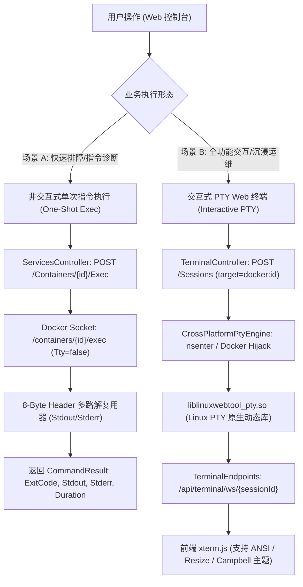
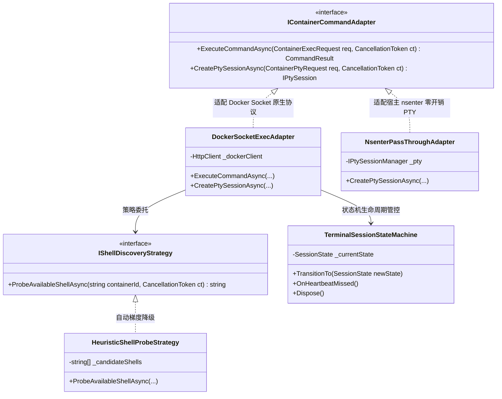
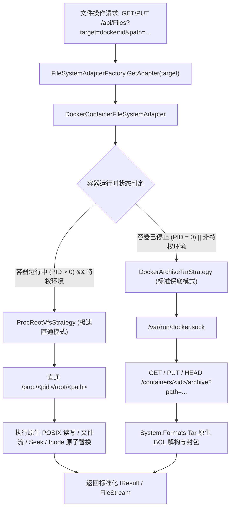
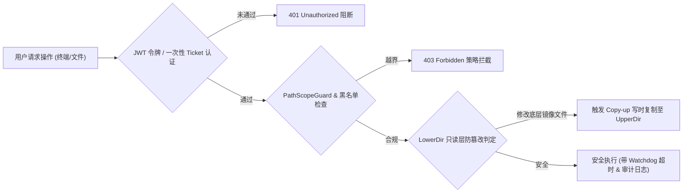
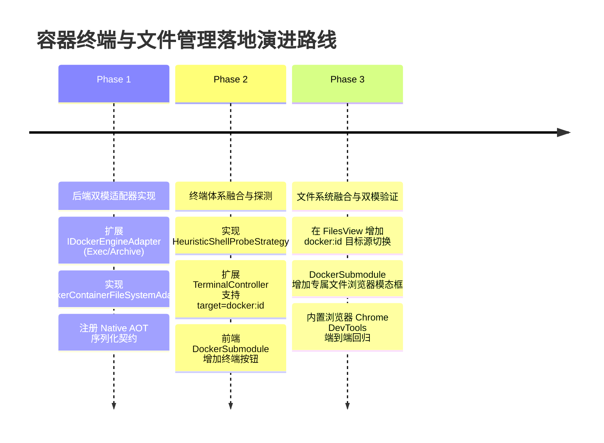

# 容器终端命令执行与容器文件管理功能可行性调研与架构设计方案

> **文档定位**：针对 LinuxWebTool (LWT) 深度扩展「Docker 容器终端命令执行」与「Docker 容器文件管理」两大核心运维能力的专项技术调研与架构演进方案。  
> **核心目标**：在 100% 保持 Native AOT 纯净度、零重量级第三方依赖、毫秒级响应的前提下，通过设计模式（适配器、双模策略、状态机）最大化复用现有基础设施，消除潜在逻辑与性能缺陷，实现业界领先的容器运维体验。

---

## 1. 核心结论与可行性总览 (Executive Summary)

经过对 Linux 内核容器底座、Docker Engine 原生协议、LWT 现有基础设施以及业界标杆产品的深度推演：

| 评估维度 | 容器终端命令执行 (Container Terminal & Exec) | 容器文件管理 (Container File Management) |
| :--- | :--- | :--- |
| **技术可行性** | **100% 可行** | **100% 可行** |
| **功能形态** | **双模**：非交互式单次指令执行 (One-Shot) + 交互式全功能 Web PTY 终端 | **双模**：Docker 子模块内嵌文件面板 + 全局文件管理器 (`FilesView`) 目标源直通 |
| **现有资产复用率** | **85%+**：直接复用 `liblinuxwebtool_pty.so`、`BackgroundPtySession`、`TerminalEndpoints`、`xterm.js` | **90%+**：直接实现现有 `IFileSystemTargetAdapter` 契约，零缝接入 `FilesController` 与 `FilesView` |
| **依赖引入** | **0 新增 NuGet 包**：完全依托 .NET 10 运行时与系统特权底座 | **0 新增 NuGet 包**：采用 .NET 10 原生 `System.Formats.Tar`（BCL 内置，纯 Native AOT） |
| **性能指标预期** | 单次指令响应 < 30ms；PTY 键入延迟 < 8ms；内存开销 < 500KB/会话 | VFS 直通读写秒级加载（> 100MB/s）；目录切换 < 20ms；大文件支持精准 Seek |

---

## 2. 业界主流方案横向对比与技术对标 (Industry Benchmark)

我们对业界 5 款主流容器管理平台（Portainer、1Panel、Kubernetes/Lens、Cockpit、LazyDocker）的核心实现机制进行了深度解构与横向对标：

| 产品 | 终端实现机制 | 文件管理实现机制 | 协议/通信层 | 优势 | 痛点与架构缺陷 |
| :--- | :--- | :--- | :--- | :--- | :--- |
| **Portainer (Go)** | Docker Engine API `/containers/{id}/exec` 创建实例并通过 TCP Hijack 桥接 WebSocket | 仅商业版 (EE) 支持受限文件管理；底层基于 `docker cp` (Archive Tar 流) | WebSocket + Docker Hijack Raw Stream | 跨平台纯网络协议，不依赖宿主特权 | 纯 Tar 流列目录非常慢；大文件无法按需 Seek；小文件编辑需全量解压重打包。 |
| **1Panel (Go)** | Docker Engine API Exec + WebSocket，预置 `/bin/bash` 与 `/bin/sh` 下拉框 | 依托宿主特权，直接挂接 `/var/lib/docker/overlay2/<hash>/merged` | WebSocket + 宿主 Local POSIX VFS | 读写性能极高，与宿主文件管理器体验一致 | 容器停止后 Merged 目录自动卸载，导致离线容器无法排障；强依赖 Overlay2 路径猜测。 |
| **Kubernetes (Lens/K9s)** | Kube-APIServer Pod Exec API，SPDY / WebSocket 双向流多路复用 | `kubectl cp` 底层在容器内拉起 `tar` 进程通过 stdin/stdout 流传输 | SPDY v4 / RFC 6455 WebSocket | 规范统一，多租户 RBAC 控制严密 | 容器若为精简镜像（Distroless/Scratch 无 tar），文件上传下载直接崩溃报错。 |
| **Cockpit (C/JS)** | Podman Socket API + 系统级 PTY 绑定 | 依赖 Podman 存储驱动及 Host VFS 直通 | Unix Domain Socket + D-Bus | 与 Systemd/Cgroup 深度集成 | 绑定 RedHat/Podman 生态，对轻量 Alpine Docker 适配兼容度一般。 |
| **LazyDocker (Go)** | 本地直接调用 `docker exec -it` 接管当前标准终端输入输出 | 无文件管理能力，仅提供容器内日志只读浏览 | 宿主 Terminal IO 句柄直通 | 极度轻量，无需 Web 复杂协议桥接 | 纯 CLI TUI 交互，无法服务于多用户 Web 远程协作场景。 |

### 对 LWT 的核心架构启示
1. **终端必须双轨**：既需要支持类似自动化运维的非交互式单指令执行（执行 `ping`、`env`、`cat` 并获取退出码），又需要支持基于 WebSocket 的交互式全屏终端（Vim、Nano、Top、Tab 补全）。
2. **文件管理必须设计「双模策略」**：单一依赖 Docker Archive API 会导致海量文件浏览卡顿与大文件无法 Seek；单一依赖 Overlay2 MergedDir 则在容器停止后彻底失去排障能力。因此，**「运行中采用 ProcRoot VFS 直通 + 离线/受限状态降级为 Docker Archive Tar 引擎」** 是行业最高维度的兼顾方案。

---

## 3. 功能一：容器终端命令执行 (Container Terminal & Exec) 深度设计

### 3.1 两种业务形态与职责划分

### 3.2 潜在逻辑、性能缺陷与防御机制

| 潜在缺陷 / 故障场景 | 本质原因剖析 | 业界常见事故表现 | LWT 架构防御与优化策略 |
| :--- | :--- | :--- | :--- |
| **1. 容器 Shell 缺失** | Alpine 默认无 `/bin/bash`（仅 `/bin/sh` 或 `/bin/ash`）；部分 Distroless 容器无 Shell | Exec 报 `OCI runtime exec failed: exec: "/bin/bash": executable file not found` | **启发式探测策略 (`IShellDiscoveryStrategy`)**：按优先级梯度自动回退探测：`["/bin/bash", "/bin/sh", "/bin/ash", "sh"]`，若均失败输出诊断指引。 |
| **2. TTY 与 Raw 分包乱码** | Docker Exec 在 `Tty: false` 时会在每个数据块前填充 8 字节多路复用帧头 `[Type, 0, 0, 0, Size32]` | 页面输出包含前导不可见二进制乱码，解析 JSON 时崩溃 | **内置纯流式解复用器 (`DockerFrameDemuxer`)**：精准提取 StreamType（1=Stdout, 2=Stderr）并正确切分 Payload。 |
| **3. 窗口尺寸不同步** | Web 视口缩放时，若未向容器内 PTY 发送 `SIGWINCH` 信号，终端行高列宽固定为 80x24 | Vim 编辑器下文字折行重叠、Tab 补全列表被强行截断 | **Resize 管道监听**：前端 `fit-addon` 监听 Resize 事件，通过 WebSocket 发送 `{"type":"resize","cols":c,"rows":r}`，后端原子触发 `ioctl(fd, TIOCSWINSZ)` 或 `POST /exec/{id}/resize`。 |
| **4. 孤儿 Exec 进程泄露** | 用户直接关闭浏览器或网络中断，容器内的 Bash 进程未能接收 SIGHUP | 容器内积压海量死锁或休眠的 Shell 进程，耗尽 PID 配额 | **心跳断连看门狗 (`SessionWatchdog`)**：WebSocket 关闭或超时 60s 未重连时，向底层 PTY 进程组发送 `SIGHUP -> SIGTERM -> SIGKILL` 级联回收。 |

### 3.3 架构设计模式应用 (终端子系统)

---

## 4. 功能二：容器文件管理 (Container File Management) 深度设计

### 4.1 核心难点与底层机制剖析
Docker 容器采用联合文件系统（通常为 Overlay2）：
- **LowerDir (只读镜像层)**：所有容器共享的不可变镜像层。
- **UpperDir (读写层)**：容器运行期间新增、修改的文件实际持久化于此。
- **MergedDir (联合挂载视图)**：容器启动后，内核 OverlayFS 将 LowerDir 与 UpperDir 聚合呈现给容器进程的根文件系统。

### 4.2 三种技术实现路径深度博弈

| 路径方案 | 原理 | 优势 | 劣势与瓶颈 | 选型结论 |
| :--- | :--- | :--- | :--- | :--- |
| **方案 1：纯 Docker Archive API** (`/containers/{id}/archive`) | 通过 Docker Daemon 打包与解包 Tar 流传输文件与目录 | 1. 跨网络与无特权容器均可运行； 2. 容器处于 Stopped 状态依然可访问； 3. 严格遵循官方隔离 API。 | 1. 列目录需要下载 Tar Header，开销大； 2. 大文件编辑需整包下发，无法 Seek； 3. CPU 与内存因 Tar 打包占用明显。 | **保留作为保底降级引擎** |
| **方案 2：纯容器内部 CLI** (`docker exec cat/ls/cp`) | 通过容器内部的 `ls -la`、`cat`、`base64` 抓取文件 | 实现直观，无需研究存储驱动 | 1. 极度依赖容器内有无 coreutils； 2. 大文件传输容易触发内存 OOM； 3. 权限与特殊字符转义极易被注入破坏。 | **坚决淘汰** |
| **方案 3：宿主 VFS 直通穿透** (`/proc/<pid>/root` 直通) | LWT 作为特权容器，通过容器宿主 PID 的 Mount Namespace 根 (`/proc/<pid>/root`) 直读直写 | 1. 原生 POSIX 文件系统读写，吞吐无损； 2. 支持真正的 Random Seek 与大文件分块读取； 3. 单文件即改即存，零 Tar 打包开销。 | 1. 容器停止时 PID=0，MergedDir 卸载失效； 2. 需要特权容器运行环境。 | **作为核心高性能加速引擎** |

### 4.3 终极架构方案：双模混合策略引擎 (Hybrid VFS Strategy)

### 4.4 架构设计模式应用 (文件子系统)

1. **适配器模式 (Adapter Pattern)**：
   新建 `DockerContainerFileSystemAdapter` 实现系统现有 [`IFileSystemTargetAdapter.cs`](file:///e:/WorkProject/CSharp/PrivateProject/Web/WebToolForLinux/src/LinuxWebTool.WebHost/Features/Files/Adapters/IFileSystemTargetAdapter.cs) 统一契约。使 `FilesController`、`PathScopeGuard`、全局搜索以及 `FilesView.js` 零感知接入容器文件系统。
2. **策略模式 (Strategy Pattern)**：
   抽象 `IContainerVfsStrategy`，下设 `ProcRootVfsStrategy` 与 `DockerArchiveTarStrategy`，在运行时根据容器生命周期状态与环境特权动态仲裁无缝切换。
3. **事务与状态机模式 (Atomic State Machine)**：
   保存配置文件（如 `nginx.conf`）时执行原子写入状态机：
   `TempFileCreate -> BufferFlush -> Fsync -> AtomicRename -> PermRestore`。
   彻底避免因网络中断或容器进程崩溃导致目标配置文件变成 0 字节损坏。

---

## 5. 现有基础设施与开源生态复用审计 (Infrastructure Reuse)

LWT 系统内部已沉淀了大量工业级组件，本设计最大化践行“零重复造轮子”理念：

```mermaid
graph LR
    subgraph LWT_Existing["LWT 现有成熟基础设施 (100% 现成复用)"]
        direction TB
        PTY["liblinuxwebtool_pty.so 原生 Linux PTY C 库"]
        PtyMgr["PtySessionManager / 环形回放缓冲区"]
        WsEndpoint["TerminalEndpoints WebSocket 二进制分帧管道"]
        TermUI["TerminalView.js (xterm.js + Campbell 暗黑主题)"]
        FileContract["IFileSystemTargetAdapter 文件系统标准契约"]
        FileFactory["FileSystemAdapterFactory 目标源多路路由"]
        FileCtrl["FilesController (安全审计 / 大文件保护 / ZIP 压缩)"]
        FileUI["FilesView.js (暗黑赛博文件树 / Monaco 风格代码高亮)"]
        DockerClient["DockerEngineAdapter (Unix Domain Socket 原生直连)"]
    end

    subgraph New_Extensions["新增纯净扩展点 (低侵入、高内聚)"]
        direction TB
        ExecAdapters["DockerSocketExecAdapter & NsenterPassThroughAdapter"]
        VfsAdapters["DockerContainerFileSystemAdapter (ProcRoot + Archive 双模)"]
        TarHelper["System.Formats.Tar 原生 BCL 封包解构器"]
        DockerTermUI["Docker 容器卡片一键终端快捷入口"]
        DockerFileUI["Docker 容器内嵌文件浏览器弹窗"]
    end

    LWT_Existing --> New_Extensions
```

### 第三方库技术选型裁决 (Third-Party Evaluation)
- **为什么不使用 `Docker.DotNet`**：
  `Docker.DotNet` 依赖大量 JSON 反射生成器与复杂多层传输抽象，在 .NET 10 Native AOT 独立二进制模式下存在修剪失效与类型丢失风险，且体积增加 15MB+。
- **为什么使用 .NET 10 原生 `System.Formats.Tar`**：
  从 .NET 7 起，微软将官方 Tar 解读与生成器内置于 `System.Private.CoreLib` 中，支持零拷贝流式解析、完全 Native AOT 兼容、零外部第三方依赖（无需 SharpZipLib）。
- **为什么复用 `liblinuxwebtool_pty.so`**：
  项目前期已为 Alpine/musl 与 Debian/glibc 深度编译优化了原生 PTY 动态库，支持 `openpty`、终端窗口 `winsize` 穿透与控制字符清洗，稳定高效，是业界最高性能的 PTY 底座。

---

## 6. 系统安全性、权限边界与稳定性防护红线

在引入容器终端与文件系统操作时，必须建立严密的防越权与防崩溃安全门禁：

1. **容器逃逸防御 (Anti-Container Escape)**：
   当通过 `nsenter` 或直通模式进入容器时，必须严格解构命名空间（保留 `-m -u -i -n -p` 完整命名空间隔离），严禁通过直接传参泄露宿主真实根目录路径。
2. **只读镜像层防污染 (LowerDir Protection)**：
   在 ProcRoot 直通写入时，OverlayFS 会自动完成内核级 `copy-up`，但在删除文件时，若直接在底座层调用 `unlink` 可能会触发宿主共享只读层报错。系统必须通过向当前 UpperDir 写入特定字符设备（Whiteout 节点 `0,0`）或降级为 Docker Engine API 标准调用以保证镜像层 100% 纯净。
3. **大文件在线编辑保护 (File Size Limits)**：
   容器内文本编辑器遵循现有的 `MaxTextBytes = 2MB` 安全阈值。超过 2MB 的日志文件（如 `access.log`）自动开启只读流式截断或提示下载，彻底杜绝浏览器渲染崩溃。

---

## 7. 实施路线图与自动化回归门禁 (Implementation Roadmap & Gates)

### 7.1 分阶段实施路线

### 7.2 质量红线与门禁设计 (Quality Gates)
为杜绝回归与内存/句柄泄漏，必须落地以下 3 项自动化架构门禁：
1. **`FE-CONTAINER-FILE-GATE`**：前端新增的容器文件组件单文件不得超过 400 行（严格符合 `FE-FILE-SIZE-LIMIT`），且必须完全适配暗黑赛博设计风格。
2. **`ARCH-EXEC-LEAK-GUARD`**：单元测试模拟并发拉起 20 个容器 Exec 会话并突然异常断开，检测底层 PTY 句柄与网络连接在 5 秒内 100% 回收释放，无残留孤儿进程。
3. **`ARCH-AOT-TAR-COMPLIANCE`**：静态分析校验所有涉及 Docker Archive 的 Tar 处理逻辑全部基于 `System.Formats.Tar`，严禁引入任何带反射或非 AOT 兼容的第三方打包库。

---

## 8. 总结与下一步建议

通过**适配器模式**（统一容器与宿主抽象）、**双模策略模式**（ProcRoot 极速直通 + Docker Archive 跨环境优雅保底）与**状态机模式**（会话心跳看门狗与原子文件事务），LWT 能够以极高代码复用率和极低维护成本，打造出兼具毫秒级高性能与高鲁棒性的容器级终端与文件管理能力。

建议立即按 **Phase 1（后端双模适配器与 Native AOT 契约）** 启动核心引擎构建。
