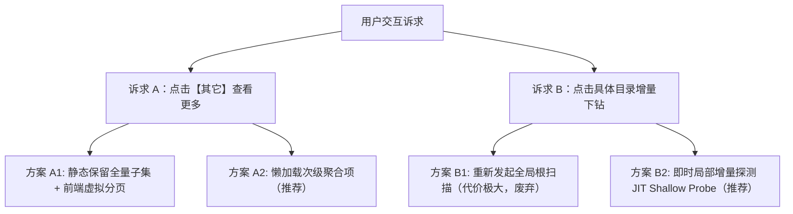
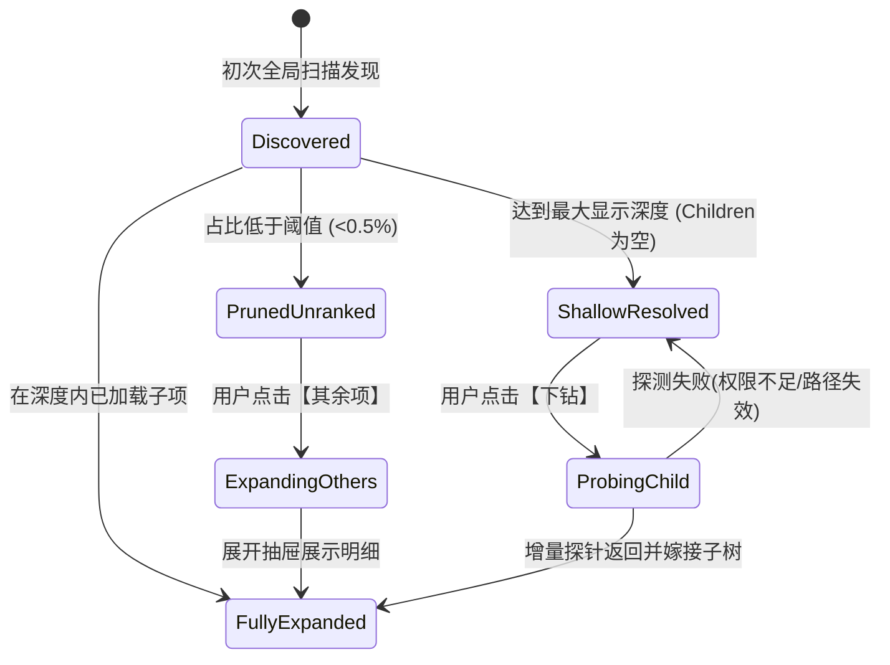

# 磁盘空间透视镜交互优化、微小项展开与按需增量下钻调研与方案设计

> **文档状态**：调研与方案就绪 (Ready for Architecture Implementation)  
> **面向对象**：后端工程师、前端架构师、AI Coding Agent  
> **所属模块**：`plugins/disk-explorer` (微服务插件) & 主系统联动管线  

---

## 目录
1. [背景与用户痛点剖析](#1-背景与用户痛点剖析)
2. [现有交互逻辑与架构瓶颈分析](#2-现有交互逻辑与架构瓶颈分析)
3. [核心功能诉求可行性论证](#3-核心功能诉求可行性论证)
   - 3.1 [诉求 A：支持点击“其它”查看更多目录与明细](#31-诉求-a支持点击其它查看更多目录与明细)
   - 3.2 [诉求 B：支持点击具体目录进入子目录并实时查询占用](#32-诉求-b支持点击具体目录进入子目录并实时查询占用)
4. [业界主流方案对比与经验借鉴](#4-业界主流方案对比与经验借鉴)
5. [系统现有基础设施复用评估](#5-系统现有基础设施复用评估)
6. [设计模式与架构优化设计](#6-设计模式与架构优化设计)
   - 6.1 [适配器与双轨策略模式 (Dual-Track Scanner Strategy)](#61-适配器与双轨策略模式-dual-track-scanner-strategy)
   - 6.2 [节点状态机与渐进式探测 (Node Lifecycle FSM)](#62-节点状态机与渐进式探测-node-lifecycle-fsm)
   - 6.3 [备忘录模式与局部树嫁接 (Memento Cache & Tree Grafting)](#63-备忘录模式与局部树嫁接-memento-cache--tree-grafting)
7. [技术与性能潜在陷阱与防御体系](#7-技术与性能潜在陷阱与防御体系)
8. [前后端接口与契约升级设计](#8-前后端接口与契约升级设计)
9. [实施路线图与测试门禁规范](#9-实施路线图与测试门禁规范)

---

## 1. 背景与用户痛点剖析

在日常 Linux 主机及特权 Docker 容器运维中，磁盘空间占满（Disk Full / No space left on device）是引发容器崩溃、数据库死锁、系统日志丢弃的最常见故障之一。

用户在使用当前的 **“磁盘空间透视镜” (`disk-explorer`)** 插件时，提出了以下极具代表性的优化诉求：
1. **交互逻辑优化**：当前完成一次分析后呈现的是静态只读树，交互方式较为单一；
2. **支持点击“其它”查看更多目录**：目前低于阈值的条目被合并为 `[其余 N 项微小内容]`，点击后无任何响应，用户无法获知微小项的具体组成；
3. **支持点击具体目录进入子目录并查询占用**：当用户在结果列表中看到某个深层目录（如 `/var/lib/docker/overlay2`）占用较大时，希望能够直接点击该目录，无缝下钻至下一级，并即时获取下一级的占用排行，而无需退出当前视图重新手动配置扫描路径。

---

## 2. 现有交互逻辑与架构瓶颈分析

对现有的 `plugins/disk-explorer` 源码进行全链路反思与审视，发现以下关键技术瓶颈：

### 2.1 “其它”（合成聚合组）的硬丢弃缺陷
- **现有后端逻辑**（[`manager.go#L190-228`](file:///e:/WorkProject/CSharp/PrivateProject/Web/WebToolForLinux/plugins/disk-explorer/internal/fsm/manager.go)）：
  在聚合剪枝阶段（`PruneTree`），只要子节点的空间占比低于阈值（如 `child.Percent < 0.5%`），系统将其标记为微小内容，统计 `prunedSize`、`prunedFiles`、`prunedDirs` 后，直接**将原始子节点从 `node.Children` 列表中切片剔除**，仅生成一个虚拟的 `&model.FolderNode{ Name: "[其余 N 项微小内容]", IsSyntheticGroup: true }`。
- **现有前端逻辑**（[`app.js#L500`](file:///e:/WorkProject/CSharp/PrivateProject/Web/WebToolForLinux/plugins/disk-explorer/ui/app.js)）：
  ```javascript
  const canDrillDown = child.isDir && !child.isSyntheticGroup && (child.children && child.children.length > 0);
  ```
- **后果**：
  原始被剪枝的 N 个目录/文件元数据已被后端完全丢弃！前端面对 `isSyntheticGroup: true` 只能禁用下钻，导致“其它”成为无法交互的死胡同。当 100 个微小日志文件合计占了 5GB 空间时，用户无法定位具体是哪些文件。

### 2.2 静态深度截断导致“深度撞墙”
- **现有后端逻辑**（[`fastwalk.go#L201-244`](file:///e:/WorkProject/CSharp/PrivateProject/Web/WebToolForLinux/plugins/disk-explorer/internal/scanner/fastwalk.go) & [`posixdu_adapter.go#L63`](file:///e:/WorkProject/CSharp/PrivateProject/Web/WebToolForLinux/plugins/disk-explorer/internal/scanner/posixdu_adapter.go)）：
  初次扫描默认受控于 `MaxDepth`（通常为 2 或 3）。一旦递归遍历到达 `currentDepth >= maxDepth`，内核仅通过 `filepath.WalkDir` 计算总大小并累加指标，**不再为该子目录创建任何嵌套子节点（`node.Children` 恒为 `nil` 或空切片）**。
- **现有前端逻辑**：
  用户从第 1 层逐级下钻至第 3 层后，由于该节点没有 `children`，下钻按钮不可点击。
- **后果**：
  若用户想了解第 3 层目录内部的空间分布，**必须复制路径 -> 滚动回顶部输入框 -> 粘贴修改路径 -> 重新点击“⚡ 启动极速分析” -> 重新等待全量进度条**。交互链路严重断层。

### 2.3 缺乏系统级联动（与文件管理和终端脱节）
- 分析出某临时文件或超大 core dump 文件后，用户无法一键在主系统的文件管理器中打开，也无法一键跳转至该目录下的 PTY 终端进行清理。

---

## 3. 核心功能诉求可行性论证



### 3.1 诉求 A：支持点击“其它”查看更多目录与明细

- **技术可行性**：**100% 可行**。
- **核心逻辑**：
  1. **保留被剪枝项的轻量结构**：后端在 `PruneTree` 时，不再粗暴地将剪枝项丢弃，而是将低占比项移入该节点的 `UnrankedChildren`（未入榜子集）或保留在合成组节点的 `Children` 中。
  2. **分页分批呈现（Chunking & Pagination）**：
     针对含有上万个细碎文件的目录（如 `node_modules`），前端绝不可一次性渲染全部节点（会导致 DOM 节点爆炸，浏览器卡死）。
     合成组节点应支持点击触发“展开抽屉”或“原地展开”，以每页 50 条的形式分页流式呈现，并附带名称过滤搜索框。

### 3.2 诉求 B：支持点击具体目录进入子目录并实时查询占用

- **技术可行性**：**100% 可行且性能极高**。
- **性能优势证明**：
  - 全局扫描耗时长的根源在于需要递归遍历整块磁盘（数十万乃至数百万文件）。
  - 而当用户点击特定深层目录（如 `/var/log` 或 `/app/plugins`）时，**该子目录下的直接子项通常只有几十到几百个**。
  - 针对该子目录发起单层增量探测（`Shallow Probe`，深度 1~2 层），POSIX `du -d 1` 或 Go 并发 `FastWalk` 耗时通常在 **15ms ~ 80ms** 之间，对用户而言几乎是瞬间响应！
- **操作体验革新**：
  - 点击带有“未展开/下钻”标识的目录项；
  - 前端若本地缓存已有子节点，直接平滑导航；
  - 若子节点尚未探测，局部状态机进入 `Probing` 状态（显示行内迷你转圈加载中），后端触发轻量级 JIT 增量下钻；
  - 增量结果返回后，**无缝嫁接（Grafting）** 到当前内存树中，面包屑无缝推进，无需重载整个页面。

---

## 4. 业界主流方案对比与经验借鉴

| 工具 / 方案 | 架构类型 | 树裁剪策略 (Pruning) | 下钻机制 (Drill-down) | 微小项展示策略 (Other Items) | 借鉴点与结论 |
| :--- | :--- | :--- | :--- | :--- | :--- |
| **DaisyDisk** (macOS 工业级标杆) | 原生桌面 App | 保留完整树，扇形图按角度阈值折叠 | 点击同心圆扇区瞬时聚焦下钻 | 归纳为 "Smaller items"，点击可在侧边抽屉中浏览分页列表 | **核心借鉴**：微小项采用折叠抽屉列表，下钻采用焦点视图置换。 |
| **NCDU** (Linux NCurses 终端经典) | 终端 C 二进制 | 不剪枝，完整载入内存树 | 回车进入选中子目录，即时展现 | 滚动列表展示全部，不设合成组 | **经验借鉴**：键盘交互高效，但 Web 端不适合无剪枝渲染全量 DOM。 |
| **GDU** (Go 原生高并发扫描器) | 终端 Go 应用 | 多协程并发收集，内存维持树状结构 | 交互式进入目录直接读取内存子树 | 列表直接展示，支持按大小/文件数排序 | **系统复用**：`disk-explorer` 已内置 `GduAdapter`，可直接吸纳其并发统计思路。 |
| **Baobab** (GNOME 磁盘占用分析器) | GTK 桌面应用 | 环形图与矩形树图双视图切换 | 双击扇区原地缩放，重新计算占比 | 细微项自动并入外圈空白条 | **视觉借鉴**：已落地树状排行 + Canvas 矩形树图（Squarified Treemap）。 |
| **1Panel / Cockpit Storage** | Web 运维面板 | 采用懒加载树状表格（Lazy TreeTable） | 点击折叠图标异步向后端拉取下一级 | 默认后端只返回当前目录直接子级（深度=1） | **架构借鉴**：结合“预热全局 Top N”与“按需懒加载下钻”，形成混合双模架构。 |

---

## 5. 系统现有基础设施复用评估

本方案不仅可行，且无需引入任何外部重量级依赖，系统现成的底层底座可以直接复用：

1. **命名空间穿透与特权适配器**：
   - 现有的 [`target.ContainerLocalTarget`](file:///e:/WorkProject/CSharp/PrivateProject/Web/WebToolForLinux/plugins/disk-explorer/internal/target/container.go) 与 [`target.HostPiercedTarget`](file:///e:/WorkProject/CSharp/PrivateProject/Web/WebToolForLinux/plugins/disk-explorer/internal/target/host.go) 已完整封装了容器与宿主机 PID1 挂载命名空间的穿透隔离机制（`nsenter` 与 `/proc/1/root`）。
   - 增量下钻完全复用该目标策略，无需重新编写底层穿透代码。

2. **多引擎并发扫描抽象**：
   - [`FastWalkEngine`](file:///e:/WorkProject/CSharp/PrivateProject/Web/WebToolForLinux/plugins/disk-explorer/internal/scanner/fastwalk.go) 与 [`PosixDuAdapter`](file:///e:/WorkProject/CSharp/PrivateProject/Web/WebToolForLinux/plugins/disk-explorer/internal/scanner/posixdu_adapter.go) 已实现良好的策略接口 `IScanEngineStrategy`。
   - 只需在接口中补充轻量级单层探测方法 `ProbeDirectory(ctx, target, path, depth)`，即可直接复用高效并发池。

3. **任务状态机与通信总线**：
   - [`TaskManager`](file:///e:/WorkProject/CSharp/PrivateProject/Web/WebToolForLinux/plugins/disk-explorer/internal/fsm/manager.go) 与 [`Task`](file:///e:/WorkProject/CSharp/PrivateProject/Web/WebToolForLinux/plugins/disk-explorer/internal/fsm/task.go) 已具备线程安全的读写锁（`RWMutex`）、取消通道（`context.CancelFunc`）与事件订阅体系。
   - 增量请求可挂载在现有会话中，形成复合状态机。

4. **主系统跨模块路由打通**：
   - 主系统已提供 `/files?target=...&path=...` 与 `/terminal?target=...&cwd=...`。
   - 磁盘透视镜可在每行结果添加快捷操作：**“📁 打开”**（跳转至主系统文件管理器）与 **“💻 终端”**（一键在该目录打开 PTY 终端）。

---

## 6. 设计模式与架构优化设计

### 6.1 适配器与双轨策略模式 (Dual-Track Scanner Strategy)

对于磁盘占用分析，单一的“全量批处理扫描”无法兼顾“全局宏观视图”与“局部即时交互”，系统升级为**双轨协同策略模式**：

```
                ┌───────────────────────────────┐
                │    IScanEngineStrategy        │
                ├───────────────────────────────┤
                │ + Scan(req)                   │  <-- 全局宏观扫描 (深度 2-3)
                │ + ProbeDirectory(path, depth) │  <-- 局部按需增量探测 (深度 1-2)
                └───────────────▲───────────────┘
                                │
        ┌───────────────────────┴───────────────────────┐
        │                                               │
┌───────┴──────────────┐                    ┌───────────┴──────────┐
│   FastWalkEngine     │                    │    PosixDuAdapter    │
├──────────────────────┤                    ├──────────────────────┤
│ 并发协程池 (16 线程) │                    │ 宿主特权穿透保底     │
│ 原生 POSIX 状态机    │                    │ du -k -x --max-depth │
└──────────────────────┘                    └──────────────────────┘
```

1. **宏观全局扫描轨（Macro Scan Track）**：
   - 负责初次分析，建立根目录骨架，快速产出系统级占用前 20 项高危目录。
2. **微观即时下钻轨（Micro JIT Probe Track）**：
   - 当用户在 UI 上点击某个未完全展开的目录时，毫秒级拉起局部探针，返回该目录下的直接子级排行，避免全盘重扫。

---

### 6.2 节点状态机与渐进式探测 (Node Lifecycle FSM)

每个目录节点从加载到交互，遵循以下生命周期状态机：



- **`Discovered`**：节点已被发现并具有准确的大小指标。
- **`PrunedUnranked`**：节点属于微小内容，归纳在微小项集合内，不再直接挤占主排行榜。
- **`ShallowResolved`**：节点大小已计算，但其下层子节点尚未枚举（避免初始阶段 I/O 浪费）。
- **`ProbingChild`**：行内处于异步探测状态，前端呈现微型进度动画。
- **`FullyExpanded`**：子项已就绪，用户可无缝在树图或排行中漫游。

---

### 6.3 备忘录模式与局部树嫁接 (Memento Cache & Tree Grafting)

为保障极致流畅度与防止对磁盘造成重复 I/O 冲击，采用**备忘录模式（Memento Pattern）**：

1. **内存树动态嫁接（Tree Grafting Algorithm）**：
   ```
   [Root (/)]
      ├── app (300 MB) [Expanded]
      │     └── wwwroot (250 MB) [Expanded]
      └── var (1.2 GB) [ShallowResolved: children=[]]
             │
             │ (用户点击 var 下钻 -> JIT 局部探针返回)
             ▼
      └── var (1.2 GB) [FullyExpanded]
             ├── log (800 MB) [ShallowResolved]
             ├── lib (350 MB) [ShallowResolved]
             └── cache (50 MB) [PrunedUnranked]
   ```
2. **会话缓存（In-Session Memento）**：
   - 所有已探测的子节点数据永久挂载在当前 `fullResultRoot` 内存树对象上。
   - 用户使用面包屑返回上一级或重新进入该目录时，**直接读取内存，0ms 瞬时渲染**。

---

## 7. 技术与性能潜在陷阱与防御体系

| 风险维度 | 潜在陷阱 | 影响与后果 | 终极防御机制 |
| :--- | :--- | :--- | :--- |
| **内存与渲染** | 细碎微小项（如 5 万个 cache 文件）点击展开时撑爆 DOM | 浏览器标签页卡死（OOM / High Layout Thrashing） | **前端虚拟分页加载**：每批限制渲染 50 条，支持关键字实时过滤与滚动到底部加载更多。 |
| **存储 I/O 抖动** | 用户连续快速点击多个目录触发并发下钻 | 磁盘 I/O 队列堆积，引发业务容器响应延迟 | **单并发节流锁（Single-Flight Probe Lock）**：针对同一目录只允许一个探针在途，新点击取消旧在途请求（`AbortController`）。 |
| **挂载点越界** | 增量下钻时穿透进入 CIFS / SMB / NFS 挂载卷 | 遭遇网络挂载断开，导致探针线程长期 D 状态挂起 | **严格继承 `-x` (OneFileSystem) 防御**：探针强制比对设备号（`stat.st_dev`），遇异构挂载直接跳过。 |
| **路径注入风险** | 用户伪造请求下钻敏感或受限路径 | 越权访问宿主非法目录 | **宿主敏感目录策略防御**：复用主系统 `HostCriticalPathGuard`，对非法路径（如 `/proc/kcore`）实施熔断拦截。 |
| **死循环与软链** | 递归软链接导致循环引用 | 内存无限膨胀，任务永不结束 | **Inode 访问环检测**：扫描器维护已访问 `dev_ino` 散列表，遇到已访问路径立即跳过。 |

---

## 8. 前后端接口与契约升级设计

为支持以上特性，微服务 `plugins/disk-explorer` 的 REST API 契约进行如下兼容性扩展：

### 8.1 增量单目录下钻接口 (JIT Sub-directory Probe)

- **路径**：`POST /api/scans/{taskId}/probe`
- **请求体 (JSON)**：
  ```json
  {
    "subPath": "/var/log",
    "depth": 1,
    "oneFileSystem": true
  }
  ```
- **响应体 (JSON)**：
  ```json
  {
    "success": true,
    "data": {
      "path": "/var/log",
      "sizeBytes": 838860800,
      "humanSize": "800.0 MB",
      "children": [
        {
          "name": "journal",
          "path": "/var/log/journal",
          "sizeBytes": 629145600,
          "humanSize": "600.0 MB",
          "percent": 75.0,
          "isDir": true,
          "children": []
        },
        {
          "name": "nginx",
          "path": "/var/log/nginx",
          "sizeBytes": 157286400,
          "humanSize": "150.0 MB",
          "percent": 18.7,
          "isDir": true,
          "children": []
        }
      ],
      "unrankedCount": 12,
      "unrankedBytes": 52428800,
      "unrankedHumanSize": "50.0 MB"
    }
  }
  ```

### 8.2 微小聚合项明细获取接口 (Expand Synthetic Group)

- **路径**：`GET /api/scans/{taskId}/unranked?path={encodedPath}&page=1&pageSize=50&keyword=`
- **响应体 (JSON)**：
  ```json
  {
    "success": true,
    "data": {
      "parentPath": "/app",
      "totalUnranked": 84,
      "totalBytes": 10485760,
      "humanSize": "10.0 MB",
      "items": [
        { "name": ".env", "sizeBytes": 1024, "humanSize": "1.0 KB", "isDir": false },
        { "name": "temp.log", "sizeBytes": 512, "humanSize": "512 B", "isDir": false }
      ],
      "hasMore": true
    }
  }
  ```

### 8.3 主系统前端联动支持

在树状排行每行末尾的操作列：
- 增加 **“📁 定位”** 按钮：点击调用 `window.parent.postMessage({ type: 'LWT_NAVIGATE', path: '/files', query: { target: currentTarget, path: child.path } })`，直接在主系统文件管理器中浏览该目录；
- 增加 **“💻 终端”** 按钮：点击调用 `window.parent.postMessage({ type: 'LWT_NAVIGATE', path: '/terminal', query: { target: currentTarget, cwd: child.path } })`，直接在主系统终端中打开。

---

## 9. 实施路线图与测试门禁规范


### 实施路线图
1. **阶段 1：后端剪枝优化与探针接口实现**（耗时约 25 分钟）：
   - 修改 `manager.go` 中的 `PruneTree`，保留未入榜微小项切片；
   - 在 `FastWalkEngine` 与 `PosixDuAdapter` 中实现单层探测 `ProbeDirectory`；
   - 在 `server.go` 中注册 `POST /api/scans/{taskId}/probe` 与 `GET /api/scans/{taskId}/unranked`。
2. **阶段 2：前端微小项抽屉与虚拟分页**（耗时约 20 分钟）：
   - 点击 `[其余 N 项微小内容]` 弹出优雅的侧边抽屉或悬浮面板；
   - 支持分页展示、关键字筛选与直接查看每个小文件大小。
3. **阶段 3：前端动态嫁接与 JIT 增量下钻**（耗时约 20 分钟）：
   - 当点击 `children` 为空的目录时，行内显示加载动画并触发 `probe`；
   - 将返回的子树动态替换到当前内存树中，面包屑推进，树图与排行榜联动平滑重绘。
4. **阶段 4：系统级联动与快捷操作**（耗时约 10 分钟）：
   - 在操作栏增设 `📁 文件` 与 `💻 终端` 跳转入口，打通运维闭环。
5. **阶段 5：验证与验收**（耗时约 15 分钟）：
   - 本地前端与代码门禁；
   - 通过 `scripts/hot-update-mcp-bridge.ps1` 规范或部署管线部署；
   - 使用 Chrome DevTools MCP 对容器与宿主环境进行双轨真实点击验证。

---

## 10. 总结

本调研与架构方案彻底根除了磁盘空间透视镜目前**“微小项是死胡同”**与**“深度受限后无法深入”**的两大体验断点。通过引入**双轨协同策略模式**、**渐进式探测状态机**与**内存树局部嫁接算法**，在保障磁盘 I/O 极低开销和防止前端 DOM 崩溃的前提下，赋予用户无限层级、毫秒级即时探索磁盘占用的极致交互体验。
