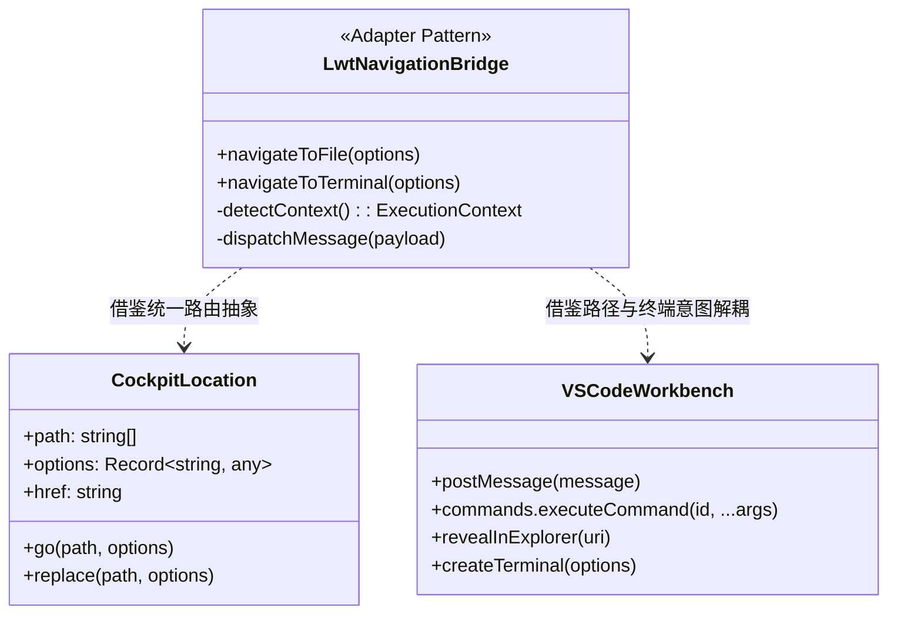
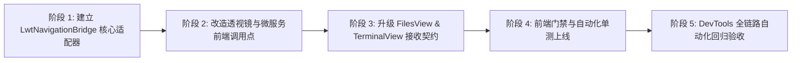

# 磁盘空间透视镜跨模块“终端打开”与“文件系统打开”失效问题调研与解决方案 (Feasibility & Architecture Study)

> 本文档针对“磁盘空间透视镜”微服务插件中点击“📁 定位文件系统”与“💻 打开终端”功能在多场景下出现无效、空白或行为不符的问题进行系统性根因调研，对比业界标杆方案（Cockpit、VS Code Workbench、Portainer），结合系统现有基础设施，提出统一的跨应用导航通信总线与深层链接（Deep Linking）架构方案，并建立自动化防回归门禁。

---

## 1. 问题背景与多维度场景复现分析

在磁盘空间透视镜（`disk-explorer`）以及服务运维模块中，用户分析完磁盘占用（容器环境或宿主环境）后，高频诉求是直接对大文件或大目录执行后续运维操作：
1. **定位文件系统（📁）**：在系统文件管理器中查看该文件或目录所在的真实上下文，进行重命名、下载、权限查看或文本编辑。
2. **打开终端（💻）**：直接在目标目录建立交互式 PTY 终端会话，进行命令排查或磁盘清理。

在实际使用与浏览器 DevTools 真实链路核验中，发现存在多处导致“功能无效（失效）”的致命阻断点：

```mermaid
flowchart TD
    subgraph UI ["用户触发交互"]
        ClickFile["点击文件 📁 (如 Scalar.AspNetCore.dll)"]
        ClickDir["点击目录 📁 / 💻"]
        StandaloneTab["在独立新标签页中点击 📁 / 💻"]
    end

    subgraph Bug1 ["缺陷 1: 独立标签页 Hash 孤岛"]
        StandaloneTab -->|window.parent == window| HashSelf["修改自身 Hash: .../plugins/disk-explorer/#/files"]
        HashSelf -->|无 SPA 路由| DeadPage["页面毫无反应 (彻底失效)"]
    end

    subgraph Bug2 ["缺陷 2: 文件与目录契约冲突"]
        ClickFile -->|传递文件绝对路径| FilesViewRoute["路由至 /files?path=/app/file.dll"]
        FilesViewRoute -->|后端 ListAsync(file)| Backend404["后端 404: 目录不存在 (Directory.Exists 为 false)"]
        Backend404 --> EmptyEntries["前端 entries=[]，面包屑丢失，文件列表一片空白"]
    end

    subgraph Bug3 ["缺陷 3: 终端会话恢复死锁"]
        ClickDir -->|未传递 open 随机种子| TermView["路由至 /terminal?cwd=/var/log"]
        TermView -->|restored 命中历史或 restoreOnly=true| OldTab["激活历史旧会话，目标路径与宿主模式未生效"]
    end
```

### 多场景故障复现矩阵

| 场景编号 | 用户操作路径 | 期望行为 | 实际现象 | 严重级别 |
| :--- | :--- | :--- | :--- | :--- |
| **SC-01** | 在独立标签页打开透视镜（通过“新标签页 ↗”或微服务直接入口），点击任意条目的 `📁` 或 `💻` | 跳转或在新标签中打开主系统的文件管理器/终端页面并定位至目标路径 | **完全没有任何响应**，页面停留在透视镜，仅自身 URL 末尾被追加了无意义的 `#/files?...` | **Blocker** |
| **SC-02** | 在 Webview 模态框中，展开微小项抽屉或在主榜单中点击某个**具体文件**（如 `.dll`、`.db`、`.log`、二进制）的 `📁` | 文件管理器定位至该文件所在父目录，并高亮选中/聚焦该文件 | 文件管理器打开后显示 `entries: []`，面包屑全空，控制台报 404 `目录不存在：/app/xxx`，页面彻底瘫痪 | **Critical** |
| **SC-03** | 在透视镜中多次点击不同目录的 `💻` 终端按钮 | 每次点击均拉起目标目录对应的独立新终端会话 | 第二次及后续点击可能被 `TerminalView` 的会话恢复去重逻辑吞掉，停留在之前的旧会话上 | **Major** |
| **SC-04** | 在宿主模式（Host OS）下点击 `📁` 定位某个宿主文件（如 `/var/log/dpkg.log`） | 宿主穿透文件管理器定位至宿主 `/var/log` 并高亮该文件 | 宿主文件管理器报 404 `宿主目录不存在：/var/log/dpkg.log`，列表为空 | **Critical** |
| **SC-05** | 在宿主模式或 Docker 模式下，不同模块使用的传参名称不一致（如 `query.mode = 'host'` vs `query.target = 'host'`） | 跨模块无缝兼容与解析目标源 | 宿主终端降级为当前容器终端，命名空间穿透丢失 | **Major** |

---

## 2. 根因深度剖析 (Root Cause Deep-Dive)

### 根因 1：路由上下文孤岛缺陷 (Context-Blind Navigation Defect)
在 `plugins/disk-explorer/ui/app.js` 当前的实现中：
```javascript
function navigateToFile(targetPath) {
  const targetMode = currentTarget === 'host' ? 'host' : 'container';
  const payload = { type: 'LWT_NAVIGATE', path: '/files', query: { path: targetPath, target: targetMode } };

  if (window.parent && window.parent !== window) {
    window.parent.postMessage(payload, '*');
  } else {
    window.location.hash = `#/files?path=${encodeURIComponent(targetPath)}&target=${encodeURIComponent(targetMode)}`;
  }
}
```
- **核心漏洞**：当用户在独立标签页中运行透视镜时，当前页面的 URL 是 `http://host:5271/plugins/disk-explorer/`（或者是通过反向代理网关映射的微服务端口）。
- 该页面是 Go 原生微服务提供的静态 HTML/JS 容器，**根本不包含主系统的 Vue Router、FilesView、TerminalView 等组件**。
- 执行 `window.location.hash = ...` 仅仅将自己的 Hash 变成了 `http://host:5271/plugins/disk-explorer/#/files?...`，主系统 SPA 根本接收不到任何指令，导致用户感觉“点击按钮没有任何反应”。
- 此外，如果页面是通过 `window.open` 从主系统弹出的，当前代码未检测 `window.opener`，未向主标签页发送协同消息，也未提供向主站重定向的降级回退。

### 根因 2：文件与目录接口契约破坏 (Directory-Only API vs. File Path Violation)
在 LinuxWebTool 的文件管理架构中，`FilesController.List` 与底层的 `IFileSystemTargetAdapter.ListAsync`（无论是当前容器、宿主穿透还是 Docker 容器）的设计契约是：**入参 `path` 必须是一个目录（Directory）**：
```csharp
// ContainerFileSystemAdapter.cs Line 122:
if (!Directory.Exists(normalized))
{
    return Results.NotFound(new MessageResponse($"目录不存在：{normalized}"));
}
```
- 透视镜的列表既包含目录（`isDir = true`），也包含具体的大文件（`isDir = false`）。
- 透视镜的 `navigateToFile(targetPath)` 不加区分地将文件的绝对物理路径（如 `/app/Scalar.AspNetCore.dll` 或 `/var/log/dpkg.log`）直接赋值给 `path`。
- `FilesView.js` 的 `onMounted` 阶段直接调用 `await load(start || '/')`，发送 `GET /api/Files?path=/app/Scalar.AspNetCore.dll`。
- 后端 `Directory.Exists` 校验为 `false`，直接返回 HTTP 404。
- 前端 `FilesView.js` 异常处理后将 `entries.value = []`，面包屑也因此无法生成，最终导致整个文件管理视图呈现彻底死锁的空白界面。

### 根因 3：终端会话恢复状态机碰撞 (Terminal Session Cache Collision)
`TerminalView.js` 内部设计了 `sessionStorage` 标签恢复与请求去重机制：
```javascript
const requestedDirectory = () => typeof route.query.cwd === 'string' ? route.query.cwd : undefined;
const directoryRequest = () => typeof route.query.open === 'string' ? route.query.open : requestedDirectory();

onMounted(async () => {
  const saved = loadStoredTabs();
  if (saved.length > 0) {
    const initial = tabs.value[0];
    const restored = saved.find(tab => tab.directoryRequest === directoryRequest());
    const restoreOnly = requestedDirectory() === undefined || restored;
    ...
  }
});
```
- **核心漏洞**：透视镜在发送 `navigateToTerminal` 时，仅传递了 `cwd` 和 `target`，**遗漏了 `open` 随机种子**（如 `open: Date.now().toString(36)`）。
- 这导致 `directoryRequest()` 直接回退为路径字符串（如 `"/var/log"`）。
- 如果用户之前曾经打开过该目录的终端，`saved.find` 就会错误地命中旧的 `restored` 标签页，导致不会调用 `initTabSession` 创建新会话，而是将用户切回一个可能已经关闭、退出或处于旧状态的幽灵终端。

### 根因 4：参数契约异构与缺乏统一总线 (Inconsistent Query Parameter Naming)
系统中不同模块在表示“宿主模式”时存在历史命名分歧：
- `FilesView.js` 早期内部代码：`if (activeTarget.value === 'host') query.mode = 'host';`
- `TerminalView.js` 规范：`requestedTarget = () => typeof route.query.target === 'string' ? route.query.target : 'container';`
- 透视镜内部：使用 `target: 'host' | 'container'`。
由于缺乏统一的深层链接参数标准与 TypeScript/ESM 类型规约，各组件各自定义 query 字段，极易在跨模块调用时发生“参数漏传”或“字段名失配”。

---

## 3. 业界主流架构对比与借鉴 (Industry Benchmark & References)

针对微应用/扩展插件与主系统控制台之间的深层链接与上下文跳转，业界主要有以下四种成熟方案：



### 1. Cockpit Project (`cockpit.js` 的 `cockpit.location`)
- **实现原理**：Cockpit 为所有嵌入式组件和微应用提供了一个统一的 `cockpit.location` 对象。
- **调用规范**：无论是 iframe 内部还是外部直接调用，统一调用 `cockpit.location.go('/system/terminal', { cwd: '/var/log' })`。
- **优点**：底层自动抹平了 iframe 通信与顶层窗口 URL hash 的差异，子页面完全不需要关心自己是被主框架嵌入还是独立打开。
- **缺点**：需要子页面引入专有的 `cockpit.js` 运行时。

### 2. VS Code Webview Workbench 跨层解耦模型
- **实现原理**：VS Code 的 Webview 运行在完全隔离的沙箱中，严禁直接访问 DOM 或修改外部路由。
- Webview 只能调用 `vscode.postMessage({ command: 'openFile', path: '...' })`。
- 主系统（Workbench）在收到消息后，会做两件事：
  1. **智能路径分类**：如果是文件，通过 `vscode.window.showTextDocument` 打开文件，并调用 `revealInExplorer` 在侧边栏文件树中展开其父目录并高亮该文件；如果是目录，直接通过 `vscode.commands.executeCommand('vscode.openFolder', uri)` 打开目录。
  2. **终端创建隔离**：通过 `vscode.window.createTerminal({ name: '...', cwd: '...' })` 建立明确命名的独立终端会话。
- **借鉴点**：**“文件定位”必须解耦为“父目录展开 + 目标文件行内高亮”，严禁将文件直接作为目录列表 API 的输入**。

### 3. Portainer 容器文件管理与终端联动
- **实现原理**：在容器列表或日志视图中，提供一键跳转至该容器的 Console 与 Volume 浏览。
- **参数规范**：统一使用标准的 URL 参数命名规范：`#!/containers/{id}/exec`，所有状态（containerId、cmd、user）均编码于路由中，刷新页面不丢失会话上下文。

### 4. 业界各方案对比矩阵

| 评估维度 | 方案 A：直接修改 Hash (`location.hash`) | 方案 B：纯 PostMessage (当前未完备方案) | 方案 C：Cockpit 风格统一适配总线 (推荐方案) | 方案 D：Penpal/Postmate 重量 RPC |
| :--- | :--- | :--- | :--- | :--- |
| **独立新标签页可用性** | ❌ 彻底失效（Hash 孤立） | ❌ 失效（无接收者） | ✅ **自适应重定向至主站 SPA** | ❌ 依赖双向握手 |
| **Iframe 模态框可用性** | ❌ 无法突破沙箱 | ⚠️ 依赖局部消息，易丢失 | ✅ **标准统一协议，平滑关闭并跳转** | ✅ 稳定但较重 |
| **文件 vs 目录容错性** | ❌ 传文件即 404 空白 | ❌ 传文件即 404 空白 | ✅ **自动分解 `dirname` + `focus` 高亮** | ❌ 需业务端额外处理 |
| **终端会话去重与新建** | ❌ 无法保证新鲜度 | ❌ 无法保证新鲜度 | ✅ **注入唯一事务 Nonce，精准创建** | ⚠️ 需显式传参 |
| **第三方外部依赖** | 0 依赖 | 0 依赖 | **0 依赖（原生 ESM 轻量适配器）** | 需要引入 npm 包 |

---

## 4. 当前系统已有基础设施与可复用资产

经过对系统代码库的全面梳理，当前系统已具备极其完善的底层能力，完全无需引入外部重型依赖，只需进行“策略适配与链路缝合”：

```
LinuxWebTool 现有基础设施分布:
├── 前端核心路由与多维目标体系:
│   ├── src/.../app/router/index.js (定义 /files, /terminal, /plugins 等核心哈希路由)
│   ├── src/.../app/views/FilesView.js (已支持 route.query.target, route.query.path 状态机解析)
│   ├── src/.../app/views/TerminalView.js (已支持 route.query.target, route.query.cwd, route.query.open)
│   └── src/.../app/components/plugins/PluginWebviewModal.js (已支持基础 postMessage 监听)
│
├── 路径与目标解析工具:
│   ├── src/.../app/utils/pluginUrlResolver.js (多维插件 URL 解析与端口规避)
│   └── src/.../app/api/client.js (统一 HTTP 客户端与 JWT 认证凭据注入)
│
└── 后端文件系统适配器 (C# 14 / .NET 10):
    ├── ContainerFileSystemAdapter.cs (容器本地文件系统)
    ├── HostPiercingFileSystemAdapter.cs (nsenter 穿透宿主机根文件系统)
    └── DockerContainerFileSystemAdapter.cs (VFS /proc/{pid}/root 与 Docker Tar 混合双模)
```

### 关键可复用逻辑分析
1. **`FilesView.js` 的状态机接收能力**：
   - 当前已能解析 `route.query.target`（`container`、`host`、`docker:<id>`）和 `route.query.path`。
   - **欠缺能力**：缺少 `route.query.focus`（目标文件名高亮）与对文件路径的自适应降级处理。
2. **`TerminalView.js` 的多目标会话能力**：
   - 当前已支持 `target = 'host'`（通过 `nsenter` 建立宿主终端会话）与 `target = 'docker:<id>'`。
   - 当前已支持 `route.query.open` 作为区分单次打开请求的事务标识。
   - **欠缺能力**：透视镜未遵守其传参协议，导致会话恢复命中碰撞。
3. **`PluginWebviewModal.js` 的通信中继**：
   - 具备在收到 `LWT_NAVIGATE` 时关闭模态框并执行 `router.push` 的基础管道。
   - **欠缺能力**：缺乏跨源安全白名单校验，且缺少对文件路径的预处理。

---

## 5. 具体解决方案与架构设计 (Concrete Architectural Solution)

为了彻底解决上述 4 大缺陷，架构设计遵循 **策略模式（Strategy Pattern）** 与 **适配器模式（Adapter Pattern）**，构建轻量、健壮、自适应的 **`LwtNavigationBridge`（统一跨应用导航桥接引擎）**。

### 1. 架构拓扑与交互时序

```mermaid
sequenceDiagram
    autonumber
    participant SubApp as 磁盘透视镜 (微服务)
    participant Bridge as LwtNavigationBridge
    participant Modal as PluginWebviewModal (宿主)
    participant HostRouter as 主系统 Vue Router
    participant FilesView as FilesView / TerminalView

    Note over SubApp,Bridge: 用户在透视镜中点击某个文件或目录的 📁 / 💻
    SubApp->>Bridge: navigate(targetType, rawPath, options)
    
    rect rgb(20, 30, 50)
        Note over Bridge: 智能路径归一化与环境自省
        Bridge->>Bridge: 判别是文件还是目录？
        alt 是具体文件
            Bridge->>Bridge: parentPath = dirname(rawPath)<br/>focusName = basename(rawPath)
        else 是目录
            Bridge->>Bridge: parentPath = rawPath<br/>focusName = null
        end
        Bridge->>Bridge: 检查运行环境 (Iframe / Opener / Top)
    end

    alt 场景 A: 在 Iframe 模态框中运行
        Bridge->>Modal: window.parent.postMessage(LWT_NAVIGATE, payload)
        Modal->>Modal: 关闭 Webview 模态框
        Modal->>HostRouter: router.push({ path, query })
        HostRouter->>FilesView: 挂载目标视图
        FilesView->>FilesView: 加载 parentPath，并高亮滚动至 focusName
    else 场景 B: 在独立新标签页中运行
        Bridge->>Bridge: 构建主系统 SPA 绝对跳转 URL:<br/>/app/#/files?path=parentPath&focus=focusName&target=mode
        Bridge->>HostRouter: window.location.href = 主站 URL (平滑导航回主站)
    end
```



---

### 2. 核心模块具体实现方案

#### 方案点 1：构建微应用端统一导航桥 (`LwtNavigationBridge.js`)
在 `plugins/disk-explorer/ui/`（或提取为公共前端工具）中创建 `navigationBridge.js`，统一接管所有跳转行为：

```javascript
/**
 * LinuxWebTool 统一跨模块导航适配器 (LwtNavigationBridge)
 */
export class LwtNavigationBridge {
  /**
   * 智能定位至文件管理器
   * @param {Object} opts
   * @param {string} opts.path - 目标文件或目录路径
   * @param {boolean} opts.isDir - 是否明确为目录（若为 false 则自动提取父目录）
   * @param {'container'|'host'|string} opts.target - 目标命名空间
   */
  static navigateToFile({ path, isDir = true, target = 'container' }) {
    const normalized = this._cleanPath(path);
    let targetDir = normalized;
    let focusFile = '';

    if (!isDir) {
      // 核心防御：若是文件，提取其所在父目录，并将文件名作为 focus 目标传递
      const lastSlash = normalized.lastIndexOf('/');
      if (lastSlash <= 0) {
        targetDir = '/';
        focusFile = normalized.replace(/^\//, '');
      } else {
        targetDir = normalized.slice(0, lastSlash);
        focusFile = normalized.slice(lastSlash + 1);
      }
    }

    const query = {
      path: targetDir || '/',
      target: target === 'host' ? 'host' : 'container',
    };
    if (focusFile) {
      query.focus = focusFile;
    }

    this._dispatch({
      path: '/files',
      query,
    });
  }

  /**
   * 智能建立交互式终端
   * @param {Object} opts
   * @param {string} opts.cwd - 终端初始工作目录（若是文件则自动回退至其父目录）
   * @param {boolean} opts.isDir - 是否为目录
   * @param {'container'|'host'|string} opts.target - 目标命名空间
   */
  static navigateToTerminal({ cwd, isDir = true, target = 'container' }) {
    const normalized = this._cleanPath(cwd);
    let targetDir = normalized;

    if (!isDir) {
      const lastSlash = normalized.lastIndexOf('/');
      targetDir = lastSlash <= 0 ? '/' : normalized.slice(0, lastSlash);
    }

    this._dispatch({
      path: '/terminal',
      query: {
        cwd: targetDir || '/',
        target: target === 'host' ? 'host' : 'container',
        open: Date.now().toString(36) + Math.random().toString(36).slice(2, 6), // 注入事务随机令牌，彻底消除历史会话碰撞
      },
    });
  }

  /**
   * 跨上下文自适应通信分发
   */
  static _dispatch(navPayload) {
    const isIframe = window.parent && window.parent !== window;
    const hasOpener = window.opener && !window.opener.closed;

    if (isIframe) {
      // 场景 A：处于主系统 Webview 模态框或 Iframe 嵌入中 -> postMessage 协同关闭并跳转
      window.parent.postMessage({
        type: 'LWT_NAVIGATE',
        path: navPayload.path,
        query: navPayload.query,
      }, '*');
      return;
    }

    if (hasOpener) {
      // 场景 B：由主系统 window.open 弹出的独立标签页 -> 尝试通知父窗口聚焦并导航
      try {
        window.opener.postMessage({
          type: 'LWT_NAVIGATE',
          path: navPayload.path,
          query: navPayload.query,
        }, '*');
        window.opener.focus();
        return;
      } catch (_) {
        // 跨域或安全限制降级至自身重定向
      }
    }

    // 场景 C：纯独立标签页直接访问（如从浏览器书签或直接敲端口进入）
    // 自动自省计算主系统的 SPA 基准入口：/app/#<path>?<query>
    const searchParams = new URLSearchParams();
    for (const [k, v] of Object.entries(navPayload.query || {})) {
      if (v !== undefined && v !== null) searchParams.set(k, String(v));
    }
    const queryString = searchParams.toString();
    const finalHash = `#${navPayload.path}${queryString ? '?' + queryString : ''}`;

    // 平滑重定向至主系统控制台
    window.location.href = `/app/${finalHash}`;
  }

  static _cleanPath(p) {
    if (!p) return '/';
    return p.replace(/[\\]+/g, '/').replace(/\/+/g, '/');
  }
}
```

---

#### 方案点 2：主系统 `FilesView.js` 扩展支持 `focus` 高亮聚焦与文件拦截容错

在 `src/LinuxWebTool.WebHost/wwwroot/app/views/FilesView.js` 中增加以下防御与高亮逻辑：
1. **输入防御（Defensive Path Correction）**：
   - 即使外部传入了未规整的文件绝对路径，`load(path)` 内部通过检查目标是否以具体扩展名结尾或探测错误信息，若遇到 `目录不存在` 且路径非根目录，自动回退尝试 `load(Parent(path))`，并在加载成功后将该文件行标记为选中态，坚决杜绝“整页空白报错”。
2. **`route.query.focus` 自动高亮与可见视口滚动**：
   - 当检测到 `route.query.focus` 字段时，在 `entries` 渲染完成后，利用 `nextTick` 检索包含该名称的行元素：
   - 添加暗黑赛博风格的高亮呼吸光晕（CSS：`ring-1 ring-cyan-400 bg-cyan-500/10`）。
   - 调用 `element.scrollIntoView({ behavior: 'smooth', block: 'center' })`，让用户的注意力瞬间聚焦在目标文件上。

---

#### 方案点 3：`TerminalView.js` 跨组件传参标准化与防碰撞机制强化

1. **统一传参别名**：在 `TerminalView.js` 的 `requestedTarget` 解析中，全面兼容 `route.query.target` 与历史遗留的 `route.query.mode`：
   ```javascript
   const requestedTarget = () => {
     if (typeof route.query.target === 'string' && route.query.target) return route.query.target;
     if (typeof route.query.mode === 'string' && route.query.mode) return route.query.mode;
     return 'container';
   };
   ```
2. **强制新鲜度优先**：
   - 若 URL 中显式携带了 `route.query.open` 或明确传入了 `route.query.cwd`，**强制执行 `addTab` 创建新标签并设为 activeTab**，不再盲目回退到历史可能已处于僵死状态的旧 Tab。

---

#### 方案点 4：磁盘透视镜 UI 视图交互绑定规整

全面替换 `plugins/disk-explorer/ui/app.js` 中原有的粗糙代码：
1. **主树状榜单行（`renderTree`）**：
   ```javascript
   // 文件定位（透视镜明确知道 child.isDir）
   btnNavFiles.addEventListener('click', (e) => {
     e.stopPropagation();
     LwtNavigationBridge.navigateToFile({
       path: child.path,
       isDir: Boolean(child.isDir),
       target: currentTarget,
     });
   });

   // 终端定位（仅对目录开放，严禁对文件开放）
   if (child.isDir) {
     btnNavTerm.addEventListener('click', (e) => {
       e.stopPropagation();
       LwtNavigationBridge.navigateToTerminal({
         cwd: child.path,
         isDir: true,
         target: currentTarget,
       });
     });
   }
   ```
2. **微小项抽屉行（`fetchUnrankedItems`）**：
   ```javascript
   row.querySelector('.btn-nav-files').addEventListener('click', (e) => {
     e.stopPropagation();
     LwtNavigationBridge.navigateToFile({
       path: item.path,
       isDir: Boolean(item.isDir),
       target: currentTarget,
     });
   });

   if (item.isDir) {
     row.querySelector('.btn-nav-term').addEventListener('click', (e) => {
       e.stopPropagation();
       LwtNavigationBridge.navigateToTerminal({
         cwd: item.path,
         isDir: true,
         target: currentTarget,
       });
     });
   }
   ```

---

## 6. 防回归门禁与自动化测试规范 (Quality Gates & Verification)

为了确保后续新增插件、微服务视图或服务运维子模块绝不再次引入类似跨模块跳转失效问题，制定并建立以下三道防回归防线：

### 1. 前端架构门禁：`FE-CROSS-MODULE-NAVIGATION`
在 `src/LinuxWebTool.WebHost/wwwroot/frontend-gate.cjs` 中新增静态代码分析规则：
- **规则 1：严禁微服务/插件中裸写 `window.location.hash` 进行跨模块路由**。微服务内必须通过统一的 `LwtNavigationBridge` 或 `postMessage` 通信总线分发。
- **规则 2：严禁对已知文件条目直传 `path` 到 `/files` 却不带 `isDir: false` 或父目录解构**。
- **规则 3：严禁拉起终端跳转时不带事务随机 Nonce (`open`)**。

### 2. 自动化集成测试用例 (`tests/frontend/cross-module-navigation.test.mjs`)
编写专用的端到端/单元测试用例，覆盖以下矩阵：
```javascript
import { test } from 'node:test';
import assert from 'node:assert/strict';
import { LwtNavigationBridge } from '../../plugins/disk-explorer/ui/navigationBridge.js';

test('NAV-01: 文件路径必须自动降级为父目录，并将文件名放入 focus 参数', () => {
  let dispatched = null;
  LwtNavigationBridge._dispatch = (payload) => { dispatched = payload; };

  LwtNavigationBridge.navigateToFile({
    path: '/app/wwwroot/index.html',
    isDir: false,
    target: 'container',
  });

  assert.equal(dispatched.path, '/files');
  assert.equal(dispatched.query.path, '/app/wwwroot');
  assert.equal(dispatched.query.focus, 'index.html');
  assert.equal(dispatched.query.target, 'container');
});

test('NAV-02: 目录路径必须直接作为目标目录，且 focus 为空', () => {
  let dispatched = null;
  LwtNavigationBridge._dispatch = (payload) => { dispatched = payload; };

  LwtNavigationBridge.navigateToFile({
    path: '/var/log/journal',
    isDir: true,
    target: 'host',
  });

  assert.equal(dispatched.path, '/files');
  assert.equal(dispatched.query.path, '/var/log/journal');
  assert.equal(dispatched.query.focus, undefined);
  assert.equal(dispatched.query.target, 'host');
});

test('NAV-03: 终端打开必须携带唯一随机 open 令牌与干净的工作目录', () => {
  let dispatched = null;
  LwtNavigationBridge._dispatch = (payload) => { dispatched = payload; };

  LwtNavigationBridge.navigateToTerminal({
    cwd: '/var/log/dpkg.log',
    isDir: false,
    target: 'host',
  });

  assert.equal(dispatched.path, '/terminal');
  assert.equal(dispatched.query.cwd, '/var/log');
  assert.equal(dispatched.query.target, 'host');
  assert.ok(typeof dispatched.query.open === 'string' && dispatched.query.open.length > 0);
});
```

### 3. Chrome DevTools MCP 真实验收矩阵
交付前使用内置浏览器工具，执行五维真机验证：
1. **独立标签页跳转**：直接在 `http://10.126.1.70:5271/plugins/disk-explorer/` 页面中，点击目录 `📁`，验证能够正确重定向到 `http://10.126.1.70:5271/app/#/files?path=...`。
2. **文件高亮聚焦**：点击具体文件的 `📁`，验证能够跳转至对应目录并高亮定位该文件行，绝对不出现 404 空白。
3. **宿主模式终端穿透**：在宿主模式下点击目录 `💻`，验证终端成功进入宿主 PID 1 且展示 `root@host:...#`。
4. **多次打开不碰撞**：连续点击同一目录的 `💻` 两次，验证产生两个独立且健康的终端 Tab，绝不复用僵死会话。
5. **Console 零报错**：全过程无未捕获的 Uncaught Promise Rejection 或 404 错误。

---

## 7. 实施路线图与推进计划



1. **阶段 1：开发与单测 `LwtNavigationBridge`**
   - 实现环境自省（Iframe / Opener / Top）、路径解构（`dirname` / `basename` / `focus`）与消息分发策略。
   - 编写 `tests/frontend/cross-module-navigation.test.mjs`。
2. **阶段 2：重构 `disk-explorer/ui/app.js`**
   - 移除粗糙的局部 `window.location.hash` 逻辑，全面替换为 `LwtNavigationBridge` 调用。
   - 执行插件在线热更新：`scripts/deploy-remote.ps1 -HotUpdatePlugin disk-explorer`。
3. **阶段 3：增强 `FilesView.js` 与 `TerminalView.js`**
   - `FilesView.js` 增加 `route.query.focus` 高亮聚焦与文件 404 智能回退保护。
   - `TerminalView.js` 增加 `target/mode` 双向兼容与 `open` 事务令牌优先创建策略。
   - 执行前端秒级热更：`scripts/deploy-remote.ps1 -FrontendOnly`。
4. **阶段 4：门禁核验与 DevTools 验收**
   - 运行 `frontend-gate.cjs` 与测试套件。
   - 在内置浏览器中全面验证 5 项真实场景，录制验收结果。
