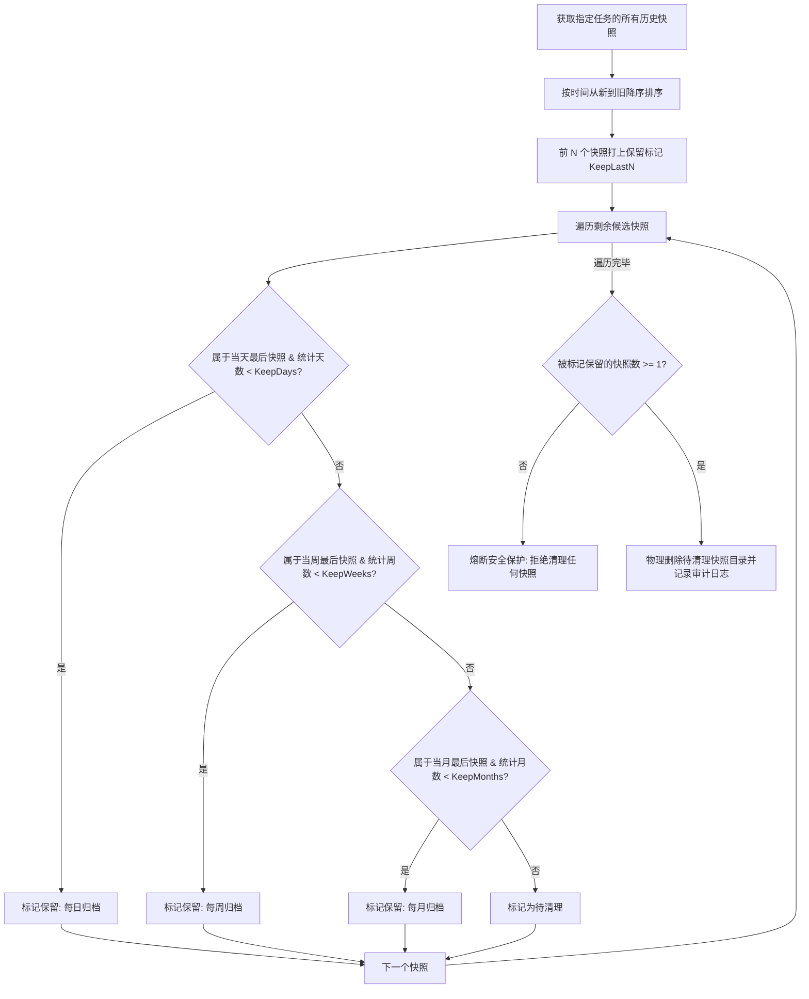
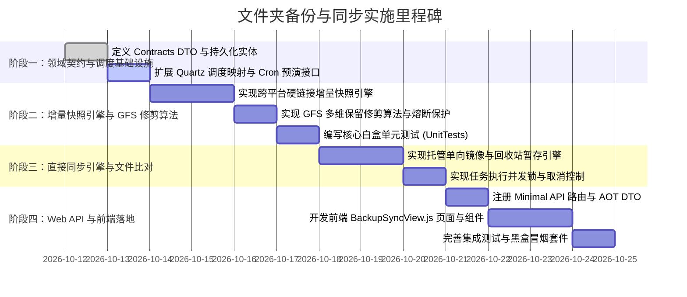

# 文件夹备份与同步功能可行性调研与预览方案

> **状态**：调研与方案规划 (RFC / Preview Plan)  
> **创建日期**：2026-10-11  
> **目标模块**：存储与媒体 (Storage) -> 文件夹备份与同步 (`/backup-sync`)

---

## 一、需求背景与目标

LinuxWebTool 作为家庭/私有 Linux 服务器的一站式 Web 管理工具，目前已具备基础文件浏览编辑、挂载管理（SMB/WebDAV/Rclone）以及媒体转码等功能。但在关键数据的**持续可用性**与**灾难恢复**方面，仍缺少统一、自动化的**文件夹级备份与同步**能力。

### 核心需求要点
1. **定向文件夹防护**：支持指定本地或挂载目录作为源文件夹，进行多模式的同步与备份；
2. **全粒度定时调度**：支持按年、月、周、日、时、分、秒灵活设定自动触发周期（如每天凌晨 2 点、每小时一次等）；
3. **多维生命周期轮转（GFS 保留策略）**：按最近“日 / 周 / 月”分层保留特定快照数量，自动淘汰过期版本；
4. **双轨同步/备份模式**：
   - **直接同步 (Direct Sync)**：源到目标的目录树镜像保持最新，兼顾双向或单向，注重即时可用；
   - **增量备份 (Incremental Backup)**：多版本快照回溯，仅备份变动数据，注重历史防篡改与勒索/误删恢复；
5. **架构决策研判**：深度分析“备份”与“同步”两项功能是否需要拆开做，给出明确设计方案与权衡结论。

---

## 二、架构决策：备份与同步是否需要拆开做？

这是本方案中最关键的架构与产品设计问题。在业界存储工程中，**“同步不是备份”（Sync is NOT Backup）** 是一条铁律。

### 2.1 本质差异对比矩阵

| 评估维度 | 直接同步 (Synchronization) | 版本备份 (Backup) |
|---|---|---|
| **核心目标** | **状态一致性 (Consistency)**：追求目标与源端一致，强调“最新可用”。 | **历史可恢复性 (Recoverability)**：追求任意时间点的状态保留，强调“灾难回滚”。 |
| **致命弱点** | **错误扩散 (Fault Propagation)**：若源端发生误删、文件损坏或遭遇勒索病毒，同步程序会**忠实且迅速地将破坏同步到目标端**，导致两端数据同时丢失。 | 备份需要消耗额外存储来存储历史增量，且还原时需要“恢复步骤”，无法直接作为工作目录访问。 |
| **数据组织形式** | 目标端始终是单个完整的当前目录树。 | 目标端是多个时间切片快照（Snapshot Timeline）或专有归档格式。 |
| **生命周期管理** | 无版本概念，最多包含一个临时的“删除回收站”缓冲区。 | 具备严格的保留策略（如保留 7 天每日、4 周每周、12 个月每月快照），由修剪（Prune）算法调度。 |
| **恢复操作行为** | 目标即源，无需恢复（或者手动反向覆盖拷贝）。 | 明确的“选择快照点 -> 预览差异 -> 一键恢复到原目录/新目录”。 |

### 2.2 架构设计结论与推荐方案

#### 结论：**“统一模块纳管，但操作模型与执行引擎彻底拆分”**（Unified UI Module, Segregated Workflows）

1. **为什么不能强行糅合在一起？**
   - 如果试图用同一个任务表单混淆“同步”与“备份”，用户很可能会以为配置了“每小时单向同步”就已经做好了“备份”，一旦文件被误删，下一个小时同步触发后目标文件也被删除，造成灾难性数据丢失。
   - 两种模式的配置参数完全正交：同步关注“镜像删除开关、冲突覆盖规则”；备份关注“快照格式、GFS 保留份数、恢复点查看”。
2. **为什么不需要拆成两个完全独立的顶层菜单页面？**
   - 底层技术资产重合度高达 70%：共用文件系统树探针、共用 Quartz Cron 调度引擎、共用目录选择弹窗组件（`FilePicker`）、共用后台执行日志与限流锁；
   - 拆成两个菜单页面（如 `/sync` 和 `/backup`）会导致前端导航冗余，碎片化用户体验。
3. **最终方案**：
   - 统一设立一级菜单入口：`存储与媒体` -> `备份与同步`（路由 `/backup-sync`）；
   - 页面内部设立清晰的两个功能选项卡（Tabs）以及一个共享时间线：
     - **Tab 1: 同步任务 (`Sync Tasks`)**：专注单向镜像/双向同步，标明“维持最新镜像”；
     - **Tab 2: 备份任务 (`Backup Tasks`)**：专注多版本增量快照与 GFS 轮转，标明“版本防护与历史回滚”；
     - **Tab 3: 快照库与恢复 (`Snapshots & Restore`)**：展示历史快照时间线、容量占用，提供快照内容浏览与一键还原。

---

## 三、关键技术可行性深度调研

### 3.1 调度系统可行性：全粒度定时（秒/分/时/日/周/月/年）

- **现状基石**：项目已集成了 `Quartz.Extensions.Hosting 3.18.2` 并拥有 `CronHelper.cs`。
- **技术可行性**：**100% 可行**。
  - Quartz 原生支持 6/7 段表达式：`[秒] [分] [时] [日] [月] [周] [年(可选)]`。
  - 项目原有的 `CronHelper` 已实现 Unix 5 段与 Quartz 6 段的自动归一化转换；
  - 调度粒度完全覆盖：
    - 秒级/分级：如 `0 0/15 * * * ?`（每 15 分钟）；
    - 日级：如 `0 0 2 * * ?`（每天凌晨 2 点 0 分 0 秒）；
    - 周级：如 `0 0 3 ? * SUN`（每周日凌晨 3 点）；
    - 月级：如 `0 0 4 1 * ?`（每月 1 号凌晨 4 点）；
    - 年级：如 `0 0 0 1 1 ? *`（每年 1 月 1 日午夜）。
- **前端输入友好度设计**：
  - 提供“预设快捷模式”（下拉选择：每小时 / 每天 / 每周 / 每月 / 指定间隔）与“高级 Cron 表达式”双模切换；
  - 自动调用后端解析接口，在前端实时回显“未来 5 次预计触发时间列表”，防止 Cron 写错导致频繁非预期执行。

---

### 3.2 增量备份技术路线对比与选型

增量备份的核心挑战是：**如何在频繁备份的情况下，既不浪费海量磁盘空间，又能保证每个历史版本可独立完整读取**。

| 方案 | 原理 | 优势 | 劣势 | 选型结论 |
|---|---|---|---|---|
| **方案 A：基于文件系统硬链接快照 (Hardlink-based Snapshot)** | 类似 `rsync --link-dest` / Linux `cp -al` / Time Machine。每次备份生成一个形如 `20261011_020000/` 的完整目录；未修改文件通过硬链接指向前一次快照，已修改/新增文件写入新文件。 | 1. **物理空间极小**：未变动文件仅消耗一个 inode 引用；<br>2. **每个快照都是完整目录**：可直接进入任意快照文件夹查阅/拷走文件；<br>3. **清理极简安全**：删除任意旧快照，只要文件仍被其他快照引用，数据块绝不丢失；<br>4. **恢复极快**：无需重放增量链。 | 跨盘（跨不同文件系统卷）不能建立硬链接；Windows FAT32 不支持（NTFS 和 Linux 均完美支持）。 | **主推核心方案**（本地与同盘/同卷备份最佳实践） |
| **方案 B：时间戳差异增量压缩包 (Differential Zip/Tar.gz)** | 首次全量打包 `full.zip`，之后仅将最后修改时间大于上次备份的文件打包为 `inc_xxx.zip`。 | 1. 跨卷、跨网络、云存储均通用；<br>2. 压缩节省空间。 | 恢复必须重放全量包加后续所有增量包，链条断裂则损坏；查看单个历史文件繁琐。 | **作为备选归档方案**（导出为单文件离线备份时使用） |
| **方案 C：现代去重快照引擎集成 (Restic / Rclone)** | 借助 `restic` 内容寻址分块去重库。 | 块级去重、原生加密、支持云存储目标。 | 需要外部二进制依赖与密码库初始化，系统复杂度较高。 | **后续进阶扩展方案**（针对远端云存储备份） |

**推荐决策**：首期核心实现 **方案 A（跨平台 C# 原生硬链接增量快照引擎）**，并在同一存储卷或 Linux 挂载盘中提供极致的性能与秒级回溯体验。

---

### 3.3 保留与轮转策略（GFS 算法）可行性

用户要求：**按最近月/周/日保留特定数量**。

#### GFS (Grandfather-Father-Son) 算法设计
配置模型：
- `KeepDays` (Son): 保留最近 $D$ 天的每日快照（每天保留最后 1 次快照）；
- `KeepWeeks` (Father): 保留最近 $W$ 周的每周快照（每周保留周日最后 1 次快照）；
- `KeepMonths` (Grandfather): 保留最近 $M$ 个月的每月快照（每月保留末日最后 1 次快照）；
- `KeepLastN`: 兜底保障，无论时间跨度，无条件保留最近生成的 $N$ 个快照。

#### 修剪淘汰判定流程（Deterministic Pruning Engine）：


**关键安全保护守则**：
1. **熔断底线保护**：任何情况下，至少保留最新的 1 份有效快照，绝不允许算法计算异常导致全部清空；
2. **Dry-Run 预演机制**：在执行真实清理前，支持调用接口返回“将被删除的快照清单及可释放预估空间”，供用户确认；
3. **元数据防篡改**：每个快照目录下生成 `manifest.json`，记录快照创建时间戳、文件总数、总大小、源路径等签名信息。

---

### 3.4 直接同步（Direct Sync）技术路线

对于直接同步功能：
- **模式分类**：
  1. **单向增量镜像（Mirror / One-way）**：目标目录始终保持与源目录一致，源端新增/修改则覆盖目标端，源端删除的文件可配置：
     - `ImmediateDelete`：直接删除；
     - `MoveToTrash`：移动到目标端的 `.trash_yyyyMMdd/` 回收站保留若干天；
  2. **单向累加同步（Backup-copy / Add-only）**：源端删除，目标端永久保留不删除。
- **引擎实现**：
  - C# 纯原生托管遍历器（基于 `DirectoryInfo` 与 `FileInfo`），比对 `Length` 与 `LastWriteTimeUtc`；
  - 批量并行复制（使用 `Parallel.ForEachAsync`，限制并发度 4~8，避免磁盘 IO 打满）；
  - 跨平台、零依赖、100% 适配 Native AOT。

---

### 3.5 快照库批量清理与生命周期治理体系 (Batch Cleanup & Lifecycle Management)

针对备份长期运行后的磁盘膨胀，**快照库必须提供完整、多维度的“批量清理”支持**，兼顾“自动化轮转清理”与“管理员手动批量清理”，并配备高标准的安全防护。

#### 1. 批量清理的三种运作模式

| 批量清理模式 | 触发方式与交互场景 | 适用需求与用户心智 |
|---|---|---|
| **模式 A：手动勾选批量清理 (Manual Multi-Select)** | 用户在快照列表前端通过表格 Checkbox 自由勾选多个快照（支持一键“全选当前页 / 全选所有”），点击 **“批量删除 (Batch Delete)”**。 | 针对特定测试产生的无用快照、或人工挑选无价值的时间点进行批量删除。 |
| **模式 B：基于规则条件快速批量清理 (Range/Rule Batch Prune)** | 提供条件清理浮窗：<br>1. **“清理早于指定日期”**（如清理 90 天前全部快照）；<br>2. **“仅保留最近 N 个快照”**（批量删除其余所有老旧快照）；<br>3. **“按时间范围区间清理”**（如删除 2026-01-01 至 2026-06-30 之间的非周快照）。 | 磁盘空间告急时，管理员快速释放指定历史区间所占用的空间。 |
| **模式 C：按 GFS 策略一键批量修剪 (Policy-based Pruning)** | 点击 **“按保留策略一键清理 (Prune Overdue)”**，系统根据该任务绑定的 GFS 规则（7天/4周/12月），自动甄别并批量清理所有未被规则命中的超期快照。 | 日常标准化维护，与自动定时轮转算法保持完全一致的修剪逻辑。 |

#### 2. 安全防护网与误删防御机制 (Safety Guardrails)

批量删除涉及高危文件破坏操作，系统内建四重安全底线：

1. **快照置顶/锁定保护 (Pin / Lock Snapshot)**：
   - 用户可以为具有重大意义的历史节点（如“大版本发布前快照”、“2026年终决算归档”）打上 **`[Pinned 🔒]` 锁定标记**；
   - **铁律约束**：不论是自动 GFS 轮转修剪、按规则清理、还是用户在前端点击“全选批量删除”，**只要快照处于锁定状态，底层引擎绝对跳过、禁止删除**！用户必须显式先解锁才能删除。
2. **底线熔断保护 (Preserve Latest Guard)**：
   - 严禁通过批量删除把一个任务的快照库彻底清空。**无论任何批量清理指令，系统底层强制拦截，至少保留最新 1 份有效快照**，防止用户误点全选导致容灾能力完全丧失。
3. **在途任务互斥锁 (In-Progress Lock)**：
   - 正在执行备份写入的目标快照、以及正在被作为恢复源读取的快照，处于加锁状态，批量清理请求直接跳过并告警提示。
4. **清理演练预演 (Dry-Run Preview & Double Check)**：
   - 批量清理必须支持 Dry-Run 预演：在物理执行前返回待清理清单、涉及文件数、预估释放空间、以及被保护跳过的锁定快照数量；
   - 前端弹窗显式展示并要求用户进行二次确认。

#### 3. 硬链接机制下的物理空间释放原理解析 (Hardlink Space Reclamation)

在基于硬链接（Hardlink）的增量备份体系中，批量清理的空间释放具有特殊物理特性：
- **单个文件物理块释放条件**：只有当该文件的硬链接计数（Link Count）降为 0 时，操作系统才会真正释放磁盘物理块；
- **清理效应**：若某个文件在 10 个快照中均未发生修改（指向同一个 inode），仅删除其中 1 个快照只减少 1 个引用，**不会释放该文件的物理存储空间**；只有当该文件只在某一个快照存在（例如老版本被修改替换，或该文件被删除），删除持有该版本的所有快照后，空间才会真正释放；
- **工程启示**：**批量清理连续的一整批历史快照（如一次性清理 3 个月前的全部连续快照），释放的实际物理空间远大于分散删除单点快照**。因此系统提供空间预估分析（Reclaim Estimator），引导用户优先以时间段进行批量清理。

---

## 四、数据模型与 API 设计（Contracts）

所有契约放置在 `LinuxWebTool.Contracts`，遵循纯 BCL、零外部依赖原则，并通过 `AppJsonSerializerContext` 注册以保证 Native AOT 序列化兼容。

### 4.1 契约模型设计

```csharp
namespace LinuxWebTool.Contracts.Features.BackupSync.Contracts;

public enum TaskMode
{
    Sync = 1,     // 直接同步
    Backup = 2    // 增量版本备份
}

public enum SyncDirection
{
    OneWayMirror = 1,   // 单向镜像（目标跟随源端）
    OneWayAddOnly = 2   // 单向累加（源端删除时不删目标）
}

public enum DeleteHandling
{
    PermanentDelete = 1, // 立即永久删除
    MoveToTrash = 2      // 暂存到目标回收站
}

/// <summary>备份同步任务定义实体/DTO</summary>
public sealed record BackupSyncTaskItem
{
    public Guid Id { get; init; }
    public string Name { get; init; } = string.Empty;
    public TaskMode Mode { get; init; } = TaskMode.Backup;
    public string SourcePath { get; init; } = string.Empty;
    public string TargetPath { get; init; } = string.Empty;
    public bool Enabled { get; init; } = true;

    // 调度配置（Quartz Cron）
    public string CronExpression { get; init; } = "0 0 2 * * ?"; // 默认每日凌晨2点
    public string CronDescription { get; init; } = "每天 02:00";

    // 同步专属配置 (Mode == Sync)
    public SyncDirection SyncDirection { get; init; } = SyncDirection.OneWayMirror;
    public DeleteHandling DeleteHandling { get; init; } = DeleteHandling.MoveToTrash;
    public int TrashRetentionDays { get; init; } = 30;

    // 增量备份专属配置 (Mode == Backup)
    public int KeepLastCount { get; init; } = 5;      // 兜底保留最近 N 次
    public int KeepDays { get; init; } = 7;           // 保留最近 D 天
    public int KeepWeeks { get; init; } = 4;          // 保留最近 W 周
    public int KeepMonths { get; init; } = 12;        // 保留最近 M 月

    // 过滤排除规则
    public List<string> ExcludePatterns { get; init; } = []; // 如 [".tmp", "node_modules", ".git"]

    // 运行状态跟踪
    public DateTime? LastRunTime { get; init; }
    public string? LastRunStatus { get; init; } // Success / Failed / Running
    public string? LastRunMessage { get; init; }
    public DateTime? NextRunTime { get; init; }
}

/// <summary>快照元数据记录</summary>
public sealed record BackupSnapshotItem
{
    public string SnapshotId { get; init; } = string.Empty; // 目录名 如 20261011_020000
    public Guid TaskId { get; init; }
    public DateTime CreatedAt { get; init; }
    public long TotalFiles { get; init; }
    public long TotalSizeBytes { get; init; }
    public string SnapshotPath { get; init; } = string.Empty;
    public string Tag { get; init; } = string.Empty; // Daily / Weekly / Monthly / Manual
    public bool IsPinned { get; init; } = false;    // 是否已锁定保护（防止批量清理误删）
    public string? Note { get; init; }              // 用户自定义快照备注
}

/// <summary>批量删除快照请求</summary>
public sealed record BatchDeleteSnapshotsRequest
{
    public Guid TaskId { get; init; }
    public List<string> SnapshotIds { get; init; } = []; // 手动勾选的 SnapshotId 列表
    public DateTime? OlderThan { get; init; }             // 可选：早于此时间的快照
    public int? KeepLatestCount { get; init; }            // 可选：仅保留最新 N 个
    public bool SkipPinned { get; init; } = true;         // 是否自动跳过已锁定快照（默认强安全保护）
}

/// <summary>批量删除快照执行与演练结果</summary>
public sealed record BatchDeleteSnapshotsResult
{
    public int TotalTargeted { get; init; }               // 命中的目标快照总数
    public int DeletedCount { get; init; }                // 实际删除/预演删除的快照数
    public int SkippedPinnedCount { get; init; }          // 因锁定而被保护跳过的快照数
    public long EstimatedReclaimedBytes { get; init; }    // 预估释放的磁盘空间字节数
    public List<string> AffectedSnapshotIds { get; init; } = [];
}

/// <summary>锁定/解锁快照请求</summary>
public sealed record TogglePinSnapshotRequest
{
    public bool Pinned { get; init; }
    public string? Note { get; init; }
}

/// <summary>保留修剪预演结果</summary>
public sealed record PrunePreviewResult
{
    public List<BackupSnapshotItem> KeptSnapshots { get; init; } = [];
    public List<BackupSnapshotItem> PrunedSnapshots { get; init; } = [];
    public long ReclaimableSizeBytes { get; init; }
}
```

### 4.2 RESTful API 端点清单

| HTTP 方法 | 路由路径 | 授权 | 功能说明 |
|---|---|---|---|
| `GET` | `/api/BackupSync/Tasks` | Authorize | 查询所有备份与同步任务列表 |
| `POST` | `/api/BackupSync/Tasks` | Authorize | 创建新任务（带路径有效性检验） |
| `PUT` | `/api/BackupSync/Tasks/{id}` | Authorize | 更新任务配置（自动重排 Quartz 计划） |
| `DELETE` | `/api/BackupSync/Tasks/{id}` | Authorize | 删除任务定义（可选择是否保留已备份数据） |
| `POST` | `/api/BackupSync/Tasks/{id}/Run` | Authorize | 立即触发一次任务执行（异步队列） |
| `GET` | `/api/BackupSync/Tasks/{id}/Snapshots` | Authorize | 获取指定备份任务的历史快照时间线 |
| `GET` | `/api/BackupSync/Snapshots/{id}/Files` | Authorize | 浏览指定快照内的文件树目录 |
| `POST` | `/api/BackupSync/Snapshots/{id}/Restore` | Authorize | 提交还原请求（源目录回滚或还原到指定新目录） |
| `PUT` | `/api/BackupSync/Snapshots/{id}/Pin` | Authorize | 切换快照加锁/解锁状态（防止批量清理误删） |
| `POST` | `/api/BackupSync/Snapshots/BatchDeletePreview` | Authorize | 批量清理演练（Dry-Run）：测算待清理快照与释放空间 |
| `POST` | `/api/BackupSync/Snapshots/BatchDelete` | Authorize | **执行批量清理**：删除所选或符合规则的快照（受底线与锁定保护） |
| `GET` | `/api/BackupSync/Tasks/{id}/PrunePreview`| Authorize | 预演 GFS 保留修剪，查看待删除快照清单 |
| `POST` | `/api/BackupSync/Tasks/{id}/PruneExecute`| Authorize | 执行 GFS 策略批量修剪 |
| `POST` | `/api/BackupSync/CronPreview` | Authorize | 传入 Cron 表达式，返回未来 5 次计算时间点 |

---

## 五、前端页面与交互方案（UI Preview）

### 5.1 页面布局原型预览

在 `/backup-sync` 路由下，整体布局采用统一的卡片与标签页流式设计：

```
+---------------------------------------------------------------------------------------+
|  文件夹备份与同步 (Folder Backup & Sync)                              [ + 新建任务 ]   |
+---------------------------------------------------------------------------------------+
| [概览卡片]                                                                            |
|  有效任务: 6 个       今日已备份: 14.2 GB      快照总计: 48 个      状态: 全部正常     |
+---------------------------------------------------------------------------------------+
|  [ 备份任务 (Backup) ]      [ 同步任务 (Sync) ]      [ 快照库与恢复 (Snapshots) ]       |
+---------------------------------------------------------------------------------------+
|  任务名称        | 源路径 -> 目标路径             | 调度频率       | 保留策略  | 上次运行  | 操作    |
+----------------+-------------------------------+--------------+----------+---------+---------+
| [备份] 文档归档  | /data/docs -> /backup/docs    | 每天 02:00    | 7天/4周/12月| 成功(2h前)| 执行 编辑|
| [备份] 配置文件  | /etc/nginx -> /backup/nginx   | 每6小时       | 保留10次 | 成功(1h前)| 执行 编辑|
| [同步] 照片镜像  | /photos -> /mnt/smb/photos    | 实时/每30分钟  | 镜像回收站| 正在同步 | 停止 编辑|
+---------------------------------------------------------------------------------------+
```

### 5.2 核心操作流程图解

#### 1. 创建增量备份任务步骤（Modal 向导）
1. **基础设置**：输入任务名称（如“项目代码每日归档”），选择模式：`增量备份 (多版本快照)`；
2. **路径选择**：源路径使用系统自带 `FilePicker` 选取，目标路径选择专用备份根目录；
3. **定时调度（全粒度）**：
   - 切换“简单模板”或“高级 Cron”；
   - 勾选：`每天 03:00:00`，下方自动展示：
     - *下一次执行: 2026-10-12 03:00:00*
     - *后续执行: 2026-10-13 03:00:00, 2026-10-14 03:00:00 ...*
4. **GFS 保留策略设置**：
   - 保留最近连续执行数：`[ 5 ]` 次
   - 保留最近每日快照数：`[ 7 ]` 天
   - 保留最近每周快照数：`[ 4 ]` 周
   - 保留最近每月快照数：`[ 12 ]` 个月
5. **排除规则**：输入排除通配符，如 `node_modules`, `*.tmp`, `*.cache`。

#### 2. 快照查看与一键恢复流程
1. 点击某任务的 **“查看快照”** 进入快照时间线；
2. 查看时间轴上的快照节点：
   - `2026-10-11 02:00:00` [每日归档] 4.2 GB (2,100 文件)
   - `2026-10-10 02:00:00` [每日归档] 4.1 GB (2,050 文件)
   - `2026-10-04 02:00:00` [每周归档] 3.8 GB (1,920 文件)
3. 点击任意快照节点，可在线展开目录树查看该时间点的具体文件；
4. 点击 **“还原此快照”**：
   - 弹窗提示：选择 `原地覆盖还原`（将清空或覆盖原目录至快照状态）或 `还原到新建目录`（如 `/restore/20261011/`）；
   - 执行后台还原作业，展示进度条。

---

## 六、分阶段实施路线图



### 自动化验证与质量门禁规划
1. **白盒单元测试 (`LinuxWebTool.UnitTests`)**：
   - `GfsRetentionPruningTests`：设计 30 个不同时间跨度快照样本，断言各保留参数下保留集与修剪集的精确匹配；
   - `CronExpressionPrecisionTests`：验证秒级到年级各 Cron 表达式的合法解析与未来 5 次计算；
   - `HardlinkEngineTests`：在临时测试目录验证硬链接建立、未修改文件引用共享、修改文件独立物理分配；
2. **黑盒集成测试 (`LinuxWebTool.IntegrationTests`)**：
   - 验证通过 REST API 创建、更新、立即触发备份任务全流程；
   - 验证快照文件列表查看与还原 API 行为；
3. **架构门禁与 CI/CD**：
   - 保证新增类型在 `AppJsonSerializerContext` 注册，符合 Native AOT 零反射要求；
   - 自动纳入门禁脚本 `./scripts/verify-fast.ps1` 与 GitHub Actions CI 流水线。
