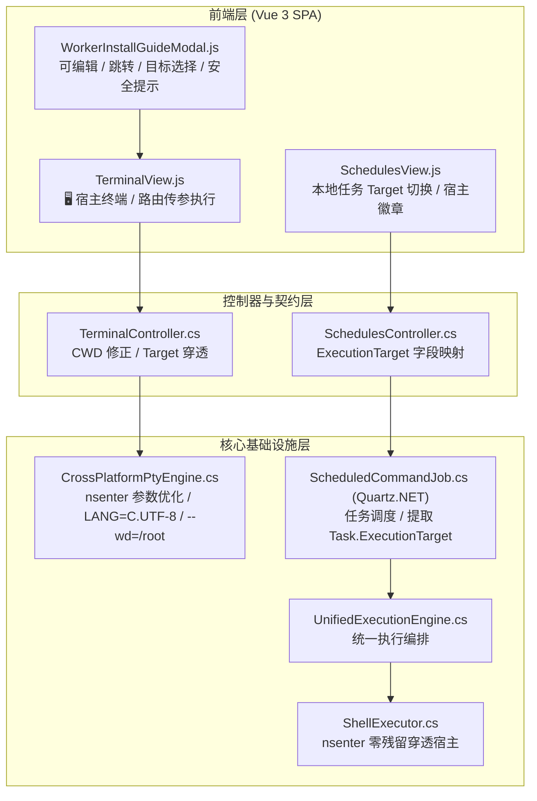

# 宿主终端 Locale 与路径净化、函数微服务安装引导跨宿主边界与定时任务宿主穿透调研及方案

## 1. 背景与核心问题梳理

在 LinuxWebTool（下称 LWT）支持 Docker 特权容器穿透宿主（Host Target via `nsenter`）后，通过真实生产环境验证与测试，识别出以下三项核心场景与问题：

### 1.1 Web 宿主终端交互与日志输出问题
用户在 Web 终端打开「🖥️ + 宿主终端」时，终端控制台输出了如下内容：
```text
[正在连接后台终端...]
[终端已连接成功]
[工作目录: /app]

bash: warning: setlocale: LC_ALL: cannot change locale (en_US.UTF-8)
locale: Cannot set LC_CTYPE to default locale: No such file or directory
locale: Cannot set LC_MESSAGES to default locale: No such file or directory
locale: Cannot set LC_ALL to default locale: No such file or directory
root@R7:/# ls
abc  boot  dev  etc  initrd.img  lib  lib64  logs  lwt  mnt  proc  run  srv  tmp  var  vmlinuz.old ...
root@R7:/# cd /root/
root@R7:~# ls
...
```
**问题分析**：
1. **工作目录提示假象**：前端提示 `[工作目录: /app]`，但实际穿透宿主后初始落地为 `root@R7:/#`（宿主机根本没有 `/app` 目录）。这是因为 `TerminalController` 在未传 `workingDirectory` 时默认取了容器当前目录（`/app`），并在会话元数据中返回给前端，与宿主真实环境脱节。
2. **Locale 告警骚扰**：容器基础镜像（如 Alpine / Debian）通常预设了 `LC_ALL=en_US.UTF-8` 或 `LANG=en_US.UTF-8`，Pty 进程继承了容器环境变量并传递给了 `nsenter`。宿主机（如极简 Debian/Ubuntu/RHEL 系统或仅生成了 `zh_CN.UTF-8` / `C.UTF-8` 的系统）因缺少 `en_US.UTF-8` 本地化数据文件，导致 `bash` 启动时频繁输出 4 行 `setlocale` 警告，干扰体验并可能导致后续命令字符编码混乱。
3. **初始落地目录不够人性化**：用户进入宿主终端后落在 `/` 根目录，往往需要手动执行 `cd /root/` 或 `cd ~` 才能访问自己的管理工作区。

---

### 1.2 函数微服务依赖安装引导与跨宿主访问/运行边界
**核心需求**：
函数微服务（Workers）的依赖安装引导弹窗是否能像扩展服务（Extensions）一样：
1. 支持**命令在线编辑**；
2. 支持点击不同 Linux 发行版预设命令自动回填；
3. 支持在特权容器下**选择执行对象（📦 当前容器 vs 🖥️ 宿主主机）**；
4. 支持「💻 在终端中执行」**一键跳转终端并自动下发执行**。

**关键疑虑：是否会存在「容器中服务跨宿主无法访问和运行」的问题？**
- **答案：必然存在，且存在三个维度的物理隔离冲突！**
  1. **解释器与依赖孤岛（Filesystem Isolation）**：
     - LWT 的 Worker 微服务（如 Node.js / Python / Go 脚本）是由运行在容器内的 C# 进程通过 `Process.Start(...)` 直接拉起的。
     - 若用户在安装引导中选择「🖥️ 宿主主机」并在宿主执行了 `apt install python3`，该解释器位于**宿主机**根文件系统 `/usr/bin/python3`。
     - **容器内部因 Mount Namespace 隔离，根本无法访问宿主的 `/usr/bin/python3`**！容器内的 `WorkersManager` 启动 Worker 时依然会报错 `⚠️ 缺少解释器运行时: python3`。
  2. **代码存储路径映射（Storage Path Mismatch）**：
     - Worker 源码保存在 `data/workers/<id>/`（容器内物理路径 `/app/data/workers/<id>/`）。
     - 宿主机的命名空间中不存在 `/app` 目录（除非用户在宿主和容器间做了特定挂载）。若试图把 Worker 放到宿主执行，宿主无法通过相同路径找到脚本文件。
  3. **网络与端口暴露边界（Network Isolation）**：
     - 若容器为 bridge 网络模式，Worker 在容器内监听的动态端口宿主机无法直接访问；只有当容器为 `--net=host`（或通过 LWT Gateway 反向代理网关转发）时，宿主与容器端口才完全互通。

---

### 1.3 定时任务（Schedules）支持宿主/容器执行目标
**核心需求**：
定时任务在检测到当前为特权容器模式时，本地主机执行模式下是否能像指令管理页面一样，支持选择执行对象为「📦 当前容器」或「🖥️ 宿主主机（nsenter 穿透）」？
- **可行性分析**：
  - **100% 可行且高度契合**！
  - LWT 的底层核心 `ShellExecutor` 和 `ExecutionModels` 已经完整实现了 `ExecutionTarget`（`"container"` vs `"host"`），具备通过 `nsenter -t 1 -m -u -i -n -p -- /bin/bash -c "..."` 穿透宿主执行、自动注入运维环境变量（`LWT_TARGET`, `LWT_IS_PRIVILEGED`）且宿主机零磁盘文件残留的能力。
  - 只需打通：
    1. 数据持久化：`ScheduleTask` 实体新增 `ExecutionTarget` 字段，并在 SQLite 中执行结构自愈兼容；
    2. 调度执行：Quartz.NET 的 `ScheduledCommandJob` 在本地主机调度时，将 `task.ExecutionTarget` 传递至 `CommandExecutionContext`；
    3. 前端交互：`SchedulesView.js` 新建/编辑弹窗提供 Target 单选切换，任务卡片展示「🖥️ 宿主」徽章。

---

## 2. 业界主流方案调研与对比

| 系统 / 方案 | 穿透/宿主执行机制 | Locale 环境变量处理 | 跨容器/宿主依赖管理策略 | 定时任务调度机制 |
| :--- | :--- | :--- | :--- | :--- |
| **Kubernetes (k9s / kubectl-node-shell)** | 借助特权 Pod 挂载宿主 PID 命名空间，执行 `nsenter -t 1 -m -u -i -n -p` | 强制指定 `/usr/bin/env -u LC_ALL LANG=C.UTF-8`，消除各种宿主发行版 setlocale 错误 | 严格区分 Pod 容器内依赖与 Node 宿主依赖，通过不同容器 Spec 隔离 | CronJob 控制器运行于独立 Pod 中，若需操作宿主需挂载 hostPID |
| **Red Hat Cockpit** | 容器版 Cockpit 通过 bind mount `/run/systemd/system` 与 `/run/dbus` 穿透宿主 | 默认回退使用 POSIX `C.UTF-8`，避免客户端 SSH 转发 Locale 污染宿主 | 强依赖宿主 RPM 包，容器本身仅作为轻量 Web UI 转发层 | 纯粹操作宿主 `systemd.timer`，无应用层定时引擎 |
| **Portainer Edge** | 特权容器挂载 docker.sock 与宿主根路径 `/host` | 终端默认使用容器内设置或直接 exec 容器 | 严格禁止混淆容器内环境与宿主环境，安装引导强制标明执行范围 | 仅支持 Docker 容器级别的调度，不支持宿主 Cron |
| **LinuxWebTool (本方案)** | **统一适配器模式**：特权模式下动态调度 `nsenter`，无物理文件残留管道流执行 | **强制 Locale 归一化**：通过 `env -u LC_ALL LANG=C.UTF-8` 彻底根除告警，智能重设工作目录为 `/root` | **智能状态机守卫**：安装引导支持可编辑与跳转，但针对 Worker 容器特性增加**安全防呆提示横幅** | **统一执行引擎集成**：Quartz.NET + `ShellExecutor`，本地任务无缝支持容器/宿主 Target 切换 |

---

## 3. 架构设计与设计模式优化



### 3.1 适配器与环境净化策略（Terminal & Locale）
- **适配器模式（Adapter Pattern）**：
  在 `CrossPlatformPtyEngine.cs` 中，`ResolveShell` 针对 `target == "host"`：
  1. **工作目录适配**：若未显式传 `workingDirectory` 或值为容器路径（如包含 `/app`），自动将工作目录修正为宿主环境的根用户家目录 `/root`（若不存在则为 `/`）；
  2. **命令行参数适配**：在 `nsenter` 命令中加入 `--wd=/root` 参数；
  3. **环境变量净化**：调用宿主 `/usr/bin/env` 剥离可能引发报警的 `LC_ALL`，强制归一化为通用 POSIX 标准 `LANG=C.UTF-8`：
     ```bash
     /usr/bin/nsenter -t 1 -m -u -i -n -p --wd=/root -- /usr/bin/env -u LC_ALL LANG=C.UTF-8 /bin/bash --login
     ```
  4. **控制器元数据适配**：在 `TerminalController.cs` 中，若 `request.Target == "host"`，响应体返回的 `workingDirectory` 显示为 `"/root"`，消除前端 `[工作目录: /app]` 的混淆提示。

### 3.2 守卫与策略模式（Worker Install Guide & Cross-Host Boundary）
- **策略模式（Strategy Pattern）**：
  将安装命令按运行环境划分为两组策略：
  - `ContainerStrategy`（当前容器）：针对 Alpine 容器默认推荐 `apk add --no-cache ...`；
  - `HostStrategy`（宿主主机）：根据宿主系统实际发行版推荐 `apt install` 或 `dnf install`。
- **状态机与安全守卫（Guard State Machine）**：
  在 `WorkerInstallGuideModal.js` 中：
  - 默认选中「📦 当前容器」；
  - 当处于特权模式容器且用户切换为「🖥️ 宿主主机」时，激活**防呆守卫警告**：
    > ⚠️ **运行环境边界提示**：当前微服务运行在 **Docker 容器** 内部。若在宿主系统上安装依赖，容器内的微服务仍将因为命名空间隔离而**无法访问**该解释器。请确认是否必须在宿主机安装，或建议切换回「当前容器」执行安装。

### 3.3 状态机与持久化贯通（Schedules Target Penetration）
- **实体与数据契约扩展**：
  - `ScheduleTask.cs` 增加 `public string ExecutionTarget { get; set; } = "container";`；
  - `DbSetup.cs` 执行增量迁移：
    `ALTER TABLE schedule_tasks ADD COLUMN execution_target TEXT DEFAULT 'container';`；
  - `ScheduleStore.cs` 在插入、更新与查询中映射 `execution_target`；
- **Quartz 调度器任务穿透**：
  - 在 `ScheduledCommandJob.cs` 中，当 `task.TargetHostMode == 0`（本地主机）时：
    ```csharp
    var effectiveTarget = !string.IsNullOrWhiteSpace(task.ExecutionTarget)
        ? task.ExecutionTarget
        : (command.ExecutionTarget ?? "container");
    ```
  - 将 `ExecutionTarget: effectiveTarget` 注入 `CommandExecutionContext`；
  - `UnifiedExecutionEngine` 自动调用 `ShellExecutor.ExecuteAsync`，直接由特权容器穿透到宿主系统定时执行！

---

## 4. 具体改造清单

| 模块 | 影响文件 | 改造内容 |
| :--- | :--- | :--- |
| **宿主终端环境净化** | [`CrossPlatformPtyEngine.cs`](file:///e:/WorkProject/CSharp/PrivateProject/Web/WebToolForLinux/src/LinuxWebTool.Infrastructure/Features/Terminal/Platform/CrossPlatformPtyEngine.cs)<br/>[`TerminalController.cs`](file:///e:/WorkProject/CSharp/PrivateProject/Web/WebToolForLinux/src/LinuxWebTool.WebHost/Features/Terminal/Routes/TerminalController.cs) | 1. `nsenter` 启动参数加入 `--wd=/root` 与 `/usr/bin/env -u LC_ALL LANG=C.UTF-8`；<br/>2. 宿主终端初始 CWD 修正为 `/root`，彻底消除 `setlocale` 4 行告警。 |
| **函数服务安装引导** | [`WorkerInstallGuideModal.js`](file:///e:/WorkProject/CSharp/PrivateProject/Web/WebToolForLinux/src/LinuxWebTool.WebHost/wwwroot/app/components/workers/WorkerInstallGuideModal.js)<br/>[`WorkersView.js`](file:///e:/WorkProject/CSharp/PrivateProject/Web/WebToolForLinux/src/LinuxWebTool.WebHost/wwwroot/app/views/WorkersView.js) | 1. 升级为可编辑文本框与发行版快捷填入；<br/>2. 特权模式下支持选择容器/宿主；<br/>3. 增加跨宿主隔离风险提示横幅；<br/>4. 提供「💻 在终端中执行」一键跳转。 |
| **定时任务宿主穿透** | [`ScheduleTask.cs`](file:///e:/WorkProject/CSharp/PrivateProject/Web/WebToolForLinux/src/LinuxWebTool.Infrastructure/Shared/Persistence/Entities/ScheduleTask.cs)<br/>[`DbSetup.cs`](file:///e:/WorkProject/CSharp/PrivateProject/Web/WebToolForLinux/src/LinuxWebTool.Infrastructure/Shared/Persistence/DbSetup.cs)<br/>[`ScheduleStore.cs`](file:///e:/WorkProject/CSharp/PrivateProject/Web/WebToolForLinux/src/LinuxWebTool.Infrastructure/Shared/Persistence/ScheduleStore.cs)<br/>[`ScheduledCommandJob.cs`](file:///e:/WorkProject/CSharp/PrivateProject/Web/WebToolForLinux/src/LinuxWebTool.Infrastructure/Features/Scheduling/Adapters/ScheduledCommandJob.cs)<br/>[`SchedulesController.cs`](file:///e:/WorkProject/CSharp/PrivateProject/Web/WebToolForLinux/src/LinuxWebTool.WebHost/Features/Schedule/Routes/SchedulesController.cs)<br/>[`SchedulesView.js`](file:///e:/WorkProject/CSharp/PrivateProject/Web/WebToolForLinux/src/LinuxWebTool.WebHost/wwwroot/app/views/SchedulesView.js) | 1. 实体与 SQLite 增加 `execution_target`；<br/>2. 调度执行时提取目标并传递至执行引擎；<br/>3. API 控制器增改查透传；<br/>4. 前端表单增加「执行目标」单选与宿主徽章。 |

---

## 5. 质量门禁与验证策略

1. **终端字符集验证**：
   - 在特权容器中启动「宿主终端」，验证控制台是否干净无 `setlocale` 告警；
   - 验证初始路径是否为 `root@R7:~#`（`/root`）。
2. **Worker 跨宿主测试**：
   - 验证安装引导弹窗的编辑、复制、多发行版命令回填；
   - 验证选中「宿主主机」时是否弹出跨宿主依赖隔离警告；
   - 验证点击「在终端中执行」后能携带正确的 `exec` 与 `target` 参数跳转终端。
3. **定时任务穿透测试**：
   - 配置定时任务：`TargetHostMode: Local`, `ExecutionTarget: host`，命令为 `uname -a && cat /etc/os-release`；
   - 触发任务后，验证执行历史输出的操作系统名称是否为宿主机系统，而非容器的 Alpine 系统。
4. **全套自动化门禁**：
   - `frontend-gate.cjs`（59 文件无原生 fetch，组件 $\le 400$ 行）；
   - 前端 ESM 单元测试（36/36）；
   - 后端白盒单测（$\ge 257$ 项）；
   - 架构测试（183 项零孤儿）；
   - 集成测试（86 项全绿）。
