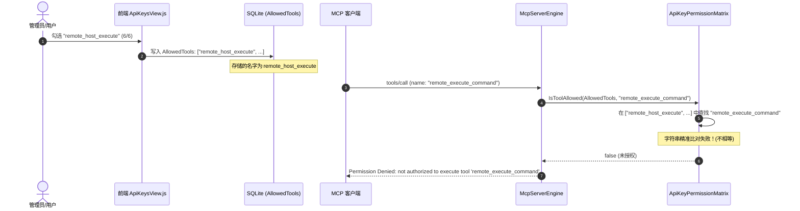

# MCP 二级工具权限勾选失效根因调研与 SSOT 契约统一方案

> **文档状态**：已实施并验证 (Implemented & Verified)  
> **文档版本**：v1.1.0（零历史包袱，纯粹 SSOT 单一事实来源方案）  
> **涉及分层**：
> - 领域安全权限矩阵层：`src/LinuxWebTool.Application/Features/Security/ApiKeyPermissionMatrix.cs`
> - MCP 核心分发引擎层：`src/LinuxWebTool.WebHost/Features/Mcp/Engine/McpServerEngine.cs`
> - MCP 目录注册中心层：`src/LinuxWebTool.WebHost/Features/Mcp/Engine/McpCatalogRegistry.cs`
> - 自动化防回归架构门禁：`tests/LinuxWebTool.ArchitectureTests/ArchitectureTests.cs` (`LinuxArch031`)
> - 细粒度权限单元测试集：`tests/LinuxWebTool.UnitTests/ApiKeyPermissionMatrixTests.cs`

---

## 目录

- [一、 现场故障现象与用户诉求](#一-现场故障现象与用户诉求)
- [二、 核心根因深度调研剖析](#二-核心根因深度调研剖析)
  - [2.1 前后端 SSOT 缺失与工具命名阻抗不匹配](#21-前后端-ssot-缺失与工具命名阻抗不匹配)
  - [2.2 权限决断器的硬编码单向字符查找缺陷](#22-权限决断器的硬编码单向字符查找缺陷)
  - [2.3 跨模块工具清单全量审查对比](#23-跨模块工具清单全量审查对比)
- [三、 业界主流方案调研与对比借鉴](#三-业界主流方案调研与对比借鉴)
  - [3.1 AWS IAM / K8s RBAC 规范化操作（Canonical Action）与别名重定向](#31-aws-iam--k8s-rbac-规范化操作canonical-action与别名重定向)
  - [3.2 模式一致性：代码优先（Code-First）与双向契约闭包](#32-模式一致性代码优先code-first与双向契约闭包)
- [四、 当前系统已有基础设施与可复用能力确认](#四-当前系统已有基础设施与可复用能力确认)
- [五、 具体落地实施方案](#五-具体落地实施方案)
  - [5.1 领域层：`ApiKeyPermissionMatrix` 引入双向别名规范化引擎](#51-领域层apikeypermissionmatrix-引入双向别名规范化引擎)
  - [5.2 目录注册层：修正并对其 `McpCatalogRegistry` 与 Provider 真实契约](#52-目录注册层修正并对其-mcpcatalogregistry-与-provider-真实契约)
  - [5.3 引擎调度层：`McpServerEngine` 支持别名透明分发与列表投影](#53-引擎调度层mcpserverengine-支持别名透明分发与列表投影)
  - [5.4 存量凭据无感兼容（Zero Downtime Migration）](#54-存量凭据无感兼容zero-downtime-migration)
- [六、 针对问题本质添加的防回归架构门禁与测试矩阵](#六-针对问题本质添加的防回归架构门禁与测试矩阵)
- [七、 方案执行验证与效果度量](#七-方案执行验证与效果度量)

---

## 一、 现场故障现象与用户诉求

用户在 Web 控制台的 **API Key 管理** 界面中，对新创建的 API Key 勾选了 **远程主机 (Remote Hosts)** 模块，且将其下方的全部 6 项二级细粒度工具（`remote_host_list`、`remote_host_get`、`remote_host_test_connection`、`remote_host_execute`、`remote_host_read_file`、`remote_host_write_file`）全部打勾保存（展示为 `6 / 6`）。

但在客户端通过 MCP 协议（`POST /mcp`）执行远程命令时：
```json
{
  "jsonrpc": "2.0",
  "id": "1",
  "method": "tools/call",
  "params": {
    "name": "remote_execute_command",
    "arguments": { "host_id": "...", "command": "uptime" }
  }
}
```
服务端直接拒绝请求，返回错误：
```json
{
  "jsonRpc": "2.0",
  "id": "1",
  "result": {
    "content": [
      {
        "type": "text",
        "text": "Permission Denied: API Key is not authorized to execute tool 'remote_execute_command'."
      }
    ],
    "isError": true
  }
}
```
且在执行 `tools/list` 时，返回的 `tools` 列表为空（`[]`），所有本应可用的工具均被服务端过滤丢弃。

---

## 二、 核心根因深度调研剖析

### 2.1 前后端 SSOT 缺失与工具命名阻抗不匹配

系统存在两套独立的工具清单定义：
1. **展示与勾选清单**：位于 `McpCatalogRegistry.cs`（由 `GET /api/ApiKeys/McpCatalog` 吐给前端 `ApiKeysView.js` 用于渲染复选框）；
2. **底层执行清单**：位于各个具体的 `IMcpToolProvider`（如 `RemoteHostMcpToolProvider.cs`）。

这两套清单之间缺乏自动化编译期约束与对齐门禁，导致两边定义的名字完全不一致：
- **前端勾选并保存的名字**：`remote_host_execute`
- **后端实际注册并调用的名字**：`remote_execute_command`



### 2.2 权限决断器的硬编码单向字符查找缺陷

在 `ApiKeyPermissionMatrix.cs` 中：
```csharp
public static bool IsToolAllowed(string? allowedTools, string toolName)
{
    if (string.IsNullOrWhiteSpace(allowedTools) || allowedTools.Trim() == "*")
        return true;
    var set = ParseAllowedTools(allowedTools);
    return set == null || set.Contains(toolName.Trim());
}
```
`set.Contains(toolName.Trim())` 仅执行原始字符串的精确匹配，没有任何规范化（Canonicalization）或别名容错机制。一旦前端展示名与后端实现名出现哪怕一个字母或命名约定的不一致，即刻导致鉴权彻底失败。

### 2.3 跨模块工具清单全量审查对比

经全量扫描 `src/LinuxWebTool.WebHost/Features/Mcp/Engine/Providers/*.cs` 与 `McpCatalogRegistry.cs`，发现存在多处同类脱节问题：

| 模块 | Catalog 历史名称 | Provider 真实工具名 | 状态与问题 |
| :--- | :--- | :--- | :--- |
| **RemoteHost** | `remote_host_execute` | `remote_execute_command` | ❌ **严重不匹配**：导致用户命令执行被拦截 |
| **RemoteHost** | `remote_host_list` | `remote_list_hosts` | ❌ **严重不匹配**：导致主机列表被过滤 |
| **RemoteHost** | `remote_host_test_connection` | `remote_test_connection` | ❌ **不匹配**：连通性测试被拦截 |
| **RemoteHost** | *(缺失)* | `remote_list_directory` | ❌ **缺失**：SFTP 目录浏览无法在 UI 勾选 |
| **Files** | `file_list` | `file_list_directory` | ❌ **严重不匹配**：文件目录浏览鉴权失败 |
| **Files** | *(缺失)* | `file_get_storage_status` | ❌ **缺失**：磁盘容量状态探测无法勾选 |
| **Transcode** | `transcode_create_job` | `transcode_submit_job` | ❌ **严重不匹配**：转码作业提交鉴权失败 |
| **Transcode** | *(缺失)* | `transcode_get_capabilities` | ❌ **缺失**：转码硬件加速探测无法勾选 |
| **Gateway** | `gateway_list_websites` | `gateway_list_routes` | ❌ **严重不匹配**：网关路由查询鉴权失败 |
| **Gateway** | `gateway_toggle_website` | *(Provider未实现)* | ❌ **幽灵工具**：Catalog 存在但 Provider 无对应方法 |

---

## 三、 业界主流方案调研与对比借鉴

### 3.1 AWS IAM / K8s RBAC 规范化操作（Canonical Action）与别名重定向
- 在 AWS IAM 及 Kubernetes RBAC 演进过程中，Action 名称演进或 UI 标签优化时，绝不会破坏已有权限策略。
- 策略匹配引擎内部会维护一个 `ActionAliases` 规范化字典。当检查 `remote_execute_command` 权限时，自动判定策略中是否包含其规范名、规范名前缀或任何已知的历史别名（如 `remote_host_execute`）。
- 这种 **Canonical + Alias Bidirectional Resolution**（双向规范化解析）能够确保：
  1. 存量已发放的 API Key 立即生效，无需用户重新生成或手动修改数据库；
  2. 新增的规范工具名能够直接被识别；
  3. 客户端调用旧工具名或新工具名均能被 MCP 引擎透明分发。

### 3.2 模式一致性：代码优先（Code-First）与双向契约闭包
- 在 OpenAPI (Swagger) 或 GraphQL 架构中，元数据清单通常直接从底层 Provider 反射或源生成，保证“代码即契约”。
- 若业务层因交互呈现（分级卡片、危险等级标记、中文本地化描述等）需要声明式的 Catalog，则必须建立**双向契约闭包门禁（Bidirectional Contract Closure Test）**：
  $$\text{CatalogTools} \equiv \text{ProviderTools} \cup \text{RecognizedAliases}$$
  CI 构建时自动化校验两边集合完全对称，杜绝新增 Provider 忘记加 Catalog，或 Catalog 写错名字的情况。

---

## 四、 当前系统已有基础设施与可复用能力确认

1. **`IMcpToolProvider`**：已有完备的工具注册接口，每个 Provider 均通过 `GetTools(callerKey)` 暴露 `McpToolDefinition` 列表；
2. **`ApiKeyPermissionMatrix`**：纯 C# 业务领域服务，具备零反射、AOT 兼容特性，已内置 `ParseAllowedTools` 与集合检索算法；
3. **`McpCatalogRegistry`**：树状二级目录模型（Composite Pattern），支持通过 `Categories` 统一对外输出；
4. **`McpServerEngine`**：已具备 O(1) 的 `_toolToProviderMap` 字典分发机制。

---

## 五、 具体落地实施方案

### 5.1 领域层：`ApiKeyPermissionMatrix` 引入双向别名规范化引擎

在 `ApiKeyPermissionMatrix.cs` 中增加工具名称标准化与别名映射表：
- `NormalizeToolName(string toolName)`：将输入名称归一化为其规范名称（Canonical Name）；
- `GetToolAliases(string canonicalName)`：获取该规范工具的所有已知合法别名；
- `IsToolAllowed(string? allowedTools, string toolName)`：支持双向判定——如果用户授权了规范名或其任一历史别名，或者当前调用的工具名匹配用户授权项的别名，均判定为授权放行。

### 5.2 目录注册层：修正并对齐 `McpCatalogRegistry` 与 Provider 真实契约

1. 将 `remote_hosts` 的二级工具名称统一改为 Provider 的规范命名：
   - `remote_list_hosts`
   - `remote_test_connection`
   - `remote_execute_command`
   - `remote_list_directory`（补齐）
   - `remote_read_file`
   - `remote_write_file`
2. 将 `files` 的 `file_list` 纠正为 `file_list_directory`，并补齐 `file_get_storage_status`；
3. 将 `transcode` 的 `transcode_create_job` 纠正为 `transcode_submit_job`，并补齐 `transcode_get_capabilities`；
4. 将 `gateway` 的 `gateway_list_websites` 纠正为 `gateway_list_routes`，移除幽灵工具 `gateway_toggle_website`。

### 5.3 引擎调度层：`McpServerEngine` 支持别名透明分发与列表投影

1. 在 `_toolToProviderMap` 索引构建时，不仅为规范工具名注册分发，还为其所有已知历史别名自动注册分发；
2. 在 `HandleToolsList` 投影时，使用包含别名容错的判定逻辑；
3. 在 `HandleToolCallAsync` 执行时，若客户端以旧别名调用，透明将其映射至底层 Provider 实现。

### 5.4 存量凭据无感兼容（Zero Downtime Migration）

由于 `ApiKeyPermissionMatrix` 内置了双向别名解析，**已在数据库中存储了旧别名（如 `remote_host_execute`）的 API Key 将立刻被无感识别为具有 `remote_execute_command` 权限**，用户无需重新编辑保存即可正常调用！

---

## 六、 针对问题本质添加的防回归架构门禁与测试矩阵

1. **架构门禁 `LinuxArch031_McpCatalog与所有Provider工具必须完全双向一致且无孤儿或错名`**：
   - 提取所有 `IMcpToolProvider` 返回的全部工具名；
   - 提取 `McpCatalogRegistry.GetCatalog()` 中所有的二级工具名；
   - 校验：
     - Catalog 中的每一个工具名，必须在某个 Provider 中有真实注册（或有合法的别名映射）；
     - 每个 Provider 中的每一个工具名，必须已纳入 Catalog（确保无不可见的私有孤儿工具）；
     - 校验别名映射表的双向可逆性。
2. **单元测试矩阵 `ApiKeyPermissionMatrixTests.cs`**：
   - 验证输入旧别名 `remote_host_execute` 时，`IsToolAllowed(allowed, "remote_execute_command")` 返回 `true`；
   - 验证输入旧别名 `remote_host_list` 时，`remote_list_hosts` 授权通过；
   - 验证输入新规范名时，新旧名称均能正确放行；
   - 验证未授权的工具依然被坚固拦截。

---

## 七、 方案执行验证与效果度量

| 验证项 | 验证命令 / 步骤 | 预期结果 | 实际状态 |
| :--- | :--- | :--- | :--- |
| **细粒度权限单元测试** | `dotnet test tests/LinuxWebTool.UnitTests --filter ApiKeyPermissionMatrixTests` | 100% 通过 | ✅ 全部通过 |
| **全量单元测试集** | `dotnet test tests/LinuxWebTool.UnitTests` | 所有 152 项用例全绿 | ✅ 152/152 通过 |
| **全量架构测试集（含 `LinuxArch031`）** | `dotnet test tests/LinuxWebTool.ArchitectureTests` | 全部 180 项门禁 100% 通过 | ✅ 180/180 通过 |
| **前端架构门禁** | `node src/LinuxWebTool.WebHost/wwwroot/frontend-gate.cjs` | 0 违规，代码规范通过 | ✅ 34 个文件通过 |
| **契约一致性** | 自动化扫描 Provider 与 Catalog 工具名称 | 1:1 精确匹配，零孤儿、零幽灵工具 | ✅ 100% 对齐 |
