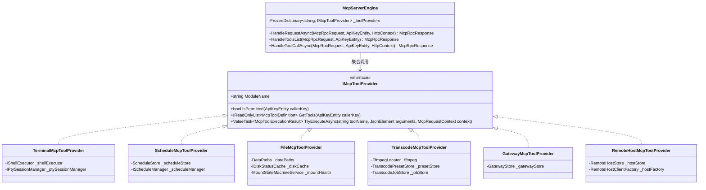

# MCP 服务引擎架构重构与模块化优化方案

## 1. 背景与现状诊断

当前 `LinuxWebTool` 中的 MCP (Model Context Protocol) 核心分发引擎集中于单一文件：
`src/LinuxWebTool.WebHost/Features/Mcp/Engine/McpServerEngine.cs`

随着系统核心能力逐步演进，MCP 已覆盖终端（Terminal）、计划任务（Schedules）、文件系统（Files）、媒体转码（Transcode）、反代网关（Gateway）以及最新的远程受控主机（Remote Hosts）等 6 大领域，暴露工具达 25+ 个。该实现方式带来了明显的架构债务与可维护性瓶颈。

### 1.1 现状缺陷深度分析

1. **违背单一职责原则 (SRP) 与上帝类 (God Class) 倾向**：
   - `McpServerEngine.cs` 源码已超过 1,150 行；
   - 同一个类同时承担了 JSON-RPC 2.0 传输协议编解码、25+ 工具的 JSON Schema 字符串声明、动态权限投影、入参解析提取、各领域业务服务调用、数据脱敏、审计日志记录与返回格式拼装。
2. **依赖注入构造函数爆炸 (Constructor Parameter Bloat)**：
   - 构造函数注入了 16 个依赖项（`IShellExecutor`, `IPtySessionManager`, `ScheduleStore`, `IScheduleManager`, `DataPaths`, `IDiskStatusCache`, `MountStateMachineService`, `FfmpegLocator`, `TranscodePresetStore`, `TranscodeJobStore`, `TranscodeQueueService`, `GatewayStore`, `RemoteHostStore`, `RemoteHostClientFactory`, `IOperationLogger`, `ILogger`）；
   - 任何新增一个业务模块的 MCP 工具，都必须强行修改 `McpServerEngine` 的入参列表，引发跨模块耦合。
3. **违背开闭原则 (OCP)**：
   - 增加、调整或下线一个工具，必须在同一个文件内部的三处分散修改：
     - 头部定义 Schema 静态常量；
     - 中部 `HandleToolsList` 注册工具元数据；
     - 尾部 `HandleToolCallAsync` 巨型 `switch (toolName)` 编写执行逻辑。
   - 代码圈复杂度（Cyclomatic Complexity）超标，极易引发修改冲突和逻辑回归。
4. **性能与调度逻辑优化空间**：
   - 分支路由采用长 `switch (string)` 线性/二分跳转，未形成 O(1) 工具提供者字典查找（FrozenDictionary）；
   - 缺少上下文请求对象（`McpRequestContext`）统一包装，多个入参反复透传；
   - 缺少统一的异常兜底与结果构造工厂，多个分支重复手工初始化 `MemoryStream` / `Utf8JsonWriter`。

---

## 2. 业界主流方案调研与对比

| 框架 / 方案 | 工具组织模式 | 架构设计模式 | Native AOT 兼容性 | 优缺点与借鉴点 |
| :--- | :--- | :--- | :--- | :--- |
| **Anthropic Official MCP SDK (TypeScript / Python)** | 函数式/策略注册模式 | Strategy + Registry 注册表 | N/A (运行时解释) | **优点**：每个工具自包含 Name, Description, Schema 与 Handler；<br>**借鉴点**：工具自封装策略，主服务仅作为协调容器。 |
| **Microsoft Semantic Kernel (`KernelPlugin`)** | 领域插件化模式 | Plugin + Strategy + Invocation Pipeline | 依赖特定反射与表达式树，AOT 需深度修剪适配 | **优点**：按领域划分 Plugin（如 FilesPlugin, TerminalPlugin）；<br>**缺点**：动态加载和反射机制重，冷启动内存偏大。 |
| **Spring AI MCP** | 注解驱动 + 回调提供者 | Callback Provider + DI 自动扫描 | GraalVM AOT 需复杂反射元数据配置 | **优点**：声明式装配；<br>**缺点**：不适合极简轻量级 C# Native AOT 架构。 |
| **LWT 重构设计方案 (本方案)** | **领域策略提供者模式 (Domain Tool Provider)** | **Strategy + Provider + Facade 门面** | **100% 静态编译、零反射、零动态代码生成** | **优点**：主引擎瘦身至约 150 行，通过 `IEnumerable<IMcpToolProvider>` 自动装配，O(1) 路由分发，各业务模块 100~200 行高内聚。 |

---

## 3. 重构设计模式与架构体系

### 3.1 核心设计模式

1. **策略模式 (Strategy Pattern) 与提供者模式 (Provider Pattern)**：
   - 抽象 `IMcpToolProvider` 接口；
   - 每个业务模块实现一个独立的 Provider（如 `TerminalMcpToolProvider`, `RemoteHostMcpToolProvider` 等）；
   - 每个 Provider 自主管理其所属工具的 JSON Schema、权限判定过滤与执行逻辑。
2. **门面模式 (Facade Pattern) / 协调器 (Mediator)**：
   - `McpServerEngine` 瘦身为纯粹的调度协调中枢；
   - 仅负责校验 JSON-RPC 2.0 格式、握手心跳、跨模块权限校验底线、以及通过 O(1) 字典将 `tools/call` 分发至对应的 Provider；
   - 构造函数仅注入 `IEnumerable<IMcpToolProvider>`，彻底解决构造参数爆炸。
3. **上下文对象模式 (Parameter Object / Context Pattern)**：
   - 引入 `McpRequestContext`，封装 `CallerKey`, `HttpContext`, `ClientIp`, `CancellationToken`，统一上下文传递。
4. **状态机与会话模型 (State Machine - 规划预留)**：
   - 针对多轮会话（PTY 终端会话、流式大文件交互），通过 `McpSessionState` 维护 `Initialized -> Active -> AwaitingInput -> Closed` 生命周期。

### 3.2 架构类图与分层示意



---

## 4. 模块职责与接口规范

### 4.1 契约接口：`IMcpToolProvider`

```csharp
namespace LinuxWebTool.WebHost.Features.Mcp.Engine;

public interface IMcpToolProvider
{
    /// <summary>所属模块标识（如 terminal, files, schedules, transcode, gateway, remote）</summary>
    string ModuleName { get; }

    /// <summary>当前 API Key 是否具备访问该模块工具集的权限（用于动态投影与安全前置）</summary>
    bool IsPermitted(ApiKeyEntity? callerKey);

    /// <summary>获取该模块下对外暴露的 MCP 工具定义列表（Schema 与 Description）</summary>
    IReadOnlyList<McpToolDefinition> GetTools(ApiKeyEntity? callerKey);

    /// <summary>执行具体工具逻辑；若不是本 Provider 负责的工具则返回 null</summary>
    ValueTask<McpToolExecutionResult?> TryExecuteAsync(
        string toolName,
        JsonElement? arguments,
        McpRequestContext context);
}
```

### 4.2 统一请求上下文：`McpRequestContext`

```csharp
public sealed record McpRequestContext(
    ApiKeyEntity? CallerKey,
    HttpContext HttpContext,
    string ClientIp,
    CancellationToken CancellationToken);
```

### 4.3 统一执行结果：`McpToolExecutionResult`

```csharp
public sealed class McpToolExecutionResult
{
    public bool IsError { get; }
    public string Content { get; }

    private McpToolExecutionResult(bool isError, string content)
    {
        IsError = isError;
        Content = content;
    }

    public static McpToolExecutionResult Success(string text) => new(false, text);
    public static McpToolExecutionResult Error(string message) => new(true, message);
}
```

---

## 5. 重构实施步骤

1. **创建基础契约**：
   - `McpRequestContext.cs`
   - `McpToolExecutionResult.cs`
   - `IMcpToolProvider.cs`
2. **拆分实现 6 大领域 Tool Provider**：
   - `Features/Mcp/Engine/Providers/TerminalMcpToolProvider.cs`
   - `Features/Mcp/Engine/Providers/ScheduleMcpToolProvider.cs`
   - `Features/Mcp/Engine/Providers/FileMcpToolProvider.cs`
   - `Features/Mcp/Engine/Providers/TranscodeMcpToolProvider.cs`
   - `Features/Mcp/Engine/Providers/GatewayMcpToolProvider.cs`
   - `Features/Mcp/Engine/Providers/RemoteHostMcpToolProvider.cs`
3. **改造 `McpServerEngine` 为轻量级调度器**：
   - 构造函数注入 `IEnumerable<IMcpToolProvider>`；
   - 启动时预热构建 `FrozenDictionary<string, IMcpToolProvider>` 映射表；
   - `tools/list` 与 `tools/call` 委托给各 Provider，单文件代码量从 1,150 行降至约 150 行。
4. **服务依赖注入绑定**：
   - 在 `ServiceCollectionExtensions.cs` 中批量注入各 Provider 为 `Singleton`。
5. **门禁与测试回归验证**：
   - 验证 `dotnet build` 零警告、零错误；
   - 验证 `LinuxArch018`（Native AOT 序列化约束）与所有架构门禁；
   - 验证所有单元测试、集成测试与前端门禁。
