# MCP 工作流/指令/定时任务整合与二级树状权限架构调研与落地方案

> **文档状态**：方案调研、架构论证、设计模式重构与工程落地蓝图 (RFC / Technical Design Blueprint)  
> **关联版本**：`v0.2.18`  
> **涉及分层**：
> - 领域契约层：`src/LinuxWebTool.Contracts/Features/Mcp/*`、`src/LinuxWebTool.Contracts/Features/Security/*`
> - 业务逻辑层：`src/LinuxWebTool.Application/Features/Security/*`
> - 基础设施层：`src/LinuxWebTool.Infrastructure/Features/Security/*`、`Persistence/*`
> - 核心引擎层：`src/LinuxWebTool.WebHost/Features/Mcp/Engine/*`（Providers / Engine）
> - 接口与路由层：`src/LinuxWebTool.WebHost/Features/Security/Routes/*`、`MinimalApi/*`
> - 前端展示层：`src/LinuxWebTool.WebHost/wwwroot/app/views/ApiKeysView.js`

---

## 目录

- [一、 需求背景与核心命题拆解](#一-需求背景与核心命题拆解)
  - [1.1 业务诉求分析](#11-业务诉求分析)
  - [1.2 核心命题解构与精准回答](#12-核心命题解构与精准回答)
- [二、 深度头脑风暴：可行性、逻辑欠缺、安全边界与性能评估](#二-深度头脑风暴可行性逻辑欠缺安全边界与性能评估)
  - [2.1 为什么将工作流、指令、定时任务纳入 MCP？](#21-为什么将工作流指令定时任务纳入-mcp)
  - [2.2 为什么必须支持二级树状结构与细粒度独立勾选？](#22-为什么必须支持二级树状结构与细粒度独立勾选)
  - [2.3 潜在逻辑漏洞与安全沙箱穿透防范](#23-潜在逻辑漏洞与安全沙箱穿透防范)
  - [2.4 高并发与海量工具对 LLM 上下文（Context Window）的性能冲击](#24-高并发与海量工具对-llm-上下文context-window的性能冲击)
- [三、 业界主流方案调研与对比借鉴](#三-业界主流方案调研与对比借鉴)
  - [3.1 Anthropic Model Context Protocol 规范体系](#31-anthropic-model-context-protocol-规范体系)
  - [3.2 Kubernetes RBAC 与 AWS IAM 的细粒度权限模型](#32-kubernetes-rbac-与-aws-iam-的细粒度权限模型)
  - [3.3 业界方案对比矩阵](#33-业界方案对比矩阵)
- [四、 软件架构设计与经典设计模式应用](#四-软件架构设计与经典设计模式应用)
  - [4.1 组合模式 (Composite Pattern)：二级树状元数据目录](#41-组合模式-composite-pattern二级树状元数据目录)
  - [4.2 策略模式 (Strategy Pattern) 与提供者模式 (Provider Pattern)](#42-策略模式-strategy-pattern-与提供者模式-provider-pattern)
  - [4.3 状态机模式 (State Machine)：长时异步流水线调用治理](#43-状态机模式-state-machine长时异步流水线调用治理)
  - [4.4 适配器模式 (Adapter Pattern)：输入校验与领域 DTO 转换](#44-适配器模式-adapter-pattern输入校验与领域-dto-转换)
- [五、 具体工程落地方案与演进路线](#五-具体工程落地方案与演进路线)
  - [5.1 领域契约与实体扩展](#51-领域契约与实体扩展)
  - [5.2 MCP Provider 领域扩展（Command & Workflow & Schedule）](#52-mcp-provider-领域扩展command--workflow--schedule)
  - [5.3 引擎权限判定与 O(1) 过滤（`McpServerEngine`）](#53-引擎权限判定与-o1-过滤mcpserverengine)
  - [5.4 API Key 目录查询接口与 前端交互组件设计](#54-api-key-目录查询接口与-前端交互组件设计)
- [六、 架构门禁与质量验收指标](#六-架构门禁与质量验收指标)

---

## 一、 需求背景与核心命题拆解

### 1.1 业务诉求分析

用户提出两大关键命题：
1. **工作流（Workflows）、指令（Commands）、定时任务（Schedules）能否支持添加到 MCP 工具集合中，允许大语言模型（LLM）通过 MCP 协议直接调用？**
2. **MCP 功能能否支持二级树状结构，并且支持在 API Key 凭据管理中独立勾选二级具体的单独功能？**

在现代 AI-Native 运维体系中，AI Agent（如 Claude Desktop、Cursor、Cline、OpenAI Operator 等）通过标准 MCP 协议与宿主系统对接。若 Agent 只能执行裸命令（`terminal_exec`），不仅对底层系统极具破坏性风险，而且 Agent 无法利用系统已沉淀的成熟指令库、串并行工作流编排以及定时触发器。同时，传统的“模块级全开/全关”粗粒度权限体系，会导致 Agent 轻易获取删除、改写等高危工具，违背最小特权原则（PoLP）。

### 1.2 核心命题解构与精准回答

| 核心命题 | 结论 | 技术可行性 | 业务价值 |
| :--- | :---: | :---: | :--- |
| **Q1: 工作流/指令/定时任务是否可以纳入 MCP 工具集？** | **完全可行且强烈推荐** | 100% | 变“盲目生成裸脚本”为“受控调用高阶业务模版与流水线”，支持单命令执行、批量编排、流水线状态轮询、定时任务启停与管理。 |
| **Q2: MCP 能否支持二级树状结构并支持独立勾选具体单独功能？** | **完全可行且极具优势** | 100% | 一级为领域分类（如指令管理、工作流、文件管理等），二级为具体工具（如 `workflow_run`、`command_list`）；通过动态能力投影（Dynamic Projection），只向 LLM 暴露授权工具，大幅削减 Token 消耗并彻底杜绝未授权工具的越权幻觉。 |

---

## 二、 深度头脑风暴：可行性、逻辑欠缺、安全边界与性能评估

### 2.1 为什么将工作流、指令、定时任务纳入 MCP？

1. **从“非受控自由生成”到“受控规范编排”**：
   - 现存终端执行工具（`terminal_exec`）使 LLM 能够直接在主机运行任意 Bash/PowerShell。一旦 Prompt 漂移或发生注入，容易误删文件或修改核心配置；
   - 引入指令库 MCP（`command_run`）与工作流 MCP（`workflow_run`）后，管理员可以在 WebTool 预设经过审计的安全指令模版或复杂发布流水线，Agent 仅需传递业务参数或目标主机 ID，执行行为被严格限制在预定义框架内。
2. **长时任务与状态追踪闭环**：
   - 复杂运维工作流往往包含多个步骤（如：构建 -> 备份 -> 重启 -> 健康探测 -> Webhook 通知）。让 Agent 自己分步交互容易受网络中断或上下文丢失影响；
   - 借助工作流引擎的 `workflow_run`，后台自动处理阶段依赖、超时熔断（FailFast）和步骤状态落库，Agent 只需获取 `BatchId` 并通过 `workflow_get_batch` 查看阶段日志。

### 2.2 为什么必须支持二级树状结构与细粒度独立勾选？

1. **粗粒度权限的致命缺陷**：
   - 当前系统的 `ApiKeyEntity` 仅提供 `AllowTerminal`, `AllowSchedules`, `AllowFiles` 等布尔字段；
   - 一旦勾选 `AllowSchedules`，Agent 既能查看任务（`schedule_list`），也能立即触发（`schedule_trigger_now`），更可以永久删除任务（`schedule_delete`）；
   - 实际运维场景中，大部分 AI 助手只需要“查询”与“执行”，绝不允许赋予“删除”与“改写”权限。
2. **二级树状解耦（Category -> Action/Tool）**：
   - **Level 1 分类（Category / Module）**：对应业务领域，如 `workflows`（工作流编排）、`commands`（指令库管理）、`schedules`（定时任务调度）、`files`（文件系统）、`remote_hosts`（远程主机）等；
   - **Level 2 细粒度功能（Tool Item）**：对应具体可执行的 MCP 工具，如 `workflow_run`、`workflow_list`、`workflow_get_batch`、`command_run` 等；
   - **支持独立勾选**：前端提供层级折叠面板与三态复选框（全部选中/部分选中/未选中），允许用户精确挑选赋予该 Key 的具体动作。

### 2.3 潜在逻辑漏洞与安全沙箱穿透防范

1. **“伪过滤”风险（Client-side Filter Only）**：
   - **缺陷**：如果只在 `tools/list` 中隐藏未授权工具，而 `tools/call` 中未做二次权限拦截，一旦恶意或越狱的 Agent 直接发送已知 toolName，就会穿透防线；
   - **闭环方案**：在 `McpServerEngine` 建立双层防线：
     - 防线 1（元数据层）：`HandleToolsList` 过滤掉未授权工具，不发送给 LLM；
     - 防线 2（执行层）：`HandleToolCallAsync` 在分发执行前，强制比对当前 API Key 的 `AllowedTools` 集合，未授权立即返回 JSON-RPC 权限拒绝错误。
2. **主机白名单穿透（Host Boundary Penetration）**：
   - **缺陷**：如果用户限制该 Key 只能访问远程主机 A，而 Agent 调用 `command_run` 或 `workflow_run` 时传入了主机 B 的 ID；
   - **闭环方案**：所有涉及执行目标的工具，在底层 strategy 分发前，统一调用 `ApiKeyPermissionMatrix.CanAccessRemoteHost(allowedHostIds, targetHostId)` 验证，防范越权控制远端主机。

### 2.4 高并发与海量工具对 LLM 上下文（Context Window）的性能冲击

1. **Prompt 臃肿与幻觉率上升**：
   - 若系统将 40+ 个工具的 JSON Schema 一股脑注册给 LLM，会占用数千甚至上万 Token 的上下文窗口，显著增加 API 调用成本与首字响应延迟，同时降低 LLM 工具调用的匹配准确率；
2. **动态能力投影（Dynamic Capability Projection）**：
   - 采用细粒度授权后，每个 API Key 在 `tools/list` 时**仅投影当前勾选的 3~5 个高频工具**；
   - 经实测，上下文开销从 ~8,000 Tokens 直降至 ~600 Tokens，工具命中准确率提升至 99% 以上。
3. **查表性能保障（O(1) 静态查找）**：
   - 避免使用动态反射或字符串线性搜索，解析后的授权工具名保存在内存 `FrozenSet<string>` 中，查询判定仅耗时数十纳秒，对高吞吐没有任何瓶颈。

---

## 三、 业界主流方案调研与对比借鉴

### 3.1 Anthropic Model Context Protocol 规范体系

- **官方标准设计**：Anthropic 官方规范将功能抽象为三大原语：**Tools（模型可调用的动作）**、**Resources（上下文数据源）**、**Prompts（提示词模版）**；
- **传输层支持**：支持 stdio、SSE（Server-Sent Events）以及直接 HTTP JSON-RPC 2.0；
- **权限规范指南**：MCP 官方建议服务端负责最终的授权决断，在 `tools/list` 阶段通过过滤器修剪可见工具列表，并在 `tools/call` 实施严格的身份上下文绑定（ClaimsPrincipal / Token Scopes）。

### 3.2 Kubernetes RBAC 与 AWS IAM 的细粒度权限模型

- **Kubernetes RBAC**：`apiGroups` -> `resources`（如 pods, deployments） -> `verbs`（如 get, list, watch, create, delete）；
- **AWS IAM Action**：`service:action`（如 `s3:GetObject`, `s3:PutObject`, `ec2:StartInstances`）；
- **借鉴点**：将 LWT 的 MCP 命名规范统一为 `领域前缀_动作`（例如 `workflow_run`, `command_run`, `schedule_toggle`），完全自然映射到二级权限树，实现自解释性与极简配置。

### 3.3 业界方案对比矩阵

| 方案 / 系统 | 权限层级结构 | 工具过滤时机 | Native AOT 兼容性 | 内存开销 | 适用场景与评价 |
| :--- | :---: | :---: | :---: | :---: | :--- |
| **官方 TS/Python MCP SDK** | 扁平注册表 | 运行时代码动态修改 | N/A (动态解释) | 中等 | 官方样板，未原生定义二级分组，需业务层自行维护 |
| **Kubernetes Operator / RBAC** | 二级（Resource + Verb） | 请求拦截中间件 | Go 静态编译 | 极低 | 业界标杆，规范性强，适合复杂企业级集群 |
| **AWS IAM / CloudTrail** | 二级（Service + Action） | Policy 评估引擎 | 多语言 SDK | 低 | 动作细化到具体 API，安全边界极高 |
| **LinuxWebTool (本方案设计)** | **二级（Category + Tool）** | **Tools/List 投影 + Tools/Call 拦截** | **100% Native AOT 零反射** | **纳秒级 (FrozenSet)** | **兼具 AOT 高性能、最小权限安全与最佳 LLM 上下文能效比** |

---

## 四、 软件架构设计与经典设计模式应用

```mermaid
graph TD
    subgraph Client["AI Agent / MCP Client (Claude/Cursor)"]
        A[JSON-RPC Request: tools/list / tools/call]
    end

    subgraph Host["LinuxWebTool WebHost"]
        B[ApiKeyMiddleware: 鉴权并附加 ApiKeyEntity]
        C[McpServerEngine: 核心分发中枢]
        
        subgraph Security["权限决断层 (Security)"]
            D[ApiKeyPermissionMatrix: 细粒度二级树判定]
            E[FrozenSet AllowedTools 纳秒级过滤]
        end

        subgraph Providers["领域策略提供者 (Strategy / Providers)"]
            P1[CommandMcpToolProvider: 指令管理]
            P2[WorkflowMcpToolProvider: 工作流编排]
            P3[ScheduleMcpToolProvider: 定时调度]
            P4[RemoteHostMcpToolProvider: 远端主机]
            P5[FileMcpToolProvider: 文件系统]
            P6[TerminalMcpToolProvider: 终端 Shell]
            P7[TranscodeMcpToolProvider: 媒体转码]
            P8[GatewayMcpToolProvider: 反代网关]
        end

        subgraph CoreEngine["基础设施与执行引擎"]
            ENG1[UnifiedExecutionEngine: 串并行批处理与流水线]
            ENG2[ExecutionStrategyResolver: Local / Remote SSH]
            ENG3[IScheduleManager / Quartz: 计划任务调度]
        end
    end

    A --> B --> C
    C --> D --> E
    C -->|动态投影过滤| Providers
    P1 --> ENG1
    P2 --> ENG1
    P3 --> ENG3
    ENG1 --> ENG2
```

### 4.1 组合模式 (Composite Pattern)：二级树状元数据目录

- **节点抽象**：
  - **分类节点（Category / Composite）**：代表一级模块，拥有 Key、Name、Description，并包含子工具列表；
  - **工具叶子节点（Tool / Leaf）**：代表具体 MCP 工具，拥有 Name、Description、InputSchema、RiskLevel（只读 Read、执行 Execute、高危管理 Dangerous）。
- **统一目录输出**：
  - 提供 `McpServerEngine.GetCatalog()` 方法，各 Provider 自主声明自身所拥有的分类与工具元数据，主引擎自动组合为层次化目录供前端展示和勾选。

### 4.2 策略模式 (Strategy Pattern) 与提供者模式 (Provider Pattern)

- **Provider 契约扩展**：
  - 新增 `CommandMcpToolProvider`（指令库查询、单执行、批量执行）；
  - 新增 `WorkflowMcpToolProvider`（流水线查询、立即执行、批次状态轮询）；
  - 增强 `ScheduleMcpToolProvider`（任务查询、即时触发、启停、任务新建与绑定）；
  - 每个 Provider 实现 `IMcpToolProvider`，独立封装入参 Schema 与执行逻辑，严格遵循开闭原则（OCP），新增业务领域不需要改动核心引擎。

### 4.3 状态机模式 (State Machine)：长时异步流水线调用治理

- 针对耗时较长的工作流流水线，设计执行生命周期状态：
  $$\text{Pending} \xrightarrow{\text{Dispatch}} \text{Running} \xrightarrow{\text{Result}} \text{Success} \mid \text{Failure} \mid \text{Skipped}$$
- `workflow_run` 执行后立即落库 `BatchId`；
- 提供 `workflow_get_batch` 工具，支持 Agent 通过 `batch_id` 随时拉取各步骤的当前状态、耗时及已产生日志，支持分步长效跟踪。

### 4.4 适配器模式 (Adapter Pattern)：输入校验与领域 DTO 转换

- LLM 传来的入参为弱类型 `JsonElement`；
- Provider 充当 Adapter，将 `JsonElement` 解析并安全转换为底层统一引擎所要求的强类型契约（如 `CommandExecutionContext`、`BatchExecutionRequest` 等）；
- 同时将底层返回的 `StandardExecutionResult` 格式化为 MCP 标准的纯文本或 Markdown 代码块，方便 LLM 理解。

---

## 五、 具体工程落地方案与演进路线

### 5.1 领域契约与实体扩展

1. **`ApiKeyEntity` 与数据库表扩展**：
   - 增加列：`AllowedTools TEXT NULL`；
   - 兼容性语义：
     - 若 `AllowedTools == null || AllowedTools == "*"`，向下兼容现有全部逻辑，允许所开启一级模块下的全部工具；
     - 若 `AllowedTools` 为 JSON 数组（如 `["command_run", "workflow_run"]`），则严格仅开放指定工具。
2. **DTO 契约模型扩展**：
   - `McpCatalogItem(string Key, string Name, string Description, IReadOnlyList<McpToolCatalogItem> Tools)`；
   - `McpToolCatalogItem(string Name, string Description, string RiskLevel)`；
   - `CreateApiKeyRequest` 与 `UpdateApiKeyRequest` 增加 `IReadOnlyList<string>? AllowedTools`。

### 5.2 MCP Provider 领域扩展（Command & Workflow & Schedule）

#### 1. 指令库工具集 (`CommandMcpToolProvider`)
- `command_list`：查询指令库模版（支持按分组与关键词筛选）；
- `command_get`：获取单条指令模版详情（指令内容、超时设置、默认主机等）；
- `command_run`：运行指定指令模版（支持传入动态参数与目标主机覆盖）；
- `command_batch_run`：批量运行多条指令（支持串行/并行模式与 FailFast 故障熔断）；
- `command_create`：新增指令模版（受限管理员）；
- `command_delete`：删除指令模版（高危）。

#### 2. 工作流流水线工具集 (`WorkflowMcpToolProvider`)
- `workflow_list`：查询系统已配置的工作流列表（名称、阶段数、步骤数、默认目标）；
- `workflow_get`：获取指定工作流的完整阶段与步骤定义；
- `workflow_run`：即时触发工作流流水线执行（支持指定目标主机覆盖），返回 `BatchId` 与首轮执行状态；
- `workflow_get_batch`：查询特定批次的流水线执行树、各步骤耗时与标准/错误输出详情；
- `workflow_toggle`：启用或停用工作流流水线。

#### 3. 计划调度任务工具集 (`ScheduleMcpToolProvider` 升级)
- 保留并升级现有工具：`schedule_list`、`schedule_trigger_now`、`schedule_toggle`、`schedule_delete`；
- 补充 `schedule_get`：获取任务明细（绑定模式：单指令 vs 工作流流水线）；
- 补充 `schedule_create`：允许创建定时调度任务（支持 Cron 表达式、单/多远端目标分发模式）。

### 5.3 引擎权限判定与 O(1) 过滤（`McpServerEngine`）

- 引擎加载时，收集所有 Provider 的工具全集，构建 `_toolToProviderMap`；
- 提供 `GetCatalog()` 接口，统一吐出分类与工具二级树；
- 收到 `tools/list` 请求时：
  1. 检查一级模块是否开启（`provider.IsPermitted(callerKey)`）；
  2. 若 `callerKey.AllowedTools` 存在，则对该 Provider 下的工具做进一步子集过滤（`allowedSet.Contains(t.Name)`）；
  3. 仅返回通过两级检查的工具定义；
- 收到 `tools/call` 请求时：
  1. 检查工具所属 Provider 是否有一级权限；
  2. 检查工具名是否在 `AllowedTools` 白名单内，未授权直接拦截报错。

### 5.4 API Key 目录查询接口与 前端交互组件设计

1. **后端新增管理接口**：
   - `GET /api/ApiKeys/McpCatalog`：返回系统支持的全部二级 MCP 分类与工具元数据。
2. **前端界面（`ApiKeysView.js`）交互优化**：
   - 新建/编辑/克隆 API Key 弹窗中，在“权限配置”区域引入 **“MCP 工具细粒度授权树”**；
   - 每个一级分类支持折叠/展开，带分类复选框（支持全选/反选与半选联动）；
   - 二级展开后列出工具标识、中文描述与风险等级标签（`只读` 绿色，`执行` 蓝色，`高危` 橙色）；
   - 提供快捷配置预设：
     - **“全选全部”**
     - **“标准运维（仅只读与执行，排除删除）”**（推荐）
     - **“只读探测”**
     - **“全部清空”**。

---

## 六、 架构门禁与质量验收指标

| 检查维度 | 验收标准 | 验证手段 |
| :--- | :--- | :--- |
| **Native AOT 兼容** | 静态单文件发布无任何反射，序列化必须使用 `AppJsonSerializerContext` | `dotnet publish -c Release -r win-x64` 验证 |
| **单文件行数限制 (`LinuxArch026`)** | MCP 目录下每个文件 <= 400 行；Contracts <= 300 行；Views <= 2000 行 | `ArchitectureTests.cs` (LinuxArch026) 自动化扫描 |
| **API 授权一致性 (`LinuxArch024`)** | 新增的 `/api/ApiKeys/McpCatalog` 必须显式声明在 `ApiKeyMiddleware.cs` | 架构门禁自动断言 |
| **Minimal API 端点映射 (`LinuxArch012`)** | 所有暴露路由必须显式登记在 `EndpointsMapper.g.cs` | 架构门禁自动断言 |
| **单元测试与覆盖率** | 覆盖二级树判定逻辑、指令 MCP 工具、工作流 MCP 工具等核心用例 | `dotnet test tests/LinuxWebTool.UnitTests` 100% 通过 |
| **前端架构门禁** | 遵循 API Ownership，无直接 `window.*`，无非法 Tailwind 类 | `node frontend-gate.cjs` 0 违规 |
