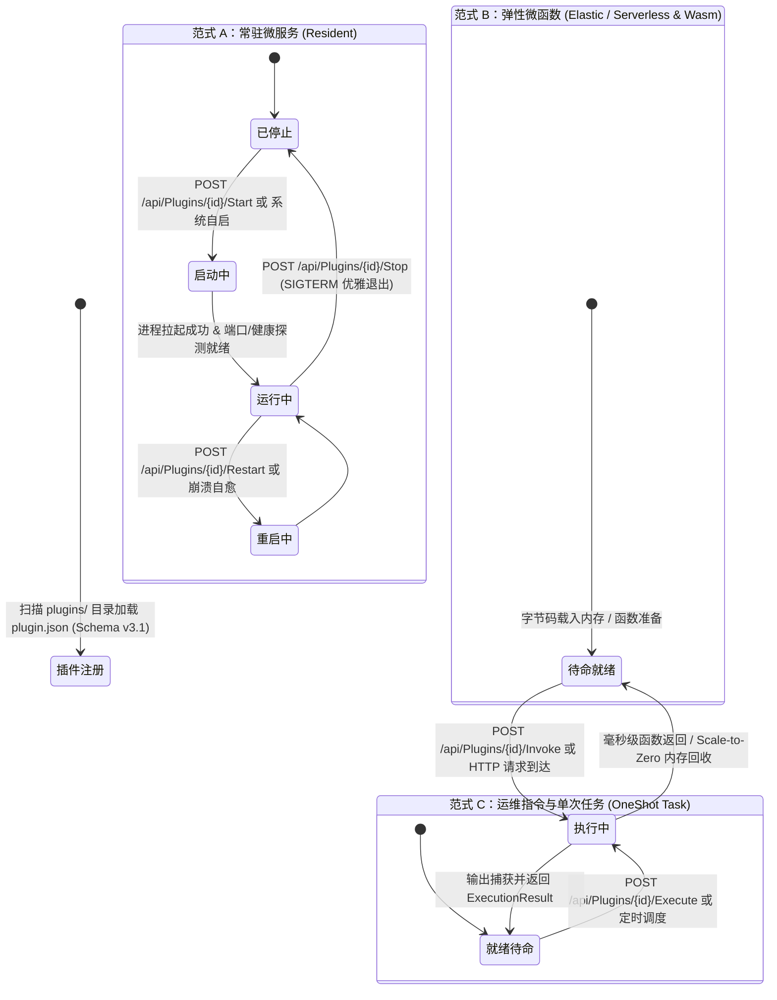

# 01. 插件架构设计、三大工作负载与元数据契约 (Manifest v3.1 Spec)

> **目标**：全面解析 LinuxWebTool (LWT) Schema v3.1 插件架构体系、三大正交工作负载模型、物理目录规范、声明式构建与 `plugin.json` 核心元数据契约，指导开发者与 AI Agent 规范化开发工业级插件。

---

## 1. 正交工作负载分类学与生命周期状态机

LWT 遵循现代云原生理念，将插件体系彻底解构为三大互斥且穷尽（MECE）的顶级工作负载范式：



### 1.1 范式 A：常驻微服务与网关 (`profile: Resident`)
- **核心定义**：长时常驻运行、持有 TCP/UDP 网络端口或 Unix 本地套接字（UDS）、由 Supervisor 监护自愈、提供持续 API 服务的微服务。
- **典型技术栈**：Go 原生静态编译、.NET 10 WebHost、Node.js Express/Fastify、Python FastAPI、Rust、C 等。
- **生命周期机制**：
  - 进程守护、优雅停止（`SIGTERM` -> 等待 5 秒 -> 超时 `SIGKILL`）与平滑重启；
  - 崩溃自愈状态机（Flapping 频率熔断与重试上限保护）；
  - PTY/日志管道实时捕获与内存环形缓冲区；
  - 控制面反向代理（Ingress）与数据面端口池自动分配。

### 1.2 范式 B：弹性微函数与计算 (`profile: Serverless`)
- **核心定义**：无状态、纳秒级或毫秒级冷启动、按需拉起（Scale-to-Zero）、强安全沙箱内存隔离的函数计算单元。
- **典型技术栈**：
  - **Wasm 字节码微函数**：C# NativeAOT WASI、C# .NET WASI、WAT 原生汇编、Rust wasm32-wasi；
  - **Serverless 动态函数**：Node.js 无状态脚本、Python 无状态执行器。
- **生命周期机制**：请求到达时即刻在安全内存沙箱中执行，无常驻内存驻留，计算完成自动回收。

### 1.3 范式 C：运维指令与单次任务 (`profile: OneShot`)
- **核心定义**：有限生命周期、随调随走、执行系统底层运维指令、环境巡检、安全加固或健康体检的任务单元。
- **典型技术栈**：POSIX 原生命令（`uname`, `iptables` 等）、Bash 脚本、PowerShell 自动化脚本。
- **生命周期机制**：带入参执行、退出码捕获、标准输出/标准错误分流隔离、执行期间防重复并发重入守卫。

---

## 2. 插件标准物理目录规范 (Layout Spec)

所有插件统一置于仓库根目录下的 `plugins/<plugin-id>/` 目录中。Schema v3.1 对物理目录进行了清晰的标准分区：

```text
plugins/<plugin-id>/
├── plugin.json                 # 核心元数据契约清单 (Schema v3.1，强制必须)
├── go.mod / *.csproj / *.js    # 源码工程文件与依赖定义
├── cmd/                        # 应用程序入口源码 (Go/C# 标准布局)
│   └── <plugin-id>/
│       └── main.go
├── internal/                   # 内部业务逻辑、算法与驱动包
├── ui/                         # 专属嵌入式 Webview 控制台 (可选)
│   ├── index.html              # 纯原生 ESM 架构单页视图
│   ├── app.js                  # 前端状态机与 API 调度逻辑
│   └── style.css               # 暗黑赛博设计风格样式
├── run/                        # 运行时临时目录 (.gitkeep，运行时 PID 与套接字)
├── storage/                    # 插件专属持久化数据目录 (.gitkeep)
├── tests/                      # 单元与集成测试夹具
└── <plugin-id>                 # 预编译生成的 Linux 静态 ELF 二进制 (用于生产直推)
```

> [!IMPORTANT]
> **目录与持久化三项军规**：
> 1. **代码与数据分离**：源码与只读资产位于 `LWT_CODE_DIR`；持久配置与数据库必须写入 `LWT_VOLUME_DIR`（容器内为 `/app/data/plugins/<id>/`），严禁写入代码目录以免热更新时被覆盖。
> 2. **相对路径原则**：插件严禁依赖容器外部的绝对路径，源码与构建产物全部使用相对路径（基于 `layout` 声明）。
> 3. **换行符归一**：所有 Shell 脚本、HTML、CSS 与 JS 文件强制使用 Unix LF (`\n`)。

---

## 3. `plugin.json` Schema v3.1 完整元数据契约

`plugin.json` 采用模块化规范块，由以下核心维度构成：

```json
{
  "manifestVersion": 3,
  "id": "disk-explorer",
  "name": "磁盘空间透视镜",
  "category": "System",
  "version": "1.0.0",
  "description": "基于 Go 高并发并发引擎的系统与宿主文件夹占用极速分析插件",
  "icon": "💾",
  "profile": "Resident",
  "runtime": "native",
  "entrypoint": "disk-explorer",
  "arguments": [
    "serve",
    "--port",
    "{port}",
    "--state-dir",
    "{stateDir}"
  ],
  "dependencies": [],
  "network": {
    "mode": "path",
    "portEnv": "PORT",
    "pathPrefix": "/plugins/disk-explorer",
    "authMode": "inherit"
  },
  "supervision": {
    "autoRestart": true,
    "flappingThresholdSec": 10,
    "maxCrashRetries": 3
  },
  "ui": {
    "entry": "ui/index.html",
    "title": "磁盘空间透视镜",
    "icon": "💾"
  },
  "archetype": {
    "profile": "Resident",
    "lifecycle": "SourceCompiled",
    "protocol": "Http",
    "language": "go"
  },
  "layout": {
    "sourceEntry": "cmd/disk-explorer/main.go",
    "targetArtifact": "disk-explorer",
    "storageDir": "storage",
    "runtimeDir": "run"
  },
  "build": {
    "toolchain": "go",
    "command": "CGO_ENABLED=0 go build -ldflags \"-s -w\" -o disk-explorer ./cmd/disk-explorer",
    "fallbackCommand": "go build -o disk-explorer ./cmd/disk-explorer",
    "artifacts": [
      "disk-explorer"
    ],
    "watch": [
      "cmd/**/*.go",
      "internal/**/*.go"
    ],
    "autoCompileOnSave": true,
    "timeoutSeconds": 120,
    "cleanTargets": [
      "disk-explorer"
    ]
  },
  "interface": {
    "protocol": "Http",
    "endpoint": "http://127.0.0.1:{port}",
    "healthEndpoint": "/health",
    "services": {
      "disk-scan-api": {
        "description": "极速磁盘空间与文件夹占用分析服务",
        "operations": [
          "capabilities",
          "scans",
          "tree",
          "abort"
        ]
      }
    }
  },
  "resources": {
    "limits": {
      "cpu": "1000m",
      "memory": "256Mi",
      "pids": 50
    },
    "requests": {
      "cpu": "100m",
      "memory": "32Mi"
    }
  }
}
```

---

## 4. 核心规范块详细定义

### 4.1 架构形态 (`archetype`)
| 字段 | 类型 | 说明 | 枚举值 |
| :--- | :--- | :--- | :--- |
| `profile` | string | 工作负载顶级范式 | `Resident` (常驻), `Serverless` (微函数), `OneShot` (运维任务) |
| `lifecycle`| string | 代码交付与运行生命周期 | `SourceCompiled` (源码编译), `PrebuiltBinary` (预编译二进制), `Interpreted` (解释型脚本) |
| `protocol` | string | 对外暴露的主要通信协议 | `Http`, `Uds` (Unix 套接字), `WasmAbi`, `CliArgs` |
| `language` | string | 核心编写语言 | `go`, `dotnet`, `node`, `python`, `sh`, `wasm` |

### 4.2 物理目录映射规范 (`layout`)
`layout` 块纯粹且严格定义插件在文件系统中的**物理目录拓扑结构**（与 C# 后端强类型 `PluginLayoutSpec` 一一映射，严禁与 UI 弹窗混淆）：

| 字段 | 类型 | 默认值 | 说明 |
| :--- | :--- | :--- | :--- |
| `sourceEntry` | string | `null` | 源码主入口文件相对路径（如 Go: `cmd/app/main.go`, .NET: `src/Program.cs`, 脚本: `hooks/records.sh`） |
| `targetArtifact`| string | `null` | 编译产出的最终二进制/字节码相对路径（如 Go: `bin/app` 或 `app`, Wasm: `bin/app.wasm`） |
| `storageDir` | string | `"storage"` | 持久存储相对目录（独享持久化卷，写入 SQLite/配置，热更与升级永不擦除） |
| `runtimeDir` | string | `"run"` | 插件私有瞬态运行时目录（用于放置业务 Unix Domain Socket 等临时句柄） |

> **关键目录职责分工与语言惯例**：
> 1. **语言惯用源码布局 (Idiomatic Source Layout)**：
>    - **Go 插件**：直接遵循官方标准 `cmd/<id>/main.go` + `internal/` + 根目录 `go.mod`，豁免外层 `src/` 包裹；
>    - **.NET / Rust 插件**：遵循标准 `src/` 源码目录 + 根目录工程文件（`*.csproj` / `Cargo.toml`）；
>    - **单次运维脚本 (OneShot)**：直接使用 `hooks/*.sh` 存放独立运维动作。
> 2. **运行时目录双轨隔离 (`run/` vs `.runtime/`)**：
>    - **`.runtime/` (宿主监护私有)**：由 LWT 宿主后台看护进程独占读写，写入内部监控 `process.pid` 与自愈文件锁；
>    - **`run/` (插件业务 IPC 域)**：由插件进程自身使用（通过环境变量 `LWT_RUNTIME_DIR` 注入），用于监听套接字 `service.sock` 等。
> 3. **编译产物建议**：推荐编译到 `bin/<id>`；构建与部署管线（`deploy-remote.ps1`）具备智能自适应能力，自动优先读取 `layout.targetArtifact`，并平滑兼容根目录二进制。

### 4.3 声明式构建规范 (`build`)
- **`toolchain`**：构建工具链标识（`go`, `dotnet`, `node`, `wasm-bflat`, `wat2wasm` 等）；
- **`command`**：标准构建命令，**必须面向 Linux 架构产出静态二进制**（如 `CGO_ENABLED=0 go build -ldflags "-s -w" -o <artifact> <entry>`）；
- **`watch`**：源码热感知 glob 通配符（如 `["cmd/**/*.go", "internal/**/*.go"]`）；
- **`autoCompileOnSave`**：布尔值，开启后在 Web 控制台在线编辑保存代码时，平台自动执行增量编译并平滑重启。

### 4.4 导出服务契约 (`interface.services`)
- 插件在 `interface.services` 中声明自身导出的微服务名称与操作列表（`operations`）；
- 平台动态服务发现组件会自动汇总并在 `GET /api/Plugins/Discovery` 中呈现，开发者可通过 `POST /api/Plugins/Invoke` 透明互调。

---

## 5. 跨语言多场景标准示例速查

### 5.1 C# 现代微服务 (`demo-dotnet-service`)
```json
{
  "manifestVersion": 3,
  "id": "demo-dotnet-service",
  "name": "C# 现代微服务",
  "category": "Backend",
  "profile": "Resident",
  "entrypoint": "bin/publish/demo-dotnet-service.dll",
  "archetype": {
    "profile": "Resident",
    "lifecycle": "SourceCompiled",
    "protocol": "Http",
    "language": "dotnet"
  },
  "build": {
    "toolchain": "dotnet",
    "command": "dotnet publish -c Release -o bin/publish",
    "artifacts": ["bin/publish/demo-dotnet-service.dll"]
  }
}
```

### 5.2 C# NativeAOT Wasm 极速微函数 (`demo-nativeaot-wasm`)
```json
{
  "manifestVersion": 3,
  "id": "demo-nativeaot-wasm",
  "name": "C# NativeAOT 极速微函数",
  "category": "Wasm",
  "profile": "Serverless",
  "entrypoint": "demo-nativeaot-wasm.wasm",
  "archetype": {
    "profile": "Serverless",
    "lifecycle": "SourceCompiled",
    "protocol": "WasmAbi",
    "language": "dotnet"
  },
  "build": {
    "toolchain": "wasm-bflat",
    "command": "bflat build --arch wasm --os wasi src/Program.cs -o demo-nativeaot-wasm.wasm",
    "artifacts": ["demo-nativeaot-wasm.wasm"]
  }
}
```

### 5.3 原生系统运维指令 (`native-command-demo`)
```json
{
  "manifestVersion": 3,
  "id": "native-command-demo",
  "name": "系统原生运维指令",
  "category": "System",
  "profile": "OneShot",
  "entrypoint": "uname",
  "archetype": {
    "profile": "OneShot",
    "lifecycle": "PrebuiltBinary",
    "protocol": "CliArgs",
    "language": "native"
  }
}
```
