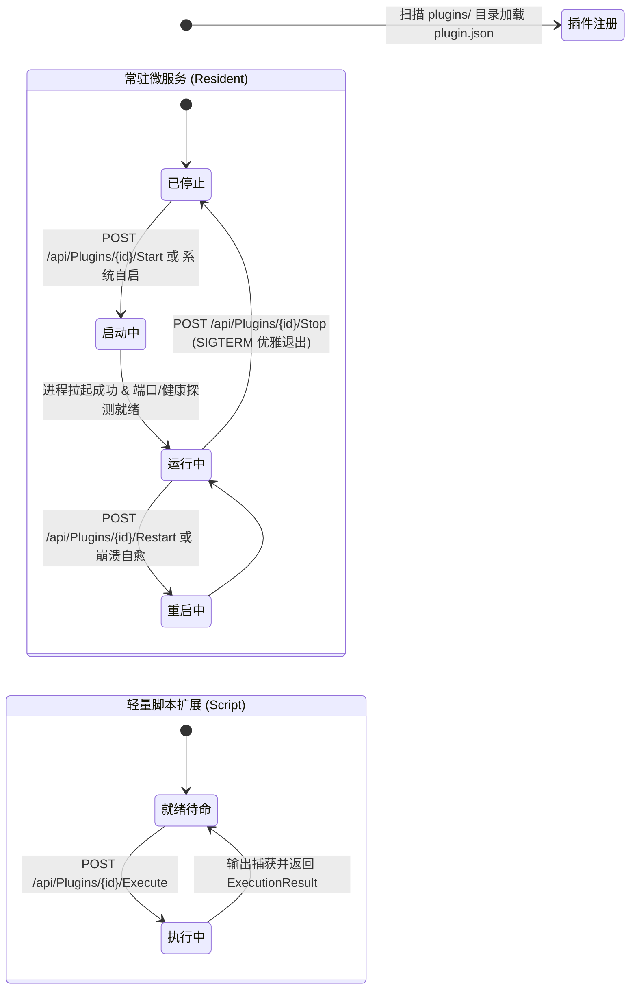

# 01. 插件架构设计与元数据契约 (Manifest Spec)

> **目标**：规范 LWT 插件的生命周期模型、分类机制、文件布局与 `plugin.json` 元数据契约，使插件开发者能够编写出具备跨平台鲁棒性、易维护且能够被平台统一编排的微服务。

---

## 1. 插件分类与生命周期模型

LWT 插件体系将功能单元严格划分为两大类别，两者的生命周期与调度模型截然不同：



### 1.1 常驻微服务 (Resident Microservice)
- **定义**：具备独立常驻运行的进程，通常承载网络服务、守护进程、代理中继或 API 网关。
- **典型技术栈**：Go 原生静态编译、.NET 10 WebHost、Node.js、Python FastAPI、Rust、C 等。
- **平台控制面支持**：
  - 启动、优雅停止（先发 `SIGTERM` 等待 5 秒，超时发送 `SIGKILL`）、平滑重启。
  - 进程崩溃自愈与状态机监护（`on-failure` / `always` 重启策略）。
  - PTY / 日志管道实时捕获与内存环形缓冲（查看即时日志）。
  - 端口转发与动态 Ingress 路由反向代理。

### 1.2 轻量脚本扩展 (Lightweight Script)
- **定义**：按需触发、瞬时运行的无状态操作单元，执行完毕后立即释放计算资源。
- **典型技术栈**：Bash 脚本、PowerShell 7 自动化脚本、Python 一次性脚本等。
- **平台控制面支持**：
  - 入参注入与标准输出/标准错误分流捕获。
  - 状态保护守卫（执行中防重复触发重入）。

---

## 2. 插件文件与目录标准结构

所有插件统一置于仓库根目录下的 `plugins/<plugin-id>/` 目录中。以核心插件 `socks5-proxy` 为例，其标准物理布局如下：

```text
plugins/socks5-proxy/
├── plugin.json                 # 核心元数据契约清单 (强制必须)
├── main.go                     # 微服务主入口源码 (Go 示例)
├── config.go                   # 配置加载与校验
├── dialer.go                   # 出站连接与网络调度
├── server.go                   # 入站协议与状态机
├── internal/                   # 内部业务包与适配器
│   └── tunnel/                 # 混淆隧道与 WebSocket 适配
├── ui/                         # 专属嵌入式 Webview 视图 (可选)
│   ├── index.html              # 纯原生 ESM 架构单页
│   └── app.js                  # 视图业务逻辑 (无构建打包依赖)
├── tests/                      # 插件测试夹具与单元测试
│   └── proxy_test.go
└── socks5-proxy                # 预编译生成的 Linux 静态 ELF 二进制 (用于生产与开发直推)
```

> [!IMPORTANT]
> **目录与代码资产规范**：
> 1. 严禁在插件目录中依赖宿主外的绝对路径，一律使用相对于插件根目录的相对路径。
> 2. 插件的持久化数据文件必须存放在 `/app/data/plugins/<plugin-id>/` 中，由宿主 Docker Volume 统一持久化备份。

---

## 3. `plugin.json` 核心元数据契约

`plugin.json` 是宿主与插件交互的唯一契约文件，遵循严格的 JSON 模式。以下为完整的标准化规范定义：

```json
{
  "$schema": "https://raw.githubusercontent.com/csvkse/lwt/main/schemas/plugin.schema.json",
  "id": "socks5-proxy",
  "name": "SOCKS5 安全代理微服务",
  "version": "1.0.0",
  "author": "LWT Team",
  "description": "基于 Go 原生运行引擎的极速高并发 SOCKS5 代理服务，支持 RFC 1928 / RFC 1929 规范与身份认证",
  "type": "resident",
  "category": "Network",
  "icon": "⚡",
  "entry": "./socks5-proxy",
  "args": ["-config", "config.json"],
  "env": {
    "SOCKS5_LOG_LEVEL": "info",
    "GODEBUG": "netdns=cgo"
  },
  "autoStart": true,
  "restartPolicy": "on-failure",
  "network": {
    "mode": "port",
    "port": 18080,
    "path": "/plugins/socks5-proxy/",
    "scope": "stealth",
    "supportHttp": false,
    "routes": {
      "/telemetry/metrics": "/ingress/socks5",
      "/api/v1/health": "/ingress/health"
    }
  },
  "ui": {
    "hasWebview": true,
    "entry": "ui/index.html"
  },
  "customActions": [
    {
      "id": "clear_connections",
      "name": "重置活跃连接",
      "command": "./socks5-proxy",
      "args": ["-action", "clear-conns"]
    }
  ],
  "dependencies": {
    "runtime": "none",
    "binaries": []
  }
}
```

### 3.1 核心字段语义解析表

| 字段路径 | 数据类型 | 必填 | 默认值 | 详细设计语义与约束 |
| :--- | :--- | :--- | :--- | :--- |
| `id` | `string` | **是** | - | 唯一标识符，全小写字母、数字及横线（`^[a-z0-9-]+$`），与目录名严格保持一致。 |
| `name` | `string` | **是** | - | 用户界面呈现的中/英文插件标题。 |
| `type` | `string` | **是** | - | `"resident"`（常驻微服务）或 `"script"`（轻量脚本）。 |
| `category` | `string` | **是** | `"System"` | 业务分类：`"AI"`、`"Network"`、`"System"`、`"Security"`、`"Web"`、`"Storage"`。 |
| `entry` | `string` | **是** | - | 可执行文件路径或脚本命令（相对插件根目录）。如 `./socks5-proxy` 或 `bash ./start.sh`。 |
| `autoStart` | `boolean` | 否 | `false` | 宿主系统拉起时，是否自动将该微服务加入启动队列。 |
| `restartPolicy`| `string` | 否 | `"no"` | 进程异常退出恢复策略：`"no"`（不重启）、`"on-failure"`（失败自愈）、`"always"`。 |
| **`network.mode`** | `string` | 否 | `"none"` | 网络监听形态：`"none"`、`"port"`（TCP/UDP端口）、`"path"`（宿主反代路由）、`"unix_socket"`（UDS 零端口）。 |
| **`network.port`** | `number` | 否 | `0` | 微服务本地监听的端口号。若与其他插件冲突，宿主提供自动消歧与端口迁移。 |
| **`network.path`** | `string` | 否 | `""` | 宿主反向代理前缀。例如 `/plugins/mcp-bridge/`。 |
| **`network.scope`** | `string` | 否 | `"standard"` | Ingress 作用域：`"standard"`（标准插件命名空间）或 `"stealth"`（低指纹隐匿通道，混淆别名不受固定前缀限制）。 |
| **`network.supportHttp`** | `boolean` | 否 | `false` | **必须保真！** 仅在微服务提供真正 HTTP Web 页面或接口时填 `true`；纯二进制代理服务（如 SOCKS5、纯 TCP 穿透）**严禁填 true**！ |
| `network.routes` | `object` | 否 | `{}` | Ingress 伪装与混淆别名映射表。键为暴露给外部的混淆路径，值为微服务内部目标端点。 |
| **`ui.hasWebview`** | `boolean` | 否 | `false` | 是否在卡片上提供专属的 Webview 弹窗。 |
| **`ui.entry`** | `string` | 否 | `""` | Webview 入口模式：填 `"web"` 表示反代微服务的 Web 站点；填相对文件路径（如 `"ui/index.html"`）表示托管宿主静态 UI 资产。 |

---

## 4. 多语言运行时环境矩阵 (Zero-Config Environment)

为了杜绝“用户机器或容器内缺少运行时导致插件无法运行”的痛点，LWT 开发镜像 `Dockerfile.dev` 与官方生产镜像均内置了 5 套标准多语言 SDK 与引擎：

| 运行时环境 | 容器内版本 / 路径 | 开箱即用状态 | 适用插件场景 |
| :--- | :--- | :--- | :--- |
| **Go 静态 ELF** | 宿主本地编译产物 (无容器依赖) | **原生零依赖 (推荐首选)** | 高性能网络网关、代理中继、底层监控守护 |
| **.NET 10 SDK** | `10.0.403` (`/usr/share/dotnet`) | **完全开箱即用** | 高性能 C# 微服务、AOT / JIT 双模后端、企业级业务中间件 |
| **Node.js** | Node 20 LTS (`/usr/bin/node`) | **完全开箱即用** | Webhook 自动化、轻量 Web 路由、自动化脚本 |
| **Python 3** | Python 3.12 (`/usr/bin/python3`) | **完全开箱即用** | 数据分析巡检、AI 模型调用桥接、自动化运维 |
| **PowerShell** | PowerShell 7.4+ (`pwsh`) | **完全开箱即用** | 跨平台系统脚本、批量配置同步 |
| **Caddy** | Caddy v2.8+ (`/usr/bin/caddy`) | **完全开箱即用** | 静态站点托管、反向代理热重载微服务 |

> [!WARNING]
> **发行版自适应规范（Alpine 禁忌）**：
> 宿主标准容器基于 Alpine Linux 构建。如果插件在安装额外系统包或向用户输出安装指引时，**绝对禁止盲目执行 `apt` 或 `apt-get`**。必须调用平台提供的发行版适配工具（`PluginManager.DetectCurrentDistroKey()`），根据宿主实际系统自适应输出：
> - Alpine 宿主：`apk add <package>`
> - Debian / Ubuntu 宿主：`apt install -y <package>`
> - RHEL / CentOS 宿主：`dnf install -y <package>`
