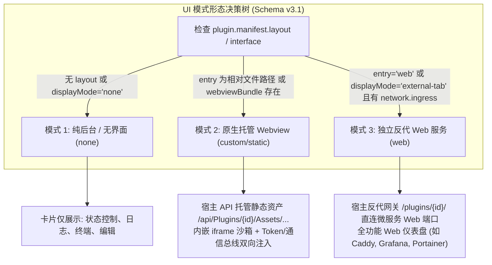
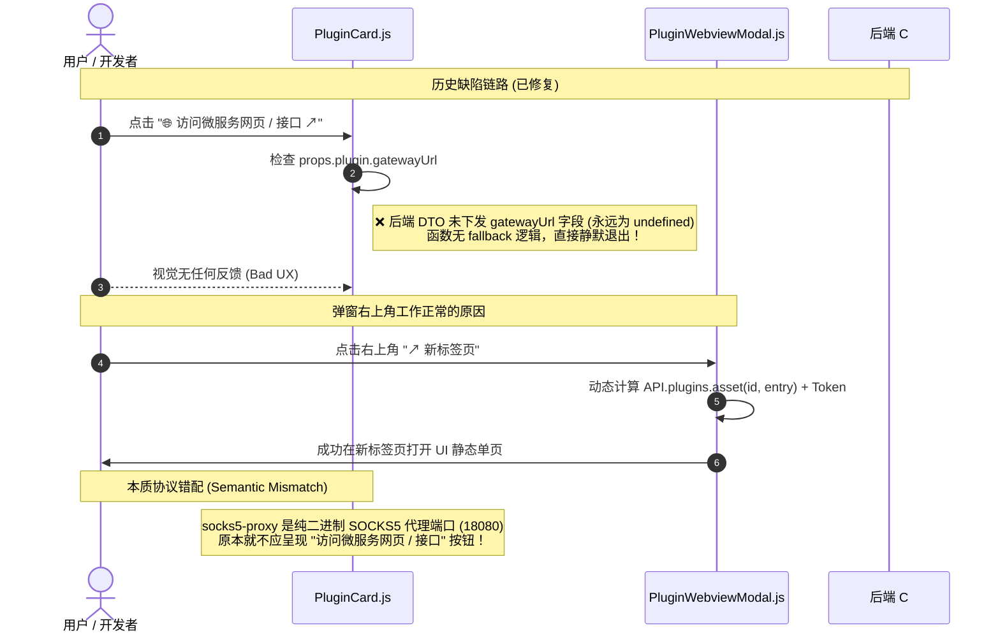

# 02. UI 模式、Webview 集成与 URL 策略仲裁

> **目标**：明确插件在 LWT 平台（Schema v3.1）中的三大 UI 渲染形态、Webview 沙箱通信协议，以及前端 URL 策略仲裁器（`PluginUrlResolver`）的设计模式，彻底杜绝坏死按钮、协议语义错配、视口无限膨胀与静默失败。

---

## 1. 插件三大 UI 模式 (Three UI Modes in Schema v3.1)

LWT 平台支持无缝接入不同技术栈与复杂度各异的插件界面，通过 `plugin.json` 中的 `layout`、`interface` 与 `network` 配置实现三种正交解耦的 UI 形态：



### 模式 1：纯后台 / 无界面 (`displayMode: "none"`)
- **适用场景**：后台网络服务（如未配置管理界面的纯 SOCKS5 代理）、系统守护进程、定时自动化脚本。
- **卡片呈现**：卡片上只保留通用运维按钮（启动、停止、重启、环境检测、日志、代码编辑、卸载），不渲染任何多余的打开按钮。
- **Schema v3.1 声明**：
  ```json
  "layout": {
    "displayMode": "none",
    "hasWebview": false
  }
  ```

### 模式 2：原生托管 Webview (`custom` / 静态单页)
- **适用场景**：绝大多数轻量、富交互的管理面板（如 `disk-explorer` 磁盘目录探针、`mcp-bridge` 控制台、`socks5-proxy` 三维配置面板）。
- **Schema v3.1 声明**：
  ```json
  "layout": {
    "displayMode": "fullscreen-dialog",
    "hasWebview": true,
    "entry": "ui/index.html",
    "dimensions": {
      "defaultWidth": "1100px",
      "defaultHeight": "820px",
      "resizable": true
    }
  }
  ```
- **工作机制**：
  - 插件在 `ui/` 目录下放置原生 HTML/JS/CSS 静态单页。
  - 宿主后端自动通过专用资产端点托管：`/api/Plugins/{id}/Assets/{filePath}`。
  - 宿主卡片渲染蓝紫色高亮主按钮：`🖥️ 打开 Webview 扩展视图`。
  - 点击弹出自适应模态框（支持 `fullscreen-dialog`, `standard-modal`, `drawer-right`），通过沙箱 iframe 呈现，无需为插件额外开启独立的 Web 端口。

### 模式 3：独立反代 Web 服务 (`displayMode: "external-tab"` / `entry: "web"`)
- **适用场景**：微服务自身内嵌了完整的 HTTP Web 服务器（例如基于 Node.js Express、Go Gin、.NET WebHost 或 Caddy Admin 驱动的完整 Web 应用）。
- **Schema v3.1 声明**：
  ```json
  "network": {
    "mode": "path",
    "port": 18000,
    "supportHttp": true,
    "ingress": {
      "path": "/plugins/my-web-app/",
      "scope": "standard",
      "stripPrefix": true
    }
  },
  "layout": {
    "displayMode": "external-tab",
    "hasWebview": true,
    "entry": "web"
  }
  ```
- **工作机制**：
  - 宿主核心反向代理中间件将 `/plugins/my-web-app/*` 请求直接全双工转发至微服务的本地监听端口 `18000`。
  - 既支持在内嵌 Webview 弹窗中浏览，又支持在新标签页中独立打开。

---

## 2. 坏死按钮与协议错配的排障复盘 (Lessons Learned)

在历史迭代中，`socks5-proxy` 曾出现卡片上的 `🌐 访问微服务网页 / 接口 ↗` 按钮点击无响应，而弹窗右上角的 `↗` 新标签页按钮却能正常打开的现象。深入剖析其本质原因对于后续开发具有极高参考价值：



### 核心根因总结：
1. **网络契约语义失真**：后端 C# 契约曾将 `Port > 0` 笼统归纳为 `supportHttp = true`，导致纯 SOCKS5 代理被误判为“拥有 HTTP 网页”，从而在前端渲染了无意义的外链按钮。
2. **缺乏兜底策略 (Missing Fallback)**：前端组件直接假定数据源必然下发完整 URL，未作防御性空值校验，未注入默认回退规则，亦未提供 Toast 反馈。

---

## 3. 统一前端策略解析器 (`PluginUrlResolver`)

为彻底消除组件间的冗余逻辑与空值隐患，系统设计了统一的 URL 策略解析器 [**`PluginUrlResolver`**](file:///e:/WorkProject/CSharp/PrivateProject/Web/WebToolForLinux/src/LinuxWebTool.WebHost/wwwroot/app/utils/pluginUrlResolver.js)：

```javascript
// src/LinuxWebTool.WebHost/wwwroot/app/utils/pluginUrlResolver.js
import { API } from '../config.js';

export const PluginUrlResolver = {
  // 1. 严格判断是否具有 Webview 面板 (兼容 Schema v3.1 layout 与历史 ui 字段)
  hasWebview(plugin) {
    if (!plugin?.manifest) return false;
    const layout = plugin.manifest.layout;
    if (layout) {
      if (layout.displayMode === 'none') return false;
      return Boolean(layout.hasWebview || layout.entry || layout.entryFile);
    }
    const ui = plugin.manifest.ui;
    if (!ui) return false;
    return Boolean(ui.hasWebview || ui.entry || ui.entryFile);
  },

  // 2. 策略仲裁：是否应在卡片上显示独立的 HTTP 接口/外链按钮
  // 规则：若已有专属 Webview 且无独立 HTTP Ingress/Path，则收敛多余按钮，避免纯代理服务产生坏死跳转
  hasIndependentHttpGateway(plugin) {
    if (!plugin || plugin.type !== 'resident') return false;
    const supportHttp = Boolean(plugin.manifest?.network?.supportHttp);
    const hasPathGateway = plugin.manifest?.network?.mode === 'path' || 
                           Boolean(plugin.manifest?.network?.ingress?.path) || 
                           Boolean(plugin.gatewayUrl);
    const hasWebview = this.hasWebview(plugin);

    if (hasWebview) {
      return supportHttp && hasPathGateway;
    }
    return supportHttp;
  },

  // 3. 安全获取网关 URL：杜绝 undefined，智能降级回退至 /plugins/{id}/
  getGatewayUrl(plugin, token = '') {
    if (!plugin) return '';
    let url = plugin.gatewayUrl || API.plugins.gatewayUrl(plugin.id);
    if (token) {
      const sep = url.includes('?') ? '&' : '?';
      url = `${url}${sep}token=${encodeURIComponent(token)}`;
    }
    return url;
  },

  // 4. 统一获取 Webview 目标 URL（兼顾微服务反代网关与静态资产端点）
  getWebviewUrl(plugin, token = '') {
    if (!plugin) return '';
    let url = '';
    const rawEntry = plugin.manifest?.layout?.entry || 
                     plugin.manifest?.ui?.entry || 
                     plugin.manifest?.ui?.entryFile;
    if (rawEntry && rawEntry !== 'web') {
      const cleanEntry = rawEntry.replace(/^\/+/, '').replace(/^ui\//, '');
      url = API.plugins.asset(plugin.id, cleanEntry);
    } else if (rawEntry === 'web' || plugin.gatewayUrl || plugin.manifest?.network?.mode === 'path') {
      url = plugin.gatewayUrl || API.plugins.gatewayUrl(plugin.id);
    } else {
      url = API.plugins.asset(plugin.id, 'index.html');
    }
    if (url && token) {
      const sep = url.includes('?') ? '&' : '?';
      return `${url}${sep}token=${encodeURIComponent(token)}`;
    }
    return url;
  },

  // 5. 交互防呆与友好提示
  openPluginGateway(plugin, token = '', toast = null) {
    if (!plugin) return;
    if (plugin.type === 'resident' && plugin.status !== 'running') {
      toast?.warning?.('微服务尚未运行，请先启动服务后再访问网关接口');
      return;
    }
    const targetUrl = this.getGatewayUrl(plugin, token);
    if (!targetUrl) {
      toast?.error?.('该插件未暴露有效的 HTTP 路由或网关端口');
      return;
    }
    window.open(targetUrl, '_blank');
  }
};
```

---

## 4. Webview 沙箱安全与通信协议规范

宿主在模态框中使用 `<iframe>` 呈现插件 Webview 时，必须遵循以下沙箱隔离规范：

```html
<iframe
  ref="iframeRef"
  :src="assetUrl"
  sandbox="allow-scripts allow-forms allow-same-origin allow-modals"
  class="w-full h-full border-0 bg-cyber-bg"
  @load="handleIframeLoad"
></iframe>
```

### 4.1 沙箱权限说明
- `allow-scripts`：允许插件运行前端 JavaScript。
- `allow-forms`：允许插件提交表单。
- `allow-same-origin`：使插件页面的 Origin 与宿主保持同源（便于调用宿主 `/api/*` 接口与 LocalStorage）。
- `allow-modals`：**极其关键！** 允许插件触发模态弹窗或下载，避免被 Chromium 内核静默掐断。

### 4.2 双轨认证 Token 与环境变量注入
插件页面无需用户重复登录，宿主提供两套 Token 注入通道：
1. **URL 参数通道**：宿主自动在 iframe `src` 附加 `?token=<JWT_TOKEN>`，页面加载之初即可通过 `new URLSearchParams(window.location.search).get('token')` 读取。
2. **PostMessage 事件通道**：iframe `onload` 后，宿主主动向子窗口派发全局环境变量包：
   ```javascript
   iframeRef.value.contentWindow.postMessage({
     type: 'LWT_PLUGIN_ENV',
     pluginId: props.plugin.id,
     token: auth.token,
     apiBase: window.location.origin + '/api',
     gatewayBase: window.location.origin + '/plugins/' + props.plugin.id
   }, '*');
   ```

### 4.3 双向事件通信总线 (PostMessage RPC)
插件前端可向宿主发送事件以请求特定权限或触发宿主系统行为：
```javascript
// 子页面 -> 宿主
window.parent.postMessage({
  type: 'LWT_PLUGIN_EVENT',
  action: 'NOTIFY', // 'NOTIFY' | 'NAVIGATE' | 'REFRESH_CONTAINER' | 'TERMINAL_EXEC'
  payload: {
    level: 'success',
    message: '磁盘分析完成，总计扫描 1.08 GB'
  }
}, window.location.origin);
```

---

## 5. 前端样式与视口容器门禁规范 (`FE-CONTAINER-HEIGHT-LIMIT`)

### 5.1 视口边界防御门禁
在前端质量体系中，插件 UI 与主应用卡片必须遵循 `FE-CONTAINER-HEIGHT-LIMIT` 门禁规范：
- **禁止无限垂直外溢**：插件 Webview 的根元素必须声明 `height: 100vh; overflow: hidden;`，内部滚动容器使用 `flex: 1; overflow-y: auto;`。
- **CSS Flex 盒子约束**：禁止在外部卡片或弹窗容器中使用无限制的 `min-height` 导致视口破损。
- **CSS 变量标准映射**：插件静态 UI 建议使用与主控台一致的极客暗黑主题变量：

```css
:root {
  --bg-primary: #0a0e17;
  --bg-card: rgba(15, 23, 42, 0.85);
  --border-cyber: rgba(56, 189, 248, 0.25);
  --text-main: #f1f5f9;
  --text-muted: #94a3b8;
  --accent-cyan: #38bdf8;
  --accent-blue: #3b82f6;
  --accent-emerald: #10b981;
  --accent-rose: #f43f5e;
}
```

---

## 6. 前端纯原生 ESM 开发与零打包准则

为了保持插件轻量与极致加载速度，插件 `ui/` 下的前端界面**强制遵循零构建纯原生 ESM 规范**：

1. **零打包工具链**：禁止引入 Webpack、Vite、Rollup 等构建步骤，直接编写原生 `index.html` 与 ES6 模块。
2. **样式风格统一**：引入宿主一致的暗黑极客主题类名（Tailwind 调色板：`bg-slate-900`, `text-slate-100`, `border-cyan-500/30`, `bg-cyber-bg` 等）。
3. **环境隔离守卫**：在公共工具模块顶层，避免无保护地直接访问 `window`，必须使用环境自适应守卫：
   ```javascript
   export const API_BASE = `${typeof window !== 'undefined' ? window.location.origin : ''}/api`;
   ```
4. **SSE / 流式输出自动重连**：若插件 UI 监听后端长连接（如 `disk-explorer` 的 `/scan/events`），必须设计客户端平滑断线重连（退避时长 1s -> 2s -> 5s），并在页面 `unload` 时显式调用 `eventSource.close()` 防止服务端连接泄露。
