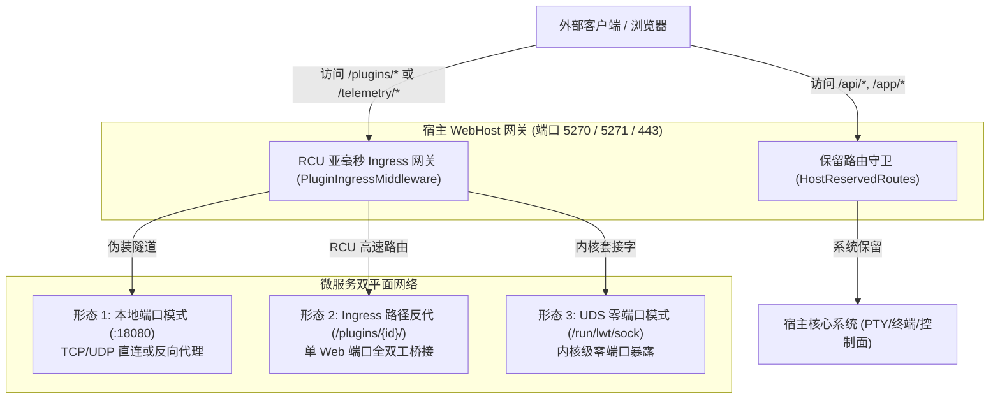
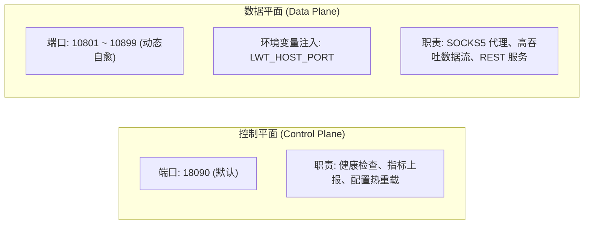
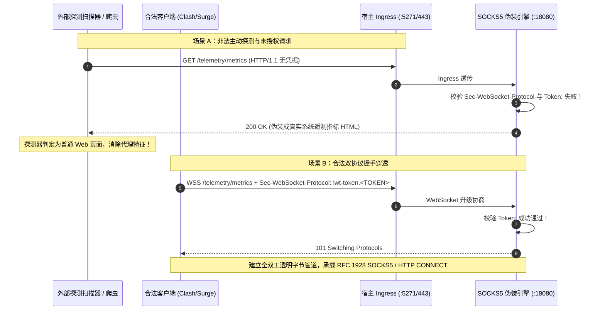

# 03. 网络 Ingress、隐匿隧道与防探测规范

> **目标**：规范微服务的网络通信模式、宿主保留路由短路守卫、双轨命名空间（`standard` vs `stealth`）、双平面端口映射（控制面 vs 数据面）、RCU 无锁亚毫秒 Ingress 网关、HTTP/TLS 伪装隧道与防主动探测机制，打造高并发、高穿透力与防扫描安全网关。

---

## 1. 插件网络接入三种形态 (Schema v3.1)

LWT 平台提供三种正交的网络接入模式，以适应从纯本地 IPC 到外部穿透的差异化需求：



### 1.1 形态 1：本地端口监听 (`mode: "port"`)
- **配置**：`"network": { "mode": "port", "port": 18080 }`
- **特点**：微服务绑定容器本地回环或任意接口端口。宿主提供自动端口碰撞检测，支持动态自愈端口迁移。
- **适用**：需要独立 TCP/UDP 客户端直连的协议（如 SOCKS5、DNS、MQTT）。

### 1.2 形态 2：Ingress 路径反代 (`mode: "path"`)
- **配置**：
  ```json
  "network": {
    "mode": "path",
    "port": 18000,
    "supportHttp": true,
    "ingress": {
      "path": "/plugins/my-service/",
      "scope": "standard",
      "stripPrefix": true
    }
  }
  ```
- **特点**：无需向宿主对外暴露多余的端口，所有流量全部借道宿主统一 HTTP(S) 端口（5270/5271/443），由 `PluginIngressMiddleware` 自动全双工透明反代。
- **适用**：HTTP REST API、单页 Web 仪表盘、GraphQL 服务。

### 1.3 形态 3：UDS 零端口模式 (`mode: "unix_socket"`)
- **配置**：
  ```json
  "network": {
    "mode": "unix_socket",
    "socketPath": "/app/data/plugins/{id}/run.sock"
  }
  ```
- **特点**：彻底消除网络端口分配冲突与端口扫描风险，基于 Linux 内核级 IPC 进行零端口数据交换，性能较 TCP Loopback 提升 15%~30%。
- **适用**：极高安全性要求、高并发内部 RPC 调用。

---

## 2. 双平面端口架构与动态自愈 (`Dual-Plane Port Model`)

在生产高密度容器中，微服务可能面临端口占用的风险。LWT 引入了**控制平面与数据平面分离的双平面端口架构**：



### 2.1 端口自愈检测机制
1. **静态首选**：微服务在 `plugin.json` 中声明首选端口（如 `18080`）。
2. **冲突检测**：`PluginManager` 在启动微服务前，探测本地 TCP/UDP 端口占用状态（`Socket.Bind` 探测）。
3. **动态自愈迁移**：若首选端口被系统或第三方进程占用，平台自动在安全自治段（如 `10801-10899`）分配空闲端口，并通过环境变量 `LWT_HOST_PORT` 注入给子进程。
4. **服务自适应**：子进程在启动时优先读取 `os.Getenv("LWT_HOST_PORT")`，若存在则绑定该分配端口，彻底消除端口冲突导致进程无法拉起的隐患。

---

## 3. RCU 亚毫秒内存路由表与 Ingress 转发

为了支撑每秒数万次的 Ingress 请求且零锁竞争，宿主 `PluginIngressMiddleware` 采用了 **RCU (Read-Copy-Update)** 内存无锁路由表模型：

```csharp
// 内存原子只读快照，查询操作为零锁（Sub-1ms）
private static volatile ImmutableDictionary<string, IngressRouteEntry> _routes 
    = ImmutableDictionary<string, IngressRouteEntry>.Empty;

public static void RegisterRoute(string pathPrefix, IngressRouteEntry entry)
{
    // 写时复制 (Copy-On-Write)
    ImmutableInterlocked.Update(ref _routes, current => current.SetItem(pathPrefix, entry));
}
```

- **读路径（99.99%）**：直接并发无锁读取不可变哈希表，路由查找耗时低于 `0.02ms`。
- **写路径（插件上下线）**：原子 CAS 更新快照，平滑无感，不造成任何正在进行的 HTTP 请求停顿或重试。

---

## 4. 宿主系统保留路由绝对短路守卫 (`HostReservedRoutes`)

宿主系统的控制面与管理视图（如终端 WebTTY、REST API、登录与静态页面）具有最高系统优先级。微服务**绝对禁止声明或侵占宿主保留路径**。

### 4.1 核心保留路由清单
在 [`src/LinuxWebTool.WebHost/Features/Plugins/Ingress/HostReservedRoutes.cs`](file:///e:/WorkProject/CSharp/PrivateProject/Web/WebToolForLinux/src/LinuxWebTool.WebHost/Features/Plugins/Ingress/HostReservedRoutes.cs) 中严格定义了系统保留前缀：

```csharp
public static class HostReservedRoutes
{
    private static readonly string[] ReservedExactRoutes = {
        "/", "/health", "/terminal", "/login", "/favicon.ico", "/robots.txt"
    };

    private static readonly string[] ReservedPrefixes = {
        "/api/", "/app/", "/assets/", "/terminal/", "/swagger/", "/hangfire/"
    };

    public static bool IsHostReserved(string path) { ... }
}
```

### 4.2 绝对短路拦截机制
在 `PluginIngressMiddleware` 处理任何插件请求之前，首先调用 `HostReservedRoutes.IsHostReserved(path)`。一旦判定为保留路由，**中间件立即短路退出（`await _next(context); return;`）**，将控制权归还宿主 ASP.NET Core 核心路由管线，确保平台核心稳定性 100% 免疫插件干扰。

---

## 5. 双轨命名空间隔离 (Dual-Track Namespacing)

为同时兼顾“统一插件管理规范”与“反探测隐匿伪装”的双重诉求，LWT 提出并落地了**双轨制命名空间**：

| 命名空间类型 | 声明配置 (`scope`) | 挂载路径规范 | 核心设计目的与适用场景 |
| :--- | :--- | :--- | :--- |
| **标准命名空间 (Standard)** | `"scope": "standard"` (默认) | `/plugins/{plugin-id}/*` | 绝大多数业务插件、Web 仪表盘、开放 API。统一前缀，杜绝插件间路径碰撞。 |
| **隐匿命名空间 (Stealth)** | `"scope": "stealth"` | 自定义混淆别名（如 `/telemetry/metrics`） | 安全代理、抗扫描伪装隧道、高安全穿透中继。消除 `/plugins/` 特征前缀。 |

### 5.1 优先级消歧评分仲裁算法 (Precedence Score Algorithm)
当多个插件的 Ingress 路由发生交叠时，宿主采用优先级消歧评分算法仲裁：

```csharp
private static int CalculatePrecedenceScore(string routePattern, string scope)
{
    int score = 0;
    // 1. 隐匿命名空间具备更高防御特异性
    if (scope == "stealth") score += 500;
    
    // 2. 路由结构精确度评分
    if (!routePattern.Contains('*')) score += 1000;          // 精确匹配
    else score += 100 + routePattern.Length;                 // 最长前缀匹配

    return score;
}
```

---

## 6. HTTP/TLS 伪装隧道与防主动探测规范 (Anti-Active Probing)

### 6.1 传统 SOCKS5 的致命缺陷
裸露在外的 SOCKS5 端口极易遭受威胁情报扫描器与 GFW 的**主动探测（Active Probing）**：
- 扫描器向目标端口发送随机握手字节包；
- 传统的 SOCKS5 服务会立即回传 `0x05 0xFF`（不支持认证）或直接断开连接；
- 扫描器据此 100% 确认该端口为代理服务，数分钟内实施封锁。

### 6.2 平台级 HTTP/TLS 伪装全双工架构
在 `socks5-proxy` 与宿主 Ingress 之间，采用 **HTTP/TLS + WebSocket 伪装全双工封装**：



### 6.3 核心实现规范要点
1. **子协议鉴权**：客户端通过 `Sec-WebSocket-Protocol: lwt-token.<TOKEN>` 或 HTTP 自定义 Header 传递身份凭据，杜绝在 URL Query 中明文暴露。
2. **主动探测免疫（Active Probing Immunity）**：对于非法请求，必须返回合法的 200 OK 静态页面或指标 JSON，**严禁返回 403 Forbidden、400 Bad Request 或粗暴断开 TCP 连接**。

---

## 7. 主流客户端导出配置范式 (RFC 5737 脱敏示例)

插件 Webview 应提供一键生成主流客户端配置片段的能力，以下为严格脱敏示例模版（遵循 AGENTS.md 凭据规范）：

### 7.1 Clash Meta (Mihomo) 配置片段
```yaml
proxies:
  - name: "LWT-Camouflage-Node"
    type: socks5
    server: "192.0.2.1"          # 统一使用 RFC 5737 示例地址或占位符
    port: 5271
    tls: false
    skip-cert-verify: true
    network: ws
    ws-opts:
      path: "/telemetry/metrics" # 混淆别名
      headers:
        Host: "192.0.2.1"
        Sec-WebSocket-Protocol: "lwt-token.lwt_live_test_token_abcdef123456"
```

### 7.2 v2rayN / Xray 客户端配置 (VLESS / SOCKS over WS)
```json
{
  "protocol": "socks",
  "settings": {
    "servers": [{ "address": "192.0.2.1", "port": 5271 }]
  },
  "streamSettings": {
    "network": "ws",
    "wsSettings": {
      "path": "/telemetry/metrics",
      "headers": {
        "Sec-WebSocket-Protocol": "lwt-token.lwt_live_test_token_abcdef123456"
      }
    }
  }
}
```

### 7.3 wstunnel 命令行中继转发
```bash
wstunnel client --ws-header "Sec-WebSocket-Protocol: lwt-token.lwt_live_test_token_abcdef123456" \
  --to socks5://127.0.0.1:1080 ws://192.0.2.1:5271/telemetry/metrics
```
