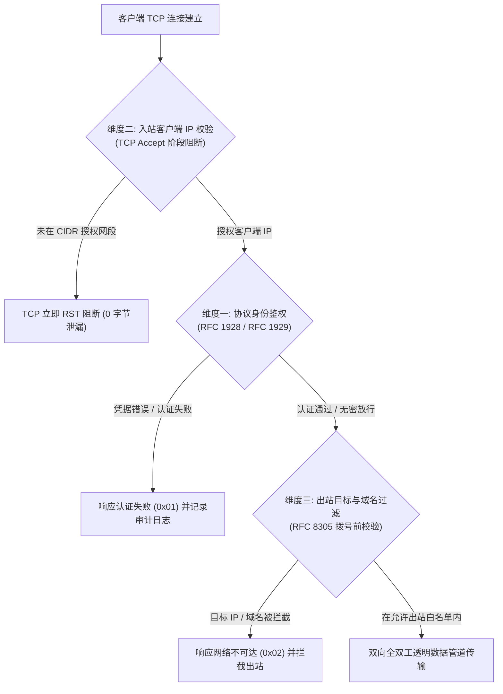

# 04. 三维安全防火墙与凭据治理规范

> **目标**：规范微服务的三维访问控制防御网（协议认证、入站客户端 CIDR 校验、出站目标过滤）以及平台级全仓凭据防泄露安全红线，杜绝内网穿透放大攻击与机密信息泄露。

---

## 1. 三维多层纵深防御体系 (3-Tier Defense-in-Depth)

代理类与网络穿透类微服务（如 SOCKS5、HTTP 代理、内网穿透网关）天生具有双向数据转发能力。一旦暴露于网络环境，若无严格防护，极易沦为攻击者扫描内网、实施 SSRF 或横向渗透的肉鸡跳板。

LWT 为微服务设计了**三维多层安全防火墙**，微服务核心调度引擎必须在数据包流转的各个阶段强制接入三维校验：



---

## 2. 维度一：协议身份鉴权模式 (RFC 1928 / RFC 1929)

微服务必须支持多套协议身份鉴权机制，并对鉴权过程实施防暴力破解与防时序攻击保护。

### 2.1 鉴权模式
1. **无密认证模式 (`0x00`)**：适用于已受维度二入站白名单严格约束的内网可信环境，减少额外握手 RTT。
2. **用户名 / 密码认证模式 (`0x02` RFC 1929)**：标准 RFC 1929 规范，要求客户端在握手后发送标准凭据。

### 2.2 防时序攻击恒定时间校验 (Constant-Time Compare)
在校验用户凭据时，**严禁使用标准字符串 `==` 运算符**，必须使用密码学安全的恒定时间比较函数，彻底免疫时序侧信道攻击：

```go
import "crypto/subtle"

func Authenticate(providedUser, providedPass, expectedUser, expectedPass string) bool {
    userMatch := subtle.ConstantTimeCompare([]byte(providedUser), []byte(expectedUser)) == 1
    passMatch := subtle.ConstantTimeCompare([]byte(providedPass), []byte(expectedPass)) == 1
    return userMatch && passMatch
}
```

---

## 3. 维度二：入站客户端 IP 访问限制 (Standard CIDR Firewall)

### 3.1 握手前快速短路拦截
为了最大化降低恶意扫描器的攻击面，微服务必须在 `net.Listener.Accept()` 接收到 TCP 套接字的第一时间提取对端 RemoteIP，**在尚未读取任何协议字节前立即执行 CIDR 判定**。非法来源直接 `conn.Close()` 掐断，实现“零字节指纹泄露”。

### 3.2 来源快速预设模式与标准 CIDR 格式
微服务 Webview 必须提供三套标准预设并支持任意自定义 CIDR（支持逗号或换行符分割）：

| 预设模式 | 标准 CIDR 规则 | 适用场景与安全等级 |
| :--- | :--- | :--- |
| **局域网私网来源 (推荐)** | `10.0.0.0/8, 172.16.0.0/12, 192.168.0.0/16, 127.0.0.0/8, ::1/128` | **极高**。仅允许局域网内部客户端与本机访问，彻底免疫来自广域网与公网接口的非法探测。 |
| **仅本机回环** | `127.0.0.1/32, ::1/128` | **极高**。仅供宿主内部容器、Sidecar 或 SSH 本地端口转发访问。 |
| **全网开放接入** | `0.0.0.0/0, ::/0` | **慎用**。全网暴露，必须强制开启维度一强密码鉴权与伪装隧道。 |

---

## 4. 维度三：出站目标网段与域名白名单 (Outbound Filtering)

### 4.1 出站网段与域名过滤规则
微服务在收到目标请求（如 SOCKS5 CONNECT 或 HTTP CONNECT）后，在发起真实网络拨号前，必须执行目标合法性核验：
1. **目标 IP 网段白名单**：支持配置标准 CIDR（如 `10.0.0.0/8` 仅允许访问内部微服务，或 `*` 允许所有公网访问）。
2. **通配符与正则域名白名单**：
   - 通配符格式：`*.internal`, `*.example.com`
   - 正则表达式格式：`regexp:^.*\.corp$`
   - 全局放行：`*`

### 4.2 RFC 8305 Dual-Stack Happy Eyeballs 竞速拨号优化
在目标域名解析与连接建立过程中，若目标兼具 IPv4 与 IPv6 地址，微服务拨号器应实现 RFC 8305 竞速算法，以大约 250ms 的交错间隔并发发起拨号，避免单栈故障或超时导致客户端卡顿。

---

## 5. 全仓凭据安全红线与脱敏治理 (Security & Credential Governance)

平台严格执行全生命周期的凭据治理红线，无论是在代码编写、测试设计还是文档编写中，均**严禁出现真实凭据**：

### 5.1 文档与测试用例标准占位符规范
| 敏感信息类型 | 严禁行为 | 强制使用的标准规范占位符 |
| :--- | :--- | :--- |
| **OpenAI / LLM API Key** | 禁止写入真实 `sk-proj-...` | `sk-proj-test-secret-key-1234567890`、`sk-test-super-secret-12345` |
| **LWT Platform Token** | 禁止写入真实生产 JWT | `lwt_live_test_token_abcdef123456`、`mock-token-xyz` |
| **Tunnel / 隧道 ID** | 禁止写入真实部署 ID | `tunnel_0123456789abcdef0123456789abcdef` (符合 39 字符校验) |
| **平台管理密码** | 禁止明文写入 `admin` 密码 | `your_secure_password_here` 或 `<ADMIN_PASSWORD>` |
| **EasyTier 组网密钥** | 禁止写入真实生产 Secret | `network_secret = "demo_secret_token"` |
| **公网 IP / 域名** | 禁止写入真实外网服务器 IP | 统一采用 RFC 5737 示例：`127.0.0.1`、`example.com` |

### 5.2 真实凭据唯一合法来源 (`env/.envdev`)
本地联调、端到端冒烟测试或部署脚本若确需真实凭据，**必须且只能从根目录的 `env/.envdev` 中动态读取**。`env/.envdev` 已被根目录 `.gitignore` 全局严格忽略，任何尝试将该文件或凭据推入 Git 的行为均被阻断。

### 5.3 自动化凭据扫描门禁体系
1. **Git Pre-commit 钩子**：每次 `git commit` 时自动调用 `.githooks/security-gate.cjs --staged`，对暂存区增量行进行香农熵与凭据规则检测，毫秒级拦截越界提交。
2. **CI 全仓受控扫描**：本地构建验证脚本 `./scripts/verify-fast.ps1` 与 GitHub Actions CI 会执行 `node .githooks/security-gate.cjs --full` 进行全仓深度审计，确保零凭据残留。
