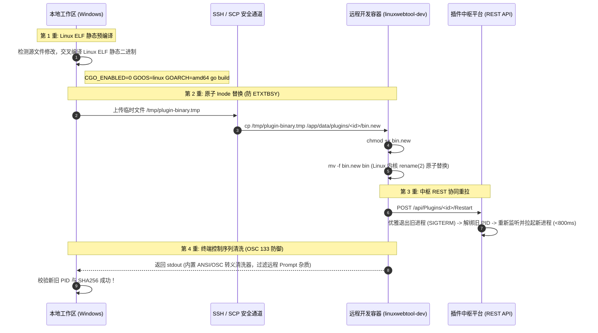
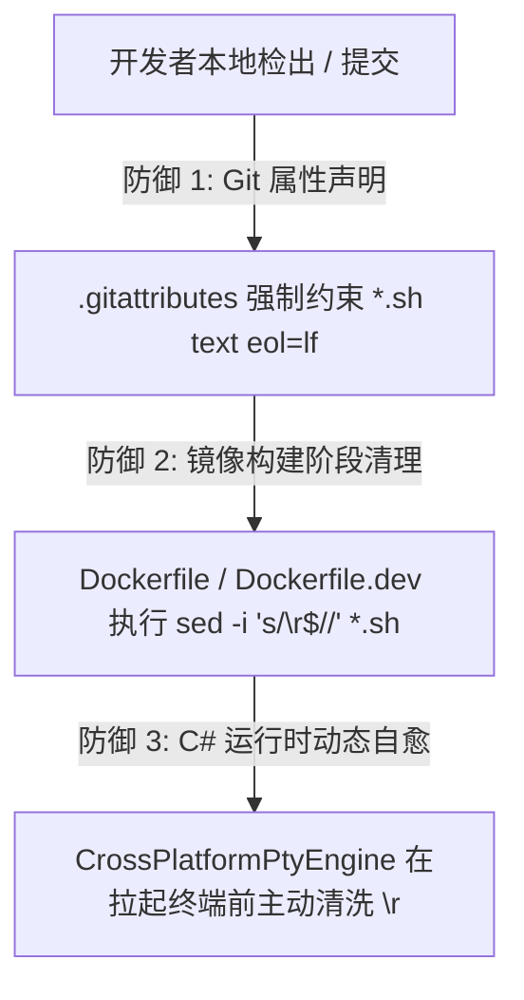

# 05. 极速开发流、在线热更新与跨平台防御规范

> **目标**：规范开发运维双轨制流水线、微服务在线热更新（5~8 秒无停机热补丁）、Linux 原子 Inode 替换防崩溃技术，以及跨平台换行符（CRLF vs LF）三重防御机制。

---

## 1. 开发运维双轨制架构 (Dual-Track Deployment Pipeline)

为了彻底根除“官方正式 Native AOT 构建耗时过长（8~15 分钟）”与“日常敏捷迭代极速验证”之间的核心矛盾，LWT 平台确立了**双轨制并行架构**：

```mermaid
graph LR
    subgraph "方案 A：极速开发部署管线 (-Mode Dev)"
        DevSrc["本地工作区实时代码"] -->|Direct 流式直推| DevHost["远程宿主机 linuxwebtool-dev"]
        DevHost -->|JIT 极速构建 ~15s / 增量直推| DevContainer["开发容器 (:5271)"]
        DevContainer -->|热同步凭据| DevPass["继承 5270 生产凭据"]
    end

    subgraph "方案 B：官方正式发布管线 (-Mode Official)"
        GitMain["Git Commit & Tag"] -->|Push to GitHub| GHA["GitHub Actions CI/CD"]
        GHA -->|Multi-Arch Native AOT 编译 (8~15m)| GHCR["ghcr.io/csvkse/lwt:latest"]
        GHCR -->|拉取镜像平滑重建| ProdContainer["生产容器 (:5270) --net=host"]
    end
```

### 1.1 双轨关键指标对比

| 核心维度 | 方案 A：极速开发管线 (`-Mode Dev`) | 方案 B：官方正式管线 (`-Mode Official`) |
| :--- | :--- | :--- |
| **容器实例名** | `linuxwebtool-dev` | `linuxwebtool` |
| **对外服务端口** | **5271** (`-p 5271:5270`) | **5270** (`--net=host`) |
| **编译机制** | 远程 Linux JIT 极速编译 (`Dockerfile.dev`) | GitHub Actions 云端 Multi-Arch Native AOT |
| **业务停机时间** | **完全零影响**（5270 生产业务全程保持运行） | 重建生产容器 |
| **平均更新耗时** | **约 40 ~ 50 秒**（增量编译 ~15s，热更 ~5s） | **约 8 ~ 15 分钟** |
| **数据与凭据** | 独立隔离卷 `linuxwebtool-dev-data`，自动同步凭据 | 生产持久化卷 `linuxwebtool-data` |

---

## 2. 敏捷开发更新决策矩阵 (Agile Decision Matrix)

AI Agent 与开发者在日常排障与迭代时，**必须依据修改范围精准选择最小粒度的更新策略**，严禁过度构建或盲目重启：

| 变更范围 | 典型修改场景 | 推荐执行命令 | 耗时 | 容器停机时间 |
| :--- | :--- | :--- | :--- | :--- |
| **插件微服务自身** (`plugins/<id>/`) | Go/Node 代码修复、OpenAI 隧道超时调整、SOCKS5 访问控制规则、`plugin.json`、专属 webview 页面 | **插件在线热更新**<br/>`deploy-remote.ps1 -HotUpdatePlugin <id>`<br/>或 `hot-update-mcp-bridge.ps1` | **~5-8 秒** | **0 秒（零容器停机）** |
| **系统前端静态资源** (`src/.../wwwroot/`) | 页面样式调整、组件模板重构、全局路由调整 | **前端静态热更**<br/>`deploy-remote.ps1 -FrontendOnly` | **~4-5 秒** | **0 秒（零容器停机）** |
| **系统后端与底层底座** (`src/.../Application`, `Infrastructure`, `WebHost`) | C# 控制器、中间件、PtyNative、EasyTier 核心调度逻辑 | **开发镜像快速重建**<br/>`deploy-remote.ps1 -Mode Dev` | **~40-50 秒** | 重启 `linuxwebtool-dev` |
| **正式交付生产** | 功能全量回归、准备发布正式 Tag | **官方生产部署**<br/>`deploy-remote.ps1 -Mode Official` | **~8-15 分钟** | 重启 `linuxwebtool` |

---

## 3. 插件在线热更新四大底层保障机制 (Quadruple-Guarantee)

> [!IMPORTANT]
> **插件更新铁律**：凡涉及插件微服务本身的问题，只要不是宿主 Plugin Platform 底座平台自身的改动，**统一且必须使用插件在线热更新方案**！严禁滥用全量重启容器！

在线热更新能够在 5~8 秒内完成跨平台部署与平滑替换，依托于底层的**四重保障机制**：



### 3.1 机制 1：Linux ELF 静态预编译
在 Windows 宿主环境下，脚本自动识别 Go 插件源码，在本地执行交叉编译：
```powershell
$env:CGO_ENABLED = "0"
$env:GOOS = "linux"
$env:GOARCH = "amd64"
go build -ldflags "-s -w" -o <output_binary> .
```
彻底避免将 Windows PE 格式二进制（`.exe`）上传至 Linux 容器导致无法执行。

### 3.2 机制 2：原子 Inode 替换防 `Text file busy` (ETXTBSY)
- **Linux 内核保护陷阱**：在 Linux 系统中，如果尝试直接覆盖或截断正在运行的可执行文件，内核会立即触发 `ETXTBSY` (Text file busy) 保护并返回错误，导致服务异常崩溃。
- **原子替换原语**：通过 `mv -f`（底层调用 Linux 内核 `rename(2)` 系统调用）将临时文件替换目标文件。`rename(2)` 会为目标路径分配全新的 Inode，正在运行的旧进程继续持有旧 Inode 的只读引用直至平滑退出，新进程则立即加载新 Inode，实现无缝平滑替换！

### 3.3 机制 3：中枢统一 REST 协同重拉
自动化流水线从 `linuxwebtool-dev-data` 卷中安全提取凭据，直接向插件管理底座下发 `POST /api/Plugins/{id}/Restart` 指令，状态机执行平滑启停，保留所有端口与环境变量映射，耗时通常 `< 800ms`。

### 3.4 机制 4：终端控制序列清洗器 (OSC 133 防御)
远程 Shell（如安装了 Oh-My-Zsh 或 Powerlevel10k 的环境）在返回命令输出时常会混入不可见的 OSC 133 / ANSI 转义序列。脚本内置了专用清洗正则表达式（`\x1B(?:[@-Z\\-_]|\[[0-?]*[ -/]*[@-~])`），确保新旧 PID 与 SHA256 校验 100% 精确无误。

---

## 4. 跨平台换行符三重防御机制 (CRLF vs LF)

Windows 开发环境下代码检出容易带入 `\r\n` (CRLF)，当包含 CRLF 的 Shell 脚本在 Linux 容器中执行时，Bash 会抛出极其隐蔽且致命的语法错误：
```text
syntax error near unexpected token $'{\r''
```

为彻底根治此问题，LWT 构建了**跨平台换行符三重防御体系**：



1. **第一重：Git 仓库级属性硬约束**：根目录 [`.gitattributes`](file:///e:/WorkProject/CSharp/PrivateProject/Web/WebToolForLinux/.gitattributes) 全局声明 `*.sh text eol=lf`，阻断 Windows 自动注入 CRLF。
2. **第二重：Docker 镜像编译阶段清理**：`Dockerfile` 与 `Dockerfile.dev` 构建脚本统一对所有脚本执行 `sed -i 's/\r$//' /app/*.sh`。
3. **第三重：C# 运行时动态自愈**：在 `CrossPlatformPtyEngine.DefaultLinuxArguments()` 中，宿主在组装启动命令行之前，会主动检测脚本的 Line Endings，如发现 `\r` 字符立即在内存中清洗并自愈写回，彻底消除外部文件注入污染。
