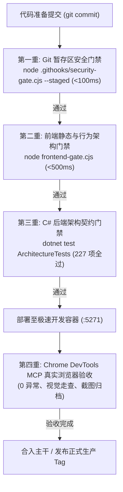

# 06. 质量门禁体系与浏览器自动化验收规范

> **目标**：规范 C# 架构测试、前端静态与行为架构门禁、全仓安全扫描，以及基于 Chrome DevTools MCP 的真实浏览器无感回归与自动化验收标准。

---

## 1. 质量防护四重网全景 (Four-Tier Quality Net)

LWT 平台确立了“代码不出机房、缺陷不过门禁”的工程防线。任何插件微服务与底座变更，在合入主干前必须 100% 通过以下四重质量门禁：



---

## 2. 第一重：Git 暂存区安全门禁 (`security-gate.cjs`)

### 2.1 触发机制与命令
- **日常自动触发**：通过 `.githooks/pre-commit` 钩子，每次执行 `git commit` 时自动执行增量校验。
- **全仓深度核验**：
  ```bash
  node .githooks/security-gate.cjs --full
  ```
- **核心检测项**：
  - 香农熵（Shannon Entropy）检测，毫秒级捕获高随机度私钥、哈希与 Token。
  - 正则表达式特征库匹配（阻断包含真实 `sk-proj-`、私有 IP、真实平台密码等字符串）。

---

## 3. 第二重：前端静态与行为架构门禁 (`frontend-gate.cjs`)

位于 [`src/LinuxWebTool.WebHost/wwwroot/frontend-gate.cjs`](file:///e:/WorkProject/CSharp/PrivateProject/Web/WebToolForLinux/src/LinuxWebTool.WebHost/wwwroot/frontend-gate.cjs)，零第三方依赖，通过纯 Node.js 在 500ms 内完成全量扫描与行为校验。

### 3.1 插件生态专属核心规则
1. **`FE-PLUGIN-GATEWAY-FALLBACK`**：
   - **约束**：业务组件（如 `PluginCard.js`）严禁直接裸读 `plugin.gatewayUrl`。
   - **原因**：防止服务端未下发字段时发生 `undefined` 静默失败；强制通过 `PluginUrlResolver` 提供安全降级与协议消歧。
2. **`FE-PLUGIN-URL-RESOLVER`**：
   - **约束**：自动运行 [`tests/frontend/plugin-url-resolver.test.mjs`](file:///e:/WorkProject/CSharp/PrivateProject/Web/WebToolForLinux/tests/frontend/plugin-url-resolver.test.mjs)，核验空值降级、Webview 资产组装与协议保真。
3. **`FE-PLUGIN-FILTER-FSM`**：
   - **约束**：插件中心的多维过滤状态机（运行中/已停止/待命）、暗黑主题搜索框契约校验。
4. **`FE-CONTAINER-HEIGHT-LIMIT`**：
   - **约束**：所有列表与卡片网格容器必须设置逻辑高度限制（`max-h-*` 或 `flex-1 min-h-0 + overflow-y-auto`），严禁无界滚动导致页面突破视口。
5. **`FE-CRLF-FORBIDDEN`**：
   - **约束**：前端所有 `.js`, `.html`, `.css` 文件严禁包含 `\r` (CRLF)，防止 Windows 检出污染。

### 3.2 运行与核验命令
```bash
node src/LinuxWebTool.WebHost/wwwroot/frontend-gate.cjs
```

---

## 4. 第三重：后端 C# 架构契约测试 (`ArchitectureTests.cs`)

位于 [`tests/LinuxWebTool.ArchitectureTests/ArchitectureTests.cs`](file:///e:/WorkProject/CSharp/PrivateProject/Web/WebToolForLinux/tests/LinuxWebTool.ArchitectureTests/ArchitectureTests.cs)，收敛了 227+ 项严格的跨层调用、接口抽象与微服务沙箱门禁。

### 4.1 插件系统核心架构测试
- **`LinuxArch045_PluginWebviewSandboxAndModalIntegrity`**：
  - 校验 WebviewModal 必须显式声明 `allow-modals` 沙箱权限；
  - 校验微服务反代网关通过 `API.plugins.gatewayUrl` 路由，静态资产统一走 `/api/Plugins/{id}/Assets/`；
  - 校验微服务前端严禁使用原生 `window.prompt` / `window.confirm` 阻断弹窗。
- **`LinuxArch078_HostReservedRoutesAndIngressGuard`**：
  - 校验宿主保留路由短路守卫包含 `/api/*`、`/app/*`、`/terminal` 等核心端点；
  - 校验中间件具备双轨命名空间识别与消歧评分机制。

### 4.2 运行与核验命令
```bash
dotnet test tests/LinuxWebTool.ArchitectureTests/LinuxWebTool.ArchitectureTests.csproj
```

---

## 5. 第四重：Chrome DevTools MCP 浏览器自动化验收规范

交付任何插件功能或前端交互优化前，开发者与 AI Agent 必须使用内置浏览器执行端到端无感验收：

### 5.1 标准巡检流程
1. **获取凭据与登录态**：
   - 从 `env/.envdev` 读取 `WEB_ADMIN_PASSWORD`；
   - 开发环境访问入口：`http://10.126.1.70:5271/app/#/login`。
2. **定位巡检视图**：
   - 导航至插件中心：`http://10.126.1.70:5271/app/#/plugins`。
3. **控制台与无感运行审计**：
   - 调用 `list_console_messages` 审计控制台输出；
   - **质量红线**：页面不得产生任何未捕获的 Console Error（`pageerror`）。
4. **DOM 结构与按钮状态交互核验**：
   - 验证目标插件卡片只呈现有意义且有效的按钮；
   - 验证点击“`🖥️ 打开 Webview 扩展视图`”能正常弹出模态框且 iframe 无跨域错误；
   - 验证右上角“新标签页”可正确打开带 Token 签名的地址。
5. **视觉走查与截图留存**：
   - 调用 `take_screenshot` 对当前视口进行高清渲染截图；
   - 命名格式遵循序号规范（例如 `07-webview-modal-verified.png`, `08-plugin-cards-grid-verified.png`），并归档留存。
