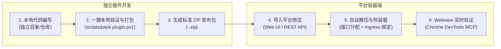
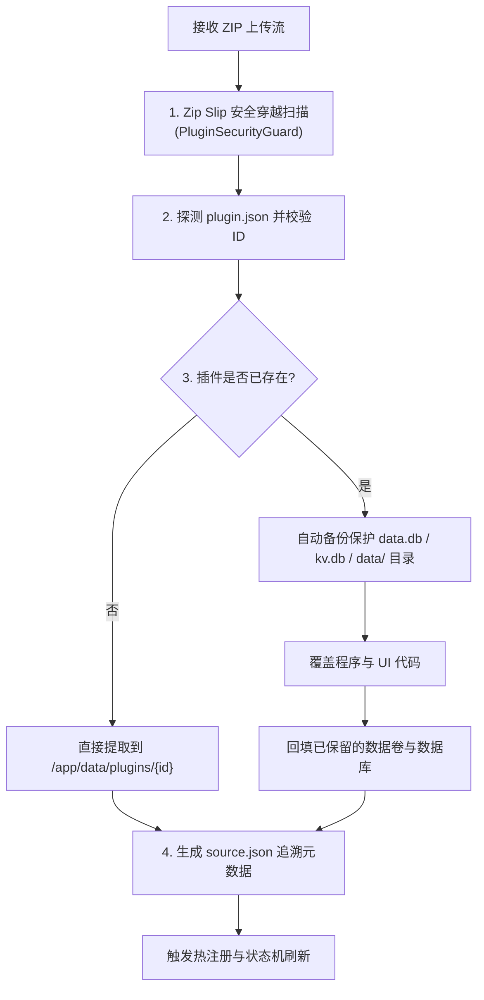

# 07. 插件标准化打包、导入优先流与实战避坑指南

> **文档标识**：`LWT-GUIDE-PLUGIN-007`  
> **所属体系**：[LinuxWebTool 插件开发全景规范与工程指南](./README.md)  
> **前置依赖**：[01. 插件架构与元数据契约](./01-architecture-and-manifest-spec.md)、[02. UI 模式与 Webview 深度集成](./02-ui-modes-and-webview-integration.md)、[05. 极速研发与在线热更新](./05-fast-development-and-hotupdate.md)  
> **核心目标**：掌握标准化插件打包规范、导入优先开发工作流、端到端一键调试及 `socks5-forwarder` 实战避坑经验。

---

## 1. 为什么推行“导入优先”开发工作流 (Import-First Workflow)？

在传统开发模式下，开发者如果为 LinuxWebTool 编写插件，往往需要将代码嵌入庞大的主工程仓库、修改宿主 C# 代码，甚至依赖特定的本地构建环境。这带来了强耦合、环境污染与协作摩擦。

**导入优先工作流（Import-First Workflow）** 实现了主系统与插件生态的彻底解耦：



### 核心收益：
1. **零宿主代码侵入**：开发者无需修改任何 C# 文件，仅凭一个标准的 `plugin.json` 和业务产物即可接入平台。
2. **轻量便携**：插件可以在完全独立的 Git 仓库中维护和持续集成，产出 Zip 即可直接在任何运行中的 LWT 实例上运行。
3. **开箱即用与环境自愈**：利用平台的 Zip 导入引擎，自动识别环境依赖、保留持久化数据库并安全拉起。

---

## 2. 标准插件 ZIP 包文件结构规范

一个合法、健壮且可直接导入 LWT 平台的插件 ZIP 压缩包，其物理结构必须严格符合以下目录分层规范：

```
socks5-forwarder-1.0.0.zip
├── plugin.json               # [必须] 插件核心清单元数据 (严格遵守 manifestVersion: 1)
├── socks5-forwarder          # [编译型必须] Linux x64 静态 ELF 二进制 (已赋予 755 可执行权限)
├── run.sh                    # [脚本型必须] Linux Shell 入口脚本 (强制 LF 换行符)
├── ui/                       # [Webview 可选] 前端扩展面板静态文件目录
│   ├── index.html            # [必须] Webview 默认展示入口
│   ├── app.js                # 前端交互与 API 通信
│   └── style.css             # 前端样式
├── README.md                 # [推荐] 插件功能介绍、使用说明与入站端口说明
└── icon.svg                  # [可选] 插件专属矢量图标
```

### 文件规范审查准则：
- **禁止打包数据文件**：严禁在 Zip 包中预置 `data.db`、`kv.db`、`.disabled` 或 `source.json`，这些由宿主运行时统一分配与管理。
- **禁止多层嵌套根目录**：解压后的根目录**必须直接呈现 `plugin.json`**，严禁外层多包裹一层无意义的顶层文件夹（如 `my-plugin/my-plugin/plugin.json`）。
- **换行符强制 Unix LF (`\n`)**：所有文本文件（包括 Shell 脚本、HTML、JS、JSON）严禁含有 Windows CRLF (`\r\n`)，否则 Linux Bash 执行脚本会报 `syntax error near unexpected token $'\r'`。

---

## 3. 标准化一键打包脚本使用指南

平台在根目录提供了通用的跨平台打包与发布工具 [`scripts/pack-plugin.ps1`](file:///e:/WorkProject/CSharp/PrivateProject/Web/WebToolForLinux/scripts/pack-plugin.ps1)，可在 Windows/macOS/Linux 上一键完成预编译、换行符清洗与 ZIP 封包：

### 3.1 常用打包指令

```powershell
# 1. 基础打包（针对 plugins/ 下的指定插件）
powershell -ExecutionPolicy Bypass -File scripts/pack-plugin.ps1 socks5-forwarder

# 2. 打包并自动导入远端测试环境（一秒接入开发容器，开箱热装载）
powershell -ExecutionPolicy Bypass -File scripts/pack-plugin.ps1 socks5-forwarder -ImportTo http://10.126.1.70:5271

# 3. 指定输出路径与跳过编译
powershell -ExecutionPolicy Bypass -File scripts/pack-plugin.ps1 socks5-forwarder -OutDir ./dist -SkipBuild
```

### 3.2 打包脚本内置的四大自动化防御能力：
1. **Go 跨平台交叉编译**：自动检测源文件，调用 `CGO_ENABLED=0 GOOS=linux GOARCH=amd64 go build -ldflags "-s -w"` 编译纯静态 Linux ELF，消除 Windows PE 二进制误传。
2. **文本换行符清洗**：递归遍历所有 `.sh`, `.json`, `.js`, `.html`, `.css`，自动将 `\r\n` 归一为 `\n`。
3. **Linux 权限位维持**：优先使用支持 POSIX 文件权限的归档器打包，确保 Linux ELF 在解压后自动保留 `rwxr-xr-x` (`0755`) 权限。
4. **Schema 预校验**：在打包前校验 `plugin.json`，拦截非法 ID、缺失 `entrypoint` 等初级失误。

---

## 4. 平台导入机制与数据自愈逻辑

LWT 平台提供了两种导入途径：

### 4.1 途径 A：Web 界面可视化导入
1. 登录 LWT 控制台，进入 **“🧩 插件中心”**（`#/plugins`）；
2. 点击右上角 **“📥 导入插件”** 按钮打开弹窗；
3. 选择 **“本地 ZIP 包导入”** 选项卡，拖入生成的 `<plugin-id>-<version>.zip`；
4. 点击上传，系统将显示上传进度并在解压完成后自动刷新插件列表。

### 4.2 途径 B：REST API 自动化 CI/CD 接入
支持使用任意 HTTP 客户端或 CI/CD 脚本自动化提交：
```bash
# 获取管理员身份凭据 Token 后，流式直推导入
curl -X POST "http://10.126.1.70:5271/api/Plugins/Import/Zip" \
  -H "Authorization: Bearer <LWT_TOKEN>" \
  -F "file=@dist/socks5-forwarder-1.0.0.zip"
```

### 4.3 平台导入引擎的四重安全防护 ([PluginManager.Imports.cs](file:///e:/WorkProject/CSharp/PrivateProject/Web/WebToolForLinux/src/LinuxWebTool.Infrastructure/Features/Plugins/PluginManager.Imports.cs))



1. **Zip Slip 与解压炸弹防御**：硬限制解压后总文件数不超过 1000 个，压缩比不超过 100:1，单文件不超过 50MB，且绝对拦截包含 `../` 的路径逃逸条目。
2. **数据保留机制**：更新插件版本时，原有的 `data.db`（SQLite 数据）、`kv.db`（轻量键值存储）以及 `data/` 目录将被安全保护，严禁被新 Zip 覆盖清空。
3. **禁用状态记忆**：若插件之前处于 `.disabled` 禁用状态，导入新版本后仍将保持禁用，避免未经审核的新版本意外自启。
4. **元数据归档**：自动在插件目录写入 `source.json`，记录 `sourceType: "zip"` 与安装时间戳。

---

## 5. `socks5-forwarder` 实战避坑复盘 (Top Lessons Learned)

在研发 `socks5-forwarder` 核心边缘中继微服务期间，经历了跨语言编译、并发锁池、协议嗅探与 Webview 嵌套等多维排障，特固化以下 6 项经典避坑案例：

### 案卷 1：Go 标准库 `sync.Pool` 的接口契约混淆
- **错误代码**：
  ```go
  var bufferPool = sync.Pool{ ... }
  bufferPool.Return(buf) // 编译报错：undefined field or method Return
  ```
- **原因剖析**：开发者习惯了 C# / Java 对象池的 `Return` 命名。Go 标准库 `sync.Pool` 归还对象的 API 为 `Put(x any)`。
- **最佳实践**：
  ```go
  // 获取对象并重置切片指针
  bufPtr := bufferPool.Get().(*[]byte)
  buf := (*bufPtr)[:cap(*bufPtr)]
  defer bufferPool.Put(bufPtr) // 统一通过 Put 归还指针
  ```

---

### 案卷 2：同模块内 `package main` 单元测试不能跨包导入
- **错误代码**：
  在 `plugins/socks5-forwarder/tests/forwarder_test.go` 中写入：
  ```go
  package tests
  import "linuxwebtool.local/socks5-forwarder/cmd/socks5-forwarder" // 编译报错：is a program, not an importable package
  ```
- **原因剖析**：Go 语言规范规定声明为 `package main` 的程序是可执行入口，不能像普通 library 一样被其他非 main 包导入。
- **最佳实践**：
  微服务的单元测试必须直接存放在 `cmd/<service>/` 目录下（如 `cmd/socks5-forwarder/forwarder_test.go`），且声明为同名 `package main`。这样测试可以直接访问包内所有非导出（小写开头）的结构体和内部函数。

---

###案卷 3：Go 语言 `switch` 默认无隐式穿透 (Fallthrough)
- **故障场景**：在入站 Profile 节点故障转移策略测试中，当主节点被标记为 `dead` 时，`single` 模式未能触发备用节点切换，直接返回连接失败。
- **原因剖析**：不同于 C/C++ 与 C# 必须写 `break`，Go 语言的 `switch case` 默认自带 `break`。
- **最佳实践**：
  ```go
  switch strategy {
  case "single", "failover": // 必须显式将兼容策略组合在同一行
      // 执行故障转移算法...
  case "best_latency":
      // 执行延迟测速选路...
  }
  ```

---

### 案卷 4：C# `PluginManifest` 严格契约字段对齐
- **故障场景**：
  1. 插件无法启动，后台日志报错：`Path: $.customActions[0].command` 无法转换为 `NativeCommandDefinition`；
  2. 调度器抛出 `ArgumentNullException: Value cannot be null. (Parameter 'path2')`。
- **原因剖析**：
  1. `plugin.json` 中的 `customActions` 如果不需要原生 Shell 快捷动作，严禁残留带有字符串 `command: "./xxx"` 的残缺配置；
  2. C# 实体期望的入口属性名为 `entrypoint`，而部分文档误写成了 `entry`。
- **最佳实践**：
  严格对齐 `01-architecture-and-manifest-spec.md` 标准 Schema：
  ```json
  {
    "manifestVersion": 1,
    "id": "socks5-forwarder",
    "profile": "resident",
    "runtime": "go",
    "entrypoint": "cmd/socks5-forwarder/main.go",
    "arguments": ["-config", "{stateDir}/config.json", "-port", "{port}"]
  }
  ```

---

### 案卷 5：Webview 远程客户端反代与 Localhost 穿透陷阱
- **故障场景**：Webview 弹窗加载微服务控制台时，界面显示白屏或 `ERR_CONNECTION_REFUSED`，检查发现 iframe 的 URL 为 `http://localhost:18090`。
- **原因剖析**：后端微服务以容器本地视角计算 `gatewayUrl` 并下发给前端。远程浏览器打开该页面时，尝试连接客户端本机的 18090 端口，自然无法访问远程容器。
- **最佳实践**：
  1. 前端组件统一经由 `PluginUrlResolver.getGatewayUrl(plugin)` 进行策略规整；
  2. 当检测到 URL 以 `localhost` 或 `127.0.0.1` 开头时，前端自动改写为宿主反代路径 `/plugins/{id}/`；
  3. Webview 内的 `app.js` 采用自适应 API 基准推断：
     ```javascript
     if (window.location.pathname.includes('/plugins/socks5-forwarder')) {
       apiBase = window.location.pathname.replace(/\/ui\/.*|\/index\.html|\/?$/, '') + '/api';
     } else {
       apiBase = '/api';
     }
     ```

---

### 案卷 6：Linux `Text file busy` (ETXTBSY) 与原子 Inode 替换
- **故障场景**：对运行中的 `socks5-forwarder` 执行热覆盖时，远程终端抛出 `cp: can't create '/app/data/plugins/socks5-forwarder/socks5-forwarder': Text file busy`。
- **原因剖析**：Linux 内核对正在运行中的程序执行原位写入（In-place Write）时会抛出 `ETXTBSY (errno 26)` 以防止内存页损坏。
- **最佳实践**：
  必须执行 **原子 Inode 替换（Atomic Inode Swap）**：
  ```bash
  # 步骤 1: 写入临时独立文件 (生成新的 Inode)
  cp /tmp/new_binary /app/data/plugins/socks5-forwarder/socks5-forwarder.new
  # 步骤 2: 赋予可执行位
  chmod +x /app/data/plugins/socks5-forwarder/socks5-forwarder.new
  # 步骤 3: 原子更名覆盖 (rename 系统调用，原子改变目录项指针，旧进程不受影响)
  mv -f /app/data/plugins/socks5-forwarder/socks5-forwarder.new /app/data/plugins/socks5-forwarder/socks5-forwarder
  ```

---

## 6. 开发者日常速查 Checklist

- [ ] 插件根目录下是否存在合法的 `plugin.json` 且 `id` 满足 `[a-zA-Z0-9_\-\.]{1,64}`？
- [ ] 所有 Shell 脚本与静态文件的换行符是否已确认为 Unix LF (`\n`)？
- [ ] Go / C 语言编译型二进制是否已交叉编译为纯静态 Linux x64 ELF（`CGO_ENABLED=0`）？
- [ ] Webview 页面内的 API 请求是否采用相对路径或自适应宿主 `/plugins/{id}/api` 反代？
- [ ] 网络服务端口模式是否标注了正确的 `portEnv` 与 `portConflictPolicy: "avoid"`？
- [ ] 打包出来的 Zip 压缩包中是否已严格剔除 `data.db`、`kv.db` 与 `node_modules`？
- [ ] 上传导入后，是否在无头浏览器中完成了无 Console Error 的视觉走查？
