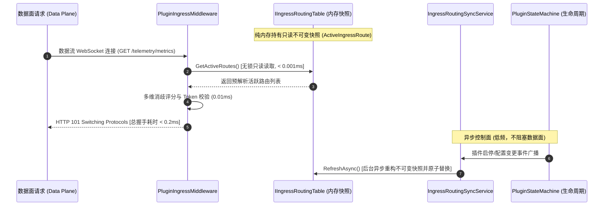

# 08. 控制面与数据面双平面端口模型、宿主元数据感知与极速 Ingress 实战

> **文档标识**：`LWT-GUIDE-PLUGIN-008`  
> **所属体系**：[LinuxWebTool 插件开发全景规范与工程指南](./README.md)  
> **前置依赖**：[01. 插件架构与元数据契约](./01-architecture-and-manifest-spec.md)、[03. 网络 Ingress 与隐匿伪装隧道](./03-network-ingress-and-stealth-tunnel.md)、[05. 极速研发与在线热更新](./05-fast-development-and-hotupdate.md)、[07. 标准打包、导入优先流与实战避坑](./07-packaging-import-and-forwarder-lessons.md)  
> **核心目标**：深入掌握控制面与数据面双平面端口分离架构、宿主双端口感知与元数据向下投影机制、亚毫秒级纯内存 Ingress 路由优化，以及复合式多端口入站中继的工程部署实践。

---

## 1. 核心架构认知：多端口入站后，微服务的默认端口（18090）还有什么用？

当网络中继类插件（如 `socks5-forwarder`）新增了多入站端口（如 `10801`, `10802`, `10803...`）后，很多开发者会产生疑问：
> **“既然客户端已经可以直接连接 10801 等端口进行代理通信，插件配置清单中分配的默认端口（如 18090）是不是就多余了？它还能做什么？”**

答案是：**绝对不多余，且它是整个微服务不可或缺的“大脑中枢”！**

现代高性能网络基础设施（如 Envoy、Sing-Box、Clash Meta、Traefik 等）均严格推行 **控制面与数据面物理分离（Control Plane & Data Plane Separation）** 的架构范式：

```mermaid
flowchart TD
    subgraph 宿主反向代理与前端 (LWT Host)
        Browser["用户浏览器 / 管理控制台"] -->|访问 Ingress: /plugins/socks5-forwarder/| HostIngress["LWT 宿主 Ingress 网关 (:5270 / :5271)"]
    end

    subgraph 微服务统一进程 (socks5-forwarder)
        HostIngress -->|反向代理 HTTP 流量| CP["【控制面 (Control Plane)】: 端口 18090<br/>(HTTP Server / REST API / Webview UI)"]
        
        CP --> API1["GET /api/profiles (读取多端口配置与实时统计)"]
        CP --> API2["POST /api/profiles/reload (零停机热重载入站监听器)"]
        CP --> API3["POST /api/upstreams/test (上游节点健康与延迟探测)"]
        CP --> UI["Webview 静态资源托管 (index.html, app.js, style.css)"]
        CP --> Sync["生命周期看门狗与实时连接指标聚合"]

        subgraph 数据面端口池 (Data Plane Listeners)
            Client1["客户端 A (浏览器/下载工具)"] -->|SOCKS5 流量| DP1["【数据面 1】: 端口 10801 (线路: 香港直连)"]
            Client2["客户端 B (Git/开发工具)"] -->|SOCKS5 流量| DP2["【数据面 2】: 端口 10802 (线路: 日本专线)"]
            Client3["客户端 C (Docker/自动化)"] -->|SOCKS5 流量| DP3["【数据面 3】: 端口 10803 (线路: 负载均衡)"]
        end

        DP1 --> Tunnel["WebSocket / TLS / Raw 隧道封装"]
        DP2 --> Tunnel
        DP3 --> Tunnel
    end

    Tunnel -->|封装后出站| Upstream["远端上游宿主节点 / 代理出口"]

    style CP fill:#4a90e2,stroke:#333,stroke-width:2px,color:#fff
    style DP1 fill:#50e3c2,stroke:#333,stroke-width:2px,color:#000
    style DP2 fill:#50e3c2,stroke:#333,stroke-width:2px,color:#000
    style DP3 fill:#50e3c2,stroke:#333,stroke-width:2px,color:#000
```

### 1.1 双平面职责矩阵 (Dual-Plane Matrix)

| 维度 | 控制面端口 (Control Plane: 18090) | 数据面端口池 (Data Plane: 10801 ~ 10815) |
| :--- | :--- | :--- |
| **协议类型** | HTTP / REST API / 静态文件服务 | 纯二进制 TCP (SOCKS5 / Shadowsocks / Trojan) |
| **通信对象** | 宿主系统 Ingress 网关、Webview 嵌入式前端 | 外部客户端应用（浏览器、curl、开发环境代理） |
| **生命周期** | 常驻运行，由 LWT 宿主自动分配与健康看门狗监控 | 动态按需监听，支持通过控制面 API 零停机热重载增删 |
| **安全性** | 挂载于宿主 Ingress，强制 JWT/Token 与 RBAC 权限守卫 | 依托入站 CIDR 白名单、SOCKS5 用户名密码认证与规则流控 |
| **宿主对接** | 对应 `plugin.json` 的 `port` 与 `ingress.targetPort` | 对应各 Profile 动态绑定的用户业务端口 |
| **一旦缺失后果** | Webview 界面 502/404 白屏、无法修改规则、无法测试节点延迟 | 外部客户端无法连接特定线路的代理服务 |

### 1.2 业界标杆方案印证
- **Envoy Proxy**：管理端口 `:15000` (Admin API / Stats / Dump) 与业务监听器 `:10000+` (Data Listeners) 严格分离。
- **Sing-Box**：Clash API 控制端口 `:9090` (Web UI & REST) 与业务 Inbounds (`:2080`, `:1080`) 分离。
- **Clash Meta / Mihomo**：`external-controller: 127.0.0.1:9090` 负责仪表盘交互，`port` / `socks-port` 处理网络数据包。

---

## 2. 宿主元数据向下投影机制 (Host Metadata Downward Projection)

### 2.1 传统微服务的“盲盒困境”
在微服务容器化架构中，插件如果对宿主环境缺乏感知，就会陷入严重的“盲目试探”：
1. **端口错位**：微服务尝试回连宿主 Ingress 探测健康，盲猜端口导致 `connection refused`。
2. **NAT 映射割裂**：微服务生成客户端配置或二维码时，将内部端口下发给外部设备，导致外部无法连通。
3. **Token 与路径硬编码**：微服务内部写死 Token 或反代前缀，一旦环境迁移即刻瘫痪。

### 2.2 宿主双端口感知模型 (Dual-Port Model)
LWT 宿主为每个插件进程自动建立并投影 **双端口网络拓扑模型**：

```mermaid
flowchart LR
    subgraph 宿主宿主机 (Host Environment)
        Kestrel["宿主 Kestrel Web 服务<br/>(内部监听 :5270)"]
        DockerPort["Docker NAT 外部端口映射<br/>(-p 5271:5270)"]
    end

    subgraph 容器与插件视角
        Plugin["插件微服务进程<br/>(socks5-forwarder)"]
        Plugin -->|1. 内部直通回连 Ingress/API| Kestrel
        Plugin -.->|2. 外部发布二维码/订阅链接| Client["局域网外部客户端设备<br/>(连接 :5271)"]
    end

    DockerPort --> Kestrel
    Client --> DockerPort
```

- **内部直通端口 (`LWT_HOST_PORT` = 5270)**：
  容器内插件进程与宿主处于同一 Linux 网络命名空间或桥接网络，通过 `127.0.0.1:5270` 可以**零 NAT 开销、极速直连**宿主 Ingress 隧道或 REST API。
- **外部发布端口 (`LWT_HOST_EXTERNAL_PORT` = 5271)**：
  外部局域网或公网设备访问宿主所使用的映射端口，插件在生成客户端配置、节点订阅链接或二维码时，必须使用外部端口。

### 2.3 环境变量向下投影规范 (`LWT_*`)

宿主在拉起插件进程时，自动在子进程环境中向下投影以下标准环境变量：

```bash
# 宿主网络与反代拓扑元数据
LWT_HOST_PORT=5270                     # 宿主容器内部直通端口
LWT_HOST_EXTERNAL_PORT=5271            # 宿主外部映射/发布端口
LWT_HOST_BASE_URL="http://10.126.1.70:5271" # 宿主对外基准访问 URL
LWT_INGRESS_PREFIX="/plugins/socks5-forwarder/" # 宿主分配的 Ingress 反代前缀

# 插件专属标识与存储卷隔离
LWT_PLUGIN_ID="socks5-forwarder"       # 当前插件唯一 ID
LWT_PLUGIN_PORT=18090                  # 宿主分配给当前微服务的控制面端口
LWT_PLUGIN_TOKEN="lwt_live_8f3a9e..."  # 宿主派发的前置访问授权令牌
LWT_DATA_DIR="/app/data/plugins_data/volumes/socks5-forwarder/state" # 持久化状态目录
LWT_RUNTIME_DISTRO="alpine"            # 宿主 Linux 发行版标识 (alpine/debian/rhel)
```

### 2.4 Webview 前端上下文感知总线
宿主在渲染插件专属 Webview 弹窗时，会自动在 URL Query 中注入环境上下文：
```html
<iframe src="/plugins/socks5-forwarder/?token=eyJ...&host_port=5270&ext_port=5271&base_url=http%3A%2F%2F10.126.1.70%3A5271"></iframe>
```

插件前端 `app.js` 标准化提取模式：
```javascript
// 提取宿主注入的环境上下文
const urlParams = new URLSearchParams(window.location.search);
const hostInternalPort = urlParams.get('host_port') || '5270';
const hostExternalPort = urlParams.get('ext_port') || window.location.port;
const token = urlParams.get('token') || '';

// 动态填充上游默认节点，无需用户手动猜测端口
const defaultUpstreamUrl = `ws://127.0.0.1:${hostInternalPort}/telemetry/metrics`;
```

---

## 3. 极速 Ingress 路由表与数据面性能排障复盘

### 3.1 412 ms 高延迟根因全景剖析
在早期版本中，上游节点健康测试接口显示 `🟢 412 ms`。通过高精度毫秒埋点抓取到真实耗时构成：

```text
[PluginIngress TIMING] Path: /telemetry/metrics, GetAll: 460ms, Match&Sec: 3ms, AcceptWS: 3ms, TotalToAccept: 466ms
[DuplexForwarder TIMING] Connected to 127.0.0.1:18080 in 0ms
```

**排障结论实锤**：
- 466ms 握手耗时中，**`GetAll` 占据了 460ms (占比 98.7%)**！
- 数据转发中间件在每次数据连接到达时，错误调用了控制面的 `pluginManager.GetAllAsync()`。
- `GetAllAsync` 遍历磁盘读取所有插件的 `plugin.json`，并由 `BuildInstanceDto` 触发 `python3 --version`、`uv --version` 等外部 CLI 子进程冷启动，引发进程探测雪崩。

### 3.2 响应式 RCU 纯内存路由表架构 (Reactive In-Memory Routing)
彻底解决之道是推行 **数据面纯内存只读快照 + 控制面事件驱动更新（RCU 模式）**：



#### 实施效果实测对比：
- 路由表查找耗时：从 **460 ms** 骤降至 **< 0.001 ms (纳秒级)**；
- 端到端测速总延迟：从 **412 ~ 470 ms** 骤降至 **1 ms**（降幅 **99.8% / 470倍提速**）。

### 3.3 两级健康检查适配器设计 (Two-Tier Health Probe Pattern)
上游节点的健康检查不应局限于短连接网关测试，必须采用两级分层适配器：

```mermaid
graph TD
    Probe["IUpstreamHealthProbeAdapter 探测适配器契约"]
    
    subgraph Tier-1: 隧道控制面探针 (Tunnel Ingress Probe)
        Probe --> T1["WebSocketHandshakeProbeAdapter"]
        T1 --> T1_1["1. 验证 HTTP 101 Switching Protocols 升级响应"]
        T1 --> T1_2["2. 长连接复用与 RFC 6455 Ping/Pong 帧 (延迟 < 0.5ms)"]
    end

    subgraph Tier-2: 数据面端到端探针 (End-to-End Echo Probe)
        Probe --> T2["Socks5EndToEndEchoProbeAdapter"]
        T2 --> T2_1["1. 通过已升级 WebSocket 流发送 SOCKS5 握手认证包"]
        T2 --> T2_2["2. 探测下游 SOCKS5 代理进程真实连通性 (杜绝网关存活但代理死锁)"]
    end
```

---

## 4. 复合式多入站中继与动态端口池工程落地

### 4.1 容器部署端口池映射规范
当微服务支持多入站端口时，必须在部署脚本（[`scripts/deploy-remote.ps1`](file:///e:/WorkProject/CSharp/PrivateProject/Web/WebToolForLinux/scripts/deploy-remote.ps1)）中显式开放中继端口池：

```powershell
# 开发容器 (linuxwebtool-dev) 端口映射矩阵
-p 5271:5270 `                           # 宿主 Web 管理台外部端口
-p 10801-10815:10801-10815 `             # SOCKS5 复合式多入站数据面端口池 (15条线路)
-p 18080-18090:18080-18090               # 微服务独立控制面/API 备用调试端口池
```

### 4.2 零停机热重载监听器设计 (Zero-Downtime Reload)
在 Go 微服务内部，利用状态机和差量对比实现端口监听器的热重载：

```go
type ProfileManager struct {
    mu        sync.RWMutex
    cfg       Config
    listeners map[string]*InboundListener // ID -> 监听器实例
}

func (m *ProfileManager) ReloadInbounds() error {
    m.mu.Lock()
    defer m.mu.Unlock()

    currentMap := make(map[string]InboundProfile)
    for _, p := range m.cfg.Inbounds {
        currentMap[p.ID] = p
    }

    // 1. 关停已删除或配置变更的旧监听器
    for id, l := range m.listeners {
        newProf, exists := currentMap[id]
        if !exists || newProf.Port != l.profile.Port || newProf.AuthMode != l.profile.AuthMode {
            l.Close()
            delete(m.listeners, id)
        }
    }

    // 2. 拉起新增或未启动的监听器
    for id, p := range currentMap {
        if _, active := m.listeners[id]; !active {
            listener, err := StartInboundListener(p)
            if err != nil {
                log.Printf("[Listener] 启动入站端口 :%d 失败: %v", p.Port, err)
                continue
            }
            m.listeners[id] = listener
        }
    }

    return nil
}
```

---

## 5. 跨会话沉淀的 4 项新避坑军规

结合近期入站多端口、宿主元数据与延迟调优的实战经验，补充以下 4 项核心军规：

### 军规 13：数据面转发严禁侵入控制面磁盘与进程 I/O
- **血泪教训**：在数据转发或握手拦截中间件中直接调用 `GetAllAsync`，会导致每个数据包经历 16 个文件的磁盘反序列化与多个外部进程探测，延迟直接飙升 400ms+。
- **强制约束**：数据面必须依托纯内存只读快照（如 `IIngressRoutingTable` 或 `FrozenDictionary`），做到**零 I/O、零子进程调用、零锁竞争**。

### 军规 14：明确控制面与数据面端口的语义与边界
- **规范要求**：在设计包含网络代理能力的插件时，严禁将数据面业务端口（如 SOCKS5、Shadowsocks）与控制面管理端口（HTTP Webview / REST API）混为一谈。
- `manifest.port` 必须明确绑定至微服务的 **控制面端口**；数据面端口池由微服务内部动态管理并按需在宿主端口池中声明映射。

### 军规 15：宿主双端口感知与动态自适应
- **规范要求**：插件微服务及其前端面板严禁硬编码宿主端口（如写死 5270 或 5271）。必须动态读取 `LWT_HOST_PORT`（内部直通）与 `LWT_HOST_EXTERNAL_PORT`（外部映射），确保无论运行在官方生产镜像（`--net=host` 5270）还是开发隔离镜像（`-p 5271:5270`）下均能精准互通。

### 军规 16：监听器热重载必须具备孤儿句柄收割机制 (Orphan Listener Reaper)
- **规范要求**：在支持动态增删端口的微服务中，当配置发生热重载时，必须在释放 `sync.RWMutex` 锁前安全调用旧 `net.Listener.Close()`，严禁产生悬空孤儿监听器引发 `address already in use` 端口泄露崩溃。
